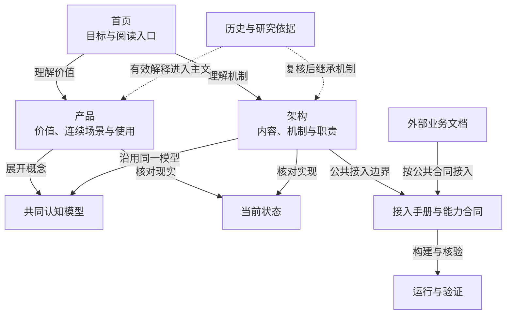

# 通用认知知识库

知识库让人和 Agent 在已有认识上继续理解问题：找到相关知识，读懂依据与条件，比较分歧，研究新问题，再记录使用和反馈如何改变认识。它接收视频、文档、规则和外部观察；抖音电商是接入场景之一。

2026-10-29 · 本文档集说明独立通用知识产品。产品目标与交互以[权威目标 Page](https://chatgpt.com/space/page_33c12e961e788191aa266d5bf67b958f)为准；源码主线、工程验证与实际部署的区别见[当前状态](current-state.md)。抖音电商是具体评估场景，普通文档是通用接入参考。

先读[产品](product.md)，了解资料怎样成为带条件的认识、旧认识怎样在新问题下综合为 C、以及 C 如何被下一轮继承和纠正。再读[架构](architecture.md)，看同一网络保存什么、哪些操作能改变它、前端和业务系统怎样协作。遇到精确定义、接入步骤或当前完成度，分别进入模型、接入、运行与当前状态。

箭头表示读者为何转向另一篇，虚线表示旧解释经复核后进入现行主文；它们不表示软件调用或资料加工顺序。从首页可直接读产品价值或架构机制，两篇共享[认知模型](model.md)的概念，并到[当前状态](current-state.md)核对哪些已实现、哪些仍待验证。[历史与依据](migration.md)保留完整来路，主文吸收仍有效的解释；读者不必先翻旧稿。业务原件、流程与行动由[外部业务文档](https://github.com/cyl19970726/commerce-creative-lab/blob/main/docs/integrations/knowledge.md)维护，沿[接入合同](integration.md)调用知识能力；[运行篇](operations.md)说明如何构建和核验独立实例。

## 两条实际阅读路径

**第一次了解产品：目标 → 认识 → 机制 → 边界 → 使用。** 先在[产品目标](product.md#我们要去哪里)找到它要改善的判断；接着读[什么是认识](product.md#什么是认识)，区分原件观察、来源主张和研究推论。沿[连续两轮场景](product.md#连续两轮从-ab-到-c再接受反例)看 A/B 怎样形成 C、C 怎样被下一轮有条件地使用；到[架构职责](architecture.md#职责怎样协作)核对哪些职责让版本、来源和审阅成立，再用[当前状态](current-state.md#今天的源码能证明到哪里)划出今天已实现的范围。最后回到[同一场景的交互](product.md#沿同一场景探索阅读研究与回查)，判断自己会在哪里查依据、停下阅读、记录采用或提出纠错。走完后应能说清 C 的新增判断、来源和限制，不能把假设场景读成已经验证的效果。

**已有概念、要接入的开发者：前提 → 输入 → 输出 → 验证。** 直接看[源码与 Node 前提](integration.md#1-准备源码node-24-与-workspaces)、[实例作用域与授权](integration.md#3-启动一个可操作的合成实例)，再看[普通文档最小链](integration.md#普通文档的最小可核验链)和[共享合同的接入输入](capabilities.md#接入前先确定的输入)：准备固定版本、原文、权利和外部任务身份，取得准确来源引用、查询读集、使用与反馈记录。按[普通文档接入验收](integration.md#10-普通文档业务端到端接入)及[运行验证](operations.md#独立试用怎样验收)检查实例能力、准确读回和可重复的工程样例；最后查[当前状态](current-state.md#今天的源码能证明到哪里)区分工程接通、语义研究和业务效果。字段以对应版本的合同源码为准。

以上是文档作者按两种任务做的自我走查路径，不是受访读者或开发者的真人验收。

## 从你要做的事开始

| 你要做什么 | 阅读入口 | 应得到的答案 |
| --- | --- | --- |
| 理解和使用知识库 | [产品与交互](product.md)、[通用认知模型](model.md) | 认识、A/B→C→下一轮继承与纠错，以及内容关系和验收 |
| 开发独立知识产品 | [职责与架构](architecture.md) | 通用核心、业务适配、前后端及设施如何连接 |
| 给新业务接入知识能力 | [技术接入手册](integration.md)、[能力与接入合同](capabilities.md) | Node/workspaces、构建运行、端到端步骤及能力边界 |
| 在电商侧做适配 | [业务适配指南](https://github.com/cyl19970726/commerce-creative-lab/blob/main/docs/integrations/knowledge.md)（需业务仓读取权限） | 采集、拉片及外部任务怎样映射到知识能力 |
| 启动或核对一个实例 | [运行与验证](operations.md) | 应获取哪个版本、如何构建、哪些证据仍缺失 |
| 判断目前能做到哪里 | [当前状态](current-state.md) | 已确认目标、主线基线、本地候选及未验条件 |
| 修改文档或追查旧说法 | [权威与继承](ownership.md)、[维护规则](maintenance.md)、[迁移与旧入口](migration.md) | 唯一维护位置、逐章继任、更新触发和完整历史去处 |

## 一次具体使用

假设你要判断“新观众是否需要先看到产品的使用方式”。先查询已有认识，读到适用人群、场景、支持案例与反例；打开来源核对实际观察范围。已有认识足够时可以停在阅读，也可以在实际使用时记录所用准确版本。

若问题变成“这个结论在另一种商品形态下还成立吗”，可以联读旧知识发起研究，不必先取得新视频。研究可能形成修订候选，也可能说明暂不改变或仍缺证。候选经过独立审阅与发表检查后，才成为正式版本。经营效果仍由相应业务的真实结果证明。此例是使用情境，不是已得到的业务结论。

## 本文档集的边界

知识库负责知识版本、关系、依据、研究、审阅发表以及采用反馈。平台采集、原片、视频分析和经营执行由业务系统负责；模型执行、任务运行和存储通过共享设施提供。独立前端和业务适配使用同一知识能力。

旧业务模块说明、阶段设计和工程验收已保留全文，放在“历史与依据”。其中的日期、方法、数量和部署结论只解释当时记录。读当前产品时从本页进入，再按需要回查原始证据。
