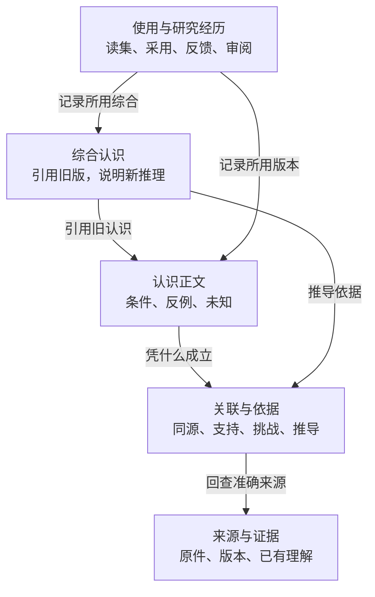
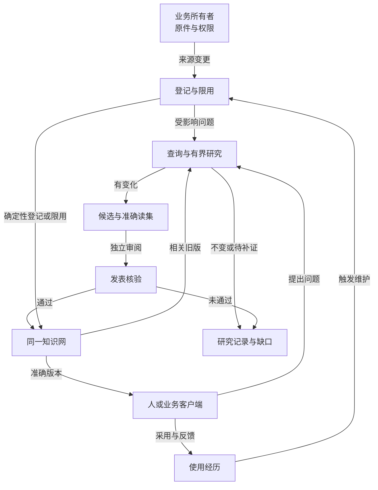
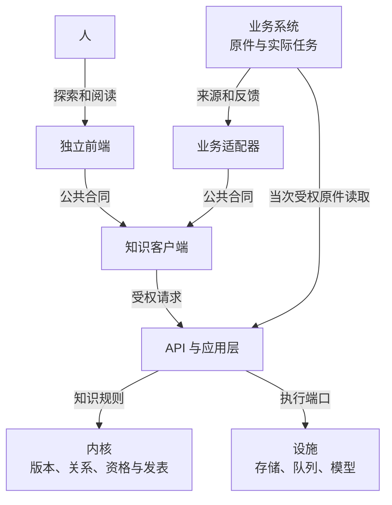

# 知识产品的职责与架构

独立前端与业务系统使用同一组知识能力；知识服务保持唯一的版本、关系、审阅和发表权威。通用核心只维护跨业务成立的内容与执行合同，业务适配保留自己的来源、身份和任务规则，固定日期的实现与部署仍由证据记录承担。

本页解释知识怎样被保存、改变和使用，再说明各层的责任。当前主线实现与正式部署见[当前状态](current-state.md)；认识与关系的细则见[通用认知模型](model.md)；新业务落地顺序见[技术接入手册](integration.md)。以下是目标架构，不以图上的模块宣称真实语义研究已经完成。

## 保存什么：同一网络中的四种内容

箭头只表示标出的关系，不表示原件必须依次升级为报告、认识和综合。来源层保留原件身份、版本、定位与实际读取覆盖；已有分析是带来路的解释，不凭另一个报告增加独立观察。认识层保存回答问题的完整正文及条件，综合 C 若引用旧认识 A/B，必须指出新推理是什么，也保留 A/B 的原依据与反例。关系层让“相关”“同源”“支持”“挑战”和关键前提有不同意义：导航近邻不自动成为证据，语义互链也不能循环自证。经历层保留一次任务实际读过、采用过和反馈过的准确版本，支撑日后复盘与维护。编纂规约约束这些内容的命名、用途、证据和审阅，但不是另一套业务知识库。

## 通用知识核心

知识核心保存可修订正文、准确版本、来源依据、关系、研究记录、审阅与正式发表，以及采用和反馈之间的关联。来源不必沿固定对象阶梯晋级：文档、规则、实践记录和已有分析都可以先按准确版本保全，再按问题参与研究；新问题也可以只联读旧认识。

| 职责组 | 通用责任 | 主要输入 → 输出 |
| --- | --- | --- |
| 来源与定位 | 保全原对象、准确版本、锚点、覆盖和所有者权利 | 原件与派生理解 → 可回查依据及读取缺口 |
| 持久知识网 | 维护正文、关系、状态、修订和不可变历史 | 旧版、候选与审阅 → 当前及历史认识 |
| 目录与有界检索 | 先定位相关旧页，再读取必要正文与原依据 | 问题、主体和范围 → 有界候选、准确读集与遗漏 |
| 研究与编纂 | 比较、连接、反证，提出有认知增量的变化或合理停止 | 旧认识、新问题和来源 → 候选、无变化、待补证 |
| 编纂规约 | 版本化页面用途、证据要求、审阅规则和适用范围 | 业务用途与核心约束 → 可校验的编纂规则 |
| 审阅与发表 | 分开语义审阅、资格与版本核验，唯一推进正式 head | 候选、读集和证明 → 正式版本或保留限制 |
| 使用与反馈 | 固定实际读取与采用版本，关联外部任务、观察和后续变化 | 查询、采用和反馈 → 可追查使用经历与维护输入 |
| 维护 | 沿关键依赖发现影响、矛盾和缺口，再显式研究 | 来源/版本变化 → 有界影响、研究请求和处理结果 |

这些职责不是要求新增一组服务。`Ingest`、`Query`、`Lint` 是作用于同一知识网的操作，任务和报告是使用方式，Schema 是共同规约，Worker 与队列是运行设施。目录和摘要帮助定位，不能替代正文与原始依据；语义综合沿用旧证据时，不增加独立支持数。

## 怎样变化：多种操作作用于同一知识网

业务所有者交接来源身份、准确版本、权限与变更；知识端登记后按范围维护，不自行获得平台采集权。查询可以只读，研究才比较、连接或反证；即便没有新来源，旧认识与新问题也可进入研究。新解释先是候选，独立审阅和发表端核验准确输入、用途与写者资格后才更新正式版本。无变化、待补证、执行失败和取消各保留原因，不强制生成新页。采用与反馈指向当时实际版本，触发有界维护；撤权或关键纠错可先限用受影响内容，再决定怎样修订。这里的箭头描述责任和数据交接，不要求把所有操作部署成各自独立服务。

## 职责怎样协作

| 部分 | 拥有的责任 | 通过什么连接 |
| --- | --- | --- |
| 独立前端 | 探索、正文阅读、研究、来源与演化，以及视图和返回状态 | 知识客户端与公开合同 |
| 知识后端 | 知识版本、关系、依据、研究策略、审阅发表、采用与反馈 | 应用服务、核心规则和设施端口 |
| 业务适配 | 平台身份、采集、分析、原始媒体、业务任务及效果记录 | 登记准确来源、查询知识、登记采用反馈 |
| 共享设施 | 模型执行、任务租约、取消、费用账本、数据库和对象存储 | 实现知识应用层所需端口 |

前端与业务适配都经同一客户端和公开合同访问知识能力；前端负责把图、正文、来源与演化变得可读，客户端负责协议、版本和错误，不承载领域判断。API 应用层组织查询、研究、采用与反馈；内核决定准确版本、关系和正式发表边界；Worker 与设施完成异步执行、存储和费用记录，并把结果交回应用层。业务系统仍拥有原件、平台身份和行动结果，来源读取由其所有者按当次权限回答。图中业务系统向 API 提供当次获准的原件读取；只有需要原件时才发生这项交接。

知识研究可以提出缺少什么资料，业务系统决定并执行自己的采集和分析。查询知识不会自动取得平台操作、付费模型或经营执行的权限。公开 DTO 和运行时校验只有一个权威来源，供前端、客户端、后端及业务适配共用；准确字段以共享 schema 为准，不在文档或业务侧维护平行 DTO。

## 内容关系与失效

关系至少区分四层：

| 关系层 | 保存什么 | 能否自动成为论证或执行依赖 |
| --- | --- | --- |
| 来源 | 原对象、派生报告、证据锚点、外部事实来源及取得口径 | 准确引用须可回查；相同内容不证明独立作者或独立效果 |
| 收录与导航 | 集合成员、页面收录、相关概念和阅读路径 | 不自动产生支持；普通导航不形成关键失效依赖 |
| 语义论证 | 支持、挑战、收窄的是哪条判断，及理由、条件、锚点和双方准确版本 | 经提案、校验和独立审阅才成立；相似或同标签不证明机制与因果 |
| 执行强依赖 | 已发布版本或冻结读集实际依赖的准确来源、结论与用途资格 | 按明确关键依赖语义限用和传播；旧版本不可变 |

来源组保留分组依据及不确定性。同一原件的多份报告、不同覆盖和多次发布仍是一组来源；字节去重不能推出作者独立或业务结果独立。重复观察与经过业务实验验证是两种证据。

关键前提变化时，后端沿已声明依赖定位受影响知识、未执行使用和未来查询，先限用相应范围，再提出局部修订。发现影响、修复提议、正式发表和问题关闭分别记录；不是每条导航边都触发全库重写。图是可重建的阅读投影，位置、聚类和边样式不能反向成为知识事实，图数据库也不是核心拆分的前置条件。

## 阅读、研究与唯一发表

查询返回有界结果及准确读集。需要保存和复用这次阅读时，使用持久回执固定实际对象、版本、顺序、范围与当时判断；日后访问仍检查当前权限。当前指针、历史版本和查询回执分别管理。普通查询不隐式采集、收费研究、采用或发表，有界无匹配不能解释成全库没有知识。

研究策略由知识应用层控制。每次研究保留目的、触发、范围、预算、选中与排除的旧版、实际覆盖、缺口和结束理由。研究可以形成候选，也可以无变化或待补证；版本变化是重新核查的理由，不是强制造新版的理由。

候选交付变化前后、理由、准确读集、必要依据、条件、反例、未知和依赖。独立审阅检查新增价值和论证；发表端在同一事务内检查写者资格、准确输入、依赖、目标页头、取消及审阅证明。执行成功、候选形成、审阅通过和正式发表是不同状态。

任务尝试的 fencing 不能代替发表权限。旧入口和新入口都必须归到同一权威；业务客户端不直接写表、修改页头、签发审阅凭据或任意发表。合并、拆分保留旧身份、历史版本、别名或后继关系，旧引用和采用记录不被悄悄改写。

## 研究执行与维护

来源新增或修订、用途决定变化、撤权、纠正和反馈先进行确定性登记，固定准确版本、来源组和受影响范围。语义研究按问题与变化有界触发；输入没有实质差异时可以不调用模型，有新输入但没有认知增量时也允许无变化结束。具体批量、等待和预算值是可复验配置，不属于跨业务固定合同。

执行端负责租约、尝试次数、取消、费用与外部未知结果。相同问题、准确输入和规约下复用已有结果；未知外部执行先按原操作或原键对账，不换键重发，不把未知费用记为零。取消请求等待执行端确认，已经发生的费用和结果保持可见。

构建结果至少区分：`changed` 表示经审阅发表实质变化；`no_change` 表示完成核查但无需修订；`restricted` 表示限用、待审或待补证；`failed` 表示执行失败。运行成功与认知结果属于不同轴，均不能单独证明语义正确。失败保留待处理范围，限用不伪装成新认识，无变化确认不能吞掉并发新事件。

研究缺口绑定准确知识或来源版本、具体问题、所需证据、价值、用途和状态；执行请求再冻结动作、输入、预算、权限和幂等键。任务完成不自动使缺口解决，新证据仍经研究与审阅。反馈只进入维护，不直接改正式知识。

## 数据与来源所有权

知识服务拥有登记后的准确来源引用、知识版本、关系、研究记录、审阅和正式发表。业务系统保留原件、原始报告、平台凭据及经营记录；普通资料明确采用托管副本时，知识服务按自己的保留与访问政策管理。

业务变更或撤销来源时，通过来源生命周期交接通知知识服务。来源元数据可见、内容可读、锚点可定位、依据有效、当前用途允许是不同判断。外部来源当前可读，不意味着发表提交时仍有权使用。外部所有者若不能提供可证明的用途保证，不能宣称跨系统撤权与数据库提交天然原子；本地托管来源则须在发表事务内重验版本与权利。

历史可读与当前可采用分别返回。撤权后的读取、使用重放、反馈和变化访问重新检查当前权利；审计记录可保留，但不能继续返回已无权的正文。版本记录摘要、所存对象字节摘要和实际返回内容范围分别核验，不能互相替代。

## 业务适配职责

业务适配器负责把业务原对象、版本、定位器和用途映射到公共知识合同，并把外部任务身份、实际采用和反馈关联回来。它不改变核心正文权威，不直接写知识表，不把业务标签、质量分或采集身份自动升级为知识用途资格。

普通文档业务提供固定修订、原文或允许节选、页段锚点和读取范围；视频业务提供准确报告、原片身份、秒点与观察范围。两者共用来源、查询、研究、采用、反馈和变化能力，具体字段映射由业务文档维护。粗拉、精拉、参考包、创作执行和平台经营规则属于 commerce 适配，不进入通用核心。

### 旧 commerce 来源的只读接入

旧分析报告和帧证据继续使用原 `analysis/evidence` 对象及准确版本。业务所有者解析自己的报告、媒体身份和定位器；知识应用通过显式配置的认证只读端口取得允许的内容。接入读取器不需要将旧原件重新登记为一份托管知识来源，也不能改写已有知识的引用。

来源元数据、实际正文或帧内容、读取覆盖分别返回。仅打开图谱或查看来源身份不算内容已读；读到一张离散帧不代表看完一段视频。同一原片的多份报告或重复帧仍属于原来源链，不增加独立证据。

这个端口的访问保证限于当次读取。它不授予采集、媒体处理、研究执行或发表权限；撤权后的新读取仍由业务所有者判断。具体已接通范围和验收结果维护在[当前状态](current-state.md)，业务字段交接仍见[业务适配指南](https://github.com/cyl19970726/commerce-creative-lab/blob/main/docs/integrations/knowledge.md)。

## 分包、应用与构建

客户端保持运行时中立，不引入 React、数据库、视频分析或业务表。前端只依赖浏览器安全入口；后端通过应用层协调核心与设施；API 和 Worker 分别承担公开服务与异步执行装配，不复制知识规则。首版图谱作为独立前端内有明确接口的模块，分别处理语义投影、布局和相机状态。

每个独立应用或包都要有清楚的构建入口和产物；目录分开不等于能独立构建。浏览器构建不能要求视频 Worker、生产数据库或模型配置。独立核心仓使用 Node 24 与根 workspaces；消费仓以 submodule 引用核心仓属于另一层集成关系。依赖顺序、API/Worker/Web 运行和普通文档接入步骤统一见[技术接入手册](integration.md)，本页不维护第二份命令清单。

## 分阶段交付与证据边界

M0 收敛合同、权限、准确读集和写者边界；M1 建立独立读取入口与前端；M2 接来源写入、研究、审阅及本地 API/Worker；M3 接通用采用反馈和不同业务适配。每阶段都按实际证据登记，不能从阶段名称推断完成。

核心仓已独立，消费仓的 submodule 集成也已完成。正式切流、部署与数据库物理拆分仍须按条件另行验证。文档、源码合并、本地工程验证、真实业务来源、真实语义研究、生产部署和业务效果分别验收；本页描述的职责不能代替各项运行证据。
