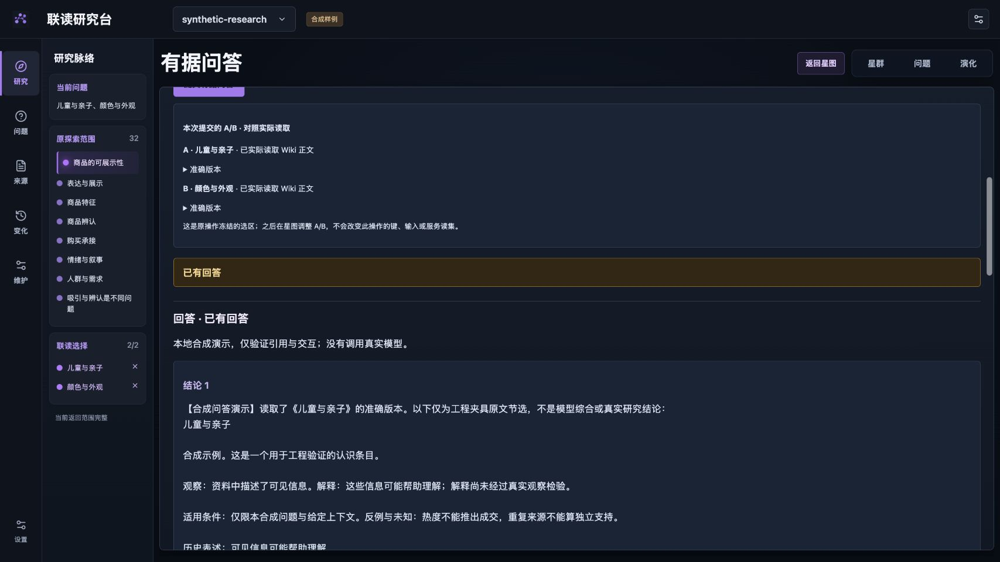
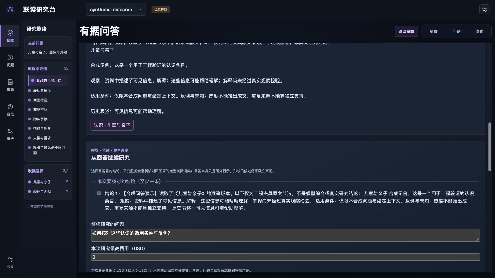
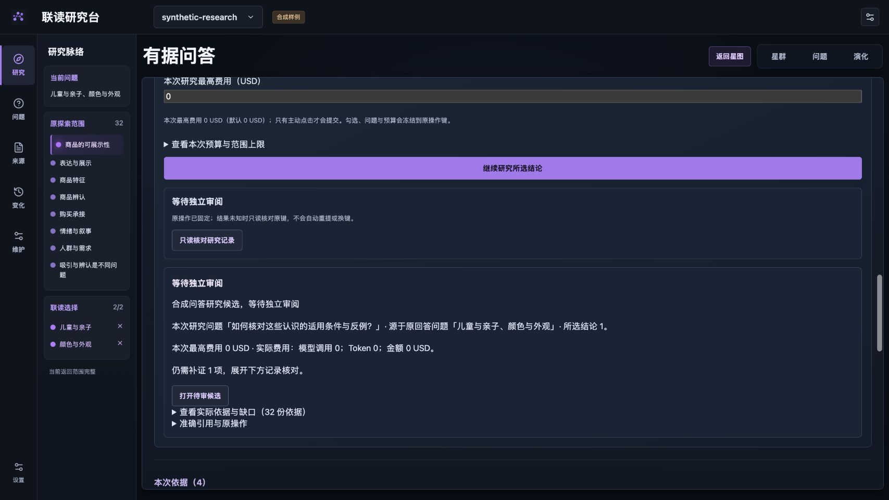
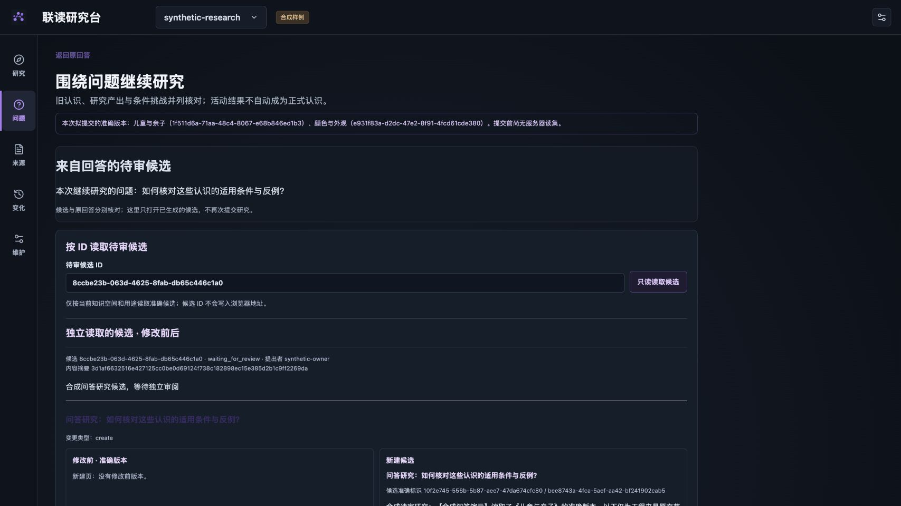
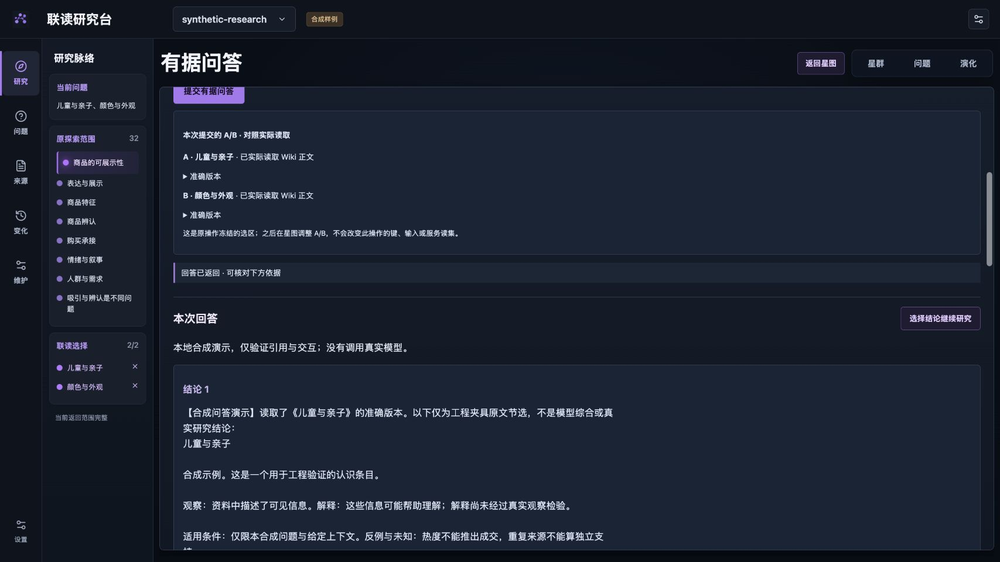
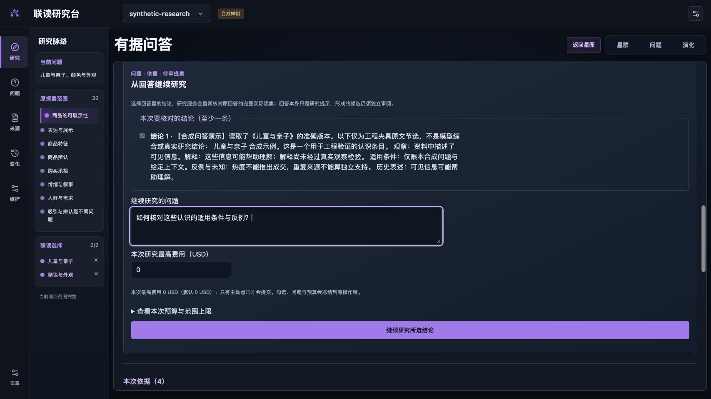
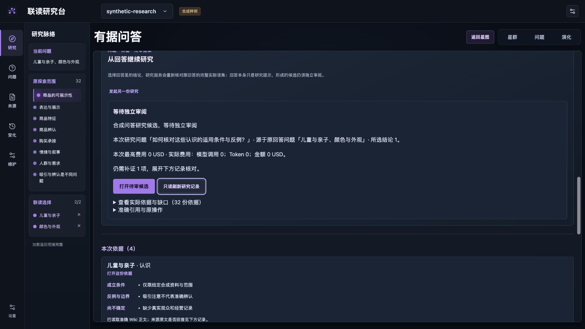
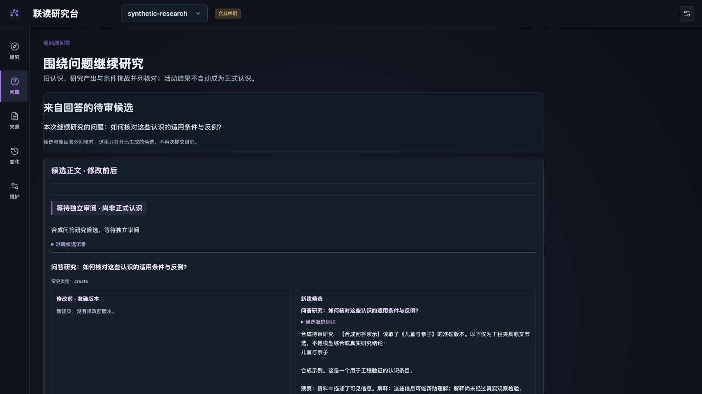

# 问答继续研究的页面审视

2026-11-02 · 使用用户指定的 Product Design 工作流。目标为 PR8 的深色联读研究台；首要任务已确认是围绕问题查知识、联读并核对依据。此次使用应用内浏览器的新截图，不以此前工程截图代替本轮审视。截图和文字只评估可见交互，不证明真实模型语义质量或完整无障碍符合性。

## 阅读路径与观察

1. **阅读回答与实际依据**：原探索范围、A/B 选择与实际读集已区分。回答前重复的状态区占据阅读空间，继续研究入口未在回答标题附近出现；宽屏长行也增加阅读负担。
   
2. **选择结论和后续问题**：能够在原问题之上填写新问题，默认费用为零，提交是明确动作。新字段仍呈原生灰色外观，和已设计的问答字段不一致；选项文本需要受控行长。
   
3. **查看研究结果**：清楚列出原问、后续问、候选状态、费用和可展开读集。但结果已进入待审时，最显眼的紫色按钮仍是再次提交，且状态重复两次；应将打开候选作为下一主操作，另一次研究放在显式入口内。
   
4. **核对候选**：原回答返回入口和后续问题保留。直接从答案打开时，手输 UUID 表单与“提交前尚无读集”的旧准备提示占据主要位置并造成状态混淆；候选标题也存在深色背景下对比过低的可见风险。
   

## 设计取舍与修正计划

沿用已有暗色、侧边研究脉络和三视角，调整信息层级：问题与结论优先，依据可展开核对，研究动作紧邻回答，候选明确等待独立审阅。新表单使用已有字段样式；新的研究和已完成操作分别呈现。版本标识、指纹及原键继续可查，但进入详情而非占据主要阅读位置。

前四张是本轮修正前证据。合成演示有生命周期上限，跨实例捕获沿用相同代码、问题与场景；不把正常清理导致的断线计作产品故障。下方是调整后相同桌面视口、对应状态的核对。当前只查可见层级、标签、对比风险与操作连续性；屏幕阅读器、完整键盘顺序、系统减少动态与真人理解仍需专门验收。

## 修正后的四步

1. **回答：入口更清楚。** 以“本次回答”为阅读起点，研究准备入口就在标题旁；已回答状态以轻量提示呈现。回答正文限制行长，保留引用。
   
2. **准备研究：字段与原界面一致。** 跳转只定位并聚焦准备区，不提交模型请求；所选结论、新研究问题和费用上限集中呈现，输入字段沿用现有深色样式。
   
3. **研究结果：下一步指向候选。** 确定结果出现后折叠再次提交表单，“打开待审候选”成为主操作；核对原记录为次操作，发起另一份研究需要明确展开。原问、后续问、费用和实际读集仍可核对。
   
4. **候选审阅：正文和状态优先。** 从回答或维护记录进入时直接读取关联候选，不显示无关的新提交准备提示或手输 ID 表单；准确标识保留在详情，标题的可见对比已改善，返回原回答入口保留。
   

已将准备区和候选页的前后截图放在同一比较输入中检查：文字行长、字段样式、主要动作和候选标题均与修正目的对应。测试中观察到聚焦轮廓；未据此声称全键盘或屏幕阅读器验收通过。

应用内浏览器的视口请求会受到当前缩放影响：首次请求 390 时实际内宽 520，随后用整数视口校准到实际内宽 389、内高 844；后者未见横向溢出，视口已恢复。下图只作为近 390px 的布局证据，不等于真实手机触点验收。

以上审视只覆盖当时的表单与候选往返修正。随后用户要求结合星图生成设计图，并选择正文与星图并列、可拖动边界的方向；提案、选定修订与语义校正见[星图联动设计记录](starmap-research-designs-20261102.md)。新布局的运行验收另行记录，不借用本页截图。
