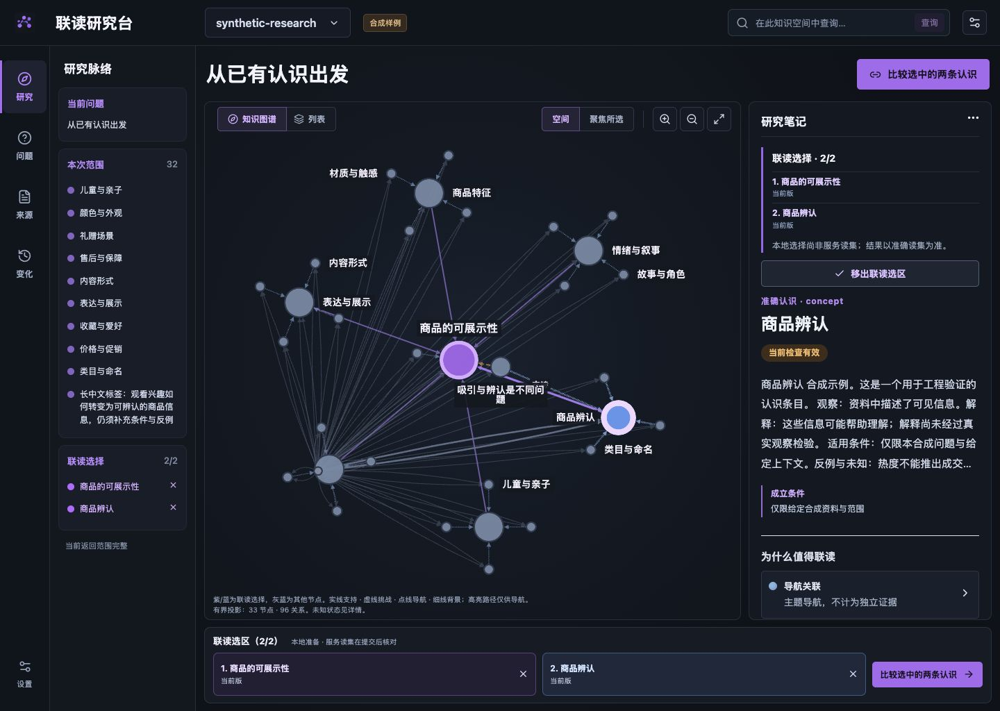
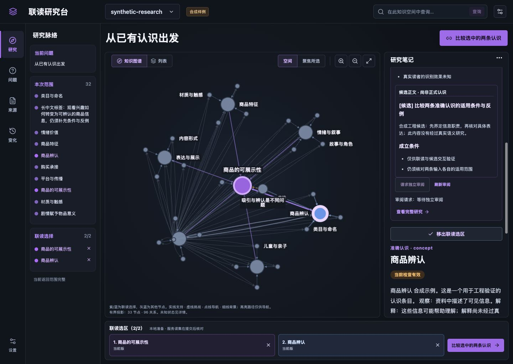
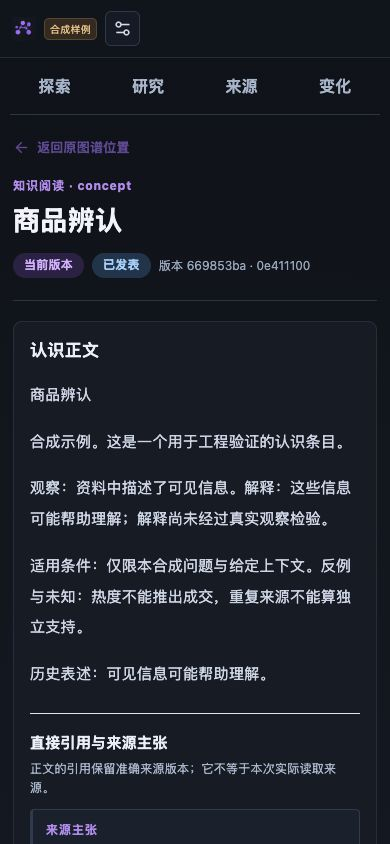
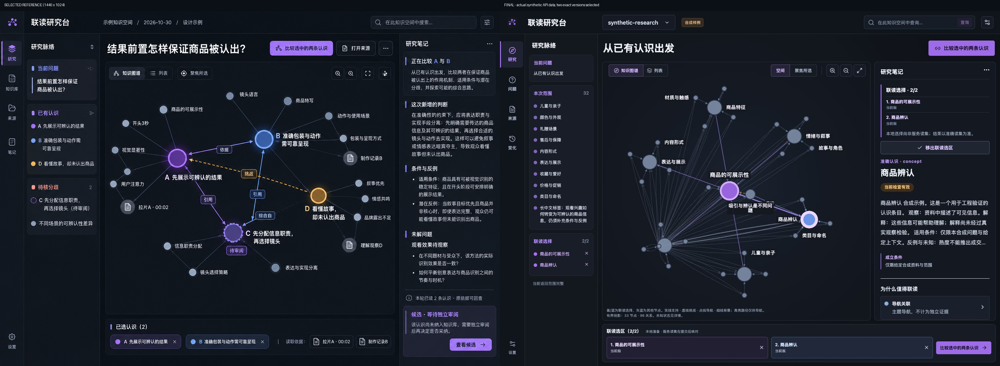

# 深色联读研究台：本地实现与复验

2026-10-30 用户选择三张提案中的第二张「联读研究台」。2026-10-31 在独立工作树完成本地实现及主会话复验，基于知识仓 `34ecfe9`；本轮尚未提交、合并或部署。预览使用专属一次性数据库、合成知识和零模型研究 provider，不连接业务数据库。这份记录证明本地软件行为与设计复核，不证明真实语义研究或真人理解。

## 实现后的使用方式

左侧是研究脉络，中央是实际知识关系，右侧是当前认识、条件、挑战与研究笔记，底部保留两条联读选择。搜索位于顶栏。图和列表可以切换；进入准确正文或来源后可返回原上下文。比较操作在当前星图旁展开研究准备与结果，完整研究、取消、审阅及提交核对入口仍保留。

选区保存准确引用，不能冒充服务实际读集。两条选满后需先移除才能换入；读取回执只有用途、范围、版本与内容摘要均匹配时才复用。候选正文由服务读取，并使用其候选 ID 与内容 hash 请求独立审阅；候选尚未读取或身份不符时不能请求。非候选结论继续使用准确研究结果摘要。前端不作独立审阅决定，也不自动发表。

本次实际候选走查发现旧前端始终提交 `research_result` 目标，服务正确拒绝候选审阅。现已修为按结果类型选择目标，回归覆盖候选缺失、身份不符及非候选；浏览器实际请求与读回显示“等待独立审阅”，正式图仍为原来的 33 节点、96 关系。

## 直接复验的行为

| 范围 | 观察结果 |
| --- | --- |
| 桌面与中等屏幕 | 1440×1024、1024×768 均无页面横向溢出；联读栏分别在 y1013、y757 以内。桌面整页高1024、scrollY=0；笔记与脉络可独立滚动。 |
| 星图和选择 | 真实节点及边保留；紫/蓝表示联读选择，灰蓝为其他节点。相邻边不再铺长标签，高亮路径只用于导航。两条标题可辨，完整引用可查看，第三条不能静默替换。 |
| 缩放与键盘 | 放大后 zoom 从1到1.25，画布世界中心变化为0；Tab能到缩小按钮，出现3px可见焦点。适配与列表入口可用于窄屏定位。 |
| 研究三分支 | 实际提交两条认识，服务准确读集为2；不变、候选、待补证均实际读回。候选有真实服务正文、条件和反例；待补证明确缺少可比较观察。 |
| 来源与返回 | 正文固定准确版本；来源所有者确认 paragraph:1，读到176字节及合成原文。来源返回正文、正文返回星图后，两条选择仍保留。 |
| 手机阅读 | 390×844 下图、正文、来源的页面宽均为390；深色标题对比已修正。手机总览可适配，细节通过缩放、点选和列表阅读，不要求在缩小的全图里读完论证。 |

## 视觉与工程证据

源图归一到1440×1024，与实际同尺寸页面放入同一比较图；另复看笔记、联读栏、手机正文和来源。首轮发现的首屏溢出、标签遮挡、UUID挤标题与笔记滚动问题已修正；之后发现的候选目标错误、深色标题与标签估算口径也已复验。具体迭代见仓库根 `design-qa.md`。

界面按服务实际数据组织，未复制图稿中虚构的新判断、候选连线或读取数量。原图的22点左右示意网络与本次33节点、96关系的合成网络不同；候选保留在研究笔记，不混入正式图。右侧按实际正文留350px并允许局部滚动。标记复用选稿位图，其他控件使用现有图标库，知识图继续使用原图引擎。

完整构建通过；核心测试193项、知识产品测试72项、Web测试34项均通过，0失败、0跳过，测试集合存在交叠，不将数量相加。文档沿原目录生成并检查两套HTML入口、旧锚点和迁移保全。截图及摘要见[结构化验证](../../assets/knowledge-workbench/validation.json)。Vite仍提示现有图引擎及布局Worker的构建体积较大；这不是大规模图谱性能验收。

体验、视觉及组件边界分别见[体验说明](../frontend/experience.md)、[设计系统](../frontend/design-system.md)、[嵌入说明](../frontend/embedding.md)。现有公共client/contracts可复用，尚无已发布的UI组件包；当前仍有全局样式和应用装配，不能直接当成任意宿主的稳定组件。真实领域知识、实际模型研究、第二宿主集成及真人理解仍需各自验证。
