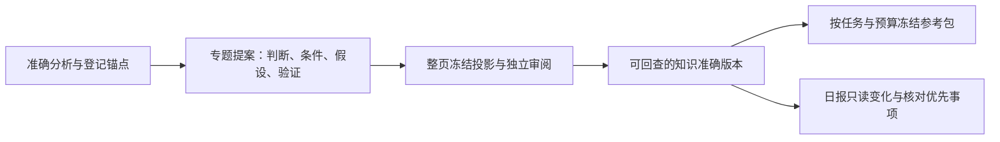

# 知识、日报与参考包的决策阅读层

2026-10-19 · 本地实现与验证；尚未合并、部署或重建生产知识。基线为 PR55（`99538454`）。业务范围仍由项目七目标与现状 Page 维护，本页只记录软件变化。

2026-10-20的[拉片到知识与日报改造方案](../../index.html#knowledge-daily-redesign)以现状／目标两张图解释已有内容的损失、共享研究单元、问题级认识修订和日报研究编辑。它是后续提案，不扩展本页的已实现声明。

## 读者现在可以看到什么

知识页先呈现当前判断、适用条件、失效条件、原创迁移假设与验证方案，再展开关键证据、原始正文及版本记录。专题关系图默认收起。旧知识缺失这些字段时明确显示未登记，不自动生成或补写。准确版本入口和图谱节点使用同一阅读层；引证编号在折叠其余引用后仍保持原编号。

新版专题提案可以生成有证据的语义标题及五字段判断指南。每项沿用登记证据的准确版本与锚点解码、引证渲染，并进入同一冻结投影接受独立审阅。原创迁移设想显式标为假设，不升级为产品事实或效果结论。导航父页不能携带这些判断。方法升至 v13，保留 v12 等历史覆盖与未知结果隔离。

日报增加一个派生的只读视图，比较同研究日较早的已完成版。待完成版本不会成为基线，原始冻结清单与七分面正文保持不变。来源范围、准确版本、登记文字变化分别表达；缺失来源不等于撤回判断，版本更新不等于新认识。按同一原片合并粗精报告，最多给三项带具体依据与未知影响的核对工作；没有足够判断时显示规则核对队列，不强造三条创作建议。

参考包按任务说明选中与排除理由，未知市场、语言和受众仍标为未知。新包标题取自实际保留的专题或案例。已审阅的条件判断随研究上下文冻结并计入预算。预算移除支持材料时重算保留材料的限制与未知，保留全局安全、用途、来源、挑战和必要反例，以及被移除版本的排除记录。旧包保持原样。

## 查找与商品事实边界

知识目录可沿准确依赖链，按当前素材库标题、发布者或已登记创作者标签找回关联知识。检索命中、目录总数和分页使用同一准确版本集合并按项目隔离。此处标签只帮助导航，不独立证明真实创作者、广告归属或报告生成时的身份。API 明确启用此读取适配；仅有知识存储的嵌入宿主不必拥有素材／分析数据表。

商品事实入口显示五类待提供资料：SKU 与包装版本、标签与每份含量、官方用法及人群、产品主张与依据、店铺／商品页身份与授权。它是缺口清单，不是新增的资料上传、事实登记或产品审批系统。本次没有收到真实 SKU 文件，未生成商品事实，也未接通新的非视频来源编译或正式制作资格。

## 验收与尚未证明的部分

合成模型端口检验精确证据映射、整页审阅、历史兼容和未知任务不重放；专用本地数据库验证存储、同日完成版选择、项目隔离和参考包预算。浏览器用合成数据检查宽窄屏阅读层，并用原评估冻结的日报及 Wiki 作本地只读回放。测试通过只证明相应软件行为。

本地验收：Node 24 全量 767 项，764 通过、0 失败、3 项可选环境跳过；另 Python 18 项通过。构建、类型、包边界、文档检查与新增敏感签名扫描通过。独立复审发现的指南消失、搜索连接等待和引证清洗问题均已补回归。宽屏与 390 像素视口的合成预览／冻结样本没有横向溢出，冻结样本正文与引证编号保持完整。构建仍提示知识前端分块超过 500 kB，未声称完成传输性能优化。

本次没有执行生产拉片、专题模型重建或未知任务恢复，没有更改生产策略、数据、主分支或部署。旧 Wiki 不会因此自动获得新的判断指南；未来获授权构建后，仍需抽查真实模型的语义质量。真人试读、原创制作／发布、实验反馈、GMV 增益以及真实商品事实登记均待后续验收。更完整的数据传输与图谱加载性能治理不在本次修改中。

## 2026-10-19 后续产品纠偏：报告的认知责任

用户指出，日报需要先定义关键问题、必要信息维度、知识之间的关联及完整生成过程。此前本地修改主要提供条件指南、同日差异、包预算和阅读层，不能据此宣称已有有效的研究报告。产品日报与知识文档现已补齐问题驱动的经营全貌、关联理由、认识前后变化、行动与反馈、冷读者验收；架构补充语义研究目标管线及分阶段实现边界。以上为目标设计，当前代码未实现问题级跨专题检索、语义关系综合、跨日认识变化和完整报告生成闭环。首屏少数动作不应成为重大风险与全量行动的硬上限。

本次只更新设计文档与既有草稿 PR；不重跑业务模型，不重建生产知识、不改变策略或部署。下一步应以准确冻结材料完成一份问题、知识修订与决策贯通的样稿，明确人工参与范围，再用真人决策任务校准实际自动化实现。
