# 视觉重构 R1：Graph-first 本地实现与复验

2026-11-01 · **结论：blocked。** 本轮完成了 Graph-first 构图、真实关系与来源投影、三视角、克制动效、移动端任务和稳定构建复验；桌面构图、标签碰撞、横向溢出、稳定切换、键盘与T1–T8已通过。严格独立视觉复核给出85.5/100，十维均不低于3；真实前台的四次47/138相机切换与三次200/500压力运行均稳定低于12ms p95。剩余阻断是系统级减少动态尚未实际启用，用户视觉确认也尚未产生，因此不得记为 `passed_local` 或 `passed`。

本轮继续使用独立工作树 `local/worktrees/unified-cognitive-workbench` 和隔离合成知识服务。最终结构与视觉证据提交号在收尾提交后由结构化记录指向。没有连接业务数据库、调用真实模型研究、发表知识、推送或部署。结构化记录见[visual-review-r1.json](../../assets/knowledge-workbench/visual-review-r1.json)。

## 实际数据与构图

稳定构建连接 `knowledge-workbench-synthetic / 认知示例`：47节点、43条认识、4个外部来源、138条关系、6个按当前连接形成的群落。7条跨群关系中有3条支持、1条挑战和3条导航；4条支持/挑战关系以增强桥梁显示。所有关系和来源均来自当前返回，没有为凑齐参考图而补造节点、来源或时间。

1440×1024 CSS px 实测：

- 中央图面边界为 `x=272.7`、`y=148.7`、`864.7×832.2px`，占视口约60.0%；右笔记282px。
- 页面 `scrollWidth=clientWidth=1440`、高度1024、`scrollY=0`。
- 星群常驻8个标签、问题视角5个；标签框全在画布内并保持至少16px安全区，框间交叠为0。
- 演化读取2个已发表版本，比较控件底部约864px，仍在首屏；当前版本的真实修订理由提升为高对比变化块。

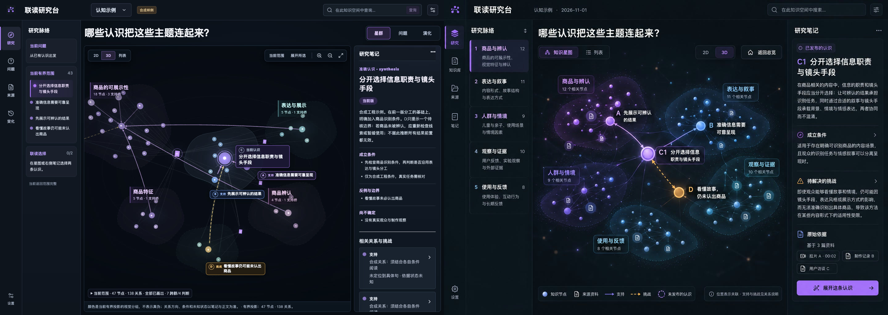

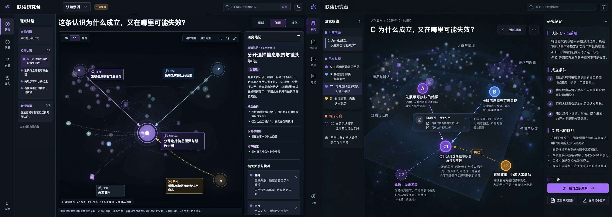

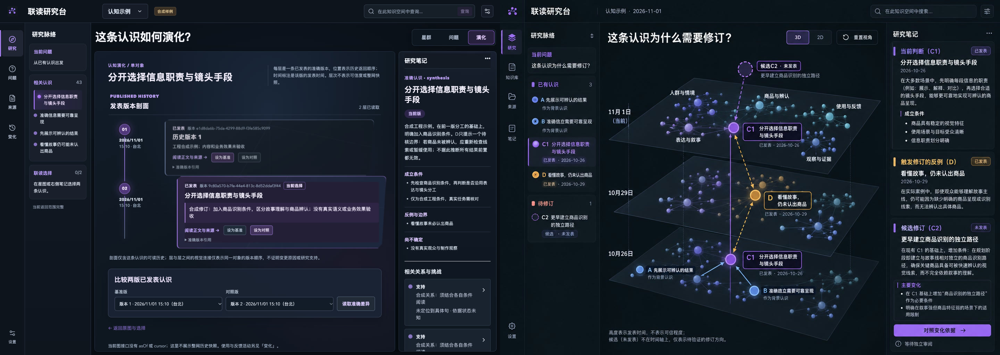

## 实现后的视觉语言

星点由亮芯、半透明加法色层与径向 Sprite 光晕组成；非当前的大节点采用中空观测环和小亮芯，当前认识保留更实的焦点与一条细状态环。真实来源节点使用所在群落的色温与双道文档标记，来源类型不靠颜色单独表达。群落用紫、蓝、青、玫瑰、青绿稳定色温，并有双层轮廓和低强度径向光场；挑战继续单独使用琥珀。背景与导航关系使用低权重曲线，支持、挑战和当前来路保持前景；全部返回关系仍在画布中，不把“变暗”解释成“不存在”。

背景加入低亮空间微尘以形成纵深感；微尘不是数据节点，不响应点击，也没有标签，范围说明明确写出“不是知识节点或关系”。星群相机略推进但保留左缘安全区，来源符号可读性优先于纯密度。

中央认识、支持、挑战与来源标签通过细引线连接所属节点。星群中的A/B改用两行短标题；群落计数牌向外让位。移动端总览只显示当前认识与3个关键群落标牌，问题视角保留A/B/C/D与来源5个标签；C、D、来源和A/B分别调整在不同阅读区域。

三视角共享同一准确选择。切换视角不再重建 WebGL 根；已访问视角通过约320ms相机过渡恢复，拖拽会立即中止。选中星点在约760ms内完成一次光晕收束，结束即停止重绘；视角按钮背景即时切换，避免标题与激活态短暂不一致。演化页移除外层记录框，两条真实历史分别成为错位悬浮版本平面，当前已有修订理由提升为变化块，容器与页面均无横向滚动条。

浏览器媒体仿真已确认 `prefers-reduced-motion: reduce` 为真时，页面和标签动画均为 `none`，相机直接应用最终位置且900ms后完全不变。该证据保存为：

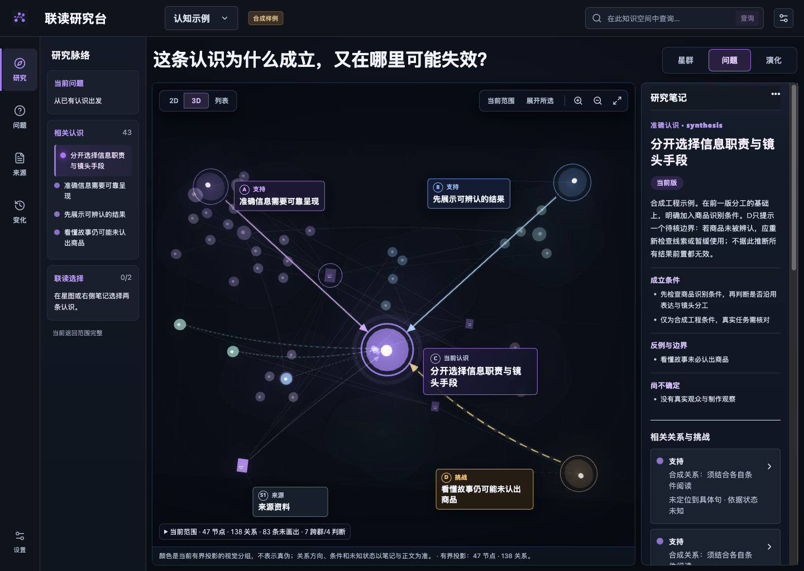

本机macOS系统媒体状态尚未实际切换，因此系统级硬阻断仍为 `not_run`。

## 任务与响应式

| 任务 | 实际证据 |
| --- | --- |
| T1 找到焦点 | 问题标题下可直接读到 `C 当前认识`、两条A/B支持和D挑战；右侧同步读取同一准确版本。 |
| T2 解释来路 | 支持为紫/蓝实线，挑战为琥珀虚线；右侧三条关系卡明确显示“依据状态未知”，导航与背景关系不升级为支持。 |
| T3 查来源 | 打开准确来源后读到 `paragraph:1`、内容可读和合成原文；返回后问题视角、当前认识与标签位置恢复。 |
| T4 跨群阅读 | 当前冻结投影有7条跨群关系/4条判断桥梁；例如“看懂故事仍可能未认出商品”以挑战跨入“分开选择信息职责与镜头手段”。 |
| T5 视角切换 | 星群→问题→演化→返回连续12次切换；另做2D/3D/列表10次切换，选择和范围均保留，稳定构建无error。 |
| T6 联读选择 | 两条准确认识进入联读栏后，第三条按钮禁用并显示“已选满两条；先移除一条再加入”，没有静默替换。 |
| T7 手机 | 391×844星群4标签、问题5标签；列表含43条认识，可从列表打开准确正文并返回原列表/视角；页面无横向溢出。 |
| T8 辅助技术 | Tab可到视角、2D/3D/列表、缩放、适配、范围和联读入口，焦点轮廓可见；辅助树读到“当前认识”、支持、挑战、来源与未知状态真实文本。 |

1024×768下星群与问题均为5个标签，`scrollWidth=clientWidth=1024`。演化页使用画布内部纵向滚动，`clientHeight=608`、`scrollHeight=950`，比较区可到达且页面本身、演化容器内部均无可见横向滚动条。

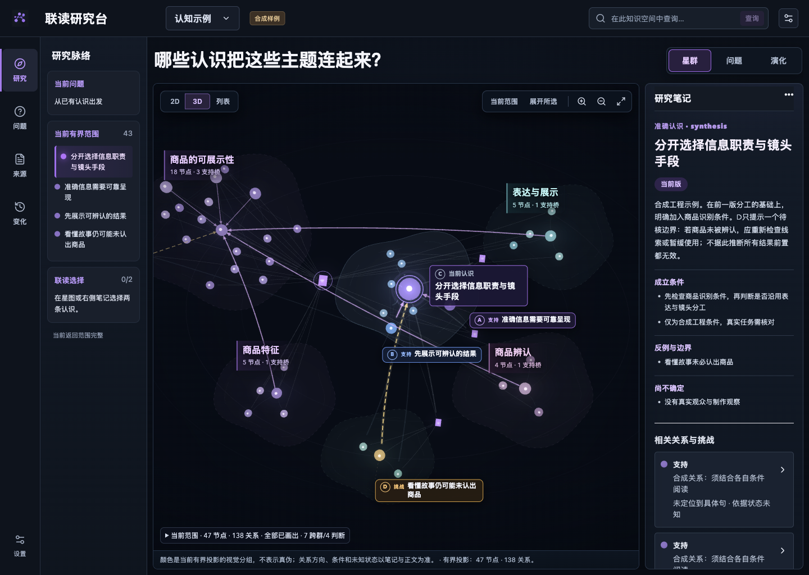

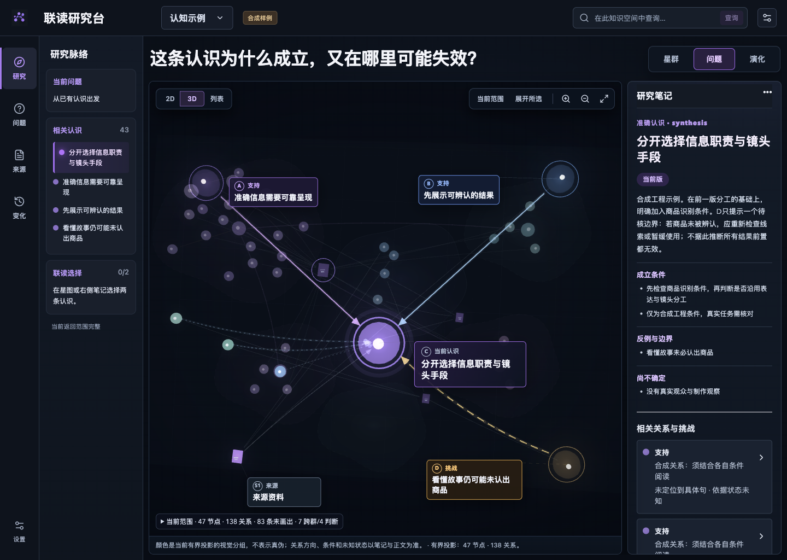

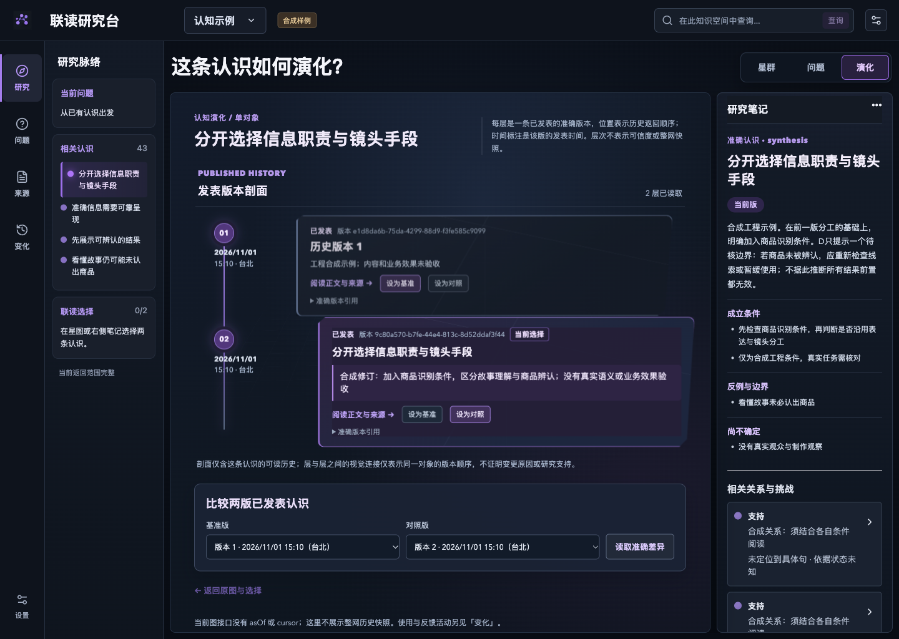

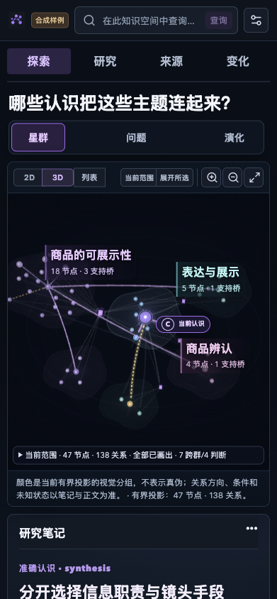

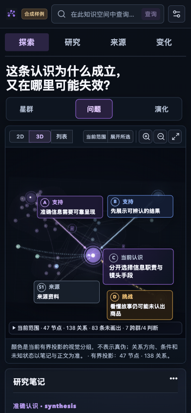

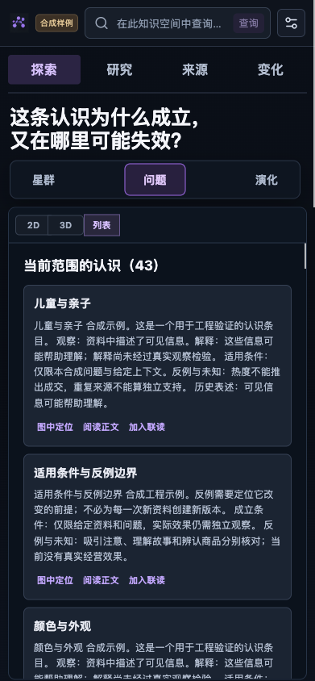

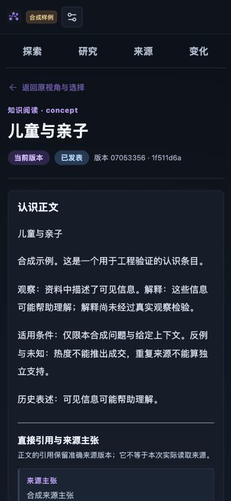

四帧动效记录按左上→右上→左下→右下排列，实际采样约186ms、426ms、775ms、1433ms：

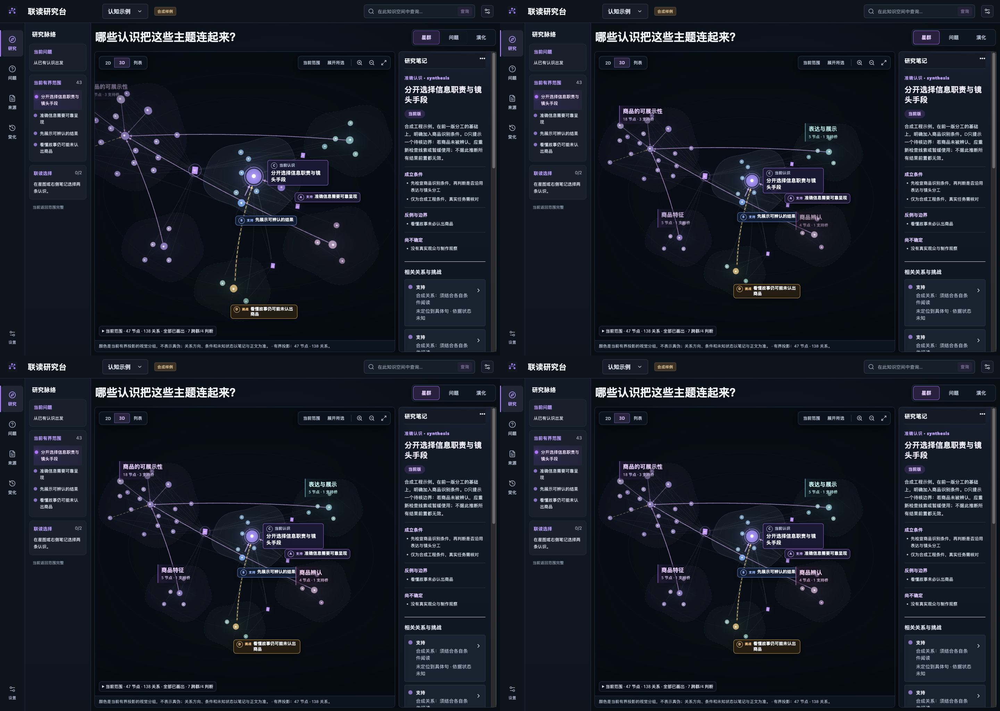

## 性能、稳定性与证据边界

从连接操作到WebGL2 ready的上限记录为1647ms。选择原生点击在37ms内改变选中态；视角相机约325ms完成过渡。稳定构建三代视角切换12次、图形方式切换10次均保留同一准确选择，WebGL上下文丢失为0，应用级error为0。仍有第三方警告：Three.js `Clock` 弃用、OrbitControls自定义滚轮灵敏度、Cytoscape拒绝三个非CSS阴影属性；这些不阻断本轮，但应作为后续依赖与2D清理项。

非前台或遮挡窗口在当前环境会被限制到约30Hz；这不是应用帧耗时。把独立Chromium窗口切到前台、启用焦点并设为active后，47/138进行了五次切换；第一次安装后的冷启动出现长帧，予以排除，随后四次有效切换各38–39个样本，中位8.3–8.4ms、p95 9.2–9.8ms、最大11.5ms。200/500压力页连续三次各74/76/76个样本，中位8.4/8.3/8.3ms、p95 9.4/9.1/9.6ms，500条关系全部绘制，无崩溃或应用级error。

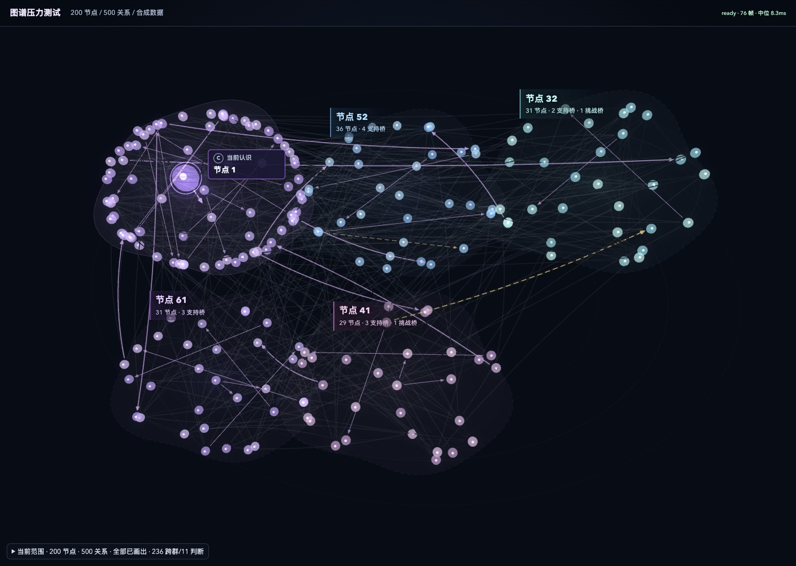

Web测试45/45、构建与 `git diff --check`通过。构建仍提示 `KnowledgeGraph3D` 约987KB、ELK Worker约1.59MB；3D继续按需加载，但这不证明大图服务容量或真实设备流畅度。

## 为什么仍为 blocked

严格独立视觉复审给出85.5/100，十维最低为参考图一致性3.0、群落关系4.0、响应式4.0、可访问性4.0和性能4.5；构图、焦点、星点、文字与动效均不低于4.5。横向滚动条、左缘安全区和按钮激活态不一致问题已复核关闭。

系统级减少动态仍未实际启用；浏览器媒体仿真不能替代操作系统状态实拍，因此 `passed_local` 仍为blocked。用户视觉确认决定最终 `passed`，不能由实现或独立复核准入代替。真实主题语义、真人理解、第二宿主、业务采用与效果仍需另行验收。
