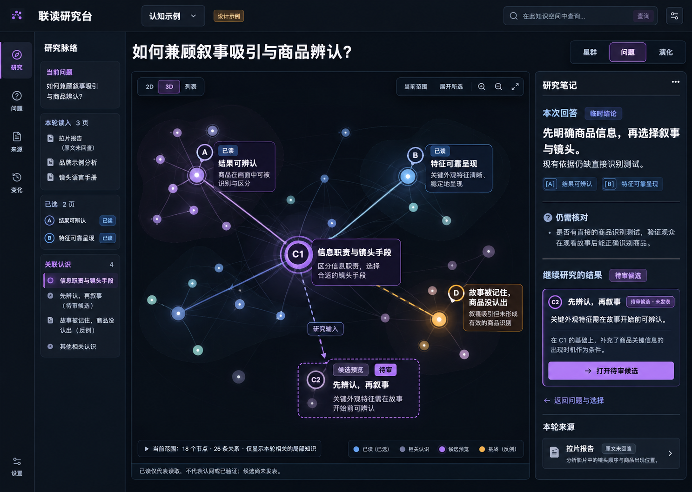
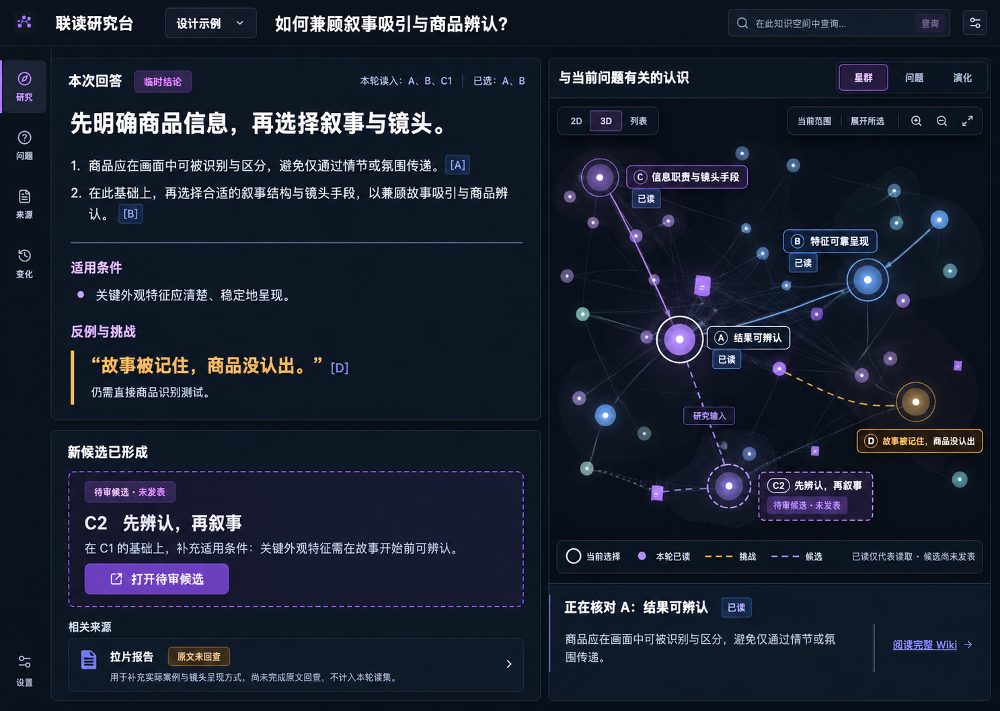
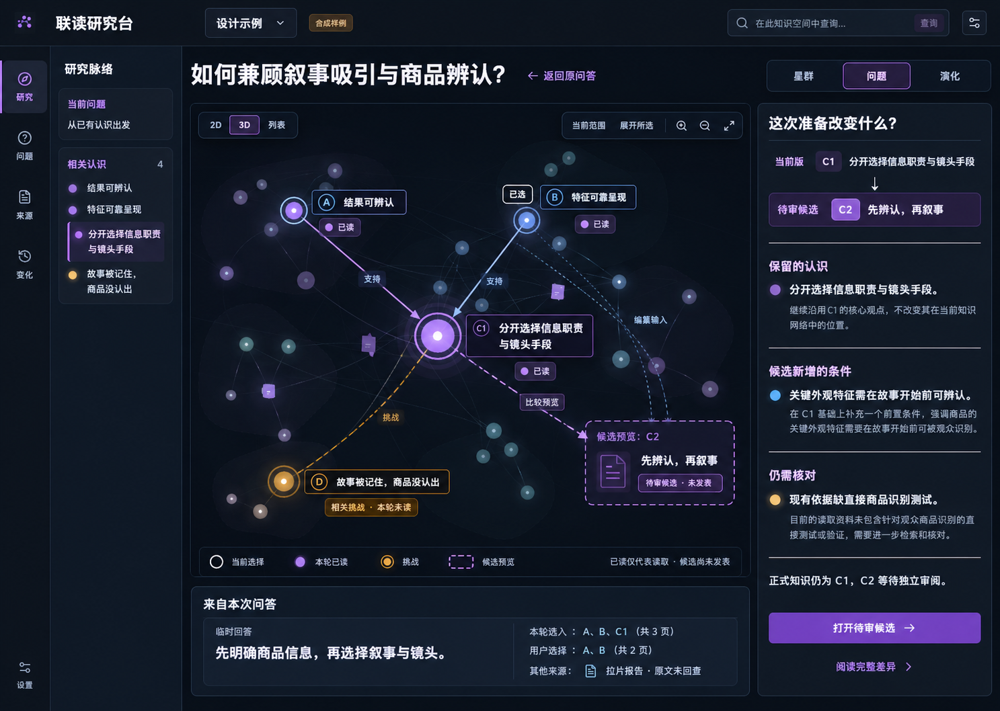
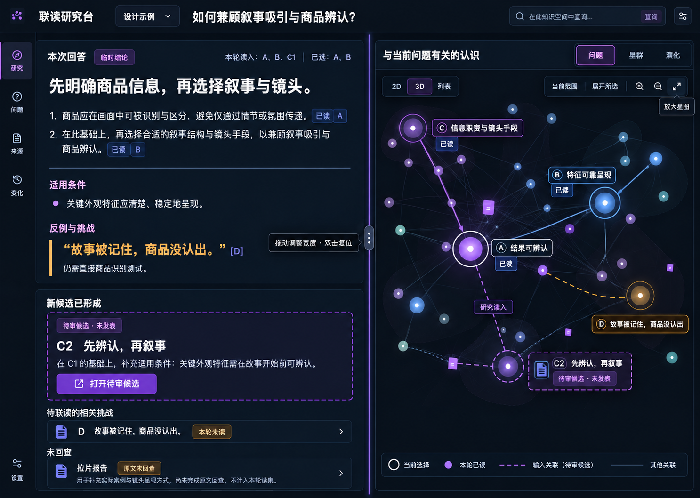

# 星图与问答联动的三种设计提案

2026-11-02 · 用户要求将问答、继续研究和候选核对放回既有星图，并生成对应设计图。首要任务仍是“围绕问题查知识、联读并核对依据”。用户已选择第 2 张，并追加可拖动分隔线、按需放大星图的要求。三张原提案保留供追溯，选定方案已完成本轮实现与核对；生成图不是运行界面的截图或验收。

## 为什么让星图持续可见

星图帮助定位认识、来源与关系；Wiki 正文负责表达结论、条件、反例和未知。用户打开回答、查看引文或审阅候选时，应始终知道自己在研究哪个问题、实际读过哪些版本，以及新判断准备改变哪部分认识。只增加问答和审阅表单，会丢掉这种共同上下文。

界面同时呈现四种不同的信息：当前正式知识的局部投影、用户选择、本轮实际读集、待审候选预览。它们使用相同的准确身份，但不能共用一个状态。被选择不等于已经读取；读取不代表论证成立；候选也不是已发表的新星。图谱的颜色、距离和大小继续遵守[既有设计系统](../frontend/design-system.md)。

## 三种布局

编号按照本轮对话中生成图实际出现的顺序固定。三图沿用 PR8 的深色星图、默认 3D、2D/列表与星群/问题/演化，以同一个合成问题比较信息层级。参考图在生成前已直接查看，并作为三个实际本地图片输入附给每次生成。

| 顺序 | 方向 | 优先帮助用户完成什么 | 取舍 |
| --- | --- | --- | --- |
| 1 | 星图伴随问答 | 保持较大的关系视野，旁读答案与候选摘要 | 最接近原工作台；长正文容易挤在侧栏 |
| 2 | 答案为主的联读画布 | 连续阅读结论、条件和引用，在常驻星图中定位对应认识 | 推荐作为问题驱动主界面；图中默认只突出与当前阅读相关的范围 |
| 3 | 星图中的版本核对 | 比较 C1 与待审 C2，解释保留内容、新条件和证据缺口 | 更适合候选核对阶段；完整回答需要展开阅读 |

### 星图伴随问答

### 答案为主的联读画布

### 星图中的版本核对

## 已选方案与可调分栏

用户选择第 2 张，并明确要求用户可拖动边界，自适应分配正文与星图宽度。选定修订保留左侧联读和右侧常驻星图，增加可见分隔手柄与放大入口。用户随后明确将可调左右分栏作为项目标准。实现统一提供键盘调整、比例记忆、复位、放大后恢复和窄屏顺序阅读；尺寸变化不能重置原问题、准确选择、相机或原操作。

修订图仍有生成文字偏差：未读 D 同时出现为反例引用，候选旁残留发光星点；实现按下述数据合同校正，不照图制造已读或已发表。

## 从设计图进入实现时的约束

本轮采用相同的说明场景：A“结果可辨认”、B“特征可靠呈现”、C1“信息职责与镜头手段”、D“故事被记住，商品没认出”，以及未发表的 C2“先辨认，再叙事”。这些标题和结论都是设计示例，不是经过业务验证的知识。

- 读集必须由服务实际返回的准确版本决定。图1自动生成的额外资料名与“已读（已选）”图例不可照搬；未回查的拉片报告不能计入已读。四种状态分别有文字或图形标记，不能让全部紫色节点都看起来已经读过。
- 图2把 D 放进反例引文，但示例实际读集只列 A、B、C1。实现时应将未读 D 放在“待联读的相关挑战”，或在真实读入后才引用；不能为凑齐漂亮关系而宣称已读。默认仍是问题视角，不能照搬图中意外选中的星群标签。
- 引用点击按准确对象、版本和摘要定位；仅标题相同的星点不能替代原引用。现有投影没有包含该版本时，显示受权的独立阅读/预览状态，不改写正式图谱。
- C2 使用独立虚线预览。比较、编纂输入和正式支持/挑战是不同关系；方向和语义来自接口，不能从生成图中的箭头反推。未发表候选没有正式发表时间。
- 原问题、后续研究问题及其原键分别保留。用户继续移动星图或改选页面，不改变已经提交的原答案读集。未知结果只读核对，不自动重发。
- 权限撤销或当前版本失效后，不依赖缓存继续展示旧答案；受权的编纂历史与当前问答遵守各自读取合同。候选仍须独立审阅后才可发表。
- 窄屏按同一研究上下文顺序展开正文、图与候选，提供列表和键盘入口。本轮只生成桌面图，不据此宣称移动交互、无障碍或性能通过。

## 生成与验证记录

使用用户指定的 Product Design `index → get-context → ideate → image-to-code` 与内置 Image Gen，先独立生成三张提案，再按用户选择与可调边界要求生成一张修订，共四次图片生成，每张只含一个界面。目标比例为 1440×1024；生成文件的实际像素、哈希、完整提示词和显示顺序见[生成记录](../../assets/knowledge-starmap-designs-20261102/prompts.json)。图片均已复制进当前知识产品仓库。

设计图生成是独立的模型使用，不计入知识应用的“真实模型调用为零”工程统计；本工具没有返回设计生成的实际费用，费用保持未知。图像已目视核对，以上标签与语义偏差明确保留，选定方案按真实数据实现，另生成可调分栏的修订图。

现有流程的运行证据见[页面审视](answer-research-design-audit-20261102.md)与[问答研究验证](wiki-answer-research-validation-20261102.json)。界面适配合同仍由[同一工作台适配文档](../frontend/wiki-loop-adaptation.md)维护。本次设计选择不会改变 PR8 已有样式基线，也不启用单独的 2.5D 实验。

选定方案已进入真实应用，并已完成[本轮工程与视觉核对](starmap-layout-validation-20261102.json)。工作台标准布局、适用范围和恢复行为由现行设计系统/适配合同维护。
