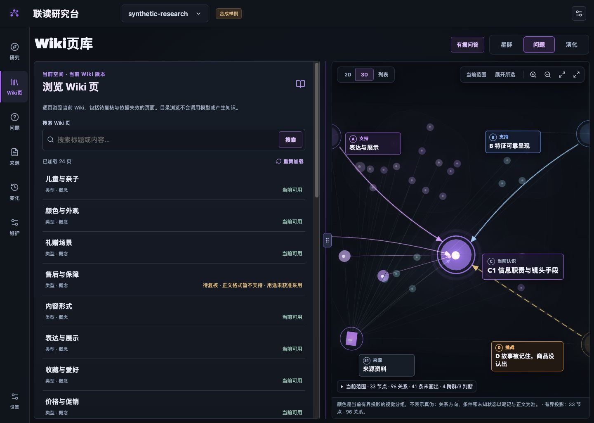
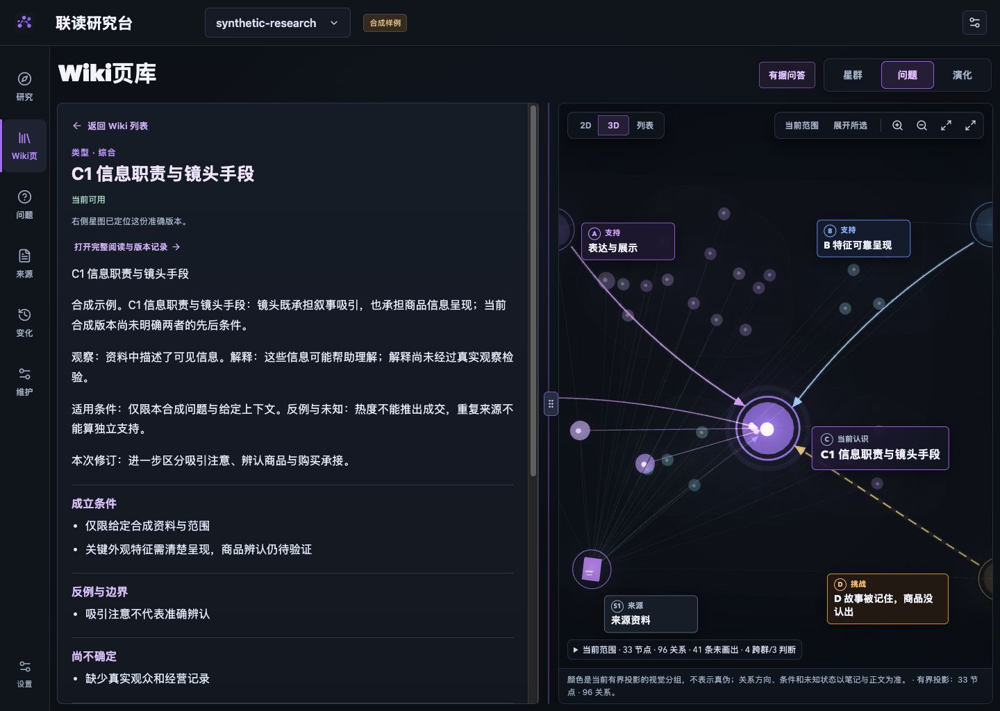

# Wiki 页库与修复任务入队验证

2026-11-03 · 本轮按用户要求补齐明确的 Wiki 页入口，并提交现有实现。工程与浏览器使用隔离的合成资料，不证明真实模型、语义质量或业务效果。

## 可浏览的知识资产

侧栏“Wiki页”进入当前空间的页库，每页24项，支持标题/内容搜索与继续加载。服务端先筛选当前已发表的 `wiki_page` 再分页；历史版本在版本记录查看，待审候选从候选入口读取。目录保留待复核、依据失效和用途未获准采用的页面，显示实际状态；只报告已加载数，不编造全库总数。

选中后准确读取对象、版本与摘要对应的正文，右侧定位同一引用；来源和完整阅读可返回该页，再返回列表仍保留搜索、分页和位置。界面复用项目标准分栏，支持拖动、键盘、复位和窄屏排列。

阅读许可与采用资格分别处理：服务成功返回的准确原文可以核对，即使当前不可采用；真实401/403仍清空数据，跨scope、错ref和迟到响应不会被展示。当前目录接口沿用KnowledgeDocument响应，界面只保留列表字段；本轮没有声称实现纯元数据传输或验证大库长正文目录容量。

## 实际验证

- 完整构建通过；核心 **494通过、0失败、0跳过**，日志 `/tmp/wiki-library-core-passed.log`。
- 新增真实HTTP/PG/SDK回归验证混合类型过滤先于LIMIT、全部当前Wiki分页恰好一次、历史/候选不冒充当前页、搜索/空结果、游标与scope隔离。
- Chrome实际验证24→32页、搜索命中1页、准确正文→239字节来源→原页→原搜索、完整阅读往返、待复核页原文可读与空搜索。原IAB控制连接不可用，改用独立Chrome标签，没有把浏览器测试冒称IAB。
- 共享分栏52→46，键盘到48，复位52；390×844顺序阅读，无页面横向溢出，console错误为空。交互数据见[记录](../../assets/wiki-library-20261102/interaction.json)。

临时预览到期后已退出并自动删除其专用数据库；后端59357专用测试容器也已停止删除。没有使用业务环境、业务数据库或真实模型。

## 修复任务入队

`KnowledgePublished.superseded` 和 `SourceRegistered.supersedes` 的传递关键依赖闭包现在持久物化并分页投递，任务、水位和收据同事务推进；保留既有撤权分页兼容。有效新发表页留明确收据，继续由周期SemanticSweep发现关系，避免每次发表立即再排研究。

Lint的复核到期、缺失关键依赖与失效关键依据会原子关联 `recompile` 任务。回归涵盖多页、回滚、重启、去重、scope隔离及任务关联。初版多排新发表任务引起的集成失败已按正确语义修正；最后的计数使用33个发表版本核对收据，仍断言只有32个当前页头与4个周期任务。

这里只补齐修复任务的来源，**recompile processor、失效目标的有界上下文、明确依赖替换以及修复后发表仍待后续实现**。不能把队列存在当作知识已修复。

## 后续边界

完整闭环还包括独立no_change审阅、未stage草稿重试、实体消歧、外部owner发表保证、业务接入发布和真实模型/人工金标/业务效果验收。2.5D仍是独立实验，不纳入本轮默认布局。
