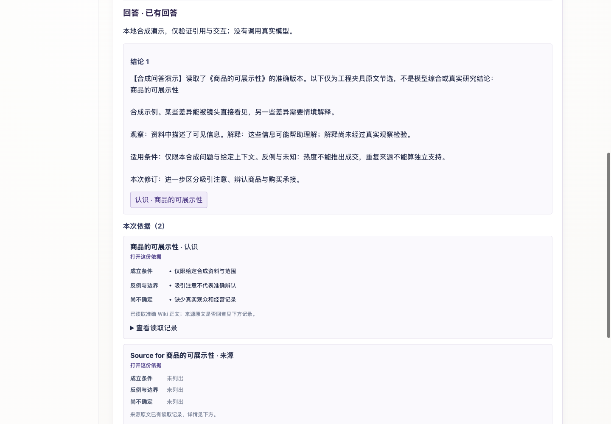
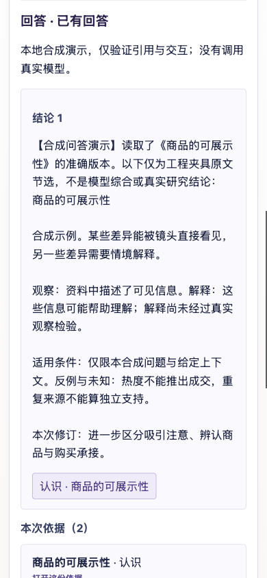
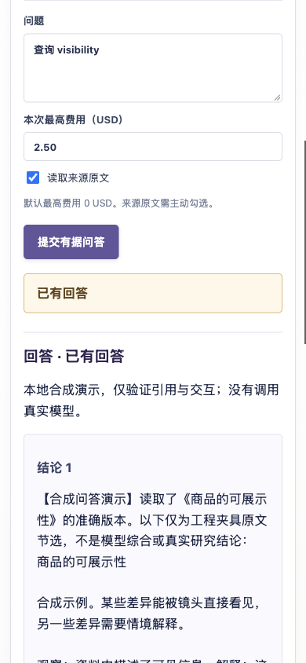
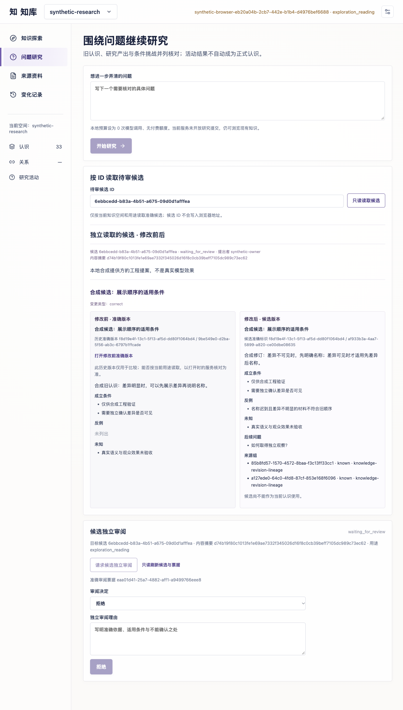
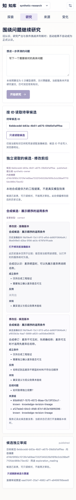

# Ingest / Query / Lint 实施回执

2026-11-02。独立开发副本始于 `knowledge@eecf30e`，现以已合并 PR8 `2f66ba1` 为集成基线，分支 `codex/wiki-ingest-query-lint`。本文维护本次持续目标的实际工程证据，不替代现行产品合同。来源 checkout 的三篇文档修改及两套阅读器已复制并保全；候选仅在开发分支集成；合并、部署与业务验收分别记录。

后续集成以已合并 PR8 的 `github/main@2f66ba174bbd47be92d0bbdc238159d33c5a74f8` 为新起点。下方各阶段的 `eecf30e`、业务 `5fbc744b`、383/998 等固定测试数和浏览器截图保留为当时的首次工程证据；不作为 PR8 集成后的重新验收。新基线的检查与未决项见文末“PR8 合入后的集成复核”。

## 本轮可验证的实现

新增 AskWiki 共享合同、SDK 的 `ask/answer/lookupAnswer`、可注入 `QueryAnswerer`、应用编排、PostgreSQL 操作账本和 API。普通词项 `/query` 保持原行为。Ask 用有界词项/身份检索取得候选元数据，再在剩余额度内读取页正文及条件/反例/未知；显式回查原文时使用所有者有界端口，相同来源准确版本只回读一次。成功读入的文本证据才有可用于回答的 ID；原页引用定位器不会被伪装为已经解析的来源锚点。

新账本在模型调用前保存准确读集和执行意图，以 scope、主体、用途和请求键去重；并发相同请求只会执行一次。超期未启动的保留请求结束为 failed；已经执行但没有确认结果的请求为 outcome_unknown，不自动排队重发。已知/未知用量和费用分别保存，准备调用不伪称已经消费一次。临时答案没有知识发表接口，原 Wiki 页头不会因问答改变。

API 仅在显式注入 answerer 和 operation writer grant 时装配问答；调用还须 `ask:write`。普通读者不会因为能调用 `/query` 就得到模型执行权。公开返回和回放检查当前依据有效性与来源权利；撤权后的准确审计记录仍保留，但不能继续披露旧答案。

## 中文词项基线

[结构化结果](wiki-query-baseline-20261102.json)来自开发者编制的合成样本：119 个 Wiki 页，30 个中文问题，定位/跨页/条件缺证各 10 个；其中 21 个可回答、8 个缺证、1 个无相关页。它不是独立人工业务金标，也没有模型答案。

真实 `store.search` 在 PostgreSQL 17.11 独立临时 schema 中与参考排序逐题比较，30 题无差异。现有词项 Recall@10 为 46/48（95.83%）；定位类别为 9/11（81.82%），跨页与条件缺证的必要页面召回为 100%。两项遗漏为仅在结构化别名中出现的英文名称。该结果支持下一批补身份/别名召回，尚不支持必须引入向量的判断。

前 100 页目录截断的合成对照 Recall@10 为 43/48（89.58%）；“只取目录前 20 页”的对照为 11/48（22.92%）。后者明确是窗口代理，不模拟现有 LLM planner 的选择，更不能当成生产漏召率。召回了缺证页不代表能正确回答缺证问题。

## 验证与环境

Node 24.21.0；专用回环 PostgreSQL 17.11-alpine 容器，只使用 `ccl_test_wiki`，每个测试自行创建/清理 schema。未读取业务 `.env`，没有业务库、真实模型或外部素材调用。

- `npm run build:knowledge-foundation`：通过。
- `npm run typecheck`：收尾变更后通过。
- `npm test`：首轮 211 项通过，0 失败、0 跳过；审查修正后的最终结果见下方补记。
- 问答合同、SDK、账本、API 和词项基线定向 29 项通过，0 失败、0 跳过，包含准确全文、调用前读集、原文覆盖、同源去重、无匹配/预算耗尽不调用、未读引文拒绝、拒答、并发去重、按键只读核对、未知结果去重、deadline 中止、用途权限及撤权。
- 独立集成审查发现 `start()` 提交确认丢失时，应用包装错误覆盖了 adapter 的 unknown；已保留 typed 提交状态，并使 API 的 unknown 错误不标记可重试。新增真实错误类型的 fake-port 回归通过，审查者定向复核未发现该项剩余问题。
- 两套文档阅读器生成与 `make docs-check` 通过；文档阅读器测试 20 项通过。原架构图已标注 Ask 本地接口/账本与真实模型待验的区别，Archify showcase 与浏览器检查通过。
- 基线运行使用 `npm run eval:wiki-query -- --sql`；纯参考排序不等同真实 `/query` 整条链路或答案质量。

## 第二批：身份别名与工作台问答

在保留默认 v1 行为的前提下，增加 `wiki-lexical-v2`：沿用原词项规则，追加稳定身份键与结构化别名信号；每个词的身份/别名信号只加一次，别名数量不增加票数。同名不同对象仍是不同候选，旧版和跨 scope 条目不能混入。显式方法版本保存在请求/回执，并隔离分页游标。Ask 固定使用 v2；工作台先检查服务能力声明，再选择 v2，旧服务继续接收原请求。

[v2 同材料结果](wiki-query-baseline-v2-20261102.json)为 48/48（100%），定位类别 11/11；v1 保留 46/48。两版各与 PostgreSQL `store.search` 比较 30 题，均为零差异。这只证明该固定合成语料的候选召回改善，不能推成任意自然语言查询、真实业务语义或大库性能结论。尚未增加向量索引。

工作台已有显式“有据问答”入口：默认 0 USD、一次调用预算，主动选择是否读原文；回答显示准确引用、条件/反例/未知、覆盖缺口和实际费用。未决意图保留在当前会话内，关闭面板或阅读引用不会丢原键；未知结果只能 GET 核对，不重新 POST。回到面板在绘制旧答案前清缓存并重新读取，409 依据失效与权限失败均隐藏旧内容。操作键、摘要及内部预算放在可展开读取记录中。

固定 Vite 构建与隔离合成 API 在浏览器实际运行，回答器明确标注为本地确定性夹具，报告零模型调用/零费用。走查用身份键问题“查询 visibility”找到当前《商品的可展示性》，读取两份依据（Wiki + 176 字节来源），分别打开 Wiki 和来源再返回；只有 1 次 `/ask`，返回时 2 次答案 GET。随后对该合成来源撤权，再回面板：旧答案与证据清空、新提交禁用、只读核对入口保留，`/ask` 仍为 1 次。

1440×1000 与 390×844 视图无页面横向溢出，条件与反例可访问。[浏览器结构化记录](wiki-loop-browser-20261102.json)区分该本地走查与未验证范围；撤权错误文案随后改为中文，最终 AskState 定向测试验证隐藏与锁定行为。

第二批最终 `npm run build` 通过（包括基础包、全量 TypeScript 和 Web 构建）；完整核心测试 **225 项通过、0 失败、0 跳过**。中文失败提示修改后，Web 定向测试 **30 项通过**；输入预算标签随后改为“回答输入上限”，Web 重新构建通过。集合与核心交叠，不相加。独立审查对 v2、游标/回执、Ask 状态和合成装配未发现可复现高/中问题。结构化源文件/命令绑定记录见[第二批验证](wiki-loop-g1v2-validation-20261102.json)。

## 第三批：刷新恢复与正文预限额

工作台通过显式协商取得认证主体/安装/项目/空间的恢复摘要，原用途再参与本地记录隔离。默认 `/capabilities` 维持旧响应字段集合，新 SDK 的 `includeRecoveryScope: true` 请求 `?recovery=1`；旧服务可以忽略该参数。sessionStorage 在 POST 前只保存严格校验的原键与调用者请求，自动保存范围没有令牌、回答或来源正文。记录无法读写或校验失败就阻止新提交；整页刷新并重新认证后恢复原问题、预算与原文选择，再只用 GET 核对原操作。

本轮固定构建走查把合成 `/ask` 回复向 UI 的交付延迟，在页面仍显示提交中时刷新。重新认证后，原问题“查询 visibility”、2.50 USD 上限与原文勾选均恢复；新页面只有一次 lookup GET、零 Ask POST，独立测试 schema 中总共一条问答记录。实际提供方仍是合成答题器，实际模型调用与金额均为零。回读记录为 Wiki JSON 载荷 5,003 字节、来源文本 176 字节、准备的回答输入 2,332 字节，声明限额 60,000 字节。浏览器事实及源文件摘要记录在[第三批验证](wiki-loop-g1v3-validation-20261102.json)。

读取先后顺序已改为候选元数据 → 大小与存储指纹预检 → 限额正文读取。核心 SQL 在向 Node 返回 Wiki JSON 前再次限制 UTF-8 载荷大小；有效性递归只取依赖与复核期限元数据。托管来源先检查权限、用途、摘要与 UTF-8 字节数，实际正文 SQL 再核限额和当前权利；来源元数据查询也不再把正文取回。所有者没有有界端口时登记缺口，不退回旧全文读取。反馈用途通过 schema 本地的安全 JSON 投影函数核验，未引入 PostgreSQL 16 专有函数依赖；实际数据库验证仍仅在 PostgreSQL 17.11 上执行。

Wiki 读集另外冻结存储指纹，回放检查指纹、当前版本、审阅、用途及失效状态，避免重复下载正文。公开准确引用仍使用原 canonical SHA256，内部存储指纹仅服务于已读输入的重新核验。此前未部署的本地 Ask 回执若缺少该指纹，会返回不可重新核验状态，保留原操作，不自动调用模型补算；没有改写旧正式 Wiki、历史引用或采用记录。

`readUsage` 限定口径是回传到 Ask 的 Wiki JSON 载荷、来源文本和准备输入。数据库内部扫描/磁盘 IO、元数据、协议及失败传输开销另行计量，尚未给出全库资源上限。旧手动读取与 synthetic research 路径没有被冒充为已全面采用同一限额；下一阶段编纂、业务桥接也须接入有界端口。

独立审查发现 checkpoint 等待期间撤权仍可能分发给 provider：先加入失败回归，观察到一次错误分发；再补 checkpoint 后的 readset 重验和 publication epoch 核对，同步检查 deadline 后才调用 provider。修正后回归为零 provider 调用、failed、零费用，审查者定向复核通过。该水位是分发前读时检查；外部网络发送与撤权的同步保证仍需实际适配器的授权租约或明确读时授权政策。

修正后完整 `npm run build` 通过，专用测试库的 `npm test` **242 项通过、0 失败、0 跳过**。测试覆盖正文超限前拒绝、UTF-8 边界、巨大依赖不回传正文、来源无界回退禁止、用途/撤权、恢复数据校验、存储失败零 POST、不同主体隔离、旧能力响应兼容，以及 checkpoint 撤权。浏览器刷新走查在该竞态修正前完成；刷新与预算代码未在修正中变化，修正后的完整构建和 242 项回归覆盖最终后端。

## G2 第一段：原 owner 报告回查与来源谱系

业务隔离副本基于 `commerce-creative-lab@5fbc744b97d63d25111e00443a5d6e963dddfad7`，分支 `codex/wiki-business-ingest`。核心继续在本仓改动；消费仓没有改动 `vendor/knowledge` 的源码、测试、manifest、文档或 submodule pin。消费仓在忽略的项目内 node_modules 中用可恢复脚本链接九个公共候选包；新 checkout 按当前 pin 安装不会得到这些候选能力，发布仍需先形成核心真实版本再明确推进依赖。

新增公共有界 owner 请求、独立 `/content-bounded` 和显式能力开关。业务 owner 在物化前检查登记大小/用途/版本，实际读取最多剩余限额加一字节，并检查长度、摘要、UTF-8/JSON；读取回执持久化后再次检查权限。核心及 commerce HTTP adapter 都限制响应流，只走有界入口，无 Content-Length 或虚报长度也受限。媒体仍在原手动入口，不计作有界 Ask 已看过画面。

Wiki 引文支持可选 `sourceDomain`，冻结依赖、展示和图保持准确域，未标记 Wiki 保留 `source` 默认。高层服务缺少外部准入保证时拒绝外部来源发表。问答保留修订继承的组及 owner 元数据的组；所有者元数据先于原文，准确摘要用于随后读取，未知组仍未知。

新增双服务器/实际 PostgreSQL 用例，以两份同原片的合成报告和预先审阅的 Wiki 种子验证：两份文本进入 provider 读集但保持同一来源组，原业务记录不变，核心托管来源版本表新增数为零；回放只核元数据而不重新物化。这个测试没有实现报告完成后的自动 Ingest，也没有证明语义关联质量。

独立权限回归先复现仅读 Wiki 时撤权未阻止答案；修正为递归收集 critical 来源的元数据并在候选读取、分发前和回放时验权。超过100项或无法完整检查即拒绝；新 Ask 为持久 failed、空答案且零 provider 调用，已存答案撤权后不可回放。补充传递依赖用例，核验经由旧知识依赖的原报告也进入权限检查，无须下载依赖正文。当前依赖 `contentReadable === true`，未提供单独 use 授权/跨系统租约，其他旧查询与采用入口的生命周期传播仍属 G3。

修正后的核心构建及完整回归 **257通过、0失败、0跳过**；新增传递来源断言的定向回归通过。业务完整回归为984通过、0失败、6项按原配置跳过（可选本地S3/API、私有捕获/回执及真实Caddy）；类型与边界检查通过，完整记录见[G2结构化回执](wiki-loop-g2-validation-20261102.json)；初次完整运行发现旧夹具直接加载 vendor 与公共候选包混用，撤权异常跨两份类身份不能正确分类，夹具已统一通过公共包入口，定向重现转为通过。没有用弱化错误判定或跳过测试取得通过。独立只读审查未发现本批可复现高/中问题，并复验了关键撤权路径。

## G2 第二段：生产事件到核心登记与实体提及台账

业务原有 `registerResult` 已在 fencing 事务内写入准确报告与 `result_registered`，并以项目锁保证同项目提交顺序；本批复用这份 outbox，没有新增一套报告完成事件。消费端新增独立投递账本、确认游标与带 token 的租约，不在 HTTP 期间持有数据库事务。先登记稳定意图，后向独立服务 lookup/提交；缺准确报告、回执不匹配、取消或未知确认均不推进该事件。adoption 事件留存完整快照并明确标 ignored，不伪装来源登记。游标绑定目标地址、认证 recoveryScope、项目/空间/用途/adapter/consumer；换目标或安装从独立进度开始，同主体令牌轮换可沿用。

核心启用 active writer 与 source intake 后，以主体/安装/用途/adapter/原事件键保存准确来源元数据及 outbox。原 owner 保管完整报告，核心没有新增托管原文副本。提及 API 另接受 caller-proposed 跨度，在有界完整文本中核验 UTF-8 起止和原字面，再次检查权限后保存不可变 batch 及 outbox。surface 是实际保留的派生节选；实体身份仍 unresolved，语义覆盖 unknown，不自动生成 Wiki、关系或发表。

独立审查发现两项P2：mentions-only 被误公布可写但实际还需 read；并发同方法可重复下载正文。先加入失败回归，再修正能力公布的组合权限和持久 claim。正常并发只允许一个请求读正文，其余409核对原方法；提交按 token/inputDigest/lease fencing，finally 只释放己方 claim。租约过期可以同键重读受限原文；没有付费模型，不宣称跨故障原件 IO 恰好一次。修复后只读复核未发现两项仍有可复现 high/medium。

核心完整构建通过，最终完整回归 **263通过、0失败、0跳过**。业务最终完整回归 **998通过、0失败、6项原配置跳过**，包括新增真实 owner HTTP → 核心 HTTP/SDK → 业务投递器的 ACK 丢失恢复；另补真实生产仓库故障注入：事件插入失败时报告、证据和事件一起回滚，恢复后同attempt/result重放仅各一份。两端使用独立 schema，核心只一条来源事件及一条后续 outbox，确认后业务游标才推进，自动登记原文物化次数零。另有9项投递器真实PG/模拟SDK回归、2项配置回归及scheduler接点验证；这些与完整测试交叠，不相加。类型检查及包边界通过，分析事件类型通过本业务包的公开入口导出，未改 vendor 源码/pin。结构化源摘要与日志见[G2事件验证](wiki-loop-g2-intake-validation-20261102.json)。

## G2 第三段：有界来源/旧页编纂与候选 stage

新增通用 `WikiCompiler`、独立 compilation 合同/账本、API及SDK。请求明确来源事件、检索词、候选分页和预算；当前检索词由调用者/业务上下文提供，尚未加入自动查询规划。读取复用 `queryCandidates → readCandidate`，全局 Wiki 正文数受 limit 控制；正文、载荷、准备输入分别计数，提供方仅接收准确读集。私有 frozenRevision 复用同一次有界读取供 stage 使用，不另下载旧页；传给提供方的数据与预算使用独立副本。

提供方输出按实际 evidence IDs、目标页身份/profile和输出大小校验。新建与修改分别生成规范候选；修改保留旧页的范围、别名、导航及关键依赖/来源引文，不把旧版本变为自己的关键前提。准确 key 冲突明确失败，不做实体语义合并。证明充分的本地来源可进入正式 changeset，外部报告保留待来源保证草稿；本批没有新 Wiki 发表，也未开放新 origin 的旧审阅接口。

独立审查定位两项P2并修正：本地 proof 在生成期间过期，会以同代/同源/同摘要/同用途刷新；候选 stage 已提交但 finish 失败，会用先落账的 stageIntent.requestHash 查验已有 changeset 并补齐本地关联，不重调模型。另先复现提案 checkpoint 期间撤权仍 stage，再加 checkpoint 后的权限/水位/期限重验，失败回归转为零 stage。模型响应缺失与账单不明都保留 outcome_unknown，已知成本不被重写为零。最终只读复核未发现这些修复仍有可复现 high/medium。

11项编纂定向测试通过，覆盖账本隔离/期限/CAS、new/update/无变化、未读引文、身份冲突、外发许可拒绝、提供方输入隔离、来源证明刷新及 stage 后 finish 故障恢复。真实业务 owner→独立核心 HTTP 另验证：实际报告文本进入本地合成编纂器，返回一份待保证草稿，正式 Wiki 数仍零；来源登记依旧只读 metadata，提及操作作为另一请求单独限额读取。核心完整回归274通过/0失败/0跳过；本批最终构建、业务完整回归和源文件摘要见[编纂验证](wiki-loop-compile-validation-20261102.json)。本轮仍无真实模型调用、业务库或生产动作。

## 新编纂审阅与本地两轮发表闭环

新增明确的 wiki_compile origin，与旧 synthetic research 验证分流；核对 compilation/stageIntent/真实changeset、费用、scope/purpose及准确候选。审阅读取要求原提出者和当前审阅者均有本地来源权限，不以 review action 自动扩权。候选视图固定 baseHeads 的旧版与拟发表新版，可显示历史和不可批准原因。

批准在单一项目锁事务内重验准确读集、关键来源和head；异人同digest/purpose，不能借审阅新增候选未声明条件。review、publication/head、票据及编纂终态同事务提交。人为在 publication 后的编纂更新处注入异常，整组修改回滚，移除故障后原key可正常完成；相同key并发审批取得同回执且只发表一次。

真实HTTP/PG合成流程走 A/A′粗精同组→C1→独立发表→D以C1为关键前提→反例B改C2→第二轮查询C2；同源计数不翻倍。C2推进同一对象新版本，D对旧C1的依赖使其失效，Ask返回needs_evidence且回答器零调用。历史编纂记录不因正常更新head而失去可读性，但原件撤权后，候选/编纂记录及审批回放都拒绝。

工作台增加准确ID只读入口、before/after及显式独立审批。浏览器已实际请求票据和批准，修复独立候选混入旧研究上下文与内部滚动遮住after，终态不再误报“需要独立身份/来源问题”。1159桌面双列、390手机单列及published历史状态都无横向溢出；真实审批点击工具恢复到1159，390是布局/终态验证，不声称手机触点发表已测。浏览器和截图使用纯合成专用schema，无真实模型调用。

全量发现G2遗留真实race：try内直接return异步putMentions会先进入finally释放claim。用异步持有断言失败复现，再改为return await，成功和失败均在持久化结束后释放；token/lease fencing未放宽。另业务scheduler的会话终止测试在触发预期拒绝后才接handler，出现PromiseRejectionHandledWarning；提前挂断言后通过，生产scheduler未改。初审并发receipt的P2怀疑被真实延迟插入实验（前后均2fulfilled/effects1）与既有writer项目锁证伪，撤回冗余锁。最终只读复核未发现剩余可复现high/medium。

当前完整build通过；核心完整294通过/0失败/0跳过（已把tsx UI回归纳入默认runner），业务998通过/0失败/6项原配置跳过，类型/包边界通过。细节见[本批结构化验证](wiki-loop-review-validation-20261102.json)。该闭环限已有本地事务来源保证；真实外部业务报告仍停草稿，独立语义效果、no_change审阅、周期Lint/判断任务与规模仍未验收。

## 未完成项与下一步

第一批补记：独立审查修正后 `npm run typecheck` 通过；专用测试库的 `npm test` **213 项通过、0 失败、0 跳过**。29 项定向检查与核心集合交叠，不相加。[结构化验证记录](wiki-loop-validation-20261102.json)保留本轮源文件摘要和验证边界；没有实际付费模型调用或生产操作。

G0/G1 的本地工程能力继续为后续闭环服务；真实问题与人工语义金标、实际模型适配、允许发送资料的用途证明、外部分发租约及受控语义验收、查询发现回流待完成。当前候选方法仍是含身份/别名的词项检索，大库索引与数据库资源预算留待规模验证。已有同标签页刷新恢复；标签页会话结束后的恢复与跨标签页发现、长读集浏览留待后续走查。

G2前三段已补读桥、事件/提及台账及有界编纂/候选stage，新编纂本地审阅/发表与两轮工程路径已接。G3维护基础随后已接入，见下节；下一主线是有界语义候选发现、任务到判断/编纂的协调与可见维护收件箱。自动查询/提及规划、外部发表保证、未stage草稿独立重试、no_change审阅及真实两轮语义效果继续验证。新编纂路径须使用已实现的有界读取，不能直接把旧 synthetic research 的工程结果称作真实语义研究。

G2–G6 剩余的自动语义抽取、实体消歧、后台语义编纂协调、真实关系判断提供方、外部来源保证与真实语义的连续两轮再利用、1 万/10 万规模和用户走查仍按实施计划推进。没有用 Ask API 的工程测试宣称完整知识闭环或实际业务效果完成。

## 编纂接入的执行约定（G2第三段）

| 决策 | 当前采用 | 可证伪的验收 |
| --- | --- | --- |
| 编纂入口 | 独立可注入 WikiCompiler；保留原 synthetic research 的明确边界 | 不注入提供方时不调用模型；新路径不使用 synthetic-local-v1 伪装真实方法 |
| 旧页定位 | 使用有界 v2 候选元数据并准确读页；可提交报告问题与已知提及形成的检索词 | 未读候选不能成为修改目标或命题依据，截断/遗漏可见 |
| 输入预算 | 原文文本、Wiki载荷及准备输入分别计量，调用前冻结读集并重验 | 超限/撤权/当前head变化时零提供方调用 |
| 提案与身份 | 修改必须指向本次准确读页；新页身份与已有当前页准确身份冲突时拒绝自动合并 | 新页/改旧页/无变化分别测试；版本与base head明确 |
| 权威候选 | 只有完整本地来源保证且通过可信stage适配器才进入正式changeset；外部read-time输入保留待证草稿 | 外部报告不得因生成成功直接发表；正式候选不推进head |
| 费用与未知 | 提供方调用前落账；响应/提交不确定保留原键，不自动再次调用 | 并发同键/响应丢失、费用未知与拒答有独立状态 |
| 审阅发表 | 后续复用独立审阅与唯一发表事务，扩展明确的编纂来源识别 | 不删除旧synthetic限制后接受任意变化；非同digest/同purpose禁止 |

上述路线在既定目标范围内可逆；真实模型账户、资料外发范围与外部发表租约仍未取得，不据此新增付费调用或生产动作。

## 新编纂审阅接入约定（实施中）

| 边界 | 采用 | 验证 |
| --- | --- | --- |
| 来源识别 | 新编纂使用明确 wiki_compile 审阅origin，核对账本/stageIntent/changeset，旧research保持原验证 | 任意changeset或错origin不能取得审阅资格 |
| 审阅读取 | 审阅权限与原件权限分开；proposer和reviewer均需对应purpose当前本地读取资格 | 未给reviewer来源权限则拒绝，不自动放宽readers |
| 前后比较 | before固定baseHeads准确旧版，不换成当下最新页；有界读取 | 差异对应准确refs，超限明确失败 |
| 发表 | 异人、同digest/purpose、当前输入/head、完整本地critical来源在唯一事务重验 | 撤权、过期head、错scope或半途失败不产生部分发表 |
| 追溯 | 发表后的编纂记录按历史权限读取，不宣称旧读集仍当前 | 第二轮修订后仍可追溯第一轮，但源撤权继续拒绝 |
| 审阅改稿 | 新conditions/gaps必须先修订候选，不在批准时偷偷改正文 | 新增审阅条件未在候选声明中则要求改稿 |

## G3 执行约定（实施中）

| 决策 | 采用 | 验证 |
| --- | --- | --- |
| 复用边界 | 沿用独立worker调度；legacy learning ledger缺少空间/安装/用途作用域，新维护账本不冒充其接受状态 | 两边游标互不覆盖，既有工作继续可用 |
| 事件处理 | source intake与knowledge各自水位，任务/事件关联/确认在同事务；初期每事件一任务 | 崩溃与重放不漏；新事件不被旧no_change吞掉 |
| 任务执行 | lease/token fencing，调用前dispatch marker；未知外部结果不自动再执行 | 取消/过期/旧worker提交/提交确认丢失分开测试 |
| 周期Lint | UUID keyset与确定shard，增量观察当前head，明确不是全库一致时点快照 | 未扫范围、跨轮新增和epoch变化可见，不宣称扫描一次全库语义完备 |
| 关系判断 | 有界读集进入provider-neutral questions，保持原答/拒答/缺证/未评估和成本 | provider判断不直接发表边，不将不同confidence当同一刻度 |
| 外部模型 | 本段仅纯协议编解码、合成回执与本地提供方；不读业务.env/不调用API | 实际账户/预算/材料许可未明确不进行真实请求 |

## G3 维护基础与逐题判断（2026-11-02）

来源 intake 与知识事件流分别保持按身份/安装/空间/用途/方法/规约隔离的水位。任务、原事件回执和游标同事务保存；每个事件独立产生工作，不让旧 no_change 吞掉下一事件。单条知识事件的引用按 SQL 页读取，并保存 pending sequence/offset；该事件所有引用完成后才推进主水位。原事件只在数据库留一份，应用每轮只接有界引用。撤权递归集合首次由数据库一次物化并保存完成标记（空集合也留标记），后续按有索引的 ordinal 页读取，避免每页重复遍历；首次物化的数据库图遍历或 IO 仍未声称是常数规模。

任务有 lease/token fencing、取消请求和三次未分发尝试上限。外部分发前落 marker，收到结果时原子 checkpoint 引用与实际费用，再完成任务。已分发而丢失租约的工作变为 outcome_unknown，不自动重调；已经确认的引用/费用不会因中断或取消被清空。Worker可显式选择仅维护，初始化空schema会先迁移core依赖，但不会自动激活writer。

周期结构Lint按日期/cycle、确定UUID分片和keyset扫描当前已发表页的元数据。它记录到期、断链、无知识边、关键依据失效、缺引文、重复来源组标识、准确profile/身份重复七种提示；不将Wiki正文传到Node、不调模型、不改head。每页发现/累计数/游标原子保存，最多1000个finding ID只是最近一页预览，完整发现可分页。覆盖为incremental_current_heads，不是一致时点全库快照；跨页换版、较小key新增及未扫范围保留说明。发现的语义成立与否、关闭/去重及自动矛盾检测仍未验收。

逐对判断先有界读准确两端，再冻结读集/规约/提供方指纹。逐题predicate概率、choice选项或score分布、拒答、缺证、未评估和provider error分别记录；同源组不算独立票，不比较不同提供方confidence为同一刻度。调用前落账，返回后先checkpoint成本、再保存原batch和实际模型；最后finish和首次披露均重验权限。丢失finish可按原键恢复已保存的batch/费用而不重调；源在处理期间撤权时内部保留回执，但首次POST和后续GET都不披露旧内容。

本批独立审查发现已确认判断结果未checkpoint、单事件引用扇出无界、拒答绕过通用字段校验；均以回归覆盖修正。另修缺证predicate被误记失败、部分拒答整批误报完成、未知账务被显示失败和首次POST撤权披露问题。Jev/OpenAI目前仅有纯wire-data编解码，没有SDK/HTTP transport/凭据或真实请求。默认Worker只做metadata；宿主需注入processor才执行任务，自动语义候选发现和任务→判断→编纂尚待接。

最终工程回归为核心321通过/0失败/0跳过，业务998通过/0失败/6原配置跳过；核心完整build及业务typecheck/包边界通过。业务初次有3项因lead测试PATH漏掉已有FFmpeg/PG工具而失败，补回路径重跑通过，无业务逻辑改动。文档、图、独立复核及源码摘要以[本批结构化验证](wiki-loop-maintenance-validation-20261102.json)中的最终状态为准；真实模型/人工金标、外部保证、规模及业务效果均不据此标完成。

## G5 当前页搜索投影与规模对照（2026-11-02）

当前页二字Unicode gram投影只作候选预筛，原SQL评分/权重/过滤/排序/分页不变。PG按同一NFKC/小写和JSON alias文本化规则生成，GIN预筛是原子串匹配的候选超集；准确head与原有权限/关键来源资格继续复核。scope gate和查询同statement snapshot，未ready/格式错/单Unicode字符词/diagnostic关闭整次回退。新增表受writer guard保护，head与可搜索修订字段的触发器同事务维护；分批回填、scope覆盖状态及API/SDK/Worker入口已经接入。

独立审阅修正缓存篡改后游标未重置、已完成Worker忙转；另以失败回归修复cache-only孤儿记录导致重建永不ready。自然重建会全量修复gram并清理额外缓存，只改投影，不改知识。超过200000规范UTF8字节的页阻止scope ready，完整fallback保留；同identity字段更新只刷新一次。首轮10k查询已加速但写入/重建各21–22s，100k准备在230s预算内未完成，失败记录保留。随后跳过零blocked delta的重复scope UPDATE，并只在投影tuple变化时写cache，减少MVCC/WAL/GIN重复工作；9项定向再次通过，独立源码复核无剩余P1/P2。

最终10k/100k均完成180次检索和60组同库原查询/投影逐项有序对照，无差异、无超时、无未运行；v2计时P95分别约17ms/31ms。同库配对原查询P95约326ms/3158ms，配对投影约16ms/31ms。10k写入+重建约6.6s；100k约33s+22s，投影表及索引约88.5MB，实际EXPLAIN含对应GIN。原始两次失败/较慢构建与最终JSON均在[投影验证](wiki-search-projection-validation-20261102.json)。这只是固定119页/30问加短中性占位的store.search工程证据；真实语义、长正文/高频词密集库、完整Ask/Lint和生产容量仍未验证。

正式文档、原图和计划随本批更新；真实模型账户/资料许可、自动提及/检索规划、语义候选发现→判断→编纂协调、独立no_change审阅、外部发表保证与完整工作台收件箱仍按原目标推进。消费仓vendor pin未推进，本地候选仍通过忽略的公共包链接装配。

本批最终完整build、核心330通过/0失败/0跳过、业务完整串行998通过/0失败/6原配置跳过、类型/包边界、两套文档生成/检查及20项文档测试通过。独立只读审查核对最终修复无剩余P1/P2，未独立运行全量。一次并行业务全量出现迁库夹具admin-terminated connection，独立3项与最终完整串行复验通过；根因尚无证据证明，未改迁库或调度生产代码，日志保留。原图通过自动validate/deliver/check/browser-check，本批未新增视觉审阅。无真实模型/付费调用、业务库、提交、部署或vendor pin推进。

## 来源驱动协调：PR8 前的固定工程证据

在 PR8 集成前，来源事件驱动的 `source_research` 协调器已用本地合成提供方验证：单一准确事件先形成持久 SourcePlan，再按 v2 有界读取旧 Wiki，最多作三次有类型的双端判断，将本次实际读取的双端结果作为 advisory hints 交给编纂器，形成待审候选而不自行发表。每个子步骤的原键、请求和预算固定，合计遵守不超过五分钟的期限及调用、金额和读量限额；已确认账单累加，未知按原键 lookup，不重新分发模型。规划提及只属于 `model_proposed`、`unresolved` 提案，不写入调用方提及台账，也不自动消歧。提供方原始安全 JSON 与已知费用先 checkpoint，再校验提案；回显完整来源正文的 raw 不持久化。

当时核心全量 383 通过、0 失败、0 跳过；业务全量 998 通过、0 失败、6 项原配置跳过。两项双租约端到端测试覆盖正常确认与审阅后租约过期 ACK；其他合成回归覆盖 A→C1→B 挑战→C2 后 Ask 读取新版本、拒绝不发表、发表事务回滚、规划后取消不下派及旧 worker 只见规范状态。批准与拒绝在同一事务结束 compilation、run 与 task，结果由 `compilationOutcome` 区分；运行中的租约不被抢占。普通任务 reason 不承载私有模型内容，计划和运行详情仍每次重验来源资格。准确测试项、日志和限制见[协调结构化回执](wiki-coordination-validation-20261102.json)。这些是 PR8 前的首次证据；下述 PR8 核心全量已重新包含协调端到端测试，仍不证明真实模型、真实语义或外部 owner 发表保证。

## PR8 合入后的集成复核（浏览器与真实语义仍待验）

当前合并起点为 `2f66ba174bbd47be92d0bbdc238159d33c5a74f8`。PR8 带入 R1 深色联读工作台：默认 3D，保留 2D/列表、星群/问题/演化及共同选区；2.5D 仅有默认关闭的实验交接，尚未实现。此次把 `Evolution.css` 的导入移到浏览器 `main` 入口，是 Node 测试无法加载 CSS 的构建入口修正，不代表视觉或交互设计发生变化。首次核心全量为 398 通过、2 失败；修正后全部 TSX 测试仍纳入 runner，核心全量 415 通过、0 失败、0 跳过，日志 `/tmp/wiki-pr8-core-final.log`。旧网页截图和浏览器空间 88 不属于这次新基线；新的浏览器走查仍待独立确认。

选区问答的公共合同允许至多五个准确 `selectedRefs`，每项须是带 canonical 内容摘要的知识引用，不能重复同一对象版本。工作台把共同选区作为**拟读意图**提交，服务优先按准确引用在剩余预算内有界回读，再处理词项候选；同版本去重。实际纳入的 evidence、排除项和读量由服务结果决定，不能把选中或检索命中写成模型已读。请求连选区、用途、预算与 deadline 一起绑定原幂等键；结果未知时只读核对，不换键重新付费。旧服务未公布 `askSelection` 时，工作台不发送选区字段，保留旧 Ask 路径。合同与实现依据分别见 `packages/knowledge-contracts/src/index.ts`、`packages/knowledge-application/src/ask.ts`、`apps/knowledge-web/src/ask-state.ts` 与 `apps/knowledge-web/src/ask-panel.tsx`；本段不声称新浏览器端到端已完成。

公开文档接入复验通过，返回 `schemaDropped: true`（`/tmp/wiki-pr8-onboarding.log`）。`make docs`、`make docs-check` 与文档测试 20 项通过（`/tmp/wiki-pr8-docs-build.log`、`/tmp/wiki-pr8-docs-check.log`、`/tmp/wiki-pr8-docs-tests.log`）。最终构建进程退出码 0（`/tmp/wiki-pr8-build-final.log`）；业务 `tsc --noEmit` 和包边界检查退出码均为 0（`/tmp/wiki-pr8-commerce-types.log`、`/tmp/wiki-pr8-commerce-boundaries.log`）。业务全量在新基线运行 1004 项，998 通过、0 失败、6 项按原配置跳过，耗时约 83.7 秒（`/tmp/wiki-pr8-commerce-final.log`）。核心 415 项包含协调端到端回归，故协调工程路径已在 PR8 基线重跑；新浏览器走查仍待完成，不借用旧截图。以上均未运行真实模型、业务数据库或生产部署。

### PR8 界面走查与修正

在已合并 PR8 基线上用专用合成服务复验：1159px 默认 3D，2D/列表及星群/问题/演化入口保留；两条联读选择在切换后仍在。词项零命中的问题通过准确选区读入两份 Wiki，确认正文载荷 5345 字节、准备输入 2428 字节，实际付费模型调用与费用均为零。随后打开 Wiki 与原来源并返回问答，账本仍只有一份 answered 操作、两份 Wiki 依据；用户后续打开来源不反向改写原答案读集。维护任务可打开编纂候选并返回仍选中的原任务；未知任务刷新后调用量、token 和费用继续未知。1159/390 布局截图已检视，无横向溢出；390 只验布局，未做手机触点发表或系统 reduced-motion/用户视觉验收。

首次桌面走查发现固定高度父容器裁掉 Ask 提交按钮；为面板增加 flex/min-height/内部滚动后，原生点击提交成功。首次合成夹具改名调用者造成原种子来源 ACL 不可见，选区被正确排除且未分发；改为保留种子 principal 后走通，不放松真实权限。网络包装器在 client 捕获 fetch 后注入，不能作 POST 次数证据；操作唯一性由持久账本与 HTTP 回归证明。改选区的浏览器探针因 stale ref 未执行，不算通过；冻结行为由状态测试与真实 HTTP/PG 回归覆盖。合成服务退出 0、schema 与临时连接文件清理，89 留空页供 active 目标后续使用。最新原始证据见协调验证 JSON。

最后收口：新增真实 HTTP/PG 选区回归后，完整核心 416 通过、0 失败、0 跳过（`/tmp/wiki-pr8-release-tests.log`），最新完整构建通过（`/tmp/wiki-pr8-release-build.log`）。Web 与产品定向入口同时纳入 TSX 候选审阅回归，避免仅默认核心入口运行这些检查。选区标题在已有操作后改标“下一次提交意图”；覆盖摘要分别显示实际依据与检索候选数量，避免零词项召回、两条准确选区的结果被误写为“返回2/已加载0”。
