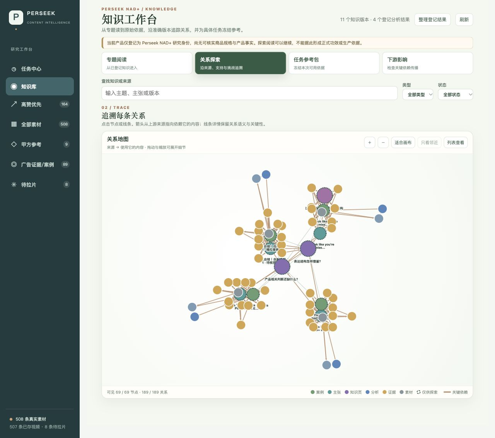
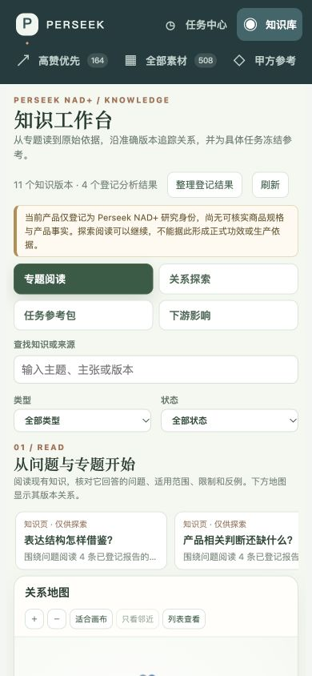

# 知识工作台：真实数据、节点图谱与使用边界

2026-10-15 · **已接入现有 5174 React/Vite 工作台并完成真实读写验收。** 这次交付完成专题阅读、节点与关系探索、证据回查、探索参考包和关键下游影响；知识模型编译、生产用途的语义审阅、真实创作与业务反馈闭环仍未启用。

打开 [知识工作台](http://127.0.0.1:5174/?view=knowledge)，或从原素材工作台左侧「知识库」进入。代码已于 2026-10-15 通过 [PR #1](https://github.com/cyl19970726/commerce-creative-lab/pull/1) 推送并合入 `main`，合并提交 `201b55d865e5378af5c11349dddf6bc123c69768`；合并本身不代表本机服务已重启或云部署。下方数量与测试结果保留各次验收快照。

早期 [5178 合成组件预览](module-20261015.md#验证记录2026-10-14)仍可用于阅读器调试；它不接真实知识数据，当前工作台也不依赖这份独立预览配置。

## 从产品目标推导界面

设计依据是[知识与记忆](../reference/commerce-product.md)、[知识架构](../reference/commerce-architecture.md)与[实验反馈](../../index.html#outcomes)。不把所有材料平铺成等价节点，也不把联系密度解释为效果。

| 需要回答的问题 | 入口与交互 | 实际依据 |
| --- | --- | --- |
| 目前知道什么 | 专题阅读：问题、案例、待核观察、限制、未知和准确版本 | 当前已登记报告与知识版本 |
| 依据在哪 | 圆形节点、上游连线、关系详情、登记分析报告、证据帧及原片秒点 | 精确 AnalysisResult、ContextSnapshot、EvidenceAnchor 与资产版本 |
| 这次怎么用 | 按目标、受众、市场、语言、制作条件和预算冻结参考包 | 选入/排除理由、版本、缺失事实、反例、限制和冻结上下文 |
| 新结果改变什么 | 关键下游遍历、历史版本、失效/待核状态 | 服务端计算关键依赖；界面筛选不改变结果 |

专题是阅读起点，图谱负责发现和追溯关系。圆形节点支持选中、拖动、缩放、邻域聚焦、搜索定位与列表访问；关系线可点开核对两端版本与传播含义。颜色区分对象类型，边框区分状态，节点大小只表示阅读角色，不表示真伪、热度或商业效果。移动端保留相同阅读入口及键盘列表。

## 图谱技术栈的决定

**使用 Cytoscape.js 3.34.3 + 内置 Canvas renderer + CoSE 布局，React 19/Vite 8 管理页面与详情。** 不增加图数据库；PostgreSQL 继续保存权威版本、审阅、依赖与历史，R2 保存原片和证据。图谱是可重建的展示投影。

| 候选 | 取舍 |
| --- | --- |
| Cytoscape.js | 圆形网络、带方向的语义边、集合/邻域操作、图算法与布局可在一个组件中完成；React 管理状态，组件销毁时清理 Canvas 与 ResizeObserver。此次采用。 |
| vis-network | Graphify 当前 exporter 的实际方案，Canvas 与力导向网络适合参考。我们更重视关系类型和依赖操作，选择 Cytoscape。 |
| Sigma.js | 大规模网络渲染值得后续评测；当前有界业务图尚未证明需要额外 WebGL/布局组合。 |
| React Flow | 节点编辑和流程编排可以单独使用；本次首先需要自然网络探索与证据追溯。 |

文档与源码依据：[Cytoscape 官方文档](https://js.cytoscape.org/)、[CoSE 实现](https://github.com/cytoscape/cytoscape.js/blob/v3.34.3/src/extensions/layout/cose.mjs)，Graphify 的固定源码与实测见[研究](../research/graphify-frontend-20261015.md)。实际安装版本由根 package-lock 固定，Cytoscape 随应用打包，不依赖在线 CDN。

工作台按需加载。构建时原素材入口约 312 kB、知识功能约 594 kB（均为压缩前产物）；知识功能仍有 Vite 的 500 kB 提示，未把它解释为性能测评通过。

## Nowledge Mem 的实际试用

已通过 Computer Use 打开本机 `/Applications/Nowledge Mem.app`，切换图谱总览与探索并搜索 Commerce。总览显示 458 节点、803 边；搜索返回 23 节点、24 边，界面提供中心/邻域/全图、侧栏解读/查看/本体/维护、类型过滤与 2D/3D 入口。

**本机画布保持空白并报服务错误，未成功验证它的节点拖动、展开或 3D 交互。** 没有重建索引、重新聚类或修改用户记忆。另打开并查看[用户给出的官方视频](https://mem.nowledge.co/videos/demo-knowledge-graph-agent.mp4)：能看到节点网络、关系、标签与旁侧内容；视频中的 2258 节点和 3353 边属于演示画面，不是本机实测或本项目性能结果。没有从画面猜测其渲染库。

借鉴的是「网络与解释联动、从局部展开、阅读层次独立」；我们的节点、关系和状态由本项目的证据、版本与用途规则决定。

## 真实数据怎样进入

宿主通过素材、资产与 analysis 公共 read ports 分页发现每个原片的最新粗拉和最新精拉，读其准确报告；知识包不查询 analysis 私有表，也不重复保存原始视频。点击「整理登记结果」执行确定性阅读投影，不调用模型。每个原片最多扫描 1,000 份结果，达到上限而未完成发现时明确报错，不把漏掉的 profile 当作不存在。

每个结果保存为探索案例及一条待核观察，保留原报告文字、质量和覆盖限制。两个问题专题组织这些引用。专题目前是探索阅读目录，没有生成跨片范式或商业结论；45 份旧报告和 508 条素材没有被自动升格为知识。

重复整理返回既有版本。同一 profile 的新登记分析形成新的案例/观察及专题版本；粗拉与精拉的当前案例可以并存，旧历史保留。原有按原片建立的 v1 案例继续归其当前 profile 使用，不删除旧对象或改写冻结包；另一 profile 建立独立对象。同源 SHA-256 去重不变。宿主来源身份策略只允许 `exploration_reading`，决定是 `exploration_only`；这不是语义复审通过。

Perseek NAD+ 另有宿主登记的研究目标身份版本，来源是用户确认的项目目标；状态 `research_identity_only`。它不包含商品规格、剂量、功效或官方事实，正式生产仍缺独立产品资料。界面明确展示这个区别。

## 关系与影响规则

- 所有边按上游 → 使用该依据的下游展示。支持、挑战、使用、来源形成、关联和收录分别保留语义。
- Pattern 支持/反例、Collection 成员角色、Wiki 导航字段优先于通用依赖文字；导航关联不传播失效。
- 同一证据准确版本只显示一个节点，保存完整锚点；不同范围或资产冒用同一证据版本会分开展示并标记冲突。
- 影响遍历只经过关键边，包含间接下游，防止循环；筛选和邻域缩放只改变画布。
- 加载上限为 200 个知识版本、800 个节点、1600 条边。达到上限或出现冲突时 `complete=false`，页面明确提示范围不完整。没有大型真实图性能或跨分页完整闭包的验收证据。

这次接线没有新增业务 Outcome，也未接通来源失效事件的持续消费或自动编译。已有知识存储支持失效与历史；前端展示的是当前已保存关系及其关键下游。

## 参考包与证据回查

正式包仍要求按任务用途采用的有效知识。探索包必须显式选择纳入探索材料，并且用途准确为 `exploration_reading`；不会修改上游采用状态，也不会通过包变成生产依据。包记录 `explorationRefs`、限制、未知、实际上下文、选排理由和全部准确版本。

默认 20,000 的预算是 UTF-8 字节保守估算，不是供应商 token 数、模型用量或账单。商品事实和反例缺失会明示，不能补造。生成时冻结，重新使用前检查准确任务、依赖有效性和用途；探索包请求生产校验会拒绝。

证据回查先校验该知识版本实际引用了锚点，再读取 analysis 登记证据、匹配资产与时间范围并校验对象内容。浏览器取得新的短时交付地址，显示证据帧及准确原片，定位到毫秒秒点。地址过期不等于知识失效；再次打开可取得新地址。外部版本链接区分分析、证据、研究身份与知识历史，避免误查成知识对象。

## 验收记录

2026-10-15 主集成补验：修复粗精互相覆盖后，真实同步新增/更新两份案例，当前 **5 案例、5 待核观察、2 专题、1 旧探索包，共 13 个版本**，图谱 85 节点、234 边。输入为 3 份粗拉与 2 份精拉；最新甲方外部结果未知任务没有报告，未混入同步。Teng 的旧粗拉与旧探索包仍为原版本且有效，重复整理 imported=0。知识专项 51 项通过；全套 235 项中 234 通过、1 项旧本地 S3 全链路跳过。真实粗精报告的内容质量并未因此变好，仍只供探索。完整边界见[当前实现](../../index.html#current-state--%E4%B8%A4%E6%A8%A1%E5%9D%97%E6%95%B4%E5%90%88%E5%A4%8D%E6%A0%B82026-10-15)。下表保留首次接线时的验收快照。

截至本次验收：508 条真实素材；4 个原片的最新登记报告（3 粗拉、1 精拉）；4 案例、4 待核观察、2 专题与 1 个用户任务形式的探索参考包，共 11 当前知识版本。精拉仍为 `review_incomplete / failed`；粗拉仍保留各自候选/未复审状态。此数量是有日期的快照，不能推为全部素材已分析。

| 验收 | 结果 |
| --- | --- |
| 真实图谱 | 69 节点、189 边，未截断；相同准确证据版本去重 |
| 重复整理 | imported=0，无跳过，既有知识与包保留 |
| Teng 5.250 秒证据 | R2 回查 200，53,054 字节 JPEG 内容哈希匹配；原片 Range 请求 206；浏览器实际帧与视频定位可见 |
| 真实探索包 | Teng 案例，估算 6,876/20,000 字节；探索重校验 200；生产请求 409 `EXPLORATION_PACK_RESTRICTED` |
| 关键影响 | Teng 原片 17 个下游、48 条关键路径边；隐藏探索节点后界面计数仍为 17 |
| 桌面与窄屏 | 1280×720 节点、关系点击/详情、参考包、证据回查；390×844 页面无横向溢出，列表入口保留 |
| 针对性测试 | `npm run test:knowledge`：50 通过、0 跳过，包含实际随机隔离 PostgreSQL schema |
| 集成检查 | 边界、类型与生产构建通过；完整 npm test 当时 225 项、190 通过、35 跳过（未在该次命令提供 PG 配置等），不称其集成测试全通过 |

真实 HTTP 回执位于本机 `local/validation/knowledge-live.json`，不含私有交付 URL。数据库新增表和整理前已有本机私有备份 `local/backups/knowledge-before-workbench-2026-10-15.dump`。截图见下方；证据原帧和用户记忆截图不作为仓库新素材入库。

## 后续边界

仍需独立语义审阅及生产用途政策、真实商品版本和资料、知识模型编译任务公共合同升级、来源失效事件消费、创作和自家 Outcome 接入、大图/检索/完整闭包评测。可继续阅读与冻结探索参考，不把这些缺口标成已完成。

两份权威业务 Pages 读取均返回 `page_read_forbidden`；本次依据当前用户授权、可读产品/架构文档与现场数据实施，未声称已更新 Pages，也未另建业务认知原本。
