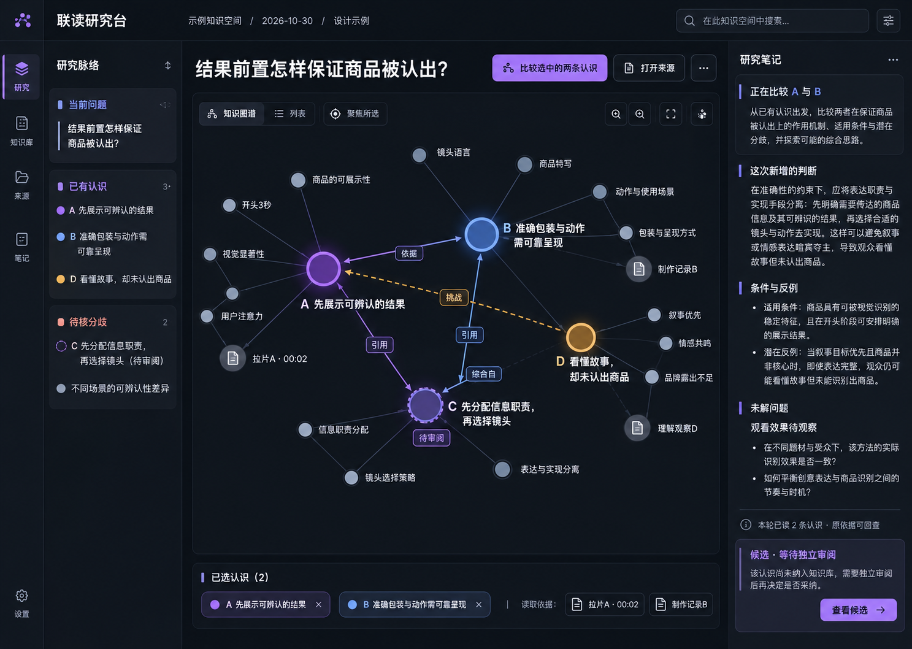

# 联读研究台设计系统

本版整体采用黑色/深色界面，保留星群作为知识阅读与研究的核心空间。它服务于看清知识内容与关系的任务；视觉提案不等于已实现，也不证明图谱语义正确。以下约束用于指导实现和验收，不指定尚未决定的 CSS 变量或颜色令牌。

体验主线见[联读研究台](experience.md)，知识关系语义见[产品说明](../product.md)。跨宿主时的样式隔离与资源要求见[嵌入说明](embedding.md)。

用户选择的第二张提案如下，固定为本版的视觉对照。图中的 A/B/C/D、关系箭头和研究文案是示意；实际界面不得据此补造知识、关系、读取或发表。

## 视觉层次

- **整体表面：** 页面背景使用近黑色，工作区、浮层、选择区及侧栏以深灰层次区分。层次依靠明度、边界和间距共同建立，不用大面积发光或装饰纹理代替信息结构。
- **阅读层级：** 问题标题与当前认识最醒目；完整正文、条件、反例与依据保持舒适阅读；来源标记、时间、版本等辅助信息较弱，但仍清晰可辨。研究结论和权限/覆盖缺口不能被压成低对比的脚注。
- **行宽与字号：** 正文采用可连续阅读的有限行宽；长段落、窄侧栏或来源锚点不得把行压到难读。正文、图中标签、按钮和状态文字都要在目标缩放下可辨。图的节点标签应有明确的缩放/聚焦策略，不因“全图适配”缩成无法读取。
- **色彩：** 不使用绿色作为主色。节点颜色每个视角只表达一个明确约定的维度；当前拓扑组色需说明它只反映连接分组，大小如表示连接数也要另列口径，两者都不代表真理或可信度。选中、焦点和候选等状态可以用不同色相，但必须同时有文字、图标、边框或线型辅助。
- **星点材质：** 每颗星由明亮内核、低透明度径向光晕和按状态出现的聚焦环组成。群落使用紫、蓝、青、玫瑰、青绿等稳定低饱和色温，节点在同一群落内可有轻微亮度变化；琥珀仅用于挑战。光晕尺寸可随选中和连接数变化，但透明度不表示真理、可信度或支持强度。
- **来源位置：** 来源节点可靠近它在当前返回关系中连接最多的群落，用来说明“主要影响落在哪里”。同一来源到同一认识的多条关系不能重复放大该群落或来源光晕；连接数按去重后的相邻对象计算。位置只描述本次受权投影，不表示出版方权威、独立证据数量或全库归属。

## 星图语法

星图上的节点表示准确知识、来源，或有清楚成员范围的聚合视图。大小若表示连接数或其他拓扑指标，必须标出指标口径，不暗示重要性或可信程度。聚合节点展开时保留成员与范围；视觉分组不创造新的强制知识类别。

边和空间位置承担不同职责。布局距离、社群和导航边帮助探索；支持、挑战、前提、同源、推导、修订和普通导航关系必须各有明确标签或线型，不能仅靠颜色区分。跨群落且 stance 为支持或挑战的实际关系可提升为桥梁，群落标签可显示对应计数；计数来自当前返回关系，不能由版式补足。关系缺少命题锚点、依据未知或目标范围未加载时，保持未知和缺口可见，前端不补造解释。聚焦时突出当前问题相关的关系，背景网络可变弱，但不得让用户误以为隐藏关系已不存在。星点光晕用径向纹理和加法混合形成柔和边缘，不为追求亮度启用会同时糊化正文、标签与关系线的整屏 Bloom。

这些是关系表达的目标。目前公开 `Relation.stance` 仅包含支持、挑战、背景和导航；其余含义只能从已有准确依赖、来源组或修订记录解释，不在画布上补造一种新边。当前旧依赖投影中缺失的命题锚点与未知依据继续显示为缺口。

| 可见状态 | 用户需要理解的事 | 可用的辅助语法 |
| --- | --- | --- |
| 当前焦点 | 正在围绕哪个问题或认识阅读 | 标题、焦点框或明确选中标记 |
| 用户选区 | 哪些认识被要求纳入考虑 | 选中样式及选择说明 |
| 实际读集 | 哪些准确版本和来源片段确实被本轮读取 | 读取标记、版本或范围摘要；与用户选区分开 |
| 候选 | 有新判断等待独立审阅 | “候选”文字、边框/图标；不混入正式版本外观 |
| 不变 | 已核查且有理由保留现有认识 | “不变”文字及本次核对摘要 |
| 待补证 | 当前材料不足以支持所需判断 | “待补证”文字、缺口和影响说明 |
| 未知/不可读 | 关系或来源状态不能确认，或当前权限不允许读取 | 文字说明原因；不以空白、消失或普通弱化代替 |

状态颜色可帮助快速扫视，但颜色感知差异、灰阶显示和图例缺失时，文字/符号/线型仍须让状态可区分。关系色彩和状态色彩不可在同一视图中悄悄承担多个互相冲突的含义。

## 窄屏与键盘

窄屏优先保留任务、当前焦点、正文和关键关系。星图可以占据独立画布并提供聚焦/展开；阅读正文与来源详情可在同一上下文中顺序展开。总览可隐藏重复的“支持/挑战来路”胶囊，保留群落名、节点数、判断桥梁和所选认识；切到问题视角后仍恢复 A/B/D 的完整标签。不得把桌面多栏简单缩成一张不可读的全图，也不得丢失当前问题、选区、版本、读集或返回位置。超过视口的图内容应可平移或聚焦查看，页面本身不应产生意外横向滚动。

所有交互都应可由键盘到达并显示清楚的焦点：按 Tab 顺序访问导航、问题控件、图谱控制、当前对象、正文/来源和研究操作；按钮和可操作节点可用 Enter/Space 激活；Escape 关闭当前覆盖层或返回上一层而不清除研究上下文。图谱还需提供不依赖拖拽的聚焦、展开、缩放和对象读取方式。焦点不可只通过颜色变化表达。

## 动效

动效用于解释状态发生了怎样的一次变化，并应在任务完成前停下。图谱缩放与适配使用约340毫秒的相机缓动，用户拖拽时立即中止；标签和演化层使用约240至420毫秒的短入场，版本层按返回顺序轻微错峰。切换后内容必须保持可操作，不能用持续闪烁、无休止漂浮或装饰粒子制造“智能感”。

每个动效都要有即时替代。`prefers-reduced-motion: reduce` 下相机直接到达目标，标签与版本层不播放入场，透视层也不位移。动效完成后的静止画面必须继续依靠尺寸、文字、线型和边界解释层次；动画不能是区分焦点、支持、挑战或候选的唯一方式。

## 可测验收

- 在宽屏和 390 CSS px 窄屏完成[体验文档](experience.md)列出的同一联读任务；窄屏没有页面级横向溢出，正文、来源和状态说明可读，星图关系可通过聚焦查看。
- 在近黑背景上检查普通正文、次级说明、节点标签、焦点、分隔和禁用状态；截图与实际页面中，状态文字不被裁切，层次可辨，图标签不会因 fit-to-view 缩到无法辨读。
- 用键盘从进入页面完成选中认识、打开正文、查看来源、返回和开始研究；全过程能看见焦点，不要求精确拖动或只用鼠标操作。
- 用至少一条支持/挑战关系、一条同源关系及一项未知依据检查图例和标签；即使转换灰阶或不看颜色，读者仍能区分关系与状态。
- 分别模拟用户选择多于实际读入、来源不可读、候选被退回、不变及待补证；界面准确显示范围、版本、理由和状态，不虚报已读、发表或权限。
- 检查缩放、复位、视角切换和版本加载的动画不会阻塞操作；拖拽可中断相机缓动，减少动态效果时所有目标状态直接可达。
- 用真实样例先确认关系与来源正确、字号可读和返回上下文完整，再按观察到的图规模测量加载、布局和交互延迟；截图美观或合成样例通过不能替代语义验收。

## 星图品质的下一轮设计

2026-10-31 用户指出实际星图仍弱于对标。整体联读工作台选稿继续保留，星图品质尚未获得用户验收；布局和流程的本地自检不代表已经达到对标。具体诊断、3D空间语法与同数据对照任务见[认知星图与3D空间提案](graph-space.md)。
