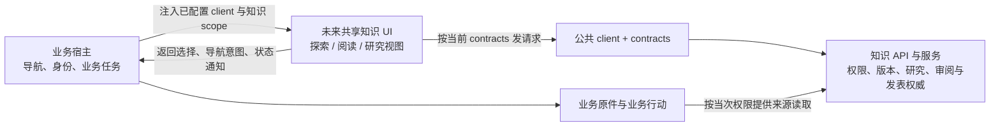

# 独立应用与未来嵌入边界

当前 knowledge-web 是独立运行的知识应用。现有公共 `client` 与 `contracts` 可供其他调用方复用，但目前没有可公开导入的知识 UI 组件包。应用包含探索、阅读、研究视图及内部图谱模块；这些视图尚未作为稳定组件出口发布。

这一区分影响集成方式：复用源码、API 能力或共享 DTO 不会自动得到可嵌入组件、宿主生命周期合同或样式隔离。独立应用与未来宿主应共用知识服务的同一权限和发表权威。整体读者流程见[联读研究台体验](experience.md)，视觉与交互约束见[设计系统](design-system.md)；公共 client 的实际调用顺序见[技术接入手册](../integration.md)。

## 当前可确认的边界

- `knowledge-web` 是独立应用；当前实现不是一个已发布的 UI 组件库。
- 公共 `knowledge-client` 与 `knowledge-contracts` 可供知识应用和业务适配器共享。请求与响应的数据形状应以 contracts 源码为准，文档不另写 DTO 或复制一套 API 类型。
- 本地版本仍围绕应用自身入口、全局样式和浏览器位置/连接上下文组织。GraphCanvas 和联读、审阅目标的内部函数可复用，但尚无宿主注入的完整 UI 合同；直接把源码目录挂进另一个站点不能视为已完成的嵌入。
- 消费仓的 Git submodule 只固定并分发知识核心源码版本；它不创建 npm UI 出口、不解决宿主路由、样式冲突或 Worker 加载，也不定义组件 props 和事件。

上述是当前边界，不是目标组件包的承诺。独立应用可以继续作为完整工作台运行；其他业务也可以只复用 client/contracts，并按自身界面调用知识服务。是否抽出共享 UI，应由真实的第二宿主任务和独立应用回归共同验证。

## 未来 UI 包的建议合同

以下内容是供后续实现讨论的合同建议，不表示已有组件、包名、属性或事件。先验证阅读与局部探索能否在两个宿主中共用，再决定是否扩展到完整工作台。

未来包若建立，至少需要在实现和发布前明确以下合同：

| 合同面 | 建议边界 |
| --- | --- |
| client 与 scope | 宿主传入已配置的公共 client，以及当前知识空间/项目等受支持范围上下文。scope 只限定请求上下文，不授予读取或写入权限；服务继续按身份、用途与所有者策略裁定。不得把 token 写入组件状态持久化、URL 或构建产物。 |
| 事件与回调 | 由组件通知宿主用户选择、需要打开的业务任务或状态变化；载荷使用公共合同中的类型或稳定的 UI 事件定义。宿主通知不能伪造知识读回执、审阅证明或发表结果。 |
| 路由与返回 | 明确独立应用路由和宿主路由如何互相导航，谁拥有浏览器历史，以及关闭/返回时如何恢复问题、选择、焦点和阅读位置。避免组件擅自接管 `window.location`。 |
| 样式与可访问性 | 说明样式隔离方式、主题入口、字体继承、层叠范围、焦点可见性和键盘行为。宿主主题可影响外层容器，不应静默改变关系语义或降低状态可辨性。 |
| Worker 与静态资源 | 说明图布局 Worker、字体/图标、动态 chunk 等资源如何打包、解析 URL、跨域加载和 CSP 配置；宿主无需猜测知识应用内部路径。没有 Worker 的降级行为也应明确。 |
| 生命周期与错误 | 明确挂载/卸载、请求取消、宿主切换 scope、权限撤销、超时/未知提交和重复挂载的处理。卸载界面不能被当成取消后台操作或撤销业务动作。 |

建议先以内部视图边界建立候选复用点，例如 Explorer、Reader 和 Research；只有通过两个宿主的真实接入后，才稳定为公共导出。包名、框架版本、导出路径、版本兼容和构建方式都待实施时选择，不能从现有目录命名推定。

## 权限与所有权

宿主负责自己的导航、登录身份、业务任务上下文及业务原件和行动。业务所有者决定是否、何时以及以何种范围提供准确原件；调用 UI 或 client 不继承其他业务的原件权限、平台凭据或执行能力。

知识服务负责知识空间访问裁定、准确知识版本、关系、研究记录、独立审阅与唯一发表入口。前端可以请求、呈现和返回这些结果，但不能通过宿主属性宣告授权、把候选标成正式知识，或直接承担发表权威。任何来源读取仍需当前权利检查；一次可读不等于永久授权。

## 未来接入验收

- 独立应用和第二业务宿主使用同一 client/contracts 合同读取准确版本，并分别通过各自配置处理登录和知识范围。
- 两个宿主在路由切换、键盘/窄屏阅读、主题隔离、图 Worker 资源加载和组件卸载后重挂载时，都能完成同一条联读任务。
- 撤销来源权限后，任何宿主的新读取都遵守知识服务裁定；宿主参数、UI 事件或 submodule 固定版本不能绕过授权。
- 候选、不变、待补证及发表结果在两个宿主中语义一致；只有知识服务确认的独立审阅和发表结果改变正式知识。
- 记录 submodule/SHA 只能证明消费了哪份源码；另行核验真实包出口、宿主加载、样式/路由/Worker 兼容和读者任务，才足以证明可嵌入。
