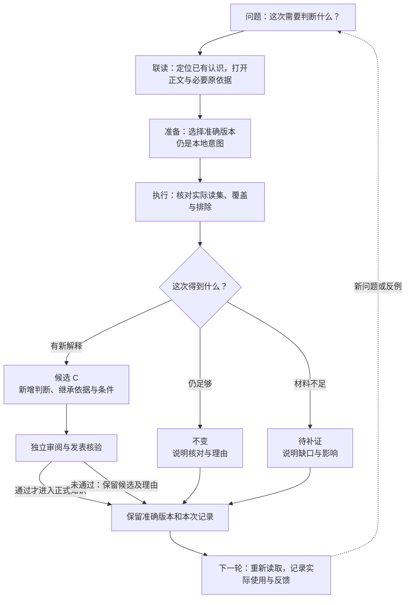

# 联读研究台：从知识问题到下一轮判断

联读研究台让人围绕一个具体问题读懂已有认识、核对它们的关系与依据，再判断是否需要研究。星图负责定位和解释知识关系，正文负责完整表达认识，研究区负责比较本次输入和结果。它们共享同一问题上下文，但各自回答不同问题。

本文说明完整体验目标与任务；本地已实现的同图联读、研究分支和手机阅读见[实现复验](../evidence/dark-workbench-20261031.md)，不能从合成走查推断所有目标或真实效果已达成。知识产品的整体目标见[产品方向](../product.md)，知识关系和发表责任见[架构说明](../architecture.md)。视觉约束见[设计系统](design-system.md)，跨应用边界见[嵌入说明](embedding.md)。

## 走完一轮联读

假设新问题是：“结果前置时，怎样仍让观众认出商品？”星图中已有两条准确认识：A 讨论结果是否可辨，B 讨论包装与动作的准确呈现；另有指出“看懂故事不等于认出商品”的反例 D。本轮研究可能在这些内容上提出新综合候选 C。已有认识及相关原依据带有自己的版本、条件和来源，C 在审阅发表前保留候选身份；这个例子用于说明交互，不宣称已有新研究或观众效果。

先从问题聚焦 A、B，沿标明含义的关系查看它们各自回答什么、适用条件是什么，以及是否共享同一原片或报告。正文可以显示“结果是否可辨”与“包装和动作是否准确”之间的互补前提；若某条边只是主题近邻或导航关系，它不能被读成论证支持。打开来源时，应说明读到的准确版本、锚点和实际覆盖；旧认识曾引用某来源，不代表本轮重新读过该来源。

随后用户选择 A、B 发起本轮研究。**选区只是用户表达的意图，不是系统已经读取的内容。** 研究范围还须受当前授权、用途和范围策略约束；系统执行后形成的实际读集，才说明真正读取了哪些知识版本、来源片段及覆盖范围。界面须并列说明“用户选了什么”“本轮获准处理什么”“实际读了什么”，并指出排除项、读取失败或未覆盖内容。视图高亮可以跟随实际读取回执，不能用选择动画或候选列表冒充读集。

研究可以提出新的有条件解释，也可以经充分核对后保持不变，或因缺少关键材料而待补证。候选需要说明新增推理、继承的准确版本、条件、反例和未知；它在独立审阅及唯一发表入口核验前不成为正式知识。无变化要说明核对过什么、为什么旧认识仍足够；待补证要指出缺口怎样影响结论。三种结果都应留下可回查记录，不要求每轮知识都晋级或产生新版本。

若候选 C 通过审阅和发表，下一轮应能在新问题下找到 C 的正式准确版本及其 A/B 来路。实际使用者可以采用、改编、拒用或暂缓，并记录真实发生的选择及理由；仅仅阅读不等于采用。后续反馈关联业务任务与当时使用的版本，再由研究判断修订、保持、限用或继续补证。原件、外部任务、经营动作与效果仍由业务所有者管理，知识服务负责知识的读取权限、版本和发表。

## 同一问题为什么需要这几个区域

| 区域 | 帮读者建立的理解 | 适合的表现形式 |
| --- | --- | --- |
| 左侧研究脉络 | 当前问题、返回范围和已选认识是什么 | 短标题与有范围的列表，便于定位和切换 |
| 中央星图 | 哪些对象相连，关系方向和性质是什么 | 节点、短边标签和聚焦；详细论证不塞进边上 |
| 右侧研究笔记 | 主张为何成立，遇到什么反例，本轮新增或缺少什么 | 短段落、条件/反例列表与正文、依据入口；两条条件可并排比较 |
| 底部联读选区 | 准备交给研究的是哪两个准确版本 | 可辨认的标题与可展开版本，明确的移除和比较动作 |

图帮助找到关系；完整解释依赖正文和原依据。密集网络先聚焦局部，不要求在缩小的全图中读完全部论证。研究也不应强迫读者离开当前星图重新寻找上下文；完整研究记录则可进入专门页面逐项核对。

## 本版需要核验的任务

- 从一个具体问题找到相关认识，解释 A 与 B 原先回答的问题、二者关系及其各自依据；能辨别主题近邻和论证关系。
- 从 C 回查准确 A/B 版本、原依据和反例；能分别指出历史引用与本次实际读取。
- 发起研究后，对照用户选区、获准范围和实际读集；不能读取的部分显示为缺口，不从空结果推断全库不存在。
- 面对候选、不变、待补证三个结果，读者能复述各自的理由及对正式知识的影响；候选未通过独立审阅前不显示为已发表。
- 离开星图打开正文或来源后返回，问题、焦点认识、局部关系视图和阅读位置仍可恢复；桌面与窄屏均完成相同任务。
- 下一轮实际读取 C 后，可以记录有条件使用或拒用，并将反馈准确关联到任务与版本，不把阅读或合成反馈写成业务效果。

## 2026-11-01 R1本地任务结果

Graph-first版本在1440×1024下把标题、三视角切换和图谱工具压到两段控制区，中央图面超过620px高并占视口约58%。问题视角能在首屏完成C、两条支持、挑战和实际来源的阅读；打开`paragraph:1`准确来源后返回，视角、焦点和相机保持。演化读取两版已发表版本，当前版已有的修订理由作为“变化”块出现，比较仍在首屏。

星群→问题→演化→返回连续12次以及2D/3D/列表10次均保留同一准确选择。手机391×844无页面横向溢出；星群保留4个关键标签，问题保留A/B/C/D与来源5个标签，列表43条，可从列表打开正文并返回。T1–T8的机制在本轮均实际走通。

严格独立复核达到85.5/100，十维均不低于3。非前台或遮挡窗口会节流到约30Hz；独立Chromium前台聚焦后，47/138四次有效切换中位8.3–8.4ms、p959.2–9.8ms，200/500三次中位8.4/8.3/8.3ms、p959.4/9.1/9.6ms，500条关系全绘。性能门槛已关闭。浏览器媒体仿真也验证减少动态下动画为none且相机静止，但系统级减少动态尚未运行，用户也尚未视觉接受，当前状态保持`blocked`；证据见[R1本地复验](../evidence/r1-graph-first-20261101.md)。
