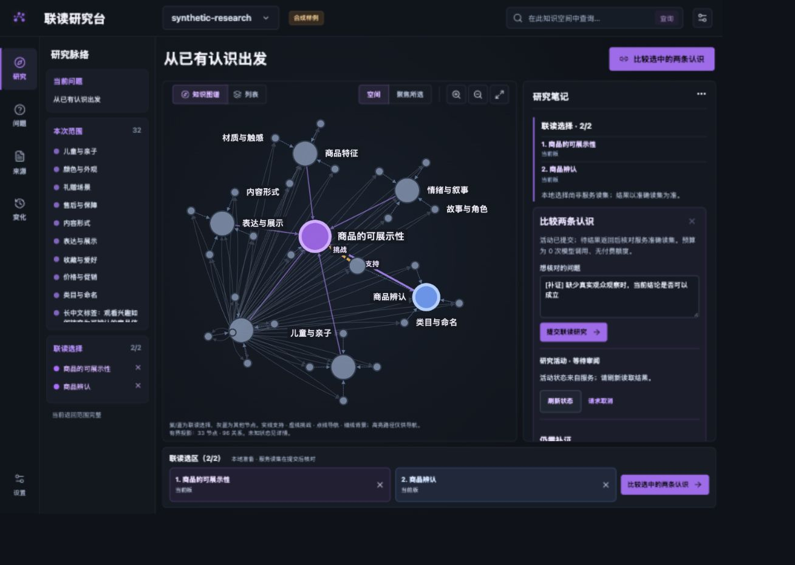
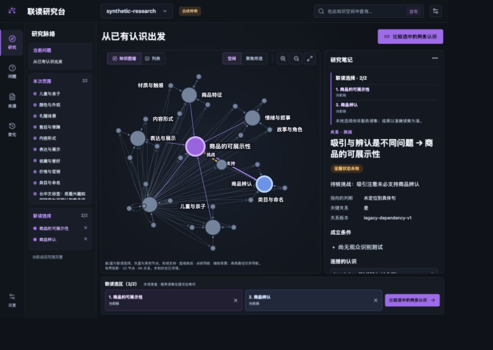
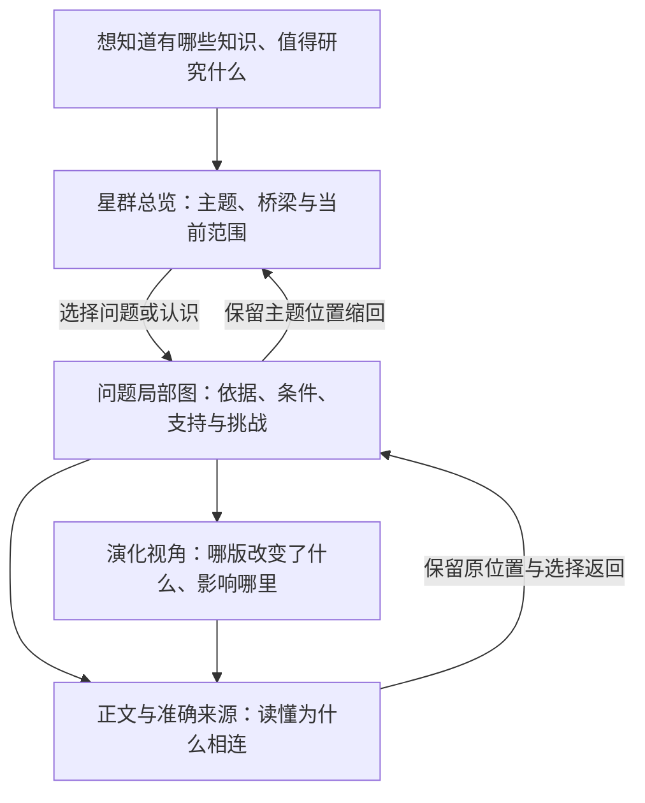

# 认知星图与 3D 空间设计提案

2026-10-31 · 用户认可第二张联读工作台方向，但指出实际星图仍明显弱于对标，并要求重新思考 3D 如何表达知识网络。本文是设计提案，尚未成为已确认的空间映射，也未实施 3D。此前本地设计自检通过说明布局与若干流程可操作，不能视为用户已认可星图品质。

星图要让读者找到值得联读的认识、解释关系及其依据、发现分歧，并看见下一轮研究怎样继承或改变已有认识。视觉品质要用这些任务和画面的清晰程度共同判断。整体保留黑色联读工作台；星图内部需要重新设计。

## 当前差距有两类来源

本轮实际查看现有页面，适配总览并打开挑战关系详情；另经公开客户端读取当前隔离演示实例，不修改业务资料。结果只描述这批合成资料：

| 当前事实 | 对画面和理解的影响 |
| --- | --- |
| 32条认识、1个外部来源、96条返回关系 | 节点数和边数本身不能说明认知结构丰富 |
| 64条关系连接同一个来源；按无向端点及stance计只有64组关系 | 共享来源形成扇形线束；应检查哪些记录可在展示时合并，并保留展开后的方向及原记录，不能删除底层关系 |
| 所有认识共享一个来源组，31条concept、1条synthesis | 不足以验证多主题群落、独立证据、跨群桥梁和多轮演化 |
| 96条关系的依据状态均为unknown，命题锚点均缺失 | 不能用前端光效、布局或模型补词伪造更精确的推导 |
| 全局用ELK force、聚焦用radial；中心主要由连接数选出 | 排点尚未解释主题、问题或形成认识的来路 |
| 当前有界图请求至多200节点，现有全局调用取110节点 | 不能把局部投影称为完整知识宇宙；大规模总览需要有权限与范围约束的聚合能力 |

以上同时涉及样例、呈现和合同能力。单源合成数据的扇出不能证明真实知识库也有相同问题；一批只适合验证准确读取的软件夹具，也不宜承担视觉上限和认知价值验收。

### 本轮实际画面

1. **适配总览：操作可用，空间组织不足。** 共享来源的扇出和一般导航占据大量连线，缺少具名群落与逐层展开。

2. **挑战详情：正确显示未知，论证仍不完整。** 右侧明确显示依据状态未知、未定位具体句。新的空间表达需要保留这种缺口。

计数见[本轮合成图统计](../../assets/knowledge-graph-space-20261031/current-graph-metrics.json)。本轮未做完整可访问性或真人理解审计，参考旧录屏只用于研究。

## 对标中应继承什么

[Nowledge Mem官方说明](https://mem.nowledge.co/zh/docs/knowledge-graph)将社群、局部探索、版本链和3D地形作为不同视角。本项目此前保留的无声录屏可见：旋转改变空间感，右侧解释保持可读，Terrain切换会明确说明高度含义；这些画面不能证明其指标计算或后台推理正确。

[nashsu/llm_wiki](https://github.com/nashsu/llm_wiki)的固定源码参考显示显式页面链接、相关性权重、坐标缓存与悬停邻域弱化；其截图也存在长标签拥挤。可以分别学习空间稳定性、清楚的群落、局部强调和阅读联动，不将对方截图或宣传作为全面质量证明。

## 同一知识网络，三种阅读视角

视角改变显示范围、布局和强调方式；知识身份、准确版本及服务裁定保持一致。主题聚合是可展开的投影，可以重叠，不创造一套强制知识目录或晋级阶梯。

| 视角 | 需要帮助读者理解 | 建议的空间语法 |
| --- | --- | --- |
| 星群总览 | 哪些议题相互联系，桥梁在哪里，还有哪些未加载 | 先显示少量具名群落、代表认识与跨群联系；进入后逐步展开。3D用于环绕观察不同群与桥，不要求所有边常亮 |
| 问题局部图 | A/B怎样参与C，D挑战了什么，来源是否独立 | 把选中关系展开为清楚、接近平面的阅读构图；方向和短语义可读，原依据按需展开。右侧提供完整条件、理由和缺口 |
| 认知演化 | C1到C2为什么变，谁仍依赖旧版 | 以准确版本、明确时间和变化记录对照；可用时间切片或剖面，选择后仍能打开正文与依据 |

例如，在总览中发现两个议题通过C相连，进入局部后读到C继承的准确A/B，以及D提出的特定反例。若C只是候选，界面显示候选身份；只有取得对应继承关系或研究记录时才解释其来路。若只是图上可达，应称为导航路径。新研究没有变化也应能结束，不能为了让星图长大而制造新认识。

## 3D 的第三维必须有口径

建议先把主题结构放在相对稳定的平面，用有限深度和可控旋转帮助分离遮挡；再验证具有明确含义的高度视角。不要直接把每个点变成大球体，也不按星系物理隐喻制造公转、中心权威或因果关系。

| 编码 | 建议 | 必须防止的误解 |
| --- | --- | --- |
| X/Y与群落 | 使用可说明方法、版本和当前范围的关联投影；保留稳定锚点与跨群成员 | 靠近只表示该投影的相近，不能证明支持、同源或因果 |
| Z高度 | 每次只选一种含义。首先验证明确时间的演化视角；若使用依赖深度，须基于已确认关系、处理环路并标明未知 | 更高不等于更可信、更新不等于更正确；不同指标不能混在同一高度里 |
| 颜色与形状 | 图例中明确当前按主题、身份还是选择着色；来源、认识、问题/候选可辨 | 不能同时用紫色代表社群、选择和可信程度而不解释 |
| 大小与亮度 | 有限尺寸；当前问题的焦点最清楚，其他点克制；若大小映射连接数，标出范围 | 连接多或更亮不能被读成知识更真、更重要 |
| 线与路径 | 默认收起无关边，仅展开当前问题必要关系；可视合并仍能查到每条原记录 | 导航路径、同源联系、论证支持和真实研究读取路径分别呈现 |

认知形态优先以明确标签和形状表达，不能自动安排为“资料低、综合高”的价值等级。时间也要区分创建、发表与来源发生时间；缺失不填零。候选、过时版本和不可读资料不能只靠透明度隐藏。

## 让空间真正可读的交互

远景显示具名群落和桥梁，中景显示当前群的关键认识，近景显示选中认识、短关系标签和来源入口。标签面向屏幕、避免互遮；不要让所有节点都挂长标题。原文和精确条件继续放在笔记、正文和来源视图。

选中节点时让相邻结构逐步显现；进入局部时相机平稳移动，返回时保留方向和位置。整体布局应可缓存，增量内容只影响必要邻域。用户可以暂停运动、一键回到选中项、重置方向，并切到2D或列表完成同一任务。3D可用鼠标、键盘和触屏操作；避免自动持续旋转和过度光晕。

共同来源特别多时，总览可显示来源组及成员数，打开C的依据时再展开准确来源与引用位置。合并只发生在展示层，并说明折叠了什么；不同关系版本、方向、条件或用途不能被无声抹平。

## 下一轮验证怎么做

1. **先建立有代表性的同一批知识。** 包含多个相互联系的主题、共享与独立来源、已定位的支持/挑战、候选和至少一次有理由的修订。真实主题优先；工程夹具要显式标注合成，不能用其代替语义验收。
2. **先做好稳定的空间骨架。** 验证聚合、跨群桥梁、边的分层、来源收束和局部展开。在相同数据上比较当前2D与改进布局，避免仅靠换样例显得更好。
3. **再对照2D/3D。** 共享同一有界投影、选择和阅读状态，检查旋转是否真的帮助区分结构。渲染器选型另做小样；当前不预先宣告换某个库就能解决问题。
4. **用读者任务决定是否推进。** 找到一个跨主题联系；解释C的A/B依据及D的挑战；指出共享来源与独立支持；说清C的候选/正式状态；从来源和历史返回时不迷路。记录完成情况、错误解释、耗时和操作，而非只问画面是否漂亮。

大规模总览还需设计经过当前身份、用途和范围裁定的聚合及按需加载，不能把全部知识先下载再在前端隐藏；缺失的社区、聚合计数或历史图能力应明确列为待实现。现有合同只有四类stance，新增空间层不自动授予新的权威关系。各阶段保留工程、视觉、认知和真人验收的区别。

## 2026-11-01 技术路线建议

用户认可上述认知与空间方向，并要求继续遵循Product Design构建，同时询问是否需要更合适的3D技术栈。建议保留现有React19、TypeScript、Vite、公开client/contracts及阅读研究流程，新增独立3D渲染模块。视觉方向先生成三张设计稿，选择后再实施；本节是选型建议，不表示依赖已经安装或3D已经运行。

| 层 | 建议与边界 |
| --- | --- |
| 工作台与内容 | 继续现有React应用，正文、来源、权限、候选审阅使用原公共合同 |
| 3D呈现 | 倾向Three.js与React Three Fiber稳定v9，定制群落、镜头、局部推理与时间剖面；与React19配套 |
| 2D与无障碍入口 | 保留现有Cytoscape局部图及列表，和3D共享准确引用、选择、焦点及当前范围，不维护平行知识真相 |
| 布局与图分析 | 与渲染独立，按需在Worker计算；社区、位置稳定、聚合与来源收束需要同数据验证。不能让默认物理模拟决定知识语义 |
| 图形后端 | 首版采用WebGL2兼容基线；WebGPU作为后续可选优化。当前R3F v10官方标为alpha，不作为首版前提 |

react-force-graph-3d可作快速小样，官方支持自定义Three对象、镜头和布局控制；不是能力不足。倾向R3F是本项目对多视角、标签及过渡可控性的适配判断，不是未经测量的性能结论。正式锁定前需验证实际设备、中文标签、选中拾取、相机返回与代表性图规模。

官方依据：[R3F简介与React版本配对](https://r3f.docs.pmnd.rs/getting-started/introduction)、[R3F性能指南](https://r3f.docs.pmnd.rs/advanced/scaling-performance)、[React Force Graph](https://github.com/vasturiano/react-force-graph)、[Three.js WebGPU渲染器及回退说明](https://threejs.org/docs/pages/WebGPURenderer.html)。3D引擎负责画面，知识关系质量、聚合查询和稳定空间仍需分别设计。

## 三个方向的统一推进

2026-11-01 用户喜欢三个方向，并要求结合知识库架构定义和实现产品。三个方向现统一为星群总览、问题局部和认知演化；不再要求从中只保留一个。产品定义、公开能力缺口及分阶段实现以[统一工作台实施方案](workbench-plan.md)展开，长期职责仍归架构篇。
