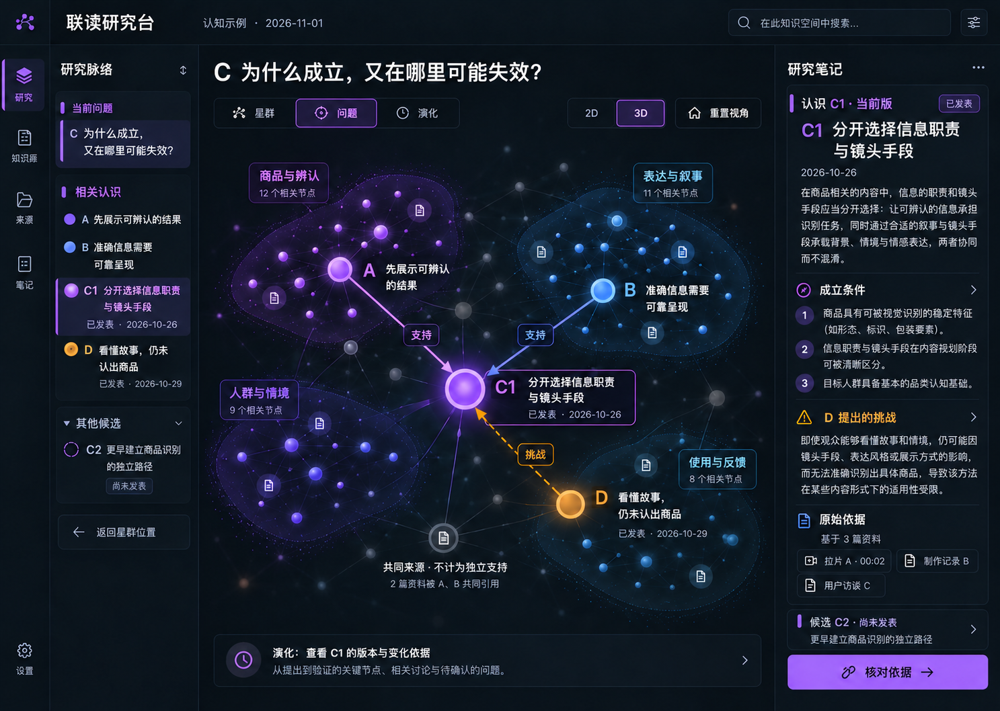
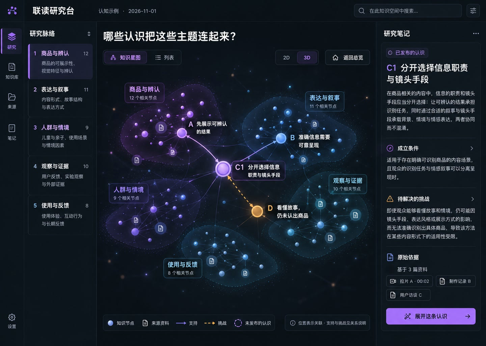
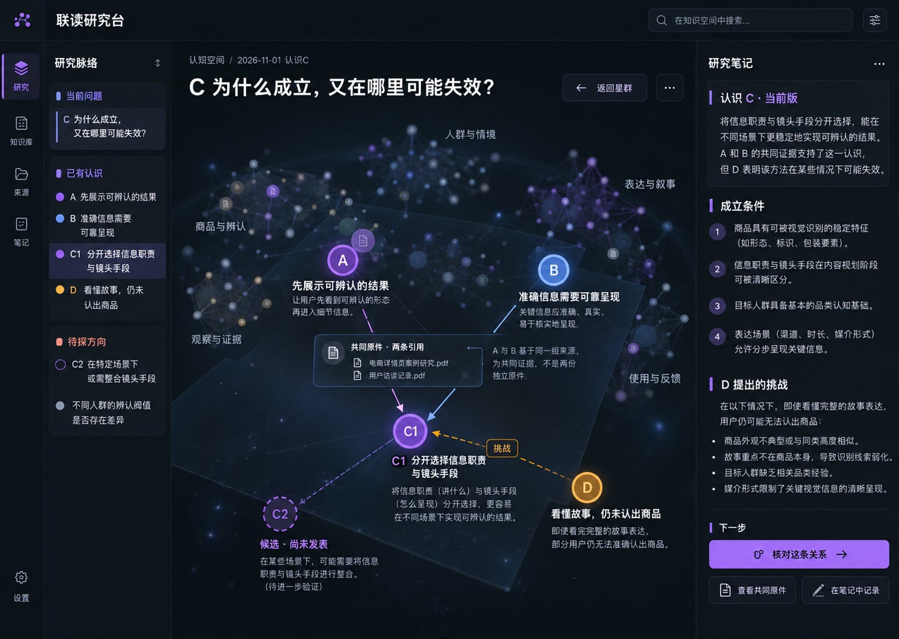
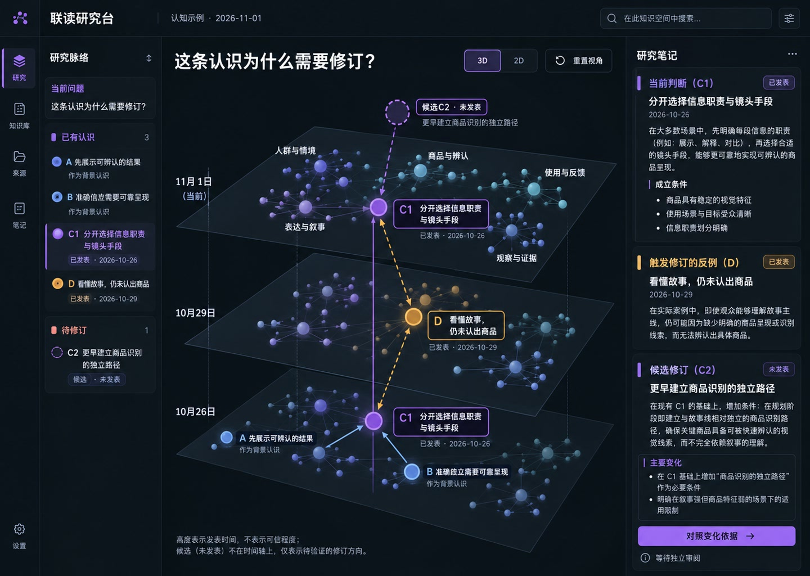

# 2.5D 实验原型与 2D/3D 对照：Claude 交接

2026-11-02 · **状态：实验范围已获 Lead 确认，等待实现。** 这是一份可独立执行的交接，不依赖本机临时服务、聊天历史、令牌或未提交文件。

## 1. 决策与边界

用户在看完当前实现与目标设计图后，提出增加一个 2.5D 版本并标记为实验，再比较美观和实际使用价值。Lead 的结论是：

- 只实现一个默认关闭、可明确识别的“实验 · 2.5D”入口。关闭实验开关时必须完全不渲染该入口或实验标签；“默认仍选 3D”不能代替关闭。
- 现有默认 3D、2D 和列表路径保持不变，2.5D 可以在验收后被撤下、替换或继续保留。
- 2.5D 是同一知识投影的另一种图形方式；“星群 / 问题 / 演化”仍然是任务视角。
- 先以真实数据、可操作性和理解效果判定，再决定是否把它提升为默认方式。
- 不得新增虚构知识节点、关系、来源、群落或时间。

本任务的仓库问题跟踪 Issue 创建后应链接回本文件。Issue 只负责问题跟踪；实现状态仍以 PR、代码、测试和验收记录为准。

- 工作 Issue：[cyl19970726/knowledge#6](https://github.com/cyl19970726/knowledge/issues/6)

## 2. 固定起点

- 仓库：`cyl19970726/knowledge`
- 工作台实现基线：`48b74a6e7e0b35c678ea27ef38752c7f8f0a9530`
- 交接文档与参考资产合入后的主线：`321a26b8a549e36f08a238c656078a8fa1762c3e`
- 最低可用交接提交：`321a26b8a549e36f08a238c656078a8fa1762c3e`
- 实现者必须从包含本次目标图修正的最新 `origin/main` 新建分支，并记录实际起始 SHA
- 已合并基实现：[PR #5](https://github.com/cyl19970726/knowledge/pull/5)
- 已合并交接资产：[PR #7](https://github.com/cyl19970726/knowledge/pull/7)
- 建议新分支：`codex/knowledge-2p5d-experiment-<YYYYMMDD>`
- Node 版本：`24.x`，以仓库 `.node-version` 为准
- 当前 R1 量化复核：`85.5/100`，十维均不低于 3
- 当前 R1 状态：实现已合并，但 macOS 系统级减少动态未实测、用户最终视觉未签收，因此不能写成 `passed_local` 或 `passed`

开始实现前先读取：

1. [产品与交互](../experience.md)
2. [深色界面与星图语法](../design-system.md)
3. [认知星图与空间提案](../graph-space.md)
4. [统一认知工作台定义与实施](../workbench-plan.md)
5. [视觉重构 R1 验收标准](../visual-acceptance-r1.md)
6. [R1 本地实现与复验](../../evidence/r1-graph-first-20261101.md)
7. 根目录 `AGENTS.md` 与 `apps/knowledge-web/README.md`

## 3. 目标参考与优先级

参考图用于视觉方向和比例判断，不是知识数据，也不是运行时截图。

1. **当前综合校正目标**

   

   原字节 SHA-256：`80b87ab9fe72414faeb46ea45298f34122eac5f1a4bebd49b6de66f227774133`。

   `selected-reference.png` 是 2026-10-30 的早期选稿，只保留为历史，不作为最高优先级目标。

2. **星群目标**

   

3. **问题目标**

   

4. **演化目标**

   

资产来源、SHA-256、尺寸、用途和限制见[reference manifest](../../../assets/knowledge-workbench/references/manifest.json)。目标图中示例性的 50 个节点、五类群落和具体关系只解释视觉格式，不能成为 fixture。

与当前实现的同尺寸对照：

- [星群当前实现与目标](../../../assets/knowledge-workbench/r1/star-comparison.jpg)
- [问题当前实现与目标](../../../assets/knowledge-workbench/r1/question-comparison.jpg)
- [演化当前实现与目标](../../../assets/knowledge-workbench/r1/evolution-comparison.jpg)

## 4. 当前实现

当前 Web 应用的图形方式状态为：

```text
2d | 3d | list
```

默认值是 `3d`。主要入口：

- `apps/knowledge-web/src/App.tsx`：`exploreView`、视角切换、选择、联读和渲染分支
- `apps/knowledge-web/src/graph/GraphCanvas.tsx`：Cytoscape 2D
- `apps/knowledge-web/src/graph3d/KnowledgeGraph3D.tsx`：React Three Fiber 3D
- `apps/knowledge-web/src/graph3d/layout.ts`：由真实返回图生成群落、位置、桥梁和问题平面
- `apps/knowledge-web/src/graph/view-model.ts`：公开返回数据到视图模型的转换
- `apps/knowledge-web/src/styles.css`：工作台、图谱、标签、响应式与减少动态
- `apps/knowledge-web/test/`：布局、来源、桥梁、问题平面、响应式和交互回归

2.5D 需要复用这些输入与回调，不应复制一套独立知识状态：

- `GraphViewModel` 中的真实节点、关系、来源和 availability
- 当前 `selectedNodeId`、`selectedEdgeId` 和联读准确引用
- `relation.stance` 与 `relation.evidenceStatus`
- 当前 scope、purpose、研究笔记和来源返回位置
- `onNode`、`onEdge`、`resetSignal`、`zoomRequest`

## 5. 数据与语义不变量

当前隔离 fixture 为：

- 47 个节点
- 43 条认识
- 4 个可读来源
- 138 条关系
- 7 条跨群关系，其中 3 条支持、1 条挑战、3 条导航
- 4 条跨群支持/挑战判断桥
- 1 个对象有 2 个已发表版本

实现必须保持：

- 图形位置、尺度和光晕只表达视觉重心，不能暗示未经记录的支持、可信度或全库覆盖。
- 群落是当前有界投影的视觉分组，不等同于真实社区、主题全集或作者身份。
- 支持、挑战、背景、导航和依据状态仍以准确关系记录为准。
- 来源必须有独立形状和可返回的准确版本；来源数量不等于独立证据数量。
- 候选认识不能进入已发表版本线。
- API 没有图级 `asOf`/cursor 时，不制造整网历史快照。
- 新增背景星尘、云层和装饰粒子必须不可点击、无知识标签，并在说明中注明不是节点或关系。
- 所有目标图数据只用于视觉参考，不从图片 OCR 或手抄生成“事实”。

## 6. 最小实现范围

1. 将 `exploreView` 扩展为 `2d | 2p5d | 3d | list`。
2. 在图形方式选择器加入显式“实验 2.5D”标签，并通过 `aria-pressed`、焦点样式和帮助文字表达实验状态。
3. 新增独立组件，建议路径 `apps/knowledge-web/src/graph25d/KnowledgeGraph25D.tsx`。
4. 复用 `GraphViewModel`，并优先复用 `constellationLayout()` 的真实分组和节点身份；可以为 2.5D 增加纯视觉投影，但不得重算另一套关系语义。
5. 实现相同节点/关系选择、联读高亮、缩放、适配、重置、键盘可达列表和错误回退。
6. 保持演化视角与版本比较的现有语义；2.5D 切换只作用于适用于星图的任务视角。
7. 保持列表作为无 WebGL/标签拥挤时的人工降级路径。
8. 默认值继续为 `3d`，直到用户明确选择新的默认；实验开关关闭时不显示 2.5D 入口。

推荐的表现方向：

- 使用确定性的 2.5D 投影，不依赖随机位置。
- 群落用柔和径向场和轻微透视分层，透视只制造纵深，不改变 topology。
- 主判断节点具有清晰亮芯、色晕和大小层级；来源继续使用文档形状。
- 支持与挑战保持颜色和线型双重编码；背景与导航降低权重。
- 标签使用 DOM 叠加或独立布局，避免 WebGL 内文字模糊；标签碰撞必须可测。
- 可以用程序纹理或一个尺寸受控的生成式星云纹理；不得把目标图整张烘焙成不可交互背景。

## 7. 对照方法与验收

所有模式使用同一 fixture、同一 scope/purpose、同一选中对象、同一状态、同一构建和同一 CSS 视口。

视口：

- 1440×1024
- 1024×768
- 391×844

任务：

| 任务 | 必须回答的问题 |
| --- | --- |
| 焦点定位 | 3 秒内能否找到当前认识及其直接支持、挑战？ |
| 关系辨识 | 能否区分支持、挑战、背景、导航与依据未知？ |
| 来源回查 | 能否从来源进入准确正文/定位并返回原选择？ |
| 跨群联系 | 能否看清当前认识的跨群支持桥与挑战桥？ |
| 联读 | 两条准确版本的选择、联读路径和已满状态是否不丢失？ |
| 手机 | 391px 是否仍可读；必要时列表是否比图形更合适？ |
| 键盘/减少动态 | 是否无需指针可达？媒体仿真下是否立即呈现最终状态？ |

视觉证据：

- 在同尺寸下分别截取 2D、2.5D、3D 的星群和问题状态。
- 必须同时检查原始目标图与同尺寸实际截图；现成 comparison 可以作为索引，不能代替原图和实拍。
- 生成同对象、同缩放、同选择的三模式并排对照。
- 记录标签数、框交叠、关键安全区、页面横向溢出和画布可读尺度。
- 分别给出优点、失败任务和“不适合使用 2.5D”的条件。

性能证据：

- 记录冷启动和预热后的有效样本数、中位数、p95、最大值。
- 覆盖 47/138 和 200/500。
- 至少做 12 次三视角切换、10 次图形方式切换和 5 次 3D/2.5D 卸载重挂。
- 记录 WebGL context loss、应用 error、首帧时间和资源清理。
- 前台聚焦结果与后台节流结果分开，不能只保留最快样本。

最终建议必须同时回答：

- 哪种方式更接近目标图的视觉语言？
- 哪种方式更能帮助普通读者理解当前认识、来路、反例与来源？
- 哪种方式在手机、大图、键盘和低动态偏好下更可靠？
- 如果没有明确收益，2.5D 应继续实验、降级为可选或删除。

## 8. 本地复现

使用仓库公开说明，不提交连接文件或令牌：

1. 按 `docs/knowledge/integration.md` 启动一次性合成演示数据库与 API。
2. `scripts/runtime/knowledge-workbench-fixture.ts` 创建隔离的 47/138 工作台 fixture。
3. 按 `apps/knowledge-web/README.md` 启动对应 Web 应用。
4. 通过连接对话框输入本地项目、空间和令牌；令牌不写入 URL、代码、截图或 Git。
5. 构建、测试和文档检查：

```sh
npm test
npm run build
make docs
make docs-check
git diff --check
```

数据库集成测试缺少专用 `TEST_DATABASE_URL` 时必须如实报告为跳过，不能改写为全部通过。

## 9. 资产与截图规范

新增实验截图放在：

```text
docs/assets/knowledge-workbench/experiments/2p5d/<YYYYMMDD>/
```

建议命名：

```text
overview-1440x1024-2p5d-actual.webp
overview-1440x1024-three-mode-comparison.jpg
question-390x844-2p5d-actual.webp
motion-sequence.jpg
manifest.json
```

每批至少记录：

- 类型：`browser_capture`、`comparison` 或 `browser_emulation`
- 来源与生成方式
- Git baseline SHA
- SHA-256
- fixture 摘要
- 准确 CSS 视口、设备像素比和缩放
- 截图状态与已知限制

仓库只保留精选图和复现记录。大视频、原始逐帧、完整 trace 和草稿放 `local/`。浏览器媒体仿真必须标记为 `browser_emulation`，不能冒充 macOS 系统级减少动态验收。

## 10. Claude 要求

实现前必须使用或遵循：

- Product Design `index`，用于确认设计审查流程与证据边界。
- Product Design `image-to-code`，用于把目标图映射为受控视觉语言。
- Product Design `design-qa` 及项目现有 `design-qa.md` 中的同框源图/实拍检查为必须步骤；环境只能发现 `audit` 时也必须使用它补充，不能用 audit 替代 design QA。
- `reader-centered-docs`，用于更新唯一产品/前端说明和交接，不制造第二套规格。
- `unknowns-to-gates`，用于在动工前列出数据、视觉、性能和授权未知。

技能必须按当前 Claude/Codex 环境的实际可用路径发现。未经用户明确授权，不得把项目专用 skill 安装到全局目录。

## 11. 交付物与结束条件

必须交付：

- 可关闭的实验入口与 2.5D 组件
- 同一真实数据下的互动选择、联读、来源和返回
- 三视口、三模式截图和结构化对照报告
- 47/138 与 200/500 性能证据
- 测试、构建、文档和差异检查
- 独立视觉/交互复核
- 一个可审查 PR，明确标注实验，不自动改为默认视图

完成不等于“看起来像目标图”。只有真实任务可用、语义不漂移、失败边界可见，并且用户明确选择是否采用后，2.5D 才能从实验进入正式路径。

## 12. 可直接交给 Claude 的任务描述

```text
先 `git fetch origin`，从包含本文件的当前 `origin/main` 创建工作分支。
工作台实现基线为 48b74a6e7e0b35c678ea27ef38752c7f8f0a9530；
交接文档和参考资产由 PR #7 合入（编写时 merge commit 为
321a26b8a549e36f08a238c656078a8fa1762c3e）。不要从旧的实现基线
检出后误以为交接文件缺失。

阅读 docs/knowledge/frontend/handoffs/2p5d-experiment-20261102.md 及其链接。

目标是新增一个默认关闭的“实验 · 2.5D”图形方式。关闭实验时不渲染入口或实验
标签；不能只靠默认选择 3D 代替。它与现有 2D、3D、列表共享
完全相同的 GraphViewModel、真实节点/关系/来源、选择、联读、scope/purpose
和研究笔记。用受控的 2.5D 投影接近 references/ 中的视觉语言，但不得从参考图
复制或推断知识数据。默认视图保持 3D，先提交可撤回的实验 PR。

完成同一 fixture 的 1440×1024、1024×768、391×844 三模式截图，执行焦点、
A/B/C/D、关系类型、来源返回、跨群桥梁、联读、手机列表、键盘和减少动态对照；
记录 47/138 与 200/500 的冷启动、稳定帧、卸载重挂和错误。最后按视觉质量、
任务理解、手机/键盘可用性和性能明确推荐采用、继续实验或删除。

不要连接业务数据库，不写入真实知识，不提交凭据，不推送未经要求的部署，
不新增虚构节点或关系，不自动改变默认视图。
```
