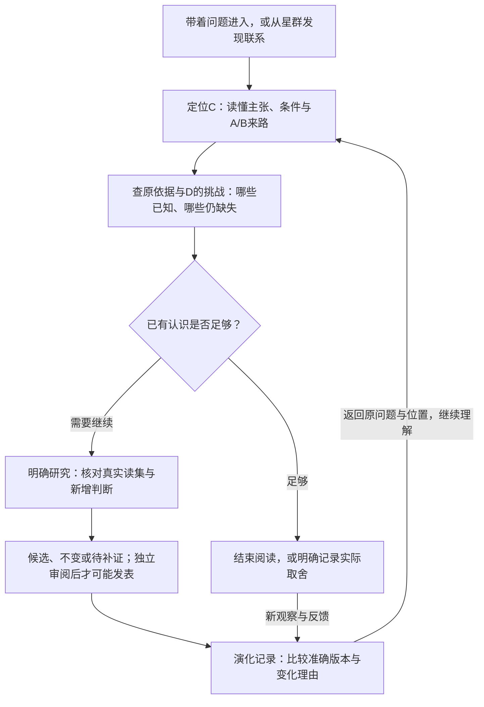
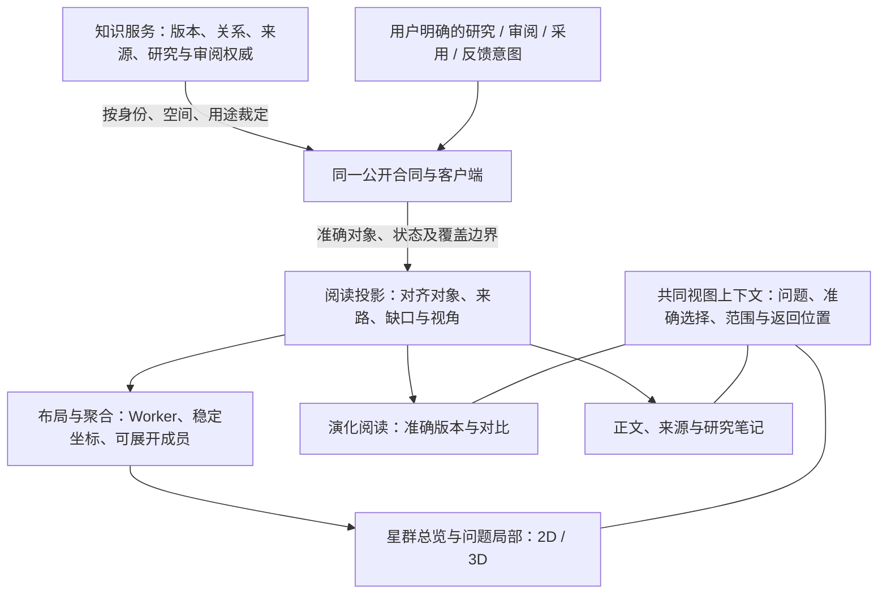

# 统一认知工作台：产品定义与实施顺序

2026-11-01 · 用户认为三张视觉稿都值得保留：星群与问题图有好的阅读体验，时间图增加了演化维度。本轮将它们组织为同一产品的三个视角。本文展开本轮实现方案；长期价值与连续场景仍由[产品篇](../product.md)维护，职责和权威由[架构篇](../architecture.md)维护。图稿是设计示例，不代表当前接口或真实研究已具备全部能力。

## 产品定义：让已有认识参与下一次判断

知识库是能够形成、保留、联读、检验和修订认识的独立知识产品；**认知工作台是人和 Agent 阅读、研究与维护这张知识网络的共同界面。** 一条认识除了正文，还保留成立条件、反例、依据、准确版本以及研究和使用经历。业务系统继续拥有原件、外部任务和行动，知识核心维护访问、版本、审阅与发表。

读者应能完成三件事：找到值得继续理解的内容；解释一个判断为何成立或存疑；把新的问题和反馈带入下一轮，并知道正式知识究竟有没有改变。全局星图提供空间线索，完整解释仍依靠正文、原依据和准确记录。阅读可以直接结束，采用与研究都是明确动作。

## 三张图是三个互相返回的视角

| 视角 | 读者的问题 | 显示与操作 | 保留的上下文 |
| --- | --- | --- | --- |
| 星群总览 | 有哪些相关主题，哪里有跨主题联系或空白？ | 有范围的群落、代表认识与桥梁；逐层展开并进入问题 | 当前知识空间、用途、主题、选择与总览位置 |
| 问题局部 | C说什么，A/B怎样参与它，D挑战了哪里？ | 可读局部关系、完整正文、条件和来源；联读与明确发起研究 | 准确引用、版本、问题、范围及正文/来源返回位置 |
| 认知演化 | 当时和现在有什么不同，为什么变，影响了谁？ | 先做单对象版本线与差异；后续才做全图历史切片 | 比较对象、版本、事件时间和返回原问题的位置 |

有明确问题时直接进入局部；没有明确目标时从总览发现。时间是按需展开的阅读维度，不把三个复杂场景同时铺满首屏。2D、3D和列表均使用同一知识身份与服务裁定，用户改变视角不会另生成一份认识。

## 以同一个连续例子检验实现

A解释“先展示可辨认结果”，B解释“准确信息需要可靠呈现”；C1在给定条件下综合为“分开选择信息职责与镜头手段”。总览将C1显示为两个议题之间的联系，局部图展示准确A/B及其条件。资料若共享原件，展开时明确是一组来源，不能画成独立支持数量。

新观察D指出“看懂故事但未认出商品”。先定位它挑战的具体条件和实际观察范围，再判断提出C2、保留C1并限制用途，或继续补证。C2在独立审阅和发表前保留候选身份。即使研究读过A/B/D，也不能自动断言三者分别支持C2的每一句话。

时间阅读先并列读取C1的准确版本和C2的受权候选正文，解释新增条件及理由。现有compare仅用于两个已发表准确版本；候选比较属于明确标注的预览，不将未发表C2当成正式版本传入compare。字段差异本身也不证明变化原因，原因须回到研究或审阅记录。若把多个时点画成层，层表示观察时点，节点另列自己的发表时间；同一个C1出现在两层只说明它在两个快照中存在，不是发表了两次。候选没有正式发表时间，不落在正式版本的发表轴上。

换成普通文档时，A可以是带地区与版本的规则说明，B是一次材料退回的实践记录；C解释资格与材料合格的不同前提，D是后续格式变化。工作台仍沿准确正文、来源与版本运行，不要求文档业务继承电商分类。以上均为说明场景，真实内容和效果另行验证。

## 现有能力怎样映射到产品

| 产品需要 | 当前公开能力 | 第一版与后续边界 |
| --- | --- | --- |
| 准确认识与原依据阅读 | 查询、准确读取、条件/反例/未知、引用、来源记录及内容读取 | 直接复用；图上出现来源或元数据不表示本轮已读原文 |
| 局部关系 | 有界GraphResult及四类stance、理由和条件 | 先保持准确范围；缺少命题锚点时显示缺口。关系解释更精确需要改进公开投影 |
| 主题群落与大图总览 | 当前图至多200节点，无公共社区摘要与聚合投影，graph cursor明确不支持 | 初版只能称当前有界范围的分组；全域总览需服务端受权聚合与展开能力 |
| 联读研究与候选 | 研究结果包含准确读集、继承依据、缺口；候选有准确身份、正文及审阅状态 | 复用现有服务；候选逐项推导边不足时只显示可核对的研究来路，不补造支持边 |
| 时间与变化 | 单对象history、准确compare，及受作用域约束的changes | 先做两个已知版本的阅读比较。全图asOf被明确拒绝；当前changes来自受作用域约束的使用/反馈事件，不能当作全库知识发表流 |
| 动态研究路径与回放 | 操作状态和研究结果可查 | 工具逐步遍历的完整画布事件尚未成为现有公开能力；不可用装饰动画冒充执行轨迹 |
| 跨项目界面复用 | client/contracts可用，尚无公开UI包 | 先形成清楚内部边界；以真实第二宿主验证后稳定组件出口 |

一个重要限制来自实现而非资料本身：`legacy-dependency-v1`关系投影当前统一返回`evidenceStatus: unknown`、`targetStatementAnchor: null`，部分stance由依赖角色和critical标志映射。不能据此推断所有真实知识没有依据，也不能把兼容映射当成经过精确命题审阅的支持。应在同一公开合同下逐步改善关系来路、语义与定位，保留版本和兼容解释。

开发核对入口为 `packages/knowledge-contracts/src/index.ts` 的Graph、ResearchResult、CandidateView和History/Compare合同，以及 `packages/knowledge-application/src/index.ts` 的graph/history/compare实现。持久存储有某类信息，不等于前端的受权公开接口已经能取得或完整解释它。

## 架构：权威知识、可解释投影与表现分开

箭头表示数据和操作职责。阅读投影是服务结果的派生表达，不创建另一套公开知识模型；布局、社群和候选叠层不具有发表权。公共类型继续来自contracts，表现层只附加群落、坐标、折叠状态等派生信息。

共同上下文至少对齐当前空间与用途、问题、准确选区、读取范围、焦点版本及各视角的相机/阅读位置。研究提交冻结当次输入；之后移动画布不会改变已提交读集。布局缓存按范围、权限和数据/算法版本隔离，撤权后重新取得允许范围，不能因缓存泄露其他空间或已经不可读的内容。

表现层建议新增Three.js/R3F v9并以WebGL2为基线，复用React19、TypeScript、Vite；现有2D和列表继续承担准确阅读入口。静止时按需绘制、节点批量绘制、标签分级和按需加载需要实测。布局与镜头的改动不触及知识发表事务。技术依据见[星图空间提案](graph-space.md#2026-11-01-技术路线建议)。

## 按可交付的纵向功能推进

| 阶段 | 做成什么 | 可以如何检查 |
| --- | --- | --- |
| 1：共同场景与语义基线 | 同一批有明确来路的多主题样例，包含共享来源、支持/挑战、候选与一次修订；核对现有关系映射 | 能逐项对照C、A/B、D及准确来源。真实资料与合成例子分开，不通过换数据掩盖布局差距 |
| 2：可操作的局部认知阅读 | 统一三个视角的选择与返回；问题局部、3D总览的有界原型、准确正文/来源、单对象版本线 | 同数据切换2D/3D/列表不丢版本或范围；读者能查明来路并返回。此时不宣称全库社区或完整历史切片 |
| 3：让总览与演化由服务支撑 | 改善语义关系投影；补受权社区聚合/展开、稳定布局输入；需要全图时间切片时再设计历史投影 | 大小范围和遗漏可见，权限前后一致；以原始版本/发表记录核对每个时点，候选不混入正式快照 |
| 4：真实主题与第二宿主 | 用真实任务验证理解和研究增量；明确宿主client、路由、样式、Worker及生命周期合同，再稳定UI出口 | 独立工作台与第二宿主完成同一阅读任务，错误解释、权限与返回行为有证据 |

第一版以“从C读懂A/B和D，查原文，再比较准确版本并回到原位置”为验收主线。全图聚合和历史投影可逐项补齐，避免等待所有后端能力完成后才交付第一个可用阅读流程。

验收分开记录：工程正确性；实际画面的阅读、遮挡和空间稳定；未参与设计者的理解任务；真实研究的增量与合理停止。性能记录目标设备、图规模、可见标签、帧时延与拾取延迟；合成渲染压力不能当作服务支持同等规模或真人认知有效的证明。

## 本轮落地范围

本轮先形成统一产品方案与校正后的综合视觉目标，随后在独立工作树接入R3F/Three.js第一版、三视角入口和单条版本阅读。构建和39项Web测试通过，浏览器观察到真实WebGL2创建；实际画面尚明显弱于设计目标，视觉QA仍blocked。用户要求由独立实施会话接手完整任务，尽可能一比一还原综合图与对应视角。没有实现整网历史或社区聚合新接口，没有提交、部署、采集或调用真实模型研究。后续实现沿用[设计系统](design-system.md)、[嵌入边界](embedding.md)与现有工作树保全约定；新增公开能力需要同步合同和消费者验证。

### 2026-11-01 接续实施与实际画面

同一隔离合成服务返回47节点、138关系。工作台现在默认进入问题3D，星群、问题、演化共用准确选择；星群按当前返回的真实连接分组，采用不规则群岛、代表节点和有界边，明确显示90条未画出关系。问题局部放大焦点与入向支持、挑战，来源和其余关系保留在背景；右侧笔记优先摘要及相关关系。演化剖面仅取单对象已发表历史，使用准确版本比较；候选留在独立区域。浏览器中的星群节点→问题→正文→准确来源→返回，以及两版比较和返回均已实际走通。

三个视角的同尺寸浏览器复拍、参考图并排对照及手机画面存于工作树 `design-qa-shots/`，结论在根目录 `design-qa.md`。与目标图相比，当前分组规模和关系密度仍有明显差异，尤其星群缺少清楚的跨群叙事与完整来源分布；不能通过添加虚构边或把有界分组改称全库主题来填补。视觉QA继续为blocked。此轮仅做隔离合成环境的浏览器与工程验证，未验证真人理解、真实知识语义或生产性能。

### 2026-11-01 视觉密度与小动效增补

星群不再只画同一分组内部的关系：当前47节点、138关系全部进入总览，支持与挑战保持前景，背景与导航关系降为低权重纹理。选中群落不再重复显示群落总标签，改由当前认识及最多三条直接支持/挑战来路构成中心叙事；这项取舍让五个群落标签与真实局部网络同时可读。星点改为亮核、径向渐变 Sprite 光晕与聚焦环三层材质，群落采用紫、蓝、青、玫瑰和青绿的稳定色温，同一群落内按准确 ID 做轻微亮度变化；挑战仍单独使用琥珀。问题视角沿用同一材质，只突出焦点、两条支持、一条挑战和实际返回来源，其余真实关系留在背景。

演化视角增加轻微透视、按版本顺序的错峰入场和悬停/键盘聚焦层次。图谱放大、缩小与适配改为约340毫秒的相机缓动，用户开始拖拽时立即取消；系统要求减少动态效果时直接切换。动效只解释一次状态变化，不承担关系真伪、候选状态或版本可信度等语义。

本地1440×1024实拍确认星群显示“全部已画出”，问题视角显示55条前景/背景线及83条未画出的总览关系，演化读取两版已发表准确版本。截图见 `design-qa-shots/constellation-glow-comparison.jpg`、`question-glow-comparison.jpg` 与 `evolution-motion-comparison.jpg`。星群来源分布、参考图中的更完整跨群叙事及演化整网历史仍受真实接口覆盖限制，视觉QA继续为blocked。

### 2026-11-01 真实来源重心与跨群桥梁

当前公开投影能识别7条跨群知识关系：3条支持、1条挑战和3条导航。星群不补造“群落摘要”，而是在实际关系上提升4条跨群支持/挑战桥梁，并在群落标签中显示“支持桥/挑战桥”；底部范围说明给出总跨群数与判断桥梁数。导航桥梁继续使用原有线型，不升级成知识判断。

4个可读来源按当前关系落在各自主导群落附近。主导分数先按群落内唯一相邻认识聚合、同一端点只取最强 stance，再做全局比较；来源光晕和节点大小也使用唯一相邻对象数，不按关系记录数累加。这样既保留一个来源连接多个群落的真实跨群射线，也避免重复关系把某来源伪装成更大的“枢纽”。知识节点所属群落、唯一邻居权重和关系 ID 索引在布局阶段一次建立，来源定位、桥梁统计与详情入口复用这些索引；问题视角的背景边筛选也使用边 ID 集合，不按每个候选边重复扫描相邻关系。

总览在391×844下隐藏重复的支持/挑战来路胶囊，把所选认识压缩为可访问的“当前认识”短标记，并保留五个群落名、节点数及支持/挑战桥梁；问题视角仍显示两条支持、一条挑战和来源。页面 `scrollWidth=clientWidth=391`，没有页面级横向溢出。第二轮对照见 `design-qa-shots/round2-constellation-comparison.jpg`、`round2-question-comparison.jpg` 及两份 `round2-mobile-*391x844.jpg`。

这轮把缺失关系从“未绘制”推进到“全部真实关系可见并有跨群统计”，但仍没有服务端受权社区摘要、独立来源分布或命题锚点；演化也只有单对象历史。视觉 QA 继续保持 blocked，待真实主题任务和语义投影补齐后再判断能否通过。

### 下一轮验收入口

视觉重构 R1 已完成一轮实现与本地复验，但结论仍为 `blocked`。新的 Graph-first 页面把标题与视角切换并到一行，1440×1024下中央图面达到836.7×835.5px、右侧笔记292px；星群全部138条关系以主次层级出现，问题视角形成A/B→C←D且保留来源，演化在首屏显示两版已发表历史与比较。三层星点材质、跨群桥梁、标签引线、320ms视角相机过渡和拖拽中断均已接入。

稳定构建在三种目标视口无页面横向溢出；移动端星群4个、问题5个标签，最终标签框无交叠或安全区裁切。12次三视角切换、10次2D/3D/列表切换、准确来源返回、联读第三条限制和手机列表正文均实际通过。Web测试45/45、构建与差异检查通过；error级日志为0。

本轮仍不能通过：独立视觉复核低于85，系统级减少动态未运行，当前IAB与空页探针都约33.3ms/帧，无法验证R1的20ms帧间隔。当前可复用数据已能表达真实的两版历史、跨群挑战和来源阅读；下一轮应继续重构焦点邻域、主星连续发光质感与演化连续构图，而不是补造参考图节点或仅调高亮度。完整结论、任务和图片见[视觉重构R1本地复验](../evidence/r1-graph-first-20261101.md)与[结构化记录](../../assets/knowledge-workbench/visual-review-r1.json)。
