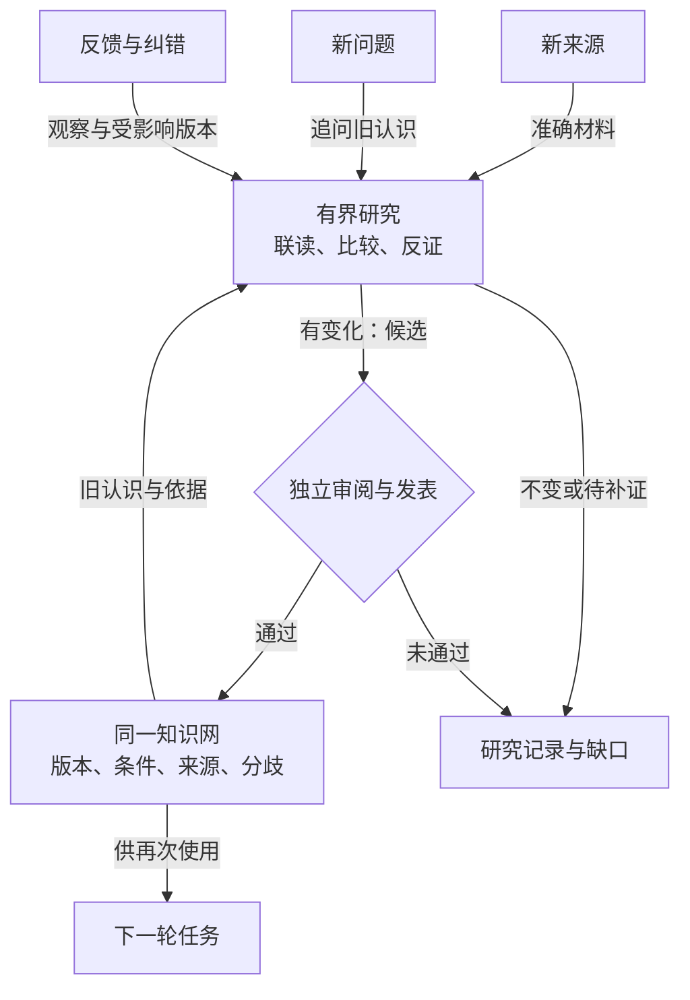

# 知识产品：方向、场景与交互

知识库的核心价值是让已有认识成为下一次判断的依据，并让认识能够受到检查、修正或合理保留。节点数量、报告数量和图的复杂程度不证明这一点。

2026-10-29 · 本页说明产品方向、连续两轮场景与交互。内容关系和研究行为的细则见[通用认知模型](model.md)；各项是否已接入真实服务见[当前状态](current-state.md)。通用目标以[知识库目标 Page](https://chatgpt.com/space/page_33c12e961e788191aa266d5bf67b958f)为准，本页把它解释为可阅读、可验收的产品行为。

## 我们要去哪里

**让认知持续形成、积累、关联、综合和修正，使已有认知成为下一轮新认知的基础，持续提高人和 Agent 理解问题、研究与行动的能力。**

我们要做的不是资料仓库、一次性答案生成器或图谱展示器，而是一个让组织经验持续参与判断、又被现实不断校验的知识产品。它保存的不只是“最像答案的一段话”，还包括依据、适用条件、反例、未知、版本，以及人们当时怎样使用它。

完整链路是：

**真实来源 → 可阅读的认识 → 新问题研究 → 采用、改编、拒用或暂缓 → 真实反馈 → 维护与演化 → 下一次判断。**

这里有两个同样重要的方向：昨天的研究要带着依据和条件服务今天；今天的新问题、反例和实践结果又要能改变明天。图谱和正文帮助人参与这个过程，研究与审阅帮助系统维护这个过程；它们都不是最终价值本身。

图中的三个入口都能触及**同一**网络。新来源先保全身份、版本、实际覆盖和权利；新问题可以完全依靠旧认识开始研究；采用反馈须指出当时用的准确版本和实际观察。研究有界地联读旧认识与必要原依据，产物可能是候选，也可能有据不变或待补证。候选经过独立审阅和发表核验才改变正式知识。下一轮任务读取这个网络后，又可能提出新问题或留下采用反馈；图以再次使用结束，避免用回转线遮住入口。并非每次操作都要调用模型或发表新版。

## 什么是认识

**资料回答“来源呈现了什么”，认识回答“我们目前怎样理解，凭什么，在什么条件下可用”。** 原片某秒出现了包装、文档某段写有规则，是带准确定位的观察；作者声称该做法有效，是来源主张；研究者据此解释为什么可能有效，是推论；真实观众是否认出产品或经营是否改善，要靠相应测试。四者不能合写为一个“已证实”标签。

一条可用的认识会说明它回答的问题、当前判断、适用范围、支持与反例、替代解释、未知以及下一次值得检查什么。它可以是一项主体认识、一种方法、条件经验或跨问题的综合。主题和标签帮助找它；关联说明它引用、支持或挑战什么；稳定身份与准确版本让人以后能修订或追问。正式版本并非永恒真理，历史版本解释当时的取舍，也不自动具备今天的采用资格。

例如“结果先出现，再解释过程”若只来自一段视频，能记录画面顺序和可能的表达意图，不能推成更高成交。两份针对同一原片的报告是两种解释，不是两份独立观察。经独立案例比较后，可以提出“在结果可辨、过程需要解释时，这种顺序可能帮助观众建立观看语境”的有条件认识；反例中结果难辨时，要收窄条件或保留分歧。

## 三个成长入口

**新来源**可能补充观察、重复旧内容、挑战某个条件或暴露未知。登记来源并不自动发表知识；发现相似也不等于独立验证。系统应说明实际读取了哪个版本和范围，哪些还不能读，再比较相关旧认识。文档、视频、规则和实作记录不必依次经过固定的“观察→案例→范式”对象阶梯。

**新问题**可以在没有新资料时改变理解。人或在明确目标、权限与预算内工作的 Agent 先查询，选出准确旧版，必要时回查原依据；然后比较它们原来各自回答的问题和适用条件。若能提出新的条件区分、迁移取舍、可检验预期或有价值的缺口，就形成候选。仅把两页缩短并排、换一种说法复述，不构成认知增量。

**反馈与纠错**来自使用和现实。阅读不等于采用；采用、改编、拒用和暂缓都可以留理由。反馈要区分实际观察、没有观察的项目与解释，连回当时采用的准确版本。来源撤权、关键事实纠正或反例出现时，先限制受影响的当前用途，再研究是修订、保留分歧、有据不变还是待补证。旧历史与当时行动不能被今天的判断悄悄改写。

三种入口都可能有相同的合理终点：正式新认识、无变化，或明确指出缺什么证据。研究记录保留本次问题、选读与排除范围、推理、费用和停止理由，让下一轮知道从哪里继续。

## 连续两轮：从 A、B 到 C，再接受反例

以下全是**假设演示**，用于说明完整产品行为，并非已获得的数字人口播效果或已跑通的真实语义研究。假设团队要制作某款需准确呈现包装与使用动作的数字人口播短片，已有两个经过审阅的认识：

- **A：表达认识。** 在结果画面可辨、过程需要解释的条件下，先让观众看到结果，再说明路径，可能帮助建立观看语境。依据是若干准确视频观察及其比较；同发布者或同原片的重复不充当独立验证。它没有证明成交或目标观众的理解效果。
- **B：制作认识。** 在某次包装文字和手持动作必须准确、而特定生成配置曾使这些细节失真的任务中，真实包装与动作镜头承担准确性，生成镜头承担环境或过渡，是本次经逐镜核对可行的方法。它记录配置、版本、失败位置、改动、人工核对和成本；没有推出“所有生成方式都不行”。

**第一轮，新问题出现。** 团队问：“能否让数字人口播先给出可辨的使用结果，同时保住包装和动作的准确性？”查询先找到 A 与 B 的准确版本，检查 A 对“结果可辨”的要求和 B 对“需准确细节”的要求，再回看关键秒点与制作记录。A 原来讨论表达顺序，B 原来讨论实现手段；两者都没有直接回答如何配合。研究者提出新综合 **C**：把“先让观众辨认什么、再解释什么”的信息职责，与“由实拍、生成或组合承担”的实现手段分开设计；在包装和动作必须准确且现有生成配置不能可靠保真的条件下，让真实镜头承载这些细节，数字人或生成部分只承担已核查可行的说明与转场。先给结果的镜头也必须让目标物可辨。

C 的增量是**两项认识之间新的条件关系和制作取舍**，不是一份新的独立效果证据。它引用 A、B 的准确版本及各自原依据，写明替代路线：若新配置经逐项核验能保真，可以重估镜头分工；若真实包装镜头无法取得，当前方案不能直接执行。对“观众是否同时看懂结果并认出产品”保留待测。审阅者检查比较是否成立、条件是否完整、推论是否越过证据；发表核验通过后，C 才有正式版本。如果审阅失败，它仍是候选，下一轮不能把它称作已发表知识。

**第二轮，实际继承 C。** 数周后另一成员做新商品脚本，问题变为：“只有一张准确包装图，能否沿用上次的结果前置方案？”系统先给出 C 的当前准确版本、条件与 A/B 来路，而不让成员从头重新推导 A+B。成员发现新任务没有可拍的真实使用动作，因而只**条件性借用** C 的信息职责，拒绝沿用其动作镜头分工；把待补实物动作证据与这次选择记在采用记录里。若系统只返回 A 和 B 或一段临时答案、找不到 C，就没有证明第一轮综合被下一轮继承。

假设随后有一项小范围观众观察：参与者理解了故事，却未能辨认商品；完整观看或成交数据尚未取得。反馈明确关联本次实际改编和 C 的版本，并将“商品识别”与“故事理解”分别记下。它挑战的是 C 中“结果镜头可辨”的应用条件，不能据此断言 A 的表达顺序普遍无效，也不能把未取得的成交数据记为零。维护可提出 **C2**：在这种包装呈现和画幅条件下，要先验证商品识别；识别不足时需加强真实商品线索，或暂缓结果前置的执行建议。C2 仍须研究、独立审阅和发表；证据太弱时可保留 C、限制用途并列出下一项理解测试。下一轮查询应显示当前可用条件及历史 C 的变化理由，而不是继续无条件推荐旧方案。

这两轮的最低可核对链是：A/B 的原依据与条件 → 第一轮问题与实际读集 → C 的新增推理、审阅及正式版本 → 第二轮实际读取 C 并做有条件的选择 → 反馈定位受影响判断 → C2、保留不变或待补证的理由。连续两轮的判据和成本比较见[认知模型](model.md#连续两轮怎样验收认知成长)。

**普通文档也走同一条机制。** 假设 A 是“某规则在指定地区、日期和合同版本下允许某种处理”的文档认识，B 是“团队在一次实际申请中因附件格式被退回”的实践认识。新问题“规则允许是否意味着可直接提交”可形成 C：“规则资格与提交材料合格是两个不同前提”，引用原规则段落与退回记录，保留地区、版本和退回原因的范围。下一次申请先读 C 再检查现行规则和附件；若官方更新格式要求，纠错定位 C 的相关前提。这个例子只是接入说明，不代表任何真实法规判断，也不要求文档业务复制视频对象或电商术语。

## 沿同一场景探索、阅读、研究与回查

以下继续使用数字人口播的 A/B→C→第二轮情境，说明人和 Agent 在界面中怎样前进。它是目标交互，不是已验证的经营结论或自动化实测。

**探索：先决定读什么。** 第一轮输入“结果先呈现又要保住包装准确性”，局部星群应找出表达认识 A、制作认识 B，以及两者各自的来源、条件和挑战关系。看到两个报告出自同一原片时，展开共同来源组，不能把两次命中计为两份独立证据。第二轮输入“只有包装图，能否沿用”时，应先找到已发表的 C 和它依赖的 A/B；只返回旧关键词列表，就漏掉了第一轮新增的综合。

**阅读：先弄清 C 说到哪里。** 正文呈现 C 的信息职责与镜头分工、必须有可辨结果和准确包装动作的条件、可改用新配置的替代路线、缺实物动作时的限制，以及尚未测到的观众理解。旁边给出准确版本、审阅状态与历史差异。第二轮成员可以只读、条件性借用信息职责、拒用镜头分工或暂缓；每种实际选择都应留下所读版本、改编或拒用理由，浏览本身不算采用。

**研究：说明为什么会有新认识。** 第一轮并列 A 与 B 原本回答的不同问题、本次实际读集以及“表达职责与实现手段分开”的新增推理，供审阅者检查是否越过证据。若第二轮出现新配置保真证据，或不同商品和受众下结果镜头难以辨认，研究应核对差异、提出 C2 候选、保留分歧、有据不变或待补证；不能为增加版本而强行发表，也不能把尚无观察的效果填成零。候选在独立审阅和发表前不占用正式版身份。

**来源：核对具体看过什么。** 从 C 打开 A 的原视频秒点和 B 的失败制作记录时，显示作者或发布者、取得方式、准确版本、实际读取范围、当前权利及不可读部分；继承的旧依据与这次实际重新读取的原件分开。由来源返回时，保留原问题、选中的 C、局部关系和正文位置。旧版可追查不等于今天仍获准用于制作。

**演化：让反馈解释下一次判断。** 第二轮小范围观察只得到“理解故事、未认出商品”，就分别记录这两项与未取得的完整观看、成交数据，连接到当时条件性使用的 C 版本。维护者定位被挑战的“结果可辨”条件，再记录为何提出 C2、限制 C 的当前用途或等待补证。三个月后复盘，能重放当时问题、实际读到的版本、采用与拒用理由、后来新增的反馈及版本差异；今天的新任务则重新检查当前版本和权利，不能用新版倒写旧决定。

把这一链换到规则文档和申请退回记录时，仍要能读准确段落、比较条件、保留使用和反馈；文档所有者继续管理原件与权限，不能继承视频业务的商品事实或用途资格。[新业务技术接入手册](integration.md)说明其工程路径，真实业务结果另行验收。

## 三种工作状态

| 状态 | 用户正在解决的问题 | 页面主次 | 下一步 |
| --- | --- | --- | --- |
| 探索 | 有哪些相关认识，它们如何联系 | 星群图帮助定位，选中项提供可读上下文 | 聚焦局部关系，进入准确正文或来源 |
| 阅读 | 这条认识说什么，凭什么、何时适用 | 正文为主体，条件、依据、分歧与版本在旁 | 回查原件、比较版本，或直接结束阅读 |
| 研究 | 旧认识在新问题下能否形成更好的解释 | 旧认识、本次候选、条件与挑战并列 | 审阅候选，或记录不变、待补证及理由 |

探索采用用户确认的 V1 星群方向：浅色背景、圆节点、细线、克制光晕，左侧通用导航，右侧可读上下文。矩形技术样片不作为产品视觉依据。布局算法和图引擎需要用真实画面与任务验证；图谱首版归前端内部模块，稳定后再按复用需要决定是否拆包。

## 关系必须能解释一个判断

主题相近、导航联读、同源材料、支持、挑战、适用条件与前提依赖分别表达。不能把“相关”画成“支持”，也不能从两个节点很近推断它们有因果关系。

例如，两个报告来自同一原片，应能展开其共同来源；它们不因此成为两份独立证据。某条边支持一个限定命题时，详情应说明支持什么、支持到哪里，以及是否仍有替代解释。来源组可以交叉，不强行套成单父目录。

## 阅读准确版本与来源

打开正文时固定准确版本。切换当前版、历史版和差异时，分别标明所读版本、当时判断和当前用途资格。旧版本保留历史解释，不能因为仍能打开就视为当前可以执行。

来源应显示身份、作者或发布者、取得方式与日期、准确版本、锚点、实际读取范围及当前可读性。继承过的依据与本次实际重新读过的内容分别呈现。只读到节选、附件不可读、格式不支持或尚未加载时，界面保留具体缺口。

从图谱到正文、再到来源或历史后返回，应恢复原问题、选择、局部范围及阅读位置；不能把返回操作变成重新检索另一组结果。

## 研究结果允许改变，也允许不变

| 结果 | 应让用户看懂什么 | 对正式知识的影响 |
| --- | --- | --- |
| 候选 | 新增解释是什么，继承了什么，条件或分歧怎样变化 | 审阅与发表检查前保持候选 |
| 不变 | 为什么现有认识仍足够，本次实际核对了什么 | 记录研究理由，不强制造一个新版本 |
| 待补证 | 缺什么、为何影响判断、可以怎样取得 | 保留缺口，不把未知写成否定结论 |

研究执行成功、内容审阅通过和正式发表是不同状态。取消请求也不能立即显示为已取消；外部结果未知时应保留未知状态和对账路径。

## 阅读与采用是不同选择

用户可以只读，也可以采用、改编、拒用或暂缓。实际采用时记录所读准确版本、选择理由、条件及改动；未考察的条目不自动生成拒用理由。

反馈分别保留实际观察、没有观察到的项目、测量范围与解释。反馈进入后续维护，不直接改正式知识。后续变化应能说明它回应了哪次反馈，为何修订、保持不变或仍缺证。

## 用真实任务验收

新读者应能独立解释一条认识从哪里来、为何可信或存疑、何时改变、影响哪里。研究验收应能比较使用前后的判断、反例、缺口与成本；真实行动的效果另由业务场景检验。

截图、浏览器检查和工程测试各自保留证据。它们支持可操作性或机制判断，不替代用户对视觉、理解和认知价值的验收。

## 怎样判断正在接近目标

| 要看的变化 | 应该得到的证据 | 不能代替它的指标 |
| --- | --- | --- |
| 旧认识真的被复用 | 新任务实际读取准确旧版，保留其条件、反例和未知，不再从头重复组织全部材料 | 检索命中数、页面访问量 |
| 新综合真的被继承 | 第一轮形成的合格认识，在第二轮能被找到、读取并用于新判断 | 第一轮多发表了一页 |
| 错误真的能纠正 | 反例能定位受影响认识，促使收窄、撤回、保留分歧或有据不变 | 版本数量、总结次数 |
| 历史真的能解释 | 能复盘当时依据、取舍和版本，同时不把旧版误作当前资格 | 一份按今天理解重写的故事 |
| 收益真的超过成本 | 与直接阅读相关材料相比，判断更清楚、错误或重复工作更少，并记录读取、模型和人工成本 | 节点数、报告数、图谱复杂程度 |

工程测试、浏览器检查和内容审阅分别证明不同事情。它们可以帮助判断机制是否可用，但不能替代真实读者理解、连续两轮认知继承和长期业务效果。连续两轮的具体通过条件见[认知模型验收](model.md#连续两轮怎样验收认知成长)。
