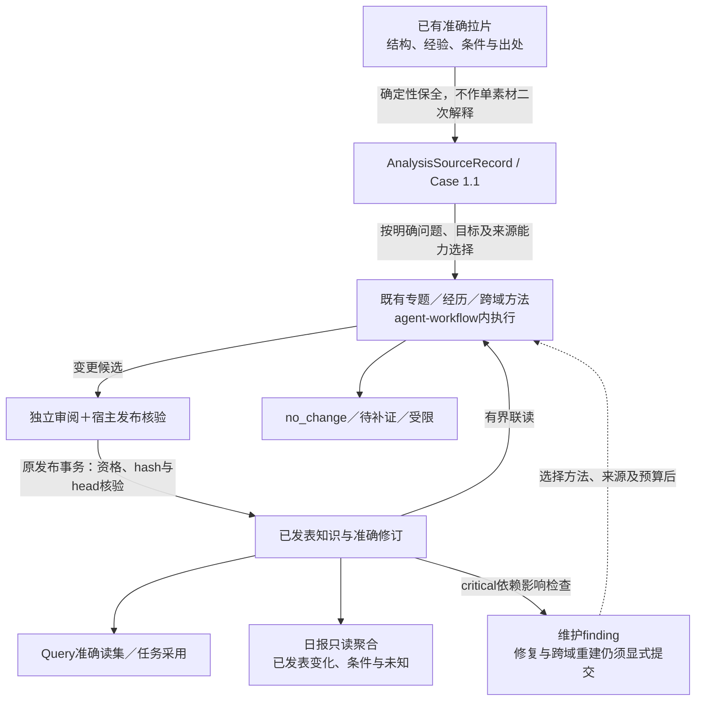
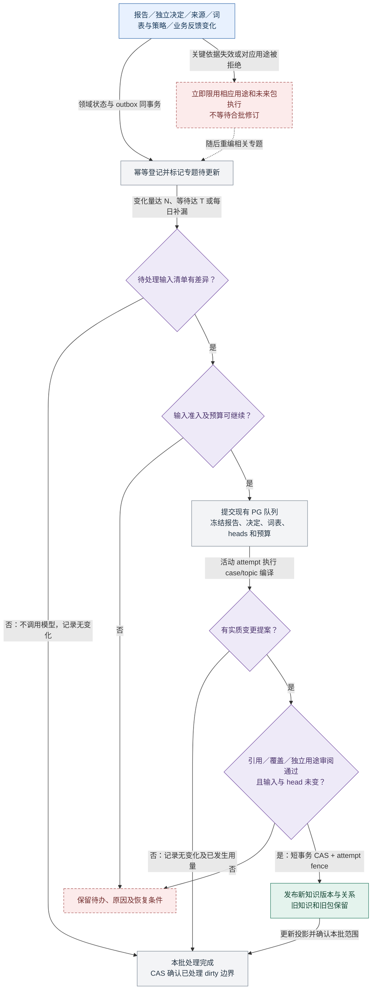

# 案例、主张、范式、Wiki 与参考包

2026-10-22 阅读状态：本页保留视频研究、参考包与旧方法的技术细节和历史合同。当前通用目标与行为统一见[认知自我成长设计](../research/purpose-architecture-20261022.md)，固定`main@1c8ba64`的对象、接口和能力核对见[实现评审](../research/architecture-review-20261022.md)。下图只表达该固定版本的代码能力，不证明当前生产启用状态或完整认知成长已经实现。

既有队列、预算、取消、失租与未知结果保护继续负责执行；原知识服务仍负责唯一正式发布。Query准确读集不是任意问题的自动语义回答，critical影响检查也不是全库语义巡检。通用主体发现、消歧和开放变更规划仍是新设计需要验证的能力。

**历史实现说明（2026-10-20）：** 当时分支冻结`knowledge-research-agent-workflow@1`，Builder、引用与KU校验、宿主暂存、独立Reviewer及有界修复使用共同运行能力，`research-source-projection@1`曾进入Case v2，日报也设独立Workflow。该次[单案例验收](../../index.html#knowledge-daily-workflow-implementation)保留；后续已明确拉片直接保全、多素材按问题维护认知、日报读取聚合，不能将旧链路继续当当前通用目标。

2026-10-19 本地增量实现与限制见[决策阅读层实施记录](../evidence/decision-value-20261019.md)。本地验证不代表已部署或已生成生产内容。

> 状态（2026-10-17）：2026-10-16 的主站知识验收记录保留为历史；PG 版本/审阅/head/依赖、有限参考包与 Cytoscape 节点图谱延续现有工作台；准确独立用途读取、局部通道/秒段限用、专题归属/研究需求/构建账本、持久事件补漏及 `knowledge.compile` Worker 已随 `main` `6e7b3ff` 接到 5174。专题提案与另一次独立审阅复用官方 SDK 订阅模型 port，仅供探索阅读；拒绝不发布。手动构建入口保留为运维修复，正常日批已启用来源事件 ingest 与按已确认专题自动合批 build，旧独立连续调度保持关闭；真实专题构建、API 及浏览器节点点选、两处证据定位和日期布局已核对；密集图标签仍需优化。完整词表治理、自动 Pattern/Claim 提炼、非视频事实与实验执行、创作消费仍为目标。见[主站验收](../evidence/main-workbench-20261016.md)与[持续更新实现](../evidence/learning-loop-20261016.md)；旧接线见[知识工作台](../evidence/workbench-20261015.md)。下文目标合同不表示所有字段或 action port 均已实施。

## 3. 粗拉、精拉都能入知识库，但入库不等于升格

知识库至少有三个清楚的产品区域：**案例资料、待核范式、可用于指定用途的知识。** 进入第一层是保留可检索资料；进入第三层要满足相应用途的证据和采用条件。模型复杂度、报告篇幅和点赞数都不能替代这个判断。

| 输入情况 | 允许沉淀 | 默认用途 | 不允许自动推出 |
| --- | --- | --- | --- |
| 仅历史未验收 JSON 或静帧初筛 | 原始资料、初筛注记与待处理项 | 定位、排队和探索性阅读 | 已粗拉/已精拉/已核知识 |
| overview，范围及来源有效 | `CaseRevision(profile=overview)`、有证据的观察、解释/假设、候选范式 | 搜索、比较、选片；核查后可采用其覆盖内的具体做法 | 没看通道的结论、完整剪辑复现、商业有效性 |
| overview partial | 明确范围的局部案例、缺口与待核问题 | 探索；只允许引用已覆盖且已核的局部 | 因有摘要就当整片完整理解 |
| fine 可读但 review_incomplete / revised_unverified | 完整候选报告、案例草稿、相关待核主张 | 独立复核或局部补证、探索槽位；疑难时人工处理 | 独立复审通过、全篇可无条件用于生产 |
| fine 来源/引用有效且按用途采用 | 详细案例、镜头/结构主张、候选/已采用范式、精确参考片段 | 具体制作借鉴，条件与通道范围保留 | 点赞导致销量、作者台词变自家产品事实 |
| 自有发布/投放及实验结果 | 独立 Outcome、支持/挑战 Claim、适用范围修订 | 检验创作假设 | 无控制条件下自动认定因果或推广全品类 |

**粗拉的观察也能成为正式知识，前提是批准用途和证据覆盖匹配；精拉也可能只是一份待核报告。** 不设置“必须全文精拉才能入库”的机械门槛；需要精确动作/字幕时序、复杂剪辑、声音或产品/效果判断时，触发有问题意识的局部核查或精拉。升级理由比“一定要深度”更重要。

例如粗拉确认“末尾用一句字幕改变前面角色的含义”，可存 `observation` 并引用那一段；“这种反转可能提高停留”是 `hypothesis`；“提高 NAD+ 转化”还没有证据。精拉随后补足出字幕时间、动作、留镜节奏，增强的是制作解释。只有独立业务测试才能另行支持转化主张。

## 4. 单条与多条怎样形成知识

以下两段保留视频研究方法的历史设计，不是新版知识模型的必经步骤；当前拉片保全与各编纂入口以页首固定版本评审为准。

单条：ResultRevision → 确定性索引 → Case 提案 + 带锚点 Claim → 独立审阅、机器校验及用途策略形成 ReviewDecision（可批量，但精确到版本与用途）→ 发布 Case/Claim revision。符合既定策略的普通事项可自动推进；冲突、依据不足或重大策略变化升级运营者。一个单例也可产生 Pattern 候选，`evidence_level=single_case`。

多条：先建 `TopicCollectionRevision(question, scope, members, selection_reasons, source_groups)`；形成 `ComparisonRevision`，对齐手法、适用条件、表现可比性；再编译 Pattern/Wiki changeset。只看高赞可总结形式，不能算该形式成功率。没表现数据就只比较表达结构。

`KnowledgeChangeSet` 必含 inputManifest、baseHeads、拟新增/修改对象、diff、证据、反例/冲突、方法与费用。提案 Agent 不拥有发布权限。独立审阅者检查语义和反例，宿主检查引用/覆盖，knowledge 的既定策略决定用途；正式发布在短 PG 事务中以 expected head/hash 比较并交换。发生并发冲突则 rebase/重审，不最后写入覆盖。

这一视频方法曾采用“单帖事实 → 跨帖主张 → 有条件范式 → Wiki 导航/综合”的组织。当前设计不要求所有来源沿此路径晋级，主体、概念、研究问题和综合均可直接维护有依据的正文。不得只把上一轮总结继续摘要，丢掉限制和反例；编译时带新源、仍有效的共同贡献源和挑战依据。

### 4.1 单片、范式与参考包的最小内容

案例摘要的用户展示由产品规划维护；本模块保留其准确报告版本、实际覆盖与 Claim 锚点。专题集合冻结问题、产品/人群/语言/期间、成员及纳排依据；新增成员、指标窗口或分析结果形成新集合版本，不静默改变旧比较。

编译读取每份准确报告时同时保留其 `AnalysisContextSnapshot`，并由分析宿主读取其中准确归档的原帖 metadata。来源记录的发布时间/检索时间、分析冻结/登记时间、用途决定和知识构建时间分别解释；没有快照字段或可核查归档时保持未知，不能用当前 Material 的日期覆盖历史。已有归档的日期补投影不需要重跑拉片。完整素材与指标属性接线、时间筛选界面及按字段补证仍未完成，交接与缺失规则由[跨模块合同](../../index.html#module-contracts--%E7%B4%A0%E6%9D%90%E4%B8%8E%E6%8B%89%E7%89%87%E4%B8%8A%E4%B8%8B%E6%96%87%E8%BF%9B%E5%85%A5%E7%9F%A5%E8%AF%86%E6%9E%84%E5%BB%BA)维护。

来源日期阅读卡已接入分析节点、案例及历史准确案例的详情：只读接口按选中报告懒读，区分归档声明发布日期、资料检索、上下文冻结和报告登记时间，保留未知与原始时间值；来源标签优先展示，完整原片/报告/归档引用按需展开。该卡不把日期当独立核验，也不新增日期筛选或表现比较。代码检查与真实主站验收分别记录，尚未验收的界面不能因组件测试通过而记为真实通过。

范式必须比“开头要吸睛”更具体：**要解决的问题 → 表达步骤 → 不可丢结构 → 可替换变量 → 适用/禁用条件 → 支持与反例 → 待测预测**。保存形式、制作要求、秒点、表现口径、来源组、版本与复核条件；不能将参考产品功效通过换瓶子移给 NAD+。这些字段由知识模块维护，不再另写一套知识卡原本。

### 4.2 类型、身份与分类：目标合同

当前代码有 `Case / Claim / Collection / Comparison / Pattern / Wiki / ReferencePack` 七种 kind；这不是永久封闭的全领域知识本体，新设计拟以版本化页面规约逐步演进并兼容旧版。原片、分析结果、证据和经营结果继续由各自领域保存，知识以准确版本引用。对象 kind 回答“这是什么记录”，不能兼任内容标签、可信度或用途资格。以下是演进目标，不要求改写已发布的 v1 内容。

| 维度 | 目标表达与边界 |
| --- | --- |
| 研究对象与来源身份 | 分开记录 `about`（材料确实关于的商品、主体、帖子等，需证据）和 `reference_for`（本项目拿它研究哪个目标）。保留实际创作者、发布者、广告主各自身份及未知；采集来源、公开可发现性和自然/广告分发也分别判断。研究 Perseek NAD+ 的参考片不自动成为有关 Perseek 的原片。 |
| 专题身份 | Wiki 复用稳定 `objectId/topic key` 表示同一个问题；同一问题的命名、成员与结论变化形成新 Wiki 版本，不新建同义专题。问题边界实质改变时另建专题并保留拆分/合并关系。Collection 冻结纳排和窗口，Comparison 冻结可比口径。 |
| 内容与表达 | 以分面词表区分内容主题、形式、叙事机制、视听手法和制作条件；`goalTags` 的七个项目目标另存，不能充当内容分类。素材 `tags[]`、`searchLane` 等来源原值原样保留。 |
| 主张 | 将“观察/解释/假设”等**认识方式**与“表达/商品事实/平台规则/业务结果”等**领域**正交表达。当前 `claimKind` 混有两轴；旧值保持可读，新增结构按版本渐进引入，不能靠字面自动重分类。 |
| 用途、有效性、范围 | 报告质量、独立用途采用、知识版本审阅、来源当前有效性、适用范围分别判断。市场、语言、受众等范围至少区分 `unknown`、有证据的 `specified` 与有证据的 `unrestricted`。当前镜像的 `scope.* = ['*']` 不能直接迁为全球适用；先按未知且探索受限解释，再据来源补证。 |

**多专题归属（目标接口）。** 一个准确来源版本可关联零到多个稳定专题，不把“首次命中的专题”写死在来源上。`TopicMembership` 至少保存 `projectId`、`sourceRef`（领域与准确版本）、稳定 `topicId`、判定时 `topicVersionRef`、纳入/排除理由、`candidate / confirmed / rejected / unassigned` 状态、提出者/方法版本和决定记录。未分派记录的 `topicId/topicVersionRef` 可为空。`unassigned` 是可检索、可回放的待分派状态，不是丢弃；新材料即使暂时不属于现有专题，也先登记 Case/来源并进入待分派池。归属可以指向已有专题，也可以提出新专题候选，确认后才建立稳定身份。

先用项目、实体身份、规范词和问题边界作确定性查重；语义近似只列候选及相似理由，不自动合并题意。一个来源支持多个问题时保留多条归属及各自理由，来源变化将相关专题分别置脏。专题拆分/合并保存旧新 `topicId`、准确 Wiki 版本、原因、审阅及成员迁移决定；旧版本与旧包仍可解释，不能把旧引用原地重指向新专题。

**词条定义 `TermDefinition`** 是可治理的概念：稳定 `termId`、分面、语言化首选名/别名、定义、必要的 `broader/related` 关系、启用/替代/废弃状态与 `vocabVersion`。同字异义不合并；跨语言同义需审定身份。候选新词先留候选，确认后纳入版本化词表；不引入独立图数据库作为前提。

**标注 `TermAssignment`** 与词条分离：指向准确对象版本或证据秒段，记录 `termId`、锚点、规则/模型/人工来源、方法版本、提出/确认/撤回状态及变更依据。模型分数仅是辅助信息；同标签命中只帮助召回，不自动证明支持或效果。撤回、新别名或词表升级创建新标注/索引版本，不覆盖来源原始标签、旧报告、旧知识或旧包。确认策略可自动处理普通事项，争议进入人工例外。

概念身份、多语言名称、别名及上位/相关关系的组织原则参考 [W3C SKOS](https://www.w3.org/TR/skos-reference/)；本项目仍在既有 TypeScript/PG 结构内实现，不因此引入 RDF/OWL 或另一套权威存储。

### 4.3 关系与失效：目标合同

| 关系层 | 保存什么 | 能否自动成为论证或执行依赖 |
| --- | --- | --- |
| 来源 | 分析结果、原片版本、证据秒段、外部事实来源及采集口径 | 准确引用须可回查；相同字节只说明内容相同，不证明独立作者或独立效果。 |
| 收录与导航 | Collection 成员、Wiki 的 Claim/Pattern 收录、相关案例、词表上位/相关 | 不自动产生 `supports`。普通导航不形成关键失效依赖；若成员确为比较或推论的必要输入，应另外登记执行强依赖。 |
| 语义论证 | 支持、挑战、缩窄的是哪条具体主张/条件；理由、适用条件、引用锚点与双方准确版本 | 经过提案、校验和独立审阅才成立；同标签、同产品或多次观察不自动证明机制/因果。 |
| 执行强依赖 | 已发布版本或冻结包实际依赖的准确来源、结论与用途资格 | 按明确 `critical` 语义决定限用和传播；来源变化后重核未来执行，旧版本不可变。 |

来源组须保留分组依据及不确定性。overview 与 fine 可作为同一原片的不同覆盖 profile 同时存在，独立来源数量只计一组；SHA-256 字节去重不能推出不同哈希对应不同作者或独立业务结果。`repeated_observation` 与经过业务实验验证是两种证据。

早期实现问题记录（保留历史，不当作今日现状）：当时图谱把部分 Wiki 收录引用显示为 `supports`，图的关键影响遍历只走 `critical`，而知识后端有效性/级联尚未按相同规则区分。修复必须统一存储关系、后端限用与图投影的语义及测试；只改 Cytoscape 边标签或投影覆写不能修正执行准入。Cytoscape 是可重建的阅读投影，PG 版本、审阅、依赖及 R2 证据仍是权威记录。

**关系断言（目标接口）。** 可审阅的 `RelationAssertion` 至少含关系身份与版本、两端准确版本、`source / membership / navigation / supports / challenges / narrows / critical_dependency` 类型、论证条件、理由、证据锚点、适用 purpose、提出与审阅决定。关系变更生成新断言版本；删除或撤回也保留历史。`critical_dependency` 的传播和用途限用须由后端同一规则计算，图只读取结果，不能私自把导航边升成关键边。

Canvas 默认给当前问题的局部视图：专题版本、纳入案例、支持/挑战断言、关键依赖与未解决缺口。用户可点关系看到理由、条件、准确两端及原证据；查看 Wiki 版本 diff 能辨认新增、缩窄、撤回及其审阅；从失效节点能看到已有但未执行任务所持包的影响，以及今后生成 ReferencePack 时的准入限制。图可按需展开概念或邻接专题，不能因过滤或截断声称影响遍历完整；后端全量依赖结果与图上标识必须一致。

### 4.4 持续构建：目标执行合同

看完此图，读者应能说清变化怎样触发编译、审阅怎样挡住发布，以及无变化和失败分别怎样结束。本图整体是待实施目标；颜色只表示角色，红虚线表示受限或待处理状态。

图例：蓝为来源，紫为判断，灰为处理，绿为不可变知识，红虚线为受限或待处理。图省略了具体错误码与资料分类；下列合同决定实际恢复动作。

1. **登记与补漏。** 报告新增/修订、准确版本的独立采用决定变化、来源撤回或失效，必须与各自领域写入一起持久记录可重放事件。消费者按事件 ID 幂等推进项目/专题 `dirty` 和 watermark；服务重启后从持久位置补漏，不能只靠进程内回调。来源失效与拒绝先限用受影响用途，再排重编译，不能等待下一批后才生效。
2. **准入快照。** 知识经升级后的公共 `AnalysisReadPort` 读取独立采用决定，或由宿主冻结经来源模块核对的准入快照。`analysisResult.quality/coverage` 不是 adoption；`claim.content.adoption/approvedPurpose` 只是生成时兼容快照。实际准入取准确报告版本、purpose 对应的最新权威独立决定及当前来源有效性；未知或拒绝不提升为生产用途。知识版本另有自己的准确 changeset/hash + purpose 审阅。
3. **合批与冻结。** 按项目和稳定专题身份，累计去重来源变化量 `N` 或最长等待 `T` 后提交候选；每日巡检补漏、lint 断链/过期及尚未处理事件。模型调用前先比较待处理输入清单：无差异则确定性 no-op；有新输入、但编译后无新认识，也可无变化完成，仍记录已发生用量。`N/T`、项目时区、预算、并发和方法策略版本需冻结并复验；当前日批用 8 个待处理来源或 30 分钟等待等条件自动触发，旧独立知识连续调度仍关闭。冻结 manifest 包含准确结果及质量/采用决定、标注与词表版本、仍有效支持/挑战、既有 heads、方法/策略版本、范围和预算；不能在长模型调用中漂移。

**宽专题增量实现（本地合成验证，尚未部署，2026-10-17）。** 首日宽专题真实输入含 29 份分析报告、21 个来源组，超过旧单批 20 报告上限；本轮共 3 个新知识 job 为 `restricted`、0 次模型调用。本地修复在同一语义专题内按准确 `reportRef` FIFO 划分每批不超过 20 份且字节有界的研究页，保留全量 inventory；不能把批次建成新语义专题。父 Wiki 只作覆盖导航，准确列已审/pending 报告数，不递归总结子页冒充全局综合。批次覆盖按准确报告、采用决定、专题归属和有效性核验；独立来源数仍以原片 SHA 另行去重。每批发布与准确报告 coverage 索引在同一事务中登记；首批只确认本批进度，不能 ACK 全专题水位。未处理批次由内部按专题分页续跑，不依赖新事件，也不受知识页其他列表 500 条截断影响；最终重验才 ACK 全专题边界。首日不提高 4 job 限额，剩余 1 个 job 至多推进一页，余量次日继续；实际每页可能少于 20。每 job 至多 2 次模型调用和每日 build 预算保持不变。旧 `restricted` 结果不倒改，后续新批次必须产生自己的记录与版本。

4. **提案与发布。** 现有 compiler 已支持 `case/topic`、`proposal_only`、选定分析版本、baseHeads 和输入限制；本轮增加 `knowledge.build.v1` 冻结构建命令、Worker 装配及下文判别结果；旧 `/compile` proposal-only 工厂仍是独立入口，未装配时返回 501，不承接持续专题发布。Case/Topic proposer 没有发布权限。确定性引用/覆盖检查、独立语义及用途 review 后，使用既有 PG 队列的活动 attempt fence 与知识 head/hash CAS，在短事务发布新版本、依赖及 outbox。head 或输入资格变动则重基、重审；重复事件和相同 manifest 不重复发布。不要另造 cron 脚本直接写知识表或第二个 dispatcher。
5. **结果与历史。** 失败保留 dirty/watermark 的待处理差额、原因和可恢复作业；取消与预算由现有 runtime 管，未知外部执行先对账，不自动重放，也不把未知费用记为 0。无变化提案不强造 Pattern/Wiki。旧报告、旧知识、旧参考包和当时词表保持不可变；新 ReferencePack 或创作执行重新检查用途、范围与关键依赖。

**局部用途准入（目标接口）。** 独立决定需要表达准确 `reportRef`、purpose、可选 `claimRef`/证据锚点、通道（画面、字幕、音频等）和秒段、允许/探索/拒绝、理由、决定版本与审阅者。默认只在明确覆盖的交集内有效，未知通道或范围不被空值扩大。上位报告对某用途的拒绝或撤回是硬上限，不能由同报告内一个局部批准绕过；部分通道不可靠时，只允许有独立记录的其他通道范围。若画面主张另获**外部独立依据**，应生成引用该依据的新 Claim/审阅链，不能把原被拒报告改写为通过。查询、编译和新包执行都读取准确版本的当前权威决定，并与 purpose、claim、evidence、channel、segment、市场等受限范围求交；交集为空即拒绝该用法。历史报告、审阅和包不倒改。

**触发与冻结（目标接口）。** 除视频报告外，非视频商品事实/规则、经营观察和自家业务反馈的新增、修订、撤回也能触发相关专题 dirty。词表别名/定义/替代关系、归属、编译方法、用途策略版本变化及审阅到期进入持久触发清单；按具体受影响范围重建，不能让无关专题每日全量编译。到期是按项目时区生成可去重事件；没有来源变化也要重核限用。冻结 manifest 需记录事件上界、准确来源与覆盖、独立决定和证据范围、归属与词表版本、关系断言、既有 heads、方法/策略、预算及当时有效性。在正式发布或确认 no-op 前重核这些准入、失效、策略与 head；已变化则保留新的 dirty 并重审，不用旧快照盖过新拒绝。

**编译结果（目标接口）。** `KnowledgeCompileOutcome` 使用显式判别字段 `kind`：

| `kind` | 必留记录 | 对 head 和 dirty 的作用 |
| --- | --- | --- |
| `changed` | manifest/事件上界、changeset、独立 review、发布版本、usage 与费用 | 短事务按 head/hash 和活动 attempt fence 发布；仅 CAS 确认该次消费的 dirty 边界。 |
| `no_change` | manifest/事件上界、无变化理由、校验结论、实际 usage（含 0 调用） | 不造空 ChangeSet、不推进 head；重核后 CAS 确认仅已消费边界，新到事件仍待处理。 |
| `restricted` | 限用对象、purpose/范围、依据、恢复条件、manifest 与 usage | 立即执行授权限用，未解决的专题 dirty 保留或以新待办衔接；不能以受限代替成功编译。 |
| `failed` | 失败阶段、错误类别、可恢复状态、manifest、已发生或未知 usage | 不推进 head 或已消费水位；未知外部结果先对账，不能自动重发或填 0 费用。 |

`no_change` 与运行层的 `succeeded` 是不同轴；两者都不能证明语义正确。幂等键覆盖项目、专题、冻结事件边界与 manifest 指纹；发布或无变化确认只消费这一边界，CAS 失败重新读取，不能吞掉并发新事件。`restricted` 可以由准入校验产生而不调用模型；四种结果均留下可回放证据。

**研究缺口到动作（目标接口）。** `ResearchNeed` 绑定准确知识/来源版本、具体问题和缺口、预期能解决问题的证据、业务价值与优先级、适用范围及状态；`ResearchRequest` 进一步冻结所选 action port（例如局部补证/精拉、来源核查、经营数据或反馈复核）、输入版本、预算、授权边界、幂等键与期望结果，并引用 Need。Need 的 `open / assigned / resolved / insufficient / withdrawn` 是问题判断状态；Request 引用实际 runtime Job 身份读取 `queued / running / waiting_external / succeeded / failed / cancelled`，不复制其枚举作第二个状态机。知识模块提出并验收问题，产品编排按目标/预算选择动作，既有 runtime 队列与 Worker 执行；不得从 Wiki 直接调用模型或建第二 dispatcher。结果未知先对账，失败或证据不足保留缺口；新证据回连原 Need、准确来源与专题，经独立用途 review 后才修订认识。任务结果本身不能自动使缺口 `resolved`。

**固定任务回放与分层验收。** 先冻结少量真实任务、准确输入版本、期望引用/用途/禁用条件和读者问题，重放同一批事件：验证多专题和未分派不漏、细粒度拒绝不被覆盖、可点关系回证据、无变化水位不吞新事件、研究请求回到原问题。这是**软件行为**验收。独立审阅者再判断具体支持/挑战理由、范围及范式内容，是**语义内容**验收。最后按权威产品目标观察连续两轮“发现→知识采用→制作/发布→真实反馈→下一轮调整”，另验业务结果；当前缺制作、发布和反馈闭环，前两层通过不能宣称两轮业务验收完成。

本轮已接准确版本用途读取、失效限用、统一关键依赖、稳定专题的事件→冻结→提案→review→CAS 和无变化路径；统一日批的自动知识路径已部署启用，真实专题版本、语义质量和跨日稳定仍须验收。后续重点是可追溯分面词表、内容质量及跨模块业务闭环。旧 schema 与 `claimKind` 保持可读，新增字段及词表版本采用向前迁移；不批量改写历史。

首轮验收至少覆盖：重复事件和重启补漏只产生一次处理；同原片 overview/fine 保留两份 profile 而独立来源只计一组；拒绝或撤回某用途立即限用相关未来参考且不抹去历史；同标签不能自动生成支持边，Wiki 收录不冒充论证；图关键影响与后端依赖失效一致；并发 head 变化或旧 attempt 到达时不得发布，允许无变化完成。生产语义质量还需独立审阅具体案例，测试通过不代表范式有效或业务效果成立。

## 6. 创作实际读取什么

创作 Agent 不循环读 508 条报告。目标流程先冻结 `CreationBriefVersion`：按用途选择产品版本或明确纯形式任务、市场语言、形式/时长、制作约束、待测问题；knowledge 再返回任务绑定的 `ReferencePackVersion`，含产品与规则依据、少量相关范式、具体案例/秒段、必要反例/近期挑战、未知项及选取理由。**整包交接尚未接入创作宿主**：当前 `admission` 只逐项读取并重验获准的准确引用，遇到整包返回 `PACK_HANDOFF_REQUIRED`；不能把新 Brief 合同存在当作旧包执行验证已接通。

三种输入组合都支持：①单条按用途核查的粗拉或精拉结果作主参考；②多个案例对照；③范式加少量代表案例。第一种不依赖多片 Pattern 或整个 Wiki 编译完成，但同样要冻结版本、覆盖和允许用途；要复现精确视听时序时补证或精拉。未审阅内容只能进入显式探索槽位，结构观察可以有限采用，关键产品事实仍需独立来源。Agent 在目标、预算和用途策略内选材并记录理由；用户指定素材优先于排序，但不改变事实状态。

研究提出的 3–5 范式、2–4 案例、9k 初始/12k 累计 tokens 只是待测配置，不作为固定业务配额；没有反例就标缺口，不生成一个充数。合同必须支持预算、实际使用量、超限遗漏说明与按需 `readEvidence(anchor)`，具体值通过首轮两条素材评测收敛。

首日自动探索包出现 4 个 Case、0 个 Wiki，即使包验证有效，也未证明专题知识带来增益。本地新版自动包只把最近 3 个已审研究页作为准确候选，遗漏历史并非全库检索结论；导航型父 Wiki 不进入研究上下文，旧通用调用及 hash 保持原样。有界选择规则：任务显式要求 Wiki 用途时，先在现有 30000 预算内保留相关 Wiki 与 Case 的最小组合，再裁减低优先级 support；反例、已知事实、限制及遗漏说明必须保留。装不下则限制用途并显示缺口，不抬高预算或伪造已审覆盖。导航型父 Wiki 的通用提案会拒绝，仅可信内部 builder 可创建；它不经 HTTP 暴露、只供探索、正文/范围固定，不能取得 `approved_for_purpose`。知识页 `pageInfo` 逐类给出总数与剩余标记，首屏不是全量。

检索先按项目、产品版本、用途、语言和有效性过滤，再用字段/全文召回；按相关性、来源独立性和多样性选择。多语/同义召回确有缺口才增加可重建语义索引。参考包保留选中和排除理由、来源去重、预算/实际用量、遗漏说明与依赖检查；缺依据可给明确标注的探索性方向，不能编造引用。

中文、英文、西班牙语分别测试分词、同语检索和跨语召回；记录查询集、命中/漏召及过期或错误引用。向量模型、文本预处理和索引版本必须有指纹，索引可从权威版本重建；删除索引不删除PG知识原本或R2源证据。没有留出任务的收益证据时，不以先做微调替代检索和引用评估。

每个实际制作单元应包含：叙事目的、借鉴的机制/锚点、原创差异、画面/角色/运动/镜头、时长、台词/字幕/音效、产品依据、输入资产、工作流能力、质量标准。Comfy 只执行已确认规格；返回 clip 后核画面身份、动作和字幕/包装，再决定采用或重做。

本模块唯一推进 Case/Claim/Pattern/Wiki 正式 head、审阅用途资格和引用依赖。`analysis` 只登记分析报告及其版本化采用决定；不能直接写正式知识。

## 原文与证据

[module-contracts.md](../../index.html#history-module-contracts)。这些原文保留历史日期；实施状态需以代码和 [实施记录](../../index.html#phase-1)核验。

## 构建失败的有界自修复（v7，实施中）

报告输入有效性哈希沿用明确的v6输入合同，保持旧覆盖字节兼容；执行方法真实记为v7并进入stageKey与发布记录。兼容仅限已知v6/v7、相同政策和用途，且仍通过current/published、整页准确输入、依赖有效性和revalidate校验。未知旧方法不自动复用；旧冻结v6任务不能静默按v7和4-call预算执行。

v7宿主把准确报告UUID与evidenceIndex登记为稳定evidenceId。普通路径为propose→review；明确格式失败为propose→revise→review；审阅拒绝为propose→review→revise→fresh review，每次仅一轮修订。持久usage执行manifest预算，不跨attempt清零。各轮change/review/ref/requestKey独立，最终仅发布获通过的确切contentHash。网络/中断的未知结果不进入修订。先前拒绝意见须匹配本页准确ref、输入指纹、问题、用途与政策，不能把另一页意见传进来，也不能把反馈当媒体证据。

来源组超预算时按准确报告分片，sourceGroup保留用于同源计数；单个报告仍须满足提案和独立审阅实际输入预算。无法进入的报告必须以准确ref和阻塞原因显式返回，禁止静默continue后让专题看似已无可处理内容。

自动调度的扫描证据同时包含独立扫描协议和 learning host 实际编译方法版本。只有扫描协议常量会使“旧方法已扫描、无新增事件”的 dirty 专题在升级后继续沉默；真实方法变化必须唤醒一次重新规划。后续相同方法与证据保持幂等，不借版本变化重放外部结果未知的任务，也不改变准确页的发布准入。

**旧分批计划完整性修复（2026-10-18）。** 继承已接受批次前，必须证明全量准确 inventory 均已进入计划或仍有效的已审覆盖，不能只核对当前页和输入指纹。旧 v6/v7 缺项计划重新规划，保留合法覆盖；旧冻结缺项任务在模型前受限，不确认专题水位，也不作为修正计划的语义拒绝。重排需要推进事件边界时，登记绑定损坏构建的幂等 planner 修复事件，并重新冻结输入，避免确认期间到来的新材料。扫描协议升级只唤醒规划，执行方法及独立审阅标准仍为 v7。

**准确证据目录（v8，2026-10-18 已部署）。** 分析报告使用 `FRAME-* / CUE-*` 等本地编号，知识引用使用不可变证据版本；只给 `resultVersion:index` 会丢失二者的关联。只读 `readEvidenceCatalog` 从原归档 artifact manifest 的 `versionRef` 精确连接已注册 anchor 的 `sourceRef`，同时核对报告 receipt 的 ID、SHA、MIME、时间范围与证据记录的原片、对象及 scope。重复、缺失或不一致不得按顺序或最近时间补配；旧归档没有 manifest 时显式返回未知映射。

提案和独立审阅接收同一目录。模型可用准确 `resultVersionId + sourceEvidenceId` 引用，宿主唯一匹配后规范化为已注册引用；不同报告的同名帧不得串用。原 stable alias 保持可读，实际执行方法记为 `topic-synthesis-evidence-catalog-v8`；输入有效性仍沿用 v6 合同，已验证的 v6/v7/v8 合法页可复用，旧冻结任务不能静默换方法执行。目录改善引用选择，不产生新观察、不把报告文字升格为像素核验，也不降低独立审阅标准。真正缺证据才建立补证需求，不能把一次整页拒绝转换成所有原片都重新精拉。

**语义与导航审阅范围（v9/v10，2026-10-18）。** v9 先用 `topic-review-scope-v1` 验证完整 change 的 hash、修订分区和准确报告/案例关联；真实审阅仍会把非关键关联导航当成正文证据，所以 v10 将模型输入改为确定性语义投影。完整 change 保留在 PG，不交给模型反复解释导航职责。

宿主先验证分区完整、互斥且无重复。研究页的 critical analysis 依赖须与本页报告精确覆盖；知识依赖只有与 `relatedRefs` 双向匹配、`uses / critical:false`、当前已发布有效 Case 且绑定本页准确分析版本时才可分类为关联导航。缺失或失效 Case、真正关键知识依赖、无法证明的关联都不能因为准备投影而跳过。父导航仍经共享渲染、范围、准确目标有效性和发布 revalidate/CAS 校验，原 critical 依赖保留。

`topic-semantic-projection-v1` 只执行两类删除：去掉已验证父导航 revision；从研究页去掉准确证明的 related case 引用及对应非关键 uses 依赖。标题、正文、完整 scope、disputes、questions、citations、sourceGroups 和其余依赖保持原样。模型只收到投影和原始报告证据，不接收父导航正文、未附正文的 caseRefs 或完整 inputManifest；正文借用外页结论的文字也保持原样，缺少支持仍须拒绝。正式 media Citation 用完整 anchor 精确连接注册证据核验，不要求成稿重复草稿字段。

每轮保存双 hash 与删除清单：模型核对 `projectionHash` 对应的语义输入，宿主在记录审阅前重新从完整 change 生成投影，比对所有内容及 `KnowledgeReview.inputReceipt` 中的完整 hash、投影 hash、准确修订分区和 case/analysis 映射；任一篡改均受限。审阅记录和发布仍绑定 full change hash。记录明确区分“模型审阅语义投影、宿主验证导航”，不声称模型核验过导航正文。`no_change` 有导航时先正规暂存验证，再以空语义修订投影独立检查无新增结论的理由；没有导航也要独立审阅。

更新旧页时，reviewer 的 bundle 不再携带完整 `existing` revision，而是标为 `comparisonOnly` 的 baseline。旧正文、范围、引证及其他依赖完整保留；只有能准确证明为同报告有效 Case 的非关键导航才移除，未知、失效或关键依赖不删除。baseline 只用于比较旧语义，不能成为新断言的独立依据，也不能仅因比较上下文保留旧链接就拒绝当前正文。宿主在审阅后重新生成比较视图，核对旧版本 hash、比较 hash 和删除清单并留存审计。

执行方法为 `topic-synthesis-semantic-projection-v10`，输入指纹仍为 v6，复用有效 v6/v7/v8/v9/v10 页。活动旧方法自然完成，未审输入按新方法自动唤醒；预算最多一次修订，外部未知仍先对账，正文质量标准不变。

唯一修订回合仍未通过格式或准确引用校验时，构建保留 `restricted` 和固定诊断码（例如 `INVALID_DRAFT_SHAPE`、`UNREGISTERED_SOURCE_EVIDENCE`），不再只落为通用任务失败；原始模型返回与任意错误字段不写入结果。已返回但格式错误是已知结果，不改为外部结果未知，不绕过修订预算或独立审阅。

## 覆盖身份与未知页隔离（2026-10-18 实施合同）

PR #45 已部署，将报告的证据／用途有效性与综合上下文版本分开。`coverageContractVersion=report-evidence-admission-v1` 的证据准入指纹绑定准确报告、coverage、adoption epoch 和决定、局部用途决定、专题问题及版本、membership、当前依赖有效性；不包含日报文字、日报窗口顺序或展示输入字节估算。既有 `processingFingerprint` 与完整 manifest 继续冻结实际提供的日报综合上下文，综合页仍能回溯到当时输入。

旧 v6–v10 的报告覆盖通过显式兼容合同逐项读取：原 build 必须已接受且具有所需独立审阅／发布凭据，冻结结构完整、方法处于兼容清单，旧与当前证据准入指纹相同，当前页和准确来源仍通过用途／依赖校验。旧 manifest 和 coverage 原始 processingFingerprint 不覆写；新 manifest 的复用项记录旧 build、准确 ref、旧指纹、新合同及新证据指纹。最终事务重读旧 build 并验证证明，不能只相信调用方的新 hash。缺字段、未知方法或改变真实证据／采用／归属／有效性均拒绝兼容。

未知页保留范围以现有未结 BuildRecord 及关联任务为权威，不引入第二套队列。隔离包含准确 reportRefs、原片 sourceGroups、pageObjectId、manifestHash、run/index；未知页每份准确报告及当前库存都必须能唯一映射到已知原片 SHA，缺项或冲突不得用 ref 代替来源组；旧任务、build 和使用账本保持。planner 保留全量 inventory，跳过与隔离范围相交的页。非 batch 或无法证明完整范围时继续阻断整个专题；取消、跨日、新事件或换 run/key 都不能清除未知调用隔离。正常 queued/running 与未附任务的准入占位仍是专题 singleflight。

新任务在短 topic 准入事务内查询全部未结记录并锁定准入范围，再以既有确定性 key 原子准备 build、入队及绑定 job，避免 prepare／enqueue／attach 之间的重复窗口。发布事务再次校验保留范围、输入版本与 fencing。父导航仅引用已接受页；未知页不计 coverage，最终 ACK 必须证明全 inventory 有效覆盖，processed 水位不得跨过缺口。旧未知结果的回收不在本轮自动重试范围内。

新旧合同的 API、Scheduler 和知识 Worker 必须兼容切换：执行端能读取新合同后才开放新准入，运行中的任务先真实退出再切对应服务；分析／素材 Worker 与 PG 保持。验收和部署回执见[实施记录](../evidence/resilience-20261018.md)。

### 变化计数与受限页恢复（2026-10-19 实施合同）

`LearningSnapshot.pending[].count` 与 `listItems(category=pending)` 保持原有读取合同：在 `sequence > processed_sequence` 范围，对事件来源的 `sourceGroup` 去重；缺组时回查准确归属，最后以 `domain:objectId:versionId` 作为来源身份。这个数量只描述未确认变化涉及的来源组，不是事件数、报告缺口或任务数。UI明确其单位并将序列位置收进运维详情；构建outcome为空只能表示结果未登记，不能推断queued/running或waiting_external。任务状态以runtime任务为准，构建结果以独立记录为准。

不把带有失效／markDirty副作用的 `freezeBatch` 暴露成GET，不为首屏遍历全库大manifest，也不以coverage表物理行数计算有效覆盖。若后续提供准确单专题进度，必须抽取与构建共用的纯读取验证，并按需查询；旧页复审、legacy兼容、当前发布范围与unknown完整隔离均须复用，不能另外实现弱化校验的SQL近似。

本轮实质性改进合成方法的输出结构及引用时间提示，同时保存有上限的安全schema诊断；执行方法版本改变，证据准入指纹合同保持稳定。v6–v10的合法旧覆盖继续严格兼容复用，只重新考虑受限决定中方法已变化的页，未知报告／原片组／页面永不因方法变化解封。每次草案格式修订、语义修订及独立审阅仍有既有预算上限。失败原始输出、客户端材料和恢复证据保持私有，不进入Git。

### 同水位成功页与提交冲突

`finishBuild`的同topic冲突检查不能把当前批次中完整、逐项验证的exact coverage来源页当作另一份竞争写入。窄豁免仅适用于同through_sequence、完整的已知有界合同、每份准确报告均以同一sourceBuildId通过既有复用验证、目标页不同且真实原片组不重叠的已changed来源页；其余原冲突检查保留。源准入、epoch、head/CAS、独立审阅及全量覆盖后才确认水位的检查均不放松。v12标识提交协议修复，v6输入指纹与v11有效覆盖兼容保留；不能用方法升级解除未知隔离。

### 身份补证的一次性准入

身份补证必须精确绑定原失败job/requestDigest/contextSnapshotId、original asset/material、postId及原片SHA/字节/MIME，并重验支持提供方原始响应、唯一manifest条目、下载回执与下载对象的归档哈希和字段链。冻结帖文也必须对应同一原始响应。执行证据类型是第三方采集绑定；不升级为像素、音频、医学或官方平台事实。

仅操作员私有计划可preview/apply；不能先独立写`reconciled`再放普通队列。新方法/证据摘要绑定的确定键、精确父任务、同SHA未知/活动/冲突诊断重检、append-only审定/提交记录与统一任务准入须在同一个advisory锁和事务中完成。内部一次性permit不能来自公共请求JSON。普通提交不能因存在审定记录而自动解封；恢复失败或未知保持阻断，匹配的已验证恢复成功后才恢复正常后续准入。Worker须在任何模型调用前重验同一不可变链；相关执行代码进入方法摘要。优先保持持久冻结snapshot合同和既有表结构。以上为本轮实现验收要求，实际发布以实施回执为准。

后续技术修补是窄例外：首个proof-bound恢复若在模型响应均结算后、报告注册阶段以准确`EVIDENCE_MISMATCH`失败，可另附精确旧任务诊断与owner-only/SHA校验的相关新方法修复回执，追加一次新审定与确定任务键。原采集证明不变，旧记录不改；同SHA未知、活动任务、未结算模型预约、通用错误与语义失败继续拒绝，不接受第二次修复链。只有精确新任务成功才解除普通准入。执行层仍严格比较每个报告证据与物理工件，不能为恢复而忽略缺项。
