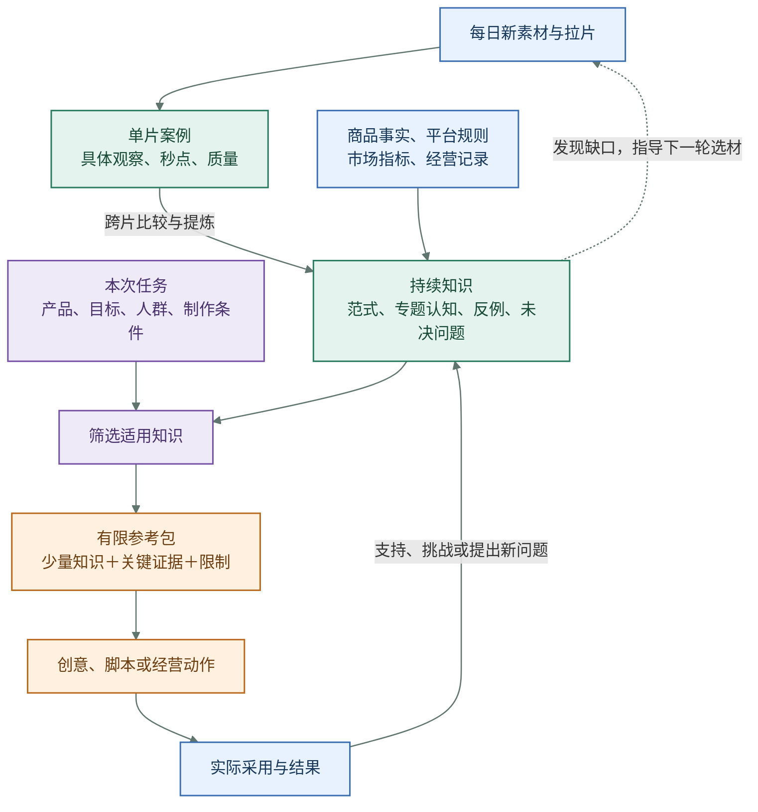
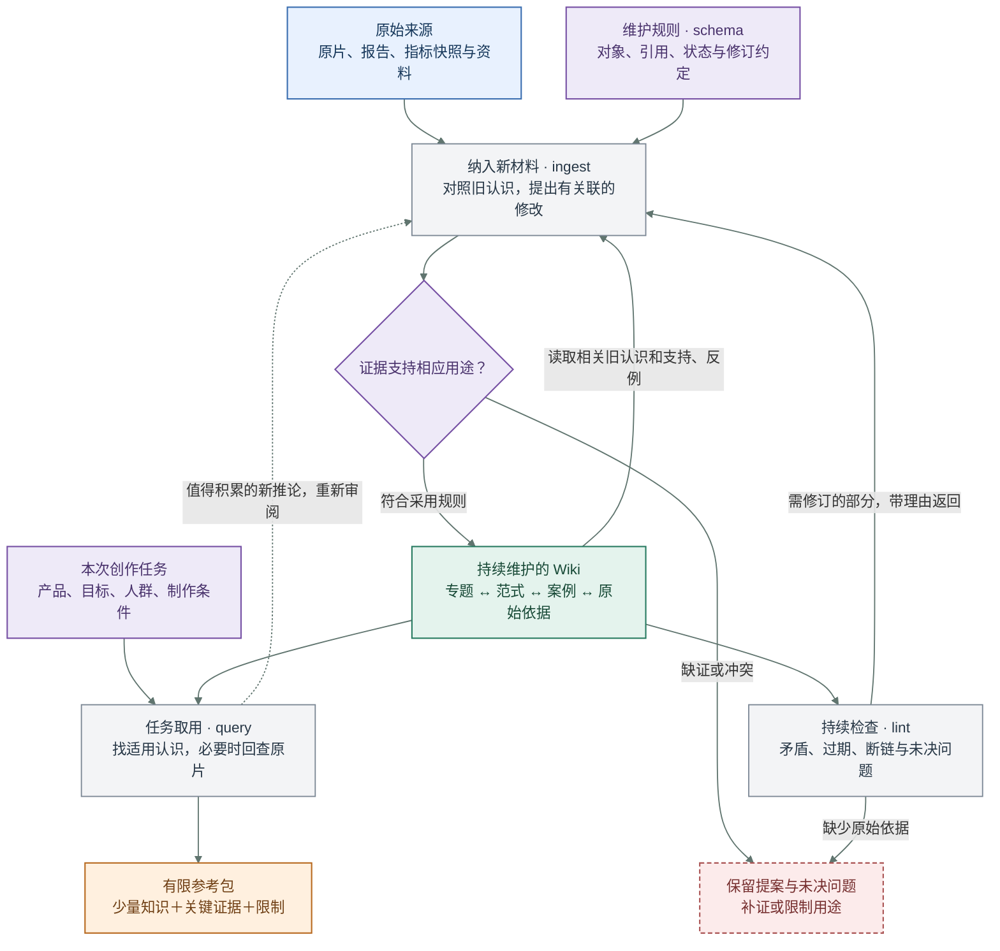
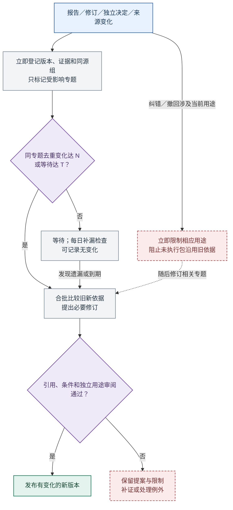
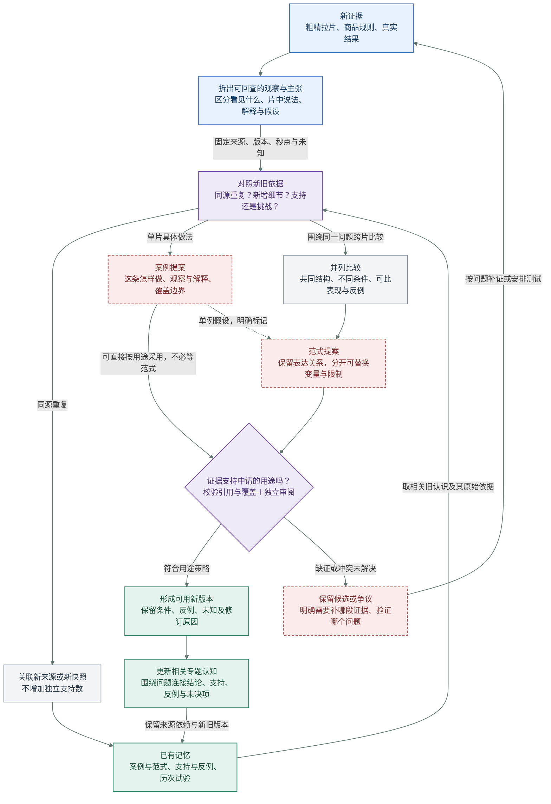
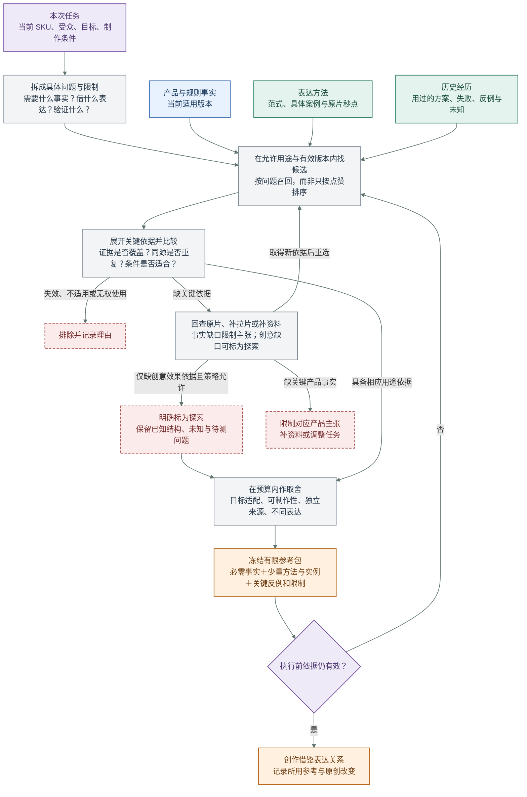
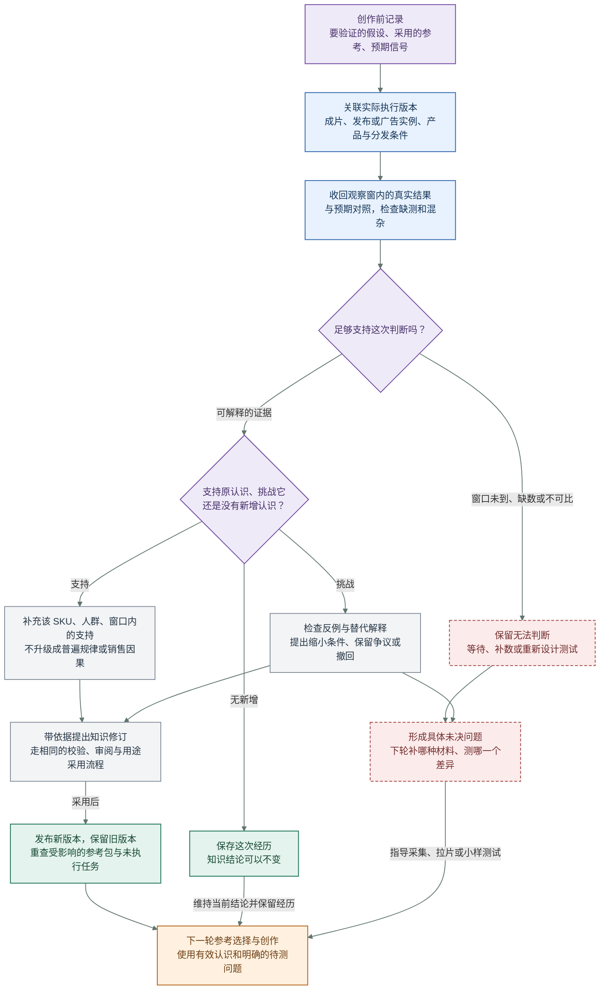
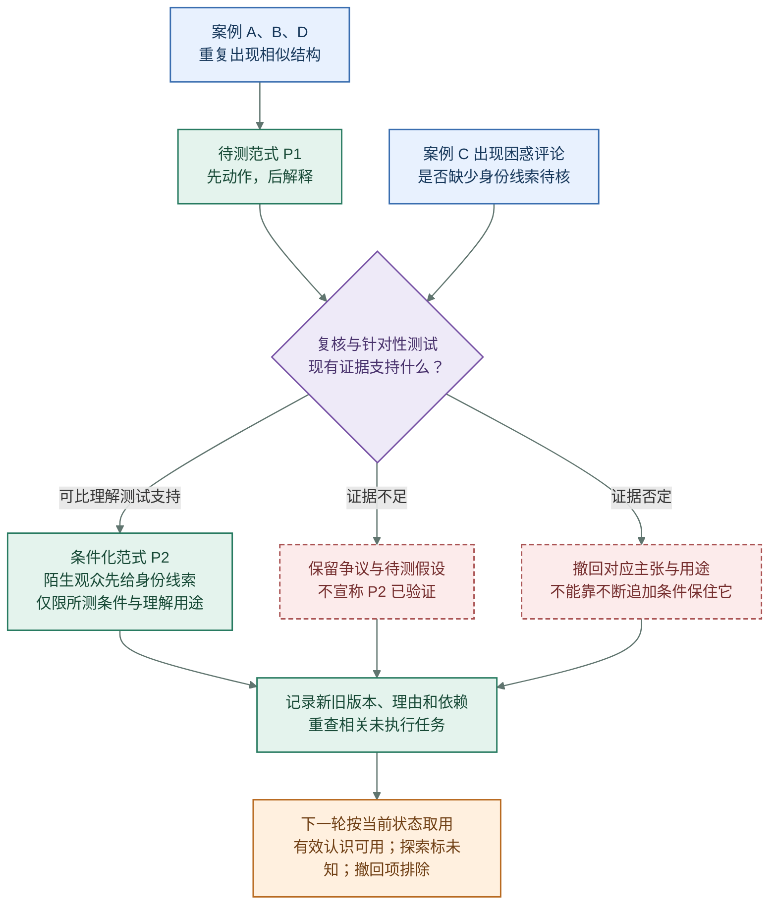

# 知识与记忆：让持续研究服务下一次决定

2026-10-22 对齐：本页保留产品场景与使用细节；[认知自我成长的目标、模型和行为](../research/purpose-architecture-20261022.md)是当前设计正文，[实现评审](../research/architecture-review-20261022.md)记录固定代码能力。知识研究随来源、Query和维护事件持续发生，日报按截点聚合已发表变化；下文带日期的旧数量、方法与部署判定均按当时记录解释。

2026-10-19 本地增量实现与限制见[决策阅读层实施记录](../evidence/decision-value-20261019.md)。本地验证不代表已部署或已生成生产内容。

2026-10-17 历史快照（不代表当前数量与部署状态）· **目标设计与首日运行中的缺口。** 自动来源登记、专题 build、日报和探索参考包已接入日批；首日两个宽专题因 29 份分析报告、21 个来源组超过单批上限而受限，自动包虽有效却只纳入 4 个 Case、0 个 Wiki。分批研究与参考包取舍已完成本地实现和合成验证，但未部署，尚未通过真实新运行验收。知识属于本项目，保存在模型之外；不等于聊天记忆或用户个人跨工具记忆。[查看当前实际能力与缺口](../../index.html#current-state)。

2026-10-16 的 5174 专题、图谱、证据回查与探索包验收是历史记录；2026-10-17 Mini 日批已启用来源事件和自动合批，旧独立连续调度仍关闭。10 月 16 日中午旧基线的精确 Vitaminme 专题曾产生新 Wiki（2 次模型调用）及一次 0 调用 `no_change`；它们不是本轮新知识。本轮新 knowledge 为 `changed=0`、`restricted=3`、模型调用 0，首日 4 个 job 额度剩 1 个；宽专题受限不能算专题成功。内容审阅与业务验收仍须单独记录。类型分面词表、完整关系治理、非视频行动、制作发布和两轮经营反馈尚未完成。见[当前运行](../../index.html#current-state)、[主站验收](../evidence/main-workbench-20261016.md)与[持续更新实现](../evidence/learning-loop-20261016.md)。

## 日报研究怎样建立和修订知识关联

2026-10-19 起逐步明确：日报要回答经营与创作问题，认知研究本身持续发生在知识库中；用户于10月22日进一步明确认知自我成长是核心目标。以下产品情境服从上述当前设计，不再为日报单独重做知识构建。日报的问题、信息维度与阅读验收由[每日研究报告](../../index.html#daily-research--%E6%8A%A5%E5%91%8A%E5%BF%85%E9%A1%BB%E5%9B%9E%E7%AD%94%E7%9A%84%E4%B8%83%E4%B8%AA%E9%97%AE%E9%A2%98)维护。

### 关联的单位是带条件的命题

仅把两篇知识标成“相关”或放进同一专题，不能解释它们如何共同影响一个决定。可讨论、可修订的单位应是具体命题：它回答哪个问题，在什么条件下成立，依据是什么，受到哪些反例或未知限制。知识页面组织并持续维护这些认识，原片、规则、商品资料与结果记录提供依据；日报解释所读正式变化及对选择的意义。命题不要求逐句拆成Claim，独立对象与页内正文的权威边界由主设计维护。

同一命题可以连接多个专题，例如“新观众能否理解产品用法”同时涉及剂型、演示顺序、达人讲解和商品页。不能因关键词相似就合并命题，也不能让不同专题各自复制一份逐渐矛盾的结论。既保留当前有效理解，也保留历史版本及此前为何作出选择。

| 关系所表达的意思 | 必须说明什么 |
| --- | --- |
| 支持／挑战 | 哪份独立原始观察支持或挑战哪个具体命题，支持到哪个程度；新证据不一定推翻整条认识。 |
| 限定适用条件 | 新案例为何要求收窄、细分或重新验证某种人群、场景、剂型、语言或渠道条件；扩大范围也需相应依据。 |
| 机制假设／替代解释 | 哪些已观察要素可能共同解释现象，另有什么解释仍成立。联系可以先作为假设存在，不能直接登记成因果。 |
| 实例与对照／不可比 | 案例在哪些维度相同、哪些不同，为什么能或不能进行这次比较。不可比也是有价值的研究结果。 |
| 前提依赖 | 哪个产品事实、规则、身份、授权或执行条件一旦不成立，会改变下游建议；知识用途批准不等于获得外部行动授权。 |
| 同一原始来源 | 粗精报告、多供应商记录、日报与 Wiki 是否反复使用同一原片；重述和多次发布不增加独立证据数。 |
| 行动检验／结果反馈 | 哪次行动使用了哪个命题与版本，实际改了什么、在何条件下得到什么结果；结果支持、挑战或暂时不能判断什么。 |
| 修订与替代 | 旧理解、新理解、变动原因和受影响决定；没有新认识也可以只增加实例、记录处理或保持不变。 |
| 缺失证据 | 哪个未知阻断何种判断，取得什么材料可能改变决定；模型未执行、没有权限和现有证据互相冲突不能混为一类。 |

每条有意义的关联都应带对象、理由、条件、准确依据与当前状态。来源链、阅读导航和解释性关系分别表达；“这篇引用那篇”不自动说明支持，“相关”不自动表示可迁移，“同时出现”不自动表示因果。甲方两个“80%”陈述的分母不同，不能因为数字相同就互相支持或合成为一条经营结论。

### 从新材料到新认识，再回到日报

1. **带着问题开始。** 读取当前业务目标、开放决定、上次判断和未决问题。新素材可以提出新问题，不把研究永远锁在既有专题里。
2. **保存并识别原始依据。** 分开商品／帖子／广告／账号及取得途径，保留原始时间、指标口径与视听覆盖。同源粗精视为一个来源组。
3. **按问题找旧认识及反证。** 不只找与新原片同来源的 Wiki，还要找到相关人群、问题、机制、前提、失败案例及前次行动结果。可以提出跨专题联系，但不能把尚未读取的邻居当成已核查支持。
4. **在可比维度上比较。** 先说明相同与不同，再提出支持、挑战、条件细分、替代解释或不可比。不能先抽象成“某种套路”，再把所有相似标题塞入。
5. **形成认识变化提案。** 写清“原先怎样理解 → 哪份新依据或新比较 → 现在怎样理解／为何不变 → 影响哪个决定 → 怎样证伪或继续验证”。重写一段话不必然产生认识变化；从旧材料得到新联系也可以先形成候选假设。
6. **审阅并维护知识。** 在明确范围内核对原始依据、独立性、反例、条件与关系理由。适合探索的认识只按探索采用；不够的留作候选或研究问题，不换请求键盲目重试未知结果。通过后保存准确新版本、修订关系及受影响内容，不覆盖历史。
7. **编写日报并记录决定。** 报告使用已审阅版本，另行区分候选解释和未决事项，解释对当前项目决策的意义；当前优先抖音任务，Perseek历史场景保留。新比较、问题与决定可作为研究经历保存；其持久结论仍回到原始依据，不以“日报这样说”增加支持数。
8. **让行动结果改变下一轮。** 保存采用版本、实际执行、偏离方案、观察窗口与结果。把意外与失败送回相关命题，再决定重检、收窄、继续观察或放弃，以及下一轮要找哪些材料。

这些工作持续按新证据、纠正、问题或真实结果触发，不为知识 build 设置每日次数目标。日历决定阶段报告的截点，不决定知识何时停止更新。正常流程由 AI 在配置范围内推进；人处理越权、重大冲突或确需业务判断的例外，不逐条人工批准每次关联。

构建预算不足时可先处理局部命题，再用其已审阅版本做问题级综合；明确本次取到哪些支持、反例及缺失。不能把有界页面的导航目录当成全专题综合，也不能靠把越来越短的总摘要反复压缩来取代原始证据。

### 以认识变化而非产出数量验收

一份报告、一次 build、一个关系节点都不是学习量。至少检验三种不同结果：新证据出现但原判断仍成立；反例使适用条件收窄并改变下次选材；某次自家结果否定或保留创作假设，并使下一轮行动发生可解释的变化。

验收还需包含：同源重复不增支持、相似但无业务理由的联系被拒绝、不可比案例不强合并、旧材料产生新假设仍标待核、缺经营资料时不把形式研究升级为经营结论、前提失效能找到受影响决定。每条输出须能追到准确依据，机器审阅与真人／业务成效分别记录。

## 一眼看懂本模块

这张总览沿用用户给出的关系：**研究如何积累为持续知识，今天如何使用，结果又怎样改变明天的认识？** 它下面的三个过程需要分别展开：[怎样记住并修订](#从单片到专题)、[怎样为任务选参考](#一次创作只读什么)、[怎样从实际结果学习](#实际结果怎样修正知识)。

**全页图例：** 🔵 证据与观察　🟢 长期知识与记忆　🟣 任务与判断　⚪ 处理动作　🟠 本轮参考与创作产物　🔴 虚线框：待补证、争议或限用。

颜色表示对象的角色，**不表示效果好坏或结论真假**；绿色知识仍须读其用途、条件和证据状态。分支判断用菱形，未决项保留文字与虚线边框，不能只靠颜色理解。

**昨天研究过的东西，今天能带着依据和适用条件使用；今天的新证据，又能修正昨天的认识。** 图里有两条不同的返回路径：实际结果修订知识，知识缺口指导下一轮获取材料。

跨片比较用于形成和修订专题；单条粗拉或精拉也可按覆盖与用途形成可用案例，直接作为参考包的依据，不必等待多片范式。图表达目标机制，尚未代表自动闭环已经运行。

| 进入这里 | 本模块要作的判断 | 交出去 |
| --- | --- | --- |
| 粗精报告、产品与规则资料、经营记录、自家反馈 | 能支持什么、适用于哪里、哪些仍未知 | 可回查的案例、主张、范式和专题 |
| 本次产品、目标、人群、语言与制作条件 | 哪些知识和原片细节适合这次任务 | 一份有限参考包，交给[创作](../../index.html#creation) |
| 新证据、反例或失效依据 | 保留、修订、争议还是撤回 | 新知识版本，以及受影响任务的处理理由 |

**人能看到：** 一条结论的来源、用途、未知和版本；本次为什么选择这些参考；新反馈究竟改变了什么。AI 在配置范围内处理这些工作，人可以纠正、撤回和处理例外。

## 为什么要分层

原片和报告持续增加，创作上下文却有限。长期保留证据和关系，每次只读任务所需部分；昨天的总结不能被反复压缩成唯一依据。

| 层次 | 保存或完成什么 | 阅读入口 |
| --- | --- | --- |
| 材料层 | 实际拿到的原片、指标、事实和规则资料 | [素材库](../../index.html#materials)、来源与快照 |
| 案例层 | 这一条说明什么：具体观察、解释、秒点、质量与未知 | [拉片报告](../../index.html#product-analysis)、案例与主张（Case / Claim） |
| 知识层 | 多条依据放在一起，目前怎样理解问题、哪些条件下适用 | 范式与专题（Pattern / Wiki）、支持、反例和争议 |
| 使用层 | 根据本次任务，选择少量适用知识和原始依据 | 本次参考包（ReferencePack）、选排理由与版本 |
| 反馈层 | 用实际采用、新结果和新证据修订此前理解 | [实验与反馈](../../index.html#outcomes)、修订理由与受影响任务 |

### 记忆究竟保存什么

“记忆”是跨任务保留上述对象及其关系的能力；“知识”是从中形成的、带条件且可以修订的理解。它们使用同一套项目记录，不额外造一份越来越短的总摘要。

| 必须记住的内容 | 下一次具体用在哪里 |
| --- | --- |
| 证据：实际看过的原片、秒点、通道、规则与指标版本 | 质疑一个结论时，能返回它最初依据的内容 |
| 认识：案例、主张、范式、支持与反例、当前适用条件 | 为新任务找到可以借鉴的表达方法，也知道不能怎样用 |
| 经历：当时的任务、参考包、选择理由、实际成片及结果 | 避免忘记“我们试过什么、改了什么、为何暂时不能判断” |
| 变化：旧版、新版、修订原因、未决问题和引用关系 | 只更新受影响的认识与后续任务，保留过去为什么那样决定 |

专题 Wiki 按问题把它们连起来，例如“陌生观众怎样理解这个产品”；案例提供实例，范式提供可迁移方法，经历记录我们的实际尝试。LLM 阅读、比较和提出修改，项目保存这些对象的证据、关系和版本。

知识卡是这些对象在界面的统称；专题是围绕问题组织它们的阅读视图。商品事实、官方规则和经营记录可以直接形成带来源的主张，不必改写成视频案例。七目标的研究都可进入，知识库不限于视频形式。

### 类型、身份和标签各回答什么

保留七类知识对象：**案例 Case** 记具体材料，**主张 Claim** 记有条件的判断，**集合 Collection** 固定纳入范围，**比较 Comparison** 对齐可比与不可比之处，**范式 Pattern** 记可迁移的方法，**专题 Wiki** 围绕稳定问题持续修订，**参考包 ReferencePack** 冻结一次任务实际取用的内容。无需为了增加标签再造对象类型；原片、帖子、广告和商品仍由各自的材料记录管理。

| 不同问题 | 产品中应单独记录的答案 | 不可偷换成 |
| --- | --- | --- |
| 关于谁、从哪里来 | 商品、帖子、发布者、创作者、广告主及获取平台的身份和依据；未知就留未知 | “研究 Perseek”即片中确为 Perseek 商品，或公开可见即自然流量 |
| 正在研究什么 | 稳定专题问题及其当前版本，例如“陌生观众怎样理解产品” | 每次构建新建一个同义专题 |
| 内容讲什么、怎样讲 | 内容主题、载体形式、叙事机制、视听手法和制作条件等分面 | 商品身份、传播效果或用途批准 |
| 这是什么认识 | 观察／解释／假设，以及表达、商品事实、平台规则、经营结果等领域 | 一个混合标签同时表示证据方式和论题 |
| 哪里、何时、为了什么可用 | 市场、语言、人群、产品版本、证据覆盖、当前有效性与独立用途决定 | “未登记市场”即全球适用，或标签命中即能用于创作 |

**词条和一次标注分开。** 词条有稳定身份、所属分面、定义、多语言名称及别名；只有真正需要时才设上位或相关词，合并或废弃保留历史。一次标注则指出它贴在哪个准确对象版本、整片还是哪个秒段或主张、依据是什么，由规则、模型还是人工提出，以及处于提出、确认或撤回哪种状态。确认可以按已配置规则自动完成，不默认逐卡人工审批；词表和标注各自留版本，原始供应商标签并存，不能被规范词覆盖。相同标签只帮助召回待比较材料，**不构成支持同一主张或证明同样有效**。

阅读关系也分四类：**来源**追到准确原片、报告与证据；**收录与导航**说明集合、专题和相关词怎样组织阅读；**支持或挑战**说明针对哪条判断、在什么条件下、凭哪段证据；**执行依赖**说明哪个版本或未执行参考包依赖哪条有效依据。专题收录一个主张、案例共享标签或图上有连线，都不能自动画成“支持”。技术合同及失效遍历见[知识架构](commerce-architecture.md)。

**材料归属按问题判断，不靠标签自动定题。** 新材料可带理由进入多个现有专题，每处说明它回答或挑战哪一问；遇到确实不同的新问题，可提出候选专题并说明与现有专题的边界。暂时无法归属的材料留在可追踪收件箱，保留来源和待判原因，不因没有专题而丢失。专题保持稳定身份；同义问题先合并候选而不每天新建，问题边界改变时记录拆分、合并、迁移成员和旧版去向，已有引用仍可回查。

### 粗精拉进入知识时保留哪些语境

同一条素材的粗拉与精拉作为两个准确报告版本保留，同时按原片来源组去重。粗拉可直接贡献其实际覆盖内的观察；精拉补充更细的时序、声音或解释，也可能提出反例、纠错或仍有未核部分，不能自动覆盖粗拉或继承其用途决定。

专题 build 按问题选取这些报告、各自的来源快照和允许用途，与旧理解对照，再提案、独立审阅和发布。具体来源、覆盖、观点与效果不可比较时分别说明，不把高赞报告拼成普遍有效的范式。当前探索编译读取原样报告、冻结分析上下文及其中准确归档的帖子记录；它没有完整指标或市场事实输入，不能回答增长或转化效果。

专题阅读与证据详情的目标是同时看见**原帖发布**、**来源记录/指标观察**、**粗精拉与覆盖**、**当前用途**、**知识更新时间**。这些是可比较的字段与版本，不另加知识对象 kind；图上“同一素材的粗/精报告”也是来源关系，不是两份独立支持。时间筛选应明确按发布、发现、分析还是构建筛选，未知值单列，不根据新建 Wiki 日期判断知识依据是否新鲜。字段语义及历史补证规则见[素材属性与日期](../../index.html#materials--%E5%B1%9E%E6%80%A7%E4%B8%8E%E6%97%A5%E6%9C%9F%E6%80%8E%E6%A0%B7%E9%9A%8F%E7%B4%A0%E6%9D%90%E8%BF%9B%E5%85%A5%E7%9F%A5%E8%AF%86%E5%BA%93)。

## LLM Wiki 的核心：把新材料编进已有认识

**新材料到来时，就把它与已有认识比较、整合；下次提问从已积累的理解出发，必要时回到原始依据。** 因而系统持续维护的是有联系、会修订的知识页，不只是按日期堆放的拉片摘要。

Karpathy 的 [LLM Wiki 模式说明](https://gist.github.com/karpathy/442a6bf555914893e9891c11519de94f) 区分三类内容：不可变的原始来源（raw sources）、持续维护并互相链接的知识页（wiki），以及约定组织和维护方式的规则（schema）。模型围绕它们执行 ingest、query、lint；有价值的查询发现也可保存回来。这里的 schema 包含写作与维护约定，不只是数据库表结构。

| 工作 | 在我们的产品中具体发生什么 | 必须留下什么 |
| --- | --- | --- |
| 纳入新材料 · ingest | 新片先形成案例，再对照相关旧认识：增加实例、补支持、提出反例或修改适用条件 | 原始依据、修改提案、受影响专题；重复材料可以只关联来源 |
| 为任务取用 · query | 按本次 SKU、受众、目标和制作条件找知识，核对关键原片，选择有限参考 | 所选版本、理由、反例与限制；新推论先作提案，不自动成为事实 |
| 持续检查 · lint | 找矛盾、过期依据、断开的引用和知识缺口，决定复核或下轮研究什么 | 哪条认识受影响、是否限用、待补什么；检查也可以得出无需修改 |

下面展示三个动作怎样围绕同一套知识发生；[后面的 A/B/C 示例](#虚构示例反例怎样改变下一次创作) 展示一次具体更新。

**我们采用这一知识维护范式，业务知识仍由自己的系统保存。** 目标设计里，PostgreSQL 管知识对象、关系和版本，R2 管原始文件；Wiki 是组织与阅读这些对象的方式。视频秒点、粗精覆盖、用途审阅、有限参考包和结果回流，是本项目对该范式的扩展；不表示已接入某个同名开源库，也不表示闭环已实现。技术取舍见[知识架构](commerce-architecture.md)，原型与替代方案见[研究依据](../../index.html#wiki-research--2-llm-wiki-%E7%9A%84%E5%87%BA%E5%A4%84%E4%B8%8E%E5%90%8C%E5%90%8D%E5%8C%BA%E5%88%86)。

### 持续构建的三种节奏（目标设计）

新增报告（包括迁入报告）、报告修订、准确版本的独立质量／用途决定变化，以及来源撤回或失效，都先触发**确定性登记**：核对身份与版本，保留原始报告和决定，固定证据、粗精同源等可由标识确认的关系，并标出受影响专题。重复输入不重复发布；同片粗精是两份各有准确版本的报告，却仍是一组来源，不算两次独立支持。报告运行成功或被登记，只说明材料进入可查范围，不让探索、拒绝或未知决定绕过用途限制。

**语义构建按专题合批。** 对同一专题，累计去重后的来源变化达到待测数量 N，或最早待处理变化等待达到待测上限 T，就比较新依据、仍有效旧依据及反例；提出集合、比较、范式或专题的必要修订，再核查引用、条件、独立用途决定与冲突。每天另做一次补漏检查，寻找漏登记、断链、过期、矛盾与等待过久的专题；它是兜底，不要求每天调用模型。输入没有变化时先跳过模型；有新输入但提炼后没有新认识时，也可记录“无变化”及已发生用量，不强造新关系、范式或知识版本。当前日批以 8 个待处理来源或最早等待 30 分钟等条件触发合批；N、T 与成本上限仍须按真实流量和质量复验，触发不等于构建成功。

**宽专题分批研究（本地实现与合成验证，尚未部署）。** 同一语义专题下按准确报告 FIFO 生成每批最多 20 份报告且字节有界的研究页，不因批次新增同义专题。保留全量 inventory；父 Wiki 只导航覆盖范围，并准确显示已审与 pending 数量，不把子页递归摘要冒充全局综合。首批完成不确认全专题水位，剩余批次无需等待新事件即可自动续做；最终重新核对报告、采用决定、专题归属及有效性后才确认相应水位。原片 SHA 单独用于来源去重，不能替代准确报告覆盖。每 job 最多 2 次模型调用、每日预算不变；首日超限的旧 `restricted` 记录保持历史，不改写为成功。

**纠错和撤回走即时限用。** 独立决定改为拒绝、关键转写纠正或来源失效时，立即按受影响证据和用途限制当前可用知识与未执行包的执行，之后再等待同专题合批修订。只错在台词，不必把独立的画面观察也一并否定；已执行包、当时的版本与创作历史保留，但未来执行必须重新检查依赖。未经独立审阅的语义提案不因定时器触发而自动通过。

这张小图只说明**何时触发、改变什么、什么还不算通过**；完整的单片判断与实际反馈仍看后文。

工作台应能按对象类型、实体身份与来源、专题、内容分面、认识方式与领域、用途／有效性／适用范围**分别筛选并组合**。构建记录区分 `changed`（有新版本）、`no_change`（已检查但无需修订）、`restricted`（已限用、待补证或待审阅）和 `failed`（构建失败）；每次显示触发原因、读入的准确来源及旧版、改动或未改动的对象、用途限制、实际费用与后续动作。失败不清掉待处理专题；限用不伪装成已发布新认识；“已登记”不展示成“已批准”。人主要配置策略、纠正与处理例外，AI 在界限内持续推进。来源事件与自动合批已启用，但宽专题分批、全局覆盖表达与质量验收仍待完成。

## 从单片到专题

**一次新的拉片，不直接变成一条新的“爆款规律”。** 系统要先判断：新增的是具体事实、已有认识的支持、适用条件的例外，还是目前无法解释的矛盾？

单片观察可以直接成为指定用途的可用案例，也可提出明确标为单例的范式候选；跨片比较用于进一步检验共同结构和适用边界。范式不是复制镜头清单，而是保留“解决什么问题、靠什么表达关系、什么条件下可能有效”。未采用候选仍可查找，但不会混入已采用知识。正式版本保留在模型之外，生成一次回答不等于已经记住。

### 粗拉与精拉都可以提供可用知识

采用取决于**覆盖与用途**。例如粗拉确实看清了开头动作，可以支持该范围的结构观察；它没看清的声音或字幕，需要补证。精拉报告也可能有未核内容，不能因篇幅长就获得更高可信度。

| 情况 | 可以怎样用 | 还不能据此说什么 |
| --- | --- | --- |
| 可回查的结构观察，通过用途校验 | 作为案例或表达参考 | 这个结构一定带来成交 |
| 视频中出现某句功效台词 | 记录“片中这样宣称” | 我们的产品也具有该功效 |
| 单条片提出一种方法 | 保存单案例范式候选（single_case），按范围试验 | 已得到普遍规律 |
| 声音、字幕或关键动作未覆盖 | 补相应证据或按问题精拉 | 用模型补齐未看的内容 |

### 范式要能指导一次新的创作

一条范式至少说明：解决的注意力、理解或信任问题；表达骨架；不可丢的结构与可替换变量；产品、人群、语言及制作条件；来源秒点与表现口径；反例、未知、成本及下一次可检验的预测。只起名字或写一句口号不够。

### 多片比较先固定比较范围

先确定产品/SKU、人群、市场、语言、形式、期间和纳排规则，再比较准确的媒体、帖子、广告、报告及指标版本。发布年龄或曝光条件不同则分层；同片粗精、同帖三平台结果、同源系列不当独立支持。

专题同时呈现支持、真正反例、不适用例和未知。新片可能增加支持、挑战、缩窄条件，或只补一个实例；重复表达不必每天生成新卡。没有样本分母，不推算某种形式的成功率。

## 采用、纠错和失效

### 工作台怎样展示一条知识

下面是界面字段示意，**不是已经取得的结论**：

| 字段 | 示意内容 |
| --- | --- |
| 结论及类型 | 开头先显示动作；属于结构观察 |
| 依据与覆盖 | 案例 A 的某版报告、0–3 秒；已看画面，声音未知 |
| 当前用途 | 可作镜头结构参考；不可作商品功效依据 |
| 检查结果 | 来源与秒点可回查；审阅指出声音缺口 |
| 采用结果 | 仅采用画面结构用途；其他用途待补证 |
| 更新影响 | 依据失效时，关联的未执行参考包需重新检查 |

专题页应以**当前认识、支持与反例、证据缺口、最新变化**回答研究问题，再按需展开案例和原片，不先铺满所有节点。点开节点可看准确版本、范围及原始依据；点开“支持／挑战”边，应看到它针对的主张、条件、理由和证据秒段，点“收录”边则只显示导航关系。版本对比说明哪句话及适用范围改变，列出受影响的未来参考包和待处理任务；旧包仍按当时版本查看。收件箱、候选专题与有界研究请求可从相关问题进入，避免无归属材料在图外消失。这是目标交互，当前探索图谱及专题阅读不代表这些关系已有语义验收。

“运行结束”“检查通过”“审阅意见”“用途采用”“现在是否适用”“真实业务效果”分开展示。AI 可提出变更，确定性校验、独立审阅和配置策略决定是否自动采用；人工复核可用，不是每张卡必经的日常步骤。

从提案进入可用版本前，系统检查来源、版本与引用是否完整；独立 AI 审阅检查证据是否支持所申请的用途，并留下意见。符合已配置用途策略才自动采用，无法按配置解决的冲突交操作者；执行参考包时再检查其依据是否仍有效。具体自动采用范围仍列在本页未决项中。

用途决定要说明**哪条主张、哪段证据、哪个通道和秒段、允许哪种用途**；整份报告的独立决定同时作为上位限制。整报告明确拒绝某用途时，局部“通过”不能绕过它，必须先有可追溯的复核或新决定解除冲突。若错误只在台词，独立的画面观察须有自己的画面锚点、覆盖核查和该用途资格，才可继续使用；不能仅因两者在同一报告中就一并批准或一并撤回。报告是否可读、局部证据是否成立、能否进入知识与未来创作分别显示。

功效、安全、资格、平台规则、财务归因及授权要有独立依据。缺证或冲突先补证、限制用途或交操作者裁定；未通过用途审阅的内容保留为明确标注的探索材料，不自动变成自家产品事实。

### 发现错误后会发生什么

字幕纠正、原片撤回、规则或产品版本变化、新实验出现，都触发修订提案：保存新旧差异、证据、挑战关系和受影响下游。

- 关键依据失效：先停止关联旧参考包的新执行，再修订知识与重建参考包。
- 两个主张冲突：保留争议并补证，不用采集时间或票数选真。
- 已执行方案：保留当时的参考、脚本和实验条件，不用新版倒改历史。
- 证据否定原方法：允许撤回；不能不断追加条件让方法永远正确。

### 缺口怎样变成下一轮研究

缺口不只是一句“待补证”。系统为它留下可追踪研究请求：关联受影响的专题、主张和用途，写清缺什么、补齐后能改变哪项决定、价值与优先级、可用预算和完成所需证据。行动可选继续采集、按具体秒段局部精拉、核对商品或规则事实、安排可比较实验；没有必要的精品不因额度未用完就精拉。一次请求可以等待外部结果，也可以因权限、预算或证据不可得而受限；这些状态和尝试要保留，不能写成已完成。新证据返回后，只重查关联主张、专题及未来包，记录请求解决了什么、仍缺什么；用户可纠正优先级或处理例外，正常路径由 AI 在配置边界内推进。

## 一次创作只读什么

### 从任务开始筛选

任务来自运行配置与前轮反馈。先把“做一个 Perseek 视频”拆成可判断的问题：讲给谁、希望发生什么、表达卡在哪里、能用什么制作方式、哪些事实已知、这轮要验证什么。再确定检索和取舍。

**选择发生两次：先决定能不能用于这次任务，再决定哪些最值得占用有限上下文。** 热度是候选线索；适配与可制作性决定取舍。跨品类案例可以借表达结构，不能继承它的产品功效或销售表现；相似度也不是事实置信度。可选单条案例、多案例对照或范式加实例，不要求先建完 Wiki。

一个**假设选材例子**：任务是用 AI 角色动画，让陌生观众理解已核实的产品身份，测试开头理解情况。下面只说明取舍，不声称这些参考已拉片或验证有效。

| 候选 | 为什么取用或排除 | 交给创作时保留什么 |
| --- | --- | --- |
| 当前 SKU 的事实与禁用主张 | 必须保留，决定能说什么 | 准确版本和事实来源 |
| 其他品类的角色反转短片 | 若解决相同的理解问题、制作条件可行，可借结构 | 反转机制、对应秒点、不可迁移的产品说法 |
| 同品类但依赖真人长期体验的高赞片 | 热度高，表达所依赖的真实经历当前无法复制 | 排除理由；不能把真实体验改成 AI 假证言 |
| 一条声音未覆盖的粗拉案例 | 可借已核画面结构；依赖台词时先补声音 | 可用范围与具体待补内容 |
| 自家旧试验中“角色有趣但产品不明”的案例 | 可提示当前任务的风险，避免重复问题 | 当时成片、条件、反馈与尚未证实的原因 |

包超预算时，优先删同源或表达重复的例子；关键产品事实、限制与必要反例不能因压缩而消失。必要依据仍装不下时拆任务或给出缺口，不用更短但失真的总结冒充完整参考。

当前首日自动包虽为有效探索包，却纳入 4 个 Case、0 个 Wiki，不能证明专题研究增益，A/B/C 对照尚未进行。本地新版自动包只取最近 3 个已审研究页的准确候选，不代表全历史知识库检索；旧默认 hash/路径保持。新版取舍是：任务显式要求 Wiki 用途时，在现有 30000 预算内先保留相关 Wiki 与 Case 的最小组合，再裁掉低优先级支持材料；反例、已知事实和限制不得因压缩丢失。若仍无法装下，应明示缺口及用途限制，不伪称已有研究提升。

### 参考包的最小交付

| 内容 | 创作需要它做什么 |
| --- | --- |
| 本次任务及已核产品事实 | 知道讲给谁、讲什么，哪些不能讲 |
| 少量案例或范式的准确版本 | 知道借鉴哪个方法、为何适用 |
| 关键原片秒点与反例 | 看具体做法，也看失效情形 |
| 选入与排除理由、冲突和未知 | 理解取舍，不误读为全库结论 |
| 素材用途、预算和制作限制 | 生成可执行的原创方案 |

执行前重新检查依赖有效性，必要时按锚点回看原片。缺口要返回原因，不能删掉限定词后仍称完整。参考数量与上下文预算由评测决定，不固定为“3–5 张卡”。没有自家效果时允许有限探索；结果尚未成熟时继续等待。

## 实际结果怎样修正知识

**先记住发生了什么，再判断它改变了哪条认识。** 自家结果是与当时任务、参考、成片和分发条件绑定的一次经历；它不能直接覆盖整个范式。

| 遇到的结果 | 更新哪一层 | 暂时不能改变什么 |
| --- | --- | --- |
| 数据还没回来 | 记录等待与下次观察时间 | 不把缺数写成零，不判范式失败 |
| 曝光低且不清楚分发条件 | 保存结果和缺口，提出分发问题 | 不仅凭低播放否定表达机制 |
| 在可比较条件下，理解测试支持身份线索 | 给该人群、产品条件下的理解主张增加依据 | 不自动推出销量改善或成分功效 |
| 新证据否定某条关键依据 | 暂停该用途，提出撤回并找出受影响引用 | 不继续执行依赖旧依据的方案，不倒改已发生的记录 |

反馈可能促成**维持、补证、缩小适用范围、争议或撤回**。只有真正发生的采用和观察才进入经历记录；创作 Agent 自评“应该有效”只是预测。关键依据失效的暂停可先发生，不能等完整知识修订结束才阻止错误用途继续传播。

## 虚构示例：反例怎样改变下一次创作

以下 A/B/C/D、秒点、P1/P2 和反馈全部是**说明机制的虚构例子**。

### 一条新材料怎样改动已有 Wiki

假设已有专题页“**陌生观众怎样看懂产品**”：它连接 A/B/D 三条案例，记录它们都先展示动作、后作解释；范式 P1 暂说“动作先行可能帮助理解”，效果与适用人群仍待测试。A 的 0–5 秒可作为动作表达参考。

今天纳入自家试验 C：原记录包含困惑评论和对应观察窗指标。它让系统意识到“观众可能不认识产品”，但还不能确定原因。

| 同一对象 | C 到来之前 | 纳入 C 之后 |
| --- | --- | --- |
| 原始 A/B/D 与报告 | 保留原片、秒点、已看通道和版本 | 不改写原记录；另存 C 及其来源、条件、指标窗口 |
| 案例与主张 | A/B/D 的动作与解释关系 | 新建案例 C：已观察到困惑；“缺身份线索导致困惑”只是假设 |
| 范式 P1 | 待测的“动作先行可能帮助理解” | 增加潜在反例 C 与适用性争议；不凭一条评论直接推翻或证明 P1 |
| 专题页 | 已有做法、支持和未知 | 新版并列“已知什么／被什么挑战／下一步验证什么”，链接 P1、C 及原依据 |
| 待办与变化记录 | 效果待测 | 增加“先给产品身份是否更易理解”的测试；记录修改理由、旧版和受影响引用 |

**这一次新增的是案例 C，并修改已有认识之间的关系。** 不需要为每条片再造一篇互不相连的“今日总结”，也不要求每次发现都增加范式。

### 什么证据才能把 P1 改成 P2

若进一步复核并做小范围理解测试，在可比条件下发现：不熟悉产品的人，先得到身份线索更容易理解使用动作，就可提出有条件的 P2。它只支持该测试范围内的理解判断，仍不证明销量、留存或产品功效。没有这样的证据，专题保留争议，P2 只能作为待测创意假设；证据若否定方法，也可以撤回。

图中三条分支都能留下记录：支持、缺证和否定会改变下一次使用方式；每次反馈不必然产生一个“更好的范式”。

### 下一次创作实际读什么、做什么

任务是“为已核实身份与标签的 Perseek SKU，做 20 秒英文短片，让首次接触者理解产品是什么”。假设上述 P2 已按用途采用，query 只取下表内容：

| 本轮参考包 | 对这次创作的具体影响 |
| --- | --- |
| 当前 SKU 事实与任务限制 | 身份说明来自自己的产品资料，不能继承参考片的功效说法 |
| P2 当前版本与适用条件 | 先给产品身份或具体问题，再进入动作；不机械套用在熟悉产品的观众上 |
| A 的 0–5 秒＋C 的相关片段 | 借鉴动作与说明的对应关系，并看清失去语境的潜在问题 |
| 反例、未知和待测问题 | 使用原创人物与画面，记录“身份是否更易理解”，不把预测当结果 |

其余几百份报告不进入本次上下文。新成片只记录它实际采用的知识与改变，后续真实反馈再进入上述纳入与复核流程。

lint 如果发现 A 的某段转写被纠正，先沿引用找到受影响主张：只依赖画面的动作观察不必全部失效，引用错误台词的判断需要复核；关键依据失效时先限用相关参考包。知识页、旧版本和实际采用记录都保留，便于知道“当时为什么这样做”。

下一轮若发现 SKU 事实缺失、P2 受挑战或 C 的结果未成熟，参考包显示缺口并限制相应用途；模型不能自行补写产品事实。

## 产品验收与未决

### 怎样证明知识真的有用

先检查固定任务是否找对案例、秒点、关键反例、限制与版本，是否漏掉冲突、重复计算支持或选入失效知识。再用同一产品任务对比“通用提示”“少量原片”“范式参考包”，记录具体性、事实错误、引用、可执行性、人工修改量、时间与费用。创作质量改善不等于销量提升，业务效果交给[真实反馈](../../index.html#outcomes)检验。

固定一组**真实研究与创作任务**及其当时可用证据，变更前后回放同样的问题：检索是否找对相关专题和案例，点开能否到准确证据，参考包引用是否正确，反例与未知范围是否保留，下轮方案是否真的采用了被修订的认识。记录漏召、错引、过度概括、被限用内容误入、无变化时重复生产以及实际时间／费用；样例答案由证据审阅，不靠模型自评分。这验证知识产品能否帮助作决定；自家作品连续两轮真实发布、观察和改进仍按整体产品单独验收，不能用回放替代。

持续构建还需用可观察情境验收；这些是**目标验收，不是当前通过记录**：

| 给系统什么变化 | 应看到什么 |
| --- | --- |
| 同一报告重复登记，或同片粗拉后补精拉 | 版本和新增细节可查，独立来源仍只算一组；重复事件不产生新专题或重复支持 |
| 两个含同一标签、不同机制的案例；一个市场未登记 | 两案可被召回比较，但不自动互相支持；市场显示未知，不扩大为不限市场 |
| 某条反例只挑战一项表达条件，或独立决定拒绝某种用途 | 只定位相关专题和用途；支持／挑战显示针对条件与证据，拒绝项不能流入相应新包 |
| 关键台词被纠正，画面观察仍有独立依据 | 依赖台词的未来执行立即限用，画面用途经核对可保留；旧包和历史不倒改 |
| 到达 N／T，或每日检查发现无新增认识、编译失败 | 记录读写版本、原因、限制、费用和无变化／失败；无变化不调用不必要模型，失败不冒充发布成功 |
| 一份材料涉及两个旧问题、新问题或暂无法归属 | 有理由地归入多个专题、提出候选专题或留在收件箱；同义题不重复建，拆并可追溯 |
| 整报告拒绝某用途，但一段画面另有局部通过；台词随后被纠错 | 上位拒绝不被局部批准覆盖；画面须有独立依据和用途资格，错误台词所依赖的未来执行即时限用 |
| 缺关键商品事实、局部动作证据或尚未成熟的效果 | 研究请求写明缺口、价值、行动、预算与验收证据；权限不足和等待外部结果保持未完成，返回后定位受影响主张 |
| 查看一个专题的变化和关系 | 首屏能读当前认识、反例、缺口和变化；点边见论证条件与证据，点版本差异见未来包影响，旧包不倒改 |

### 哪些还没确定

初期自动采用范围、例外处理责任、证据复核周期、标签分面与词表治理、N／T 和成本上限、检索质量要求、中/英/西语召回、上下文预算均待实测。先用一组报告修订、同源粗精、独立拒绝及来源纠错跑通上述情境，再决定合批参数；不能用单次手动整理推断调度可靠。正式知识保存在项目存储中，技术细节见[知识架构](commerce-architecture.md)及[存储归属](../../index.html#storage-boundaries)；创作怎样接包见[创作规格](../../index.html#creation)。本页的阅读效果另用[文档有效性走查](../../index.html#docs-evaluation)验证，不能用上面的产品实验代替。

## 每日研究报告的归档与构建

每日研究报告本身按准确版本进入研究档案，供回看与后续专题 build 使用。证据先登记，不需要等结论全部成熟才出日报；归档也不等于新判断已被正式采用。日报沿用原帖和拉片的来源组，不能成为自己的第二份支持。产品约定和流程图见[每日研究报告](../../index.html#daily-research)，实现与未接线边界见[本轮实施记录](../../index.html#impl-daily-research)。

### 日报更新与未知页面的连续构建（2026-10-18 实施合同）

日报保存当时的研究上下文；仅有日报改写、排序或版本补充时，仍然有效的原报告审阅覆盖继续保留。准确报告、证据范围、用途决定、专题归属或来源有效性改变，才需要重新检查受影响覆盖。旧综合页仍保留原冻结输入和审阅记录，不能因采用新判定规则而改写历史内容或提升用途。日报提出的新矛盾应进入明确的补证或复核事项，不作为第二份独立证据。

一个构建页的模型结果未知时，保留其任务、调用账本和准确材料范围，禁止自动重放。能够证明不共享该页准确报告、原片来源组或发布对象的其他页面可自动继续；无法证明范围独立时保留阻断。同一专题正常排队和运行仍逐页进行；未知页面始终计入缺口，不能提前宣称全专题完成或越过其待确认水位。参考包只使用已审、当前有效内容。

本节是本轮实现与验收合同，当前部署事实见[知识构建韧性修复](../evidence/resilience-20261018.md)。

### 待确认变化与安全恢复（2026-10-19）

工作台必须区分三件事：未确认变化涉及的去重来源组、准确报告的有效覆盖缺口、持久任务及其构建结果。原“待处理83”按未确认变化的来源组去重，既不是83条事件，也不是83份未构建报告或83个排队模型任务。同一原片的粗精报告可能只是一组；已覆盖报告可复用，未知隔离也会保留待确认变化。事件确认位置仅作为运维细节，不用“已处理200”暗示完成200份报告。没有读取全部准确状态时，界面只说明当前分页，不推算全库缺口。

已知失败和外部结果未知走不同恢复路径。已知ASR失败允许先离线核对：硬界内但几乎全在原片外的末条字幕应舍弃，并保留原始字幕、审计哈希、处理理由和未观察尾段的提示；不能通过放宽漂移阈值将不可信整句当成证据，没有其他可用字幕时仍拒绝。原帖身份冲突／不确定须先补充可核验的绑定证据，不通过新日期或请求键洗白。

知识草案格式失败保存有界、去敏的字段路径与校验类别，便于定位，但不保存原始模型输出或任意未知字段文本。生成及修订须使用明确结构合同；画面时间描述必须与实际引用的准确注册锚点一致，缺证据则删除或标明未知，独立审阅仍是发布前提。只有实质性方法修订或新准入证据改变后，已知受限页才能重新准入一次有界尝试；相同输入不原样重跑。未知请求的原片组、准确报告和页面隔离继续有效，旧报告、拒绝与有效覆盖不倒改。

### 独立研究页的覆盖复用

同一专题可能在同一变化确认水位下多次规划剩余材料。已经完整验证并复用的成功页，不应仅因run不同阻止另一个独立页发布；同页、重叠原片、未知或不完整计划仍不能据此解封。发布事务失败与语义审核失败要按原始回执区分，不能从回滚后的通用失败状态推断审核结论。

### 采集身份与内容主张分开核验

同帖附片关系、帖文与画面细节的关系、主张真实性是三个不同判断。第三方原始响应中精确原帖ID、视频URL、下载回执、原片SHA/字节及冻结帖文一致的归档链，只支持“采集时该提供方返回了这条帖的这段视频”；它不是平台官方签名，也不证明补充剂功效、医学陈述或画面包含长文细节。报告和知识必须继续区分帖文主张、字幕与采样画面。

已知身份失败可在补齐这类不可变证据后走仅操作员可用的预览/应用入口：保留旧失败与诊断，记录审定和新恢复任务；不得直接改为成功或通过普通接口自报“已验证”。同原片的任何结果未知不得因绑定证明而重放。只有本次审定对应的恢复可获一次准入；失败或未知继续阻断，成功后才允许正常的后续分析。新报告仍经正常调度构建知识和独立审阅。该入口设计与实现验证另见实施记录，不由此宣称已上线。

来源核查通过后发生的确定软件登记错误，要与内容不成立分开。只有准确旧失败、已知调用结果、未改变的来源证明及对应实现修复均可核验时，才允许一次受控技术修补；不能用这个入口绕过来源冲突、审核失败或结果未知，也不能无限更换方法重试。修后仍走完整报告校验、登记与知识独立审阅。
