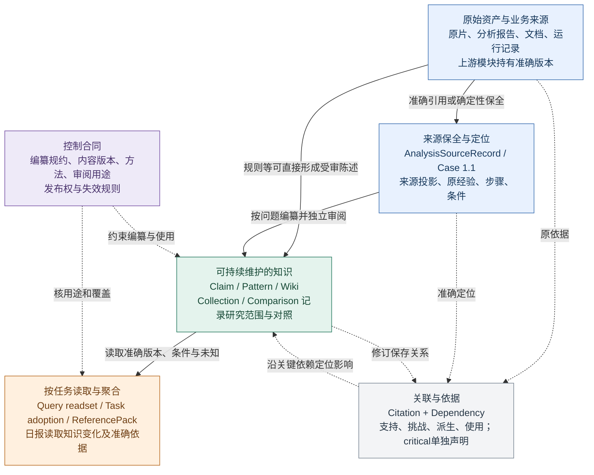
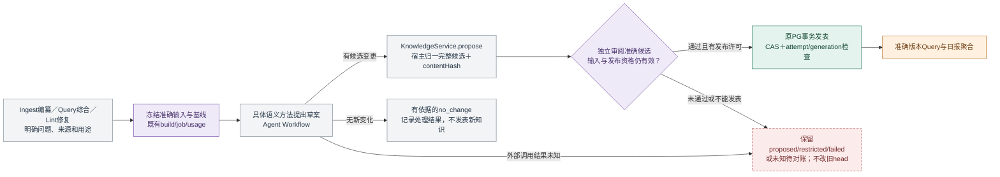

# 知识库架构评审与接口对齐

2026-10-22 · 原工程探针基线 `main@cf6258656360991e7d09dc9529a00f60d96e7e1f`，已包含合并的 PR60；本次知识生长补充复核固定 `main@1c8ba646a6fa976408e2fb6b287f68a93925a9b3`，PR62/63未改变本文所评的知识核心。本页是当前实现评审及后续建议，没有修改业务实现或重新运行知识编纂。业务范围以[七目标 Page](https://chatgpt.com/space/page_d2cb3d9f4fc8819188ac80363db3f30d)和[持续认知 Page](https://chatgpt.com/space/page_35e0d83c4f14819180a5b50a5995a1d4)为准，结合用户最新明确的认知自我成长目标。evoLoop 的 `docs/research/commerce-knowledge/01-scenarios.md`、`02-architecture.md`、`03-implementation.md` 保留为场景、方案与实施计划参考，其中历史基线与目标图不覆盖最新决定，也不充当今日实现完成清单。

## 结论与优先级

关于知识库的核心目标与新分层，请先看[认知自我成长：目标、模型、行为与验收](purpose-architecture-20261022.md)。本页继续保留固定源码的接口评审、合同探针及证据；目标设计和实际实现分别说明。

**可信知识内核已有清楚且值得保留的设计；更优先的设计问题是让知识围绕主体、概念与问题持续生长。** 来源、不可变知识、关系、候选、审阅、发布与任务采用已实际分开。接口收敛与注册调度仍需做，但其服务的对象和行为应先由知识库目标决定，不能靠补齐类型名或整理Worker完成开放编纂。当前目标、图和例子统一维护在前述设计文档；本页集中维护外部范式对照、固定代码限制、工程债与探针证据。

本轮发现一处已复现的写读合同不一致、一处已证实的标题职责歧义、三组主要类型/扩展债，以及维护调度的能力边界和文档状态漂移。没有证据表明它们推翻此前实际链路验收，也没有据此认定生产数据已经损坏。前次验收回答“指定链路能否正确运行”；本次评审回答“对象、行为和扩展规则能否被开发者正确理解，并继续可靠演进”。

以下顺序只针对工程债，不代替认知研究行为的设计优先级。

| 工程顺序 | 问题 | 证据与影响 | 建议 |
| --- | --- | --- | --- |
| A1 合同修补 | 跨域 Wiki 的 binding 可以附到 Claim 并进入提案 | 真实 schema 与 `KnowledgeService.propose` 接受；只读 Query 又以 `CONTENT_BINDING_MISMATCH` 拒绝。写提案与读用合同不一致 | 在写端约束 `CrossDomainWikiBinding` 只能对应 Wiki 及其内容版本；保留来源型 binding 对规则 Claim 的合法使用 |
| A2 合同明确 | 同一 Wiki 的顶层 title 与 content.title 可分叉 | schema 和宿主归一都保留两个不同值。目录与内容可能给同一准确版本不同名称 | 明确两者是否同一标题；若是，统一构造并校验相等；若不同，给出不同名称与职责 |
| A3 类型及解码 | 版本化 manifest 进入 BuildRecord 后丢失具体类型 | 宽字典可带不完整 `wiki-experience@1` 和非数值模型预算；下游靠版本字符串与强转恢复。持久 JSON 没有统一版本 decode | 明确 manifest 判别联合、版本解码器和内部 `BuildRecord<M>`，保留旧记录兼容分支 |
| B1 扩展合同 | 方法、支持版本、来源可用性在多个宿主/读端分派 | 一个 `SourceReadPort` 实现不能独立完成新空间接入；Query synthesis 还硬性依赖规则与经历两个特定适配器 | 共享一份受控注册表，绑定内容校验、读兼容、来源能力、方法与审阅策略；API 与后台综合共用 |
| B2 领域边界 | 公共 KnowledgeScope 仍要求 Perseek 七目标标签 | 新领域只能从七目标枚举中选标签；公共类型开始承担特定项目分类 | 七目标仍保留在当前项目，逐步移入项目/领域配置；公共知识合同保留准确身份、范围和版本约束 |
| B3 维护编排 | 下游失效与 finding 已自动接事件，修复及跨域重建仍是显式入口 | 正常事件消费者登记影响并复核已发表后继；已核路径没有自动提交跨域重建 | 明确发现后由谁选择方法、预算与来源并提交修复；复用既有队列，避免将 finding 存在说成自动修好 |
| 文档漂移（本次已整理入口） | 架构入口与目录状态落后于代码 | 整理前模块首页仍画“日报 Workflow”，目录仍标阶段1/3语义未接线；固定代码已有认知只读聚合及维护/跨域方法 | 已对齐模块入口、日报职责与目录；旧方案和验收保留日期，当前目标只在主设计维护 |

A1 的重现只到纯合成提案与只读投影，没有发布或权限绕过实证。A2 证实两标题可以不同，但当前没有定义它们必须相同，属于职责歧义。A3 是类型与解码债，不是已经发生的持久记录损坏。B 类是扩展成本，不等于当前受限链路失败。[修订校验][schema] · [写提案][propose] · [读用校验][bounded] · [构建账本][learning-types] · [宿主装配][assembly]

## 外部范式对照与当前设计取舍

本节是固定资料的对照，不是三个系统的效果评测。当前目标、内容分层、两个贯穿例子和认知研究合同只在[主设计](purpose-architecture-20261022.md)维护；旧深链接经阅读器别名转向对应正文，不再复制一份较早目标。

### 三套方案怎样取舍

| 参考 | 可以借鉴什么 | 不能从它推出什么 |
| --- | --- | --- |
| Karpathy 原案 | Raw、Wiki、Schema，以及Ingest、Query、Lint；来源可更新多页，有价值查询可回存，持续检查分歧与缺口 | 是与Agent共同细化的范式，不是固定本体或已验证的自动执行产品。[原案](https://gist.github.com/karpathy/442a6bf555914893e9891c11519de94f) |
| OpenViking LLM Wiki编纂规约，固定`20f9c11` | 先查看旧目录，按实体／概念及检索目的组织正文，核对身份、别名和歧义，再决定新建或更新；保留既有有效信息、来源和不确定性 | 页面类别首先是编纂规约，不能直接当领域类。资源导入后仍须提交compile并由配置的Agent Runtime执行，不保证导入即自动正确维护。[规约](https://github.com/volcengine/OpenViking/blob/20f9c11362ad16193b0daa4a414e1095061af427/examples/compile/ov-compile-skills/llm-wiki/SKILL.md#L57-L111) · [执行](https://github.com/volcengine/OpenViking/blob/20f9c11362ad16193b0daa4a414e1095061af427/docs/en/context-compilation/01-overview.md#L2-L24) |
| nashsu/llm_wiki，固定`e08cfce` | 项目模板和Schema规定页面用途，并保留研究问题、工作假设、方法和发现；提示我们保存研究过程及其产物 | 模板不是全部知识的完备分类；字段互链和保存成功不等于语义论证正确。[模板](https://github.com/nashsu/llm_wiki/blob/e08cfce65aad8b76b13546a081c1a8d4422b70c3/src/lib/templates.ts#L9-L122) |

Karpathy将Raw/Wiki/Schema称为三层；当前设计把Schema画成侧向规约，是为了分清内容与控制职责，不是说原案没有Schema层。我们保留其功能而不把类型、动作、运行设施堆进同一个层级。

nashsu中用户此前列出的九个名称，可以按其模板作如下理解；模板还包含项目级`overview`，因此“固定九类”本身就不准确。这些是页面用途，不是知识必须晋级经过的阶段。[用途与研究规约](https://github.com/nashsu/llm_wiki/blob/e08cfce65aad8b76b13546a081c1a8d4422b70c3/src/lib/templates.ts#L9-L122)

| 页面用途 | 模板赋予的职责 |
| --- | --- |
| source | 一份论文、文章、演讲等来源的知识页面；不等于raw原件 |
| entity | 有名称的具体主体，如人、工具、机构或数据集 |
| concept | 概念、技术、现象或框架 |
| comparison | 相关主体的并列分析 |
| query | 正在调查的开放问题 |
| synthesis | 跨主题总结与结论 |
| thesis | 随依据演化的工作假设 |
| methodology | 研究方法、协议与设计，说明理由 |
| finding | 单项经验结果或观察，关联来源、复现状态并区分观察与推论 |

还需区分规约与运行事实：nashsu同路径合并会合并部分字段并粗检正文，保留备份不能证明新正文的语义融合正确。[合并实现](https://github.com/nashsu/llm_wiki/blob/e08cfce65aad8b76b13546a081c1a8d4422b70c3/src/lib/page-merge.ts#L89-L198) 聊天答案由用户点击保存为query页，配置允许时还会触发不等待结果的auto-ingest；不能据保存回执声称后续编纂完成。这也与模板里持续调查的开放问题有职责差别。[保存与后续触发](https://github.com/nashsu/llm_wiki/blob/e08cfce65aad8b76b13546a081c1a8d4422b70c3/src/components/chat/chat-message.tsx#L526-L619)

OpenViking的[知识蒸馏方案](https://github.com/volcengine/OpenViking/blob/20f9c11362ad16193b0daa4a414e1095061af427/docs/en/context-compilation/05-knowledge-distillation.md)还展示了围绕主题从已有知识库提取、综合认识的路线。这支持“旧认知也可作输入”，并不证明综合一定准确或已经提高我们的业务判断。

**取舍建议：保留当前准确版本、依赖、审阅发布内核；采用可配置且版本化的编纂规约，让持久知识页围绕主体、概念和问题演化。** 页面决策参考OpenViking，闭环检查参考Karpathy，研究产物积累借鉴nashsu；继续复用现有agent-workflow与Worker。无需复制三个系统的全部类型或替换执行器。认知增量、正文权威、推导和终止等合同见[最小行为合同](purpose-architecture-20261022.md#认知研究与更新的最小行为合同)。这是一项设计建议，尚未完整实施。

### 对当前五类对象的判断需要校正

Claim、Pattern、Wiki、Collection、Comparison共用知识修订的判别联合，本身合理：不同角色可以复用同一存储与审阅容器。这五类是当前讨论的重点，不是代码全部kind。更准确的限制有三处：

- 核心kind联合封闭，新增页面内容形态需要改核心类型和解码；范围合同还固定旧项目七目标标签。
- 当前经历编纂入口要求已有Topic和指定目标页，缺少通用的主体／概念发现、旧知识匹配及变更规划。这是该工作流的限制，泛提案内核并不要求Topic。
- 当前Wiki内容结构偏问题研究，但Claim／Pattern引用可以为空，已有自由正文和知识到知识准确依赖；不能说所有Wiki被强制先生成Claim／Pattern。

依据：[内容类型与正文](https://github.com/cyl19970726/commerce-creative-lab/blob/1c8ba646a6fa976408e2fb6b287f68a93925a9b3/packages/knowledge/src/schemas.ts#L98-L170)、[经历编纂入口](https://github.com/cyl19970726/commerce-creative-lab/blob/1c8ba646a6fa976408e2fb6b287f68a93925a9b3/packages/contracts/src/wiki-compilation.ts#L5-L13)。前次验收证明指定链路可运行，没有证明通用组织与认知成长能力已经存在。

## 一 先分清三种层次

“知识有哪些层”“代码分哪些包”“任务按什么步骤运行”是三个问题。把它们画成同一个线性层级，会误以为每份素材必须依次产生 Claim、Pattern、Wiki，或者图谱中的每条边都必须是一个独立实体。

### 数据与知识的职责层

这是固定版本实现的职责视图，不是新设计的全部内容模型。看完此图应能回答：原片在哪里、关系由谁保存、认识在哪里维护、日报是不是又一层知识生产。



这是逻辑职责，不是四套数据库。Case 1.1 实际存入知识修订库，但承担的是准确来源桥接，不表示新认知已被认可。文档规则可以直接成为 Claim；一个素材的有限经验可以保留为单例；跨素材综合需按问题、条件和实际支持形成，不强制逐层升级。

**Link 层已经有实质实现，但没有独立可修订的 Link 实体。** 论据和关系保存在知识修订的 `Citation`、`Dependency` 中；`ccl_knowledge_deps` 是发布时写入的反查/失效索引。`KnowledgeGraphEdge` 是可重建展示投影，不能反过来成为业务权威。当前语义论证的生命周期随所属知识修订变化；若以后需要脱离某页独立审阅/撤回关系断言，再考虑独立关系实体。[对象类型][types] · [依赖索引][deps] · [图谱投影][graph]

Schema 属于控制面，不是比 Wiki 更高级的认知。资产、分析、知识、采用、日报也不会因为层层派生而增加独立来源票数。

### 代码的分层

| 位置 | 当前责任 | 评审判断 |
| --- | --- | --- |
| `packages/contracts` | 版本引用、引证、Case/Claim、编纂提交、日报等边界结构和运行时校验 | 应保持可共享的严格合同；一部分列表/结果合同仍在应用层隐式推导 |
| `packages/knowledge` | 知识类型、校验、提案归一、审阅发布、准确版本/依赖/失效、构建账本和参考包 | 可信内核已形成；PG 存储实现与部分 PG 事务形状也在此包内，不是完全与存储无关的领域层 |
| `apps/shared` | 项目来源与规约装配、具体方法、API/Worker共用的 Ingest/Query/维护服务及日报读取 | 组合式装配合理；方法支持与版本兼容分派偏集中、重复，扩展知识须了解多处宿主细节 |
| API / Worker / Scheduler | 验输入、受理、排队、执行与定时/事件触发 | 入口已分清同步读取与异步编纂；入口 DTO 可以更明确地表达各自结果 |
| 上游 assets / analysis、模型与存储适配器 | 持有来源事实、媒体、准确报告和外部能力 | 知识经读取端口取准确版本；继续避免复制另一套素材/商品主数据 |

包依赖检查本轮通过。它只证明规定的导入边界没有被破坏，不证明包内所有职责都已经优雅，也不证明生产配置启用了所有方法。

## 二 对象已经定义了什么

| 对象 | 回答什么问题 | 所有权与关键边界 |
| --- | --- | --- |
| `VersionRef`、资产/分析/注册来源 | 我们读的是哪份原件与哪次解释 | 原件归上游；知识按项目和准确版本读取，明确同源与观察覆盖 |
| `AnalysisSourceRecord`、`SourceRecordRef`、`CaseFieldReadingRef` | 拉片里哪些原步骤、经验、条件被保全与读过 | 准确 Case/报告与字段定位；已引用不等于已读全文，更不等于独立媒体观察 |
| `CaseVersion` | 一份具体分析的来源与有限案例理解 | 目前仍有分析结果前提；不能仅改名就称通用业务经历 |
| `ClaimVersion` | 关于某事的具体陈述是什么 | 有陈述种类、依据、条件和采用状态；Claim 不等于已证实事实，规则不强求视频 |
| `CollectionContent` | 这一轮研究纳入和排除了什么 | 准确成员、理由、样本框与不可比边界；当前成员仍是 Case |
| `ComparisonContent` | 在什么维度比较，差异是什么 | 绑定准确 Collection/成员；对照不是所有知识的共同模板 |
| `PatternContent` | 什么机制在什么条件下可能成立 | sequence、必要/可变要素、适用/排除、支持/反例、预测、证据级别；不等于可直接执行的方法 |
| `WikiContent` | 围绕问题目前理解了什么、还缺什么 | 持久正文与精确引用；专题综述、跨域综述与 navigationOnly 导航明确区分 |
| `Topic` / `TopicMembership` | 我们在研究什么问题，来源为何属于它 | 稳定问题ID、版本和归属理由；Topic 不等于知识正文 |
| `KnowledgeChangeSet` / `KnowledgeReview` / `Publication` | 想改什么、谁审了什么、最后发表了什么 | 三者分离，审阅绑定实际 contentHash，发表受准确 heads 与有效性约束 |
| `LearningManifest` / `BuildRecord` / job | 这次读了什么、执行怎样结束 | 冻结输入、预算和版本；任务运行状态与知识发表状态有不同记录 |
| `TaskKnowledgeAdoption` / `ReferencePack` | 某项任务选择了哪些准确知识 | 前者冻结研究核查选择，后者服务创作依据；采用不是已执行或业务效果 |
| 日报归档 / Graph projection | 今天怎样变化、读者怎样浏览 | 消费与展示产物；不成为新增独立原始证据，也不拥有正式知识写入权 |

类型里 `kind` 与 content 已用判别联合连接，这是合理设计。主要不足是 binding 还在所有 kind 的公共字段里，以及部分版本条件仍只由运行时校验补足。[知识对象][types] · [Case/Claim合同][contracts] · [构建与问题身份][learning-types]

**尚没有通用 KnowledgeSpace、Entity、Concept、Method 的完整实体体系。** 空间目前主要是 binding.spaceId 与 legacy 映射的逻辑读范围；概念词表治理和实体知识档案仍有目标设计。现有业务实体有各自身份，Topic 也有别名，但这不等于完整概念知识维护。下一步先验证稳定主体聚合、同义词召回、定义变化定位，再决定增加严格 Wiki 内容版本或独立类型。复制名词、增加空类不能补出这些行为。

## 三 Ingest Query Lint 的真实行为

| 工作 | 当前具体实现与结果 | 必须分清的语义 |
| --- | --- | --- |
| 分析来源 Ingest | `createAnalysisSourceIngest` 将准确拉片确定性保全成 Case 1.1；旧 sync 镜像仍有兼容路径 | 来源已入库，不等于分析结论被独立认可，不需要单素材再解释一遍 |
| 规则 Ingest | `createDeterministicRuleIngest` 从固定 Git 文档原句形成规则 Claim 提案，显式策略下可发表 | 是实际可运行的窄方法，不是任意文档通用导入器 |
| 经历编纂 | `createWikiExperienceBuildHost` + `WikiExperienceBuildMethod` 读新来源与已有 Wiki，提出改动或 no_change | 走原 `knowledge.compile`、独立审阅与原 publisher；当前要求已有目标页 |
| 视频专题研究 | `createVideoTopicSynthesisHost` 与旧 learning 兼容路径按问题比较拉片/旧知识 | 有自己的来源能力、内容和审阅；非 analysis 来源不会因归属 Topic 就自动被视频方法理解 |
| Query read | `createBoundedWikiQuery` 返回准确版本、用途准入、限制、覆盖及读集指纹 | `/query` 是知识读集，不是自动语义回答；空间由调用者显式选择，读取不等于创作执行准入 |
| Query synthesis | `createQuerySynthesisBuildHost` 提交跨域综合，独立审阅后维护 cross-domain Wiki | 有价值的综合可持久化，但普通 query 不会自动写回；当前是有界显式方法 |
| Task adoption | `createKnowledgeTaskAdoption` 持久化准确采用/排除、理由、缺口及行动 | 不改知识 head，不代表行动已执行；创作仍走 ReferencePack 的执行验证 |
| Lint inspect | `createKnowledgeMaintenanceHost.inspect` 根据来源失效/知识更新沿 critical 依赖冻结 finding | 返回需核查对象与完整度；这是确定性影响检查，不是全库语义矛盾巡检 |
| Lint repair | maintenance method 在 finding 的准确范围内修订已有 Wiki；跨域依赖须按准确版本另行复核/重建 | 发现、修复提案、发表、finding完成分别记；未经审阅不能把发现问题直接当自动纠正 |
| Daily aggregate | 正常日报冻结认知快照，`buildCognitionDailyReport` 聚合变化、条件、未知和依据 | 日报不重新 build 这些认识；日报归档可读不等于今天有新增原片或商业结果 |

默认 Query 没有自动空间发现、全库语义召回与任意问题回答。默认 Lint 也不会自动发现无依赖边的矛盾、遗漏关系和孤页。事件检查能留下 finding、发表后能核对有效后继；修复和跨域重建仍须显式提交，不能把这条可运行链描述成已自动完成的研究计划。这些是明确的后续能力，不应让一个接口名暗示已经拥有。[只读Query][query-api] · [经历编纂][experience] · [跨域综合][synthesis] · [维护finding][maintenance] · [日报读取][daily-reader]

### 异步语义编纂 综合与修复的共同写路径



图表达异步语义方法的共同生命周期。确定性规则与分析来源登记是同步路径，不经过 Worker build/attempt，但复用提案、审阅和原知识发布事务；程序审阅与模型独立审阅按方法分别选择。`no_change` 是有依据的正常结束，不经过知识发表。未知外部结果属于运行账本的待核状态，不应强行写成已完成的 BuildOutcome。

## 四 接口和实现有没有落地

**有。当前主要采用 TypeScript 结构化类型、函数工厂和组合，不要求类显式写 implements。** 例如 `createKnowledgeStore(...): KnowledgeStore` 返回满足接口的对象；具体来源适配器返回 `SourceReadPort`。这与接口抽象的目标一致。

| 现有抽象 | 具体实现方式 | 评价 |
| --- | --- | --- |
| `AnalysisReadPort` / `SourceReadPort` / `EvidenceReadPort` | 分析仓库、准确来源 bundle、固定仓库规则适配、媒体读取 | 来源事实归上游、知识依赖读端口，这一层清楚 |
| `KnowledgeStore` | `createKnowledgeStore(pool, options)` 的 PG 实现 | 事务、head、历史、依赖与发布是共同内核；接口较宽，可按使用能力逐步拆小 |
| `KnowledgeService` | `createKnowledgeService` 工厂，类型由 ReturnType 得到 | 实际承担业务不变量；不缺实现，但消费方依赖整个工厂结果，缺少少量精确能力端口 |
| `KnowledgeReviewPolicy` | 确定性规则策略与独立语义审阅回执 | 审阅与提案、发表分离合理；保持核对完整归一候选的顺序 |
| `WikiExperienceBuildMethod` / `QuerySynthesisMethod` | 前者显式接口，后者具体方法判别联合，方法本身组合 Agent Workflow | 局部已可替换；尚未形成贯穿输入、草案、内容版本、策略与读取兼容的统一描述符 |
| `BoundedWikiQuery` / Maintenance host | 工厂返回有具体行为的对象 | 行为存在，但尚无清晰、共享的 Query/Lint 公共结果族；多空间只读与 finding 的返回形状主要由实现推导 |
| 公共编纂提交与准入结果 | `WikiCompilationSubmissionV1`、`WikiCompilationAdmissionResultV1` | 清楚区分调用意图与宿主冻结、受理与完成；异步结果仍需结合 build 与 job 查看 |

不建议让 Wiki、Claim、Pattern 继承一个带 `ingest/query/lint/save` 的基类。它们是不可变知识值；摄入、检索与维护是跨多个对象的应用行为，正式发表由宿主和共同服务负责。实体自己保存自己，会模糊当前已经做好的独立审阅及唯一发布权。

## 五 泛型应该用在哪里

当前 `KnowledgeRevision` 的判别联合适合有限、严格的知识种类；用 `Extract<KnowledgeRevision, {kind:'wiki'}>` 能拿到准确 Wiki 分支，无需七套继承树。

最值得增加泛型的是**保留调用者已经知道的关联**：构建版本与 manifest、列表 category 与 item，以及方法输入与草案输出。示意如下，均是建议而非当前已导出的接口：

```ts
type BuildManifest = LegacyTopicManifest | WikiExperienceManifest | QuerySynthesisManifest;
type TypedBuildRecord<M extends BuildManifest = BuildManifest> =
  Omit<BuildRecord, 'manifest'> & { manifest: M };

type LearningItemByCategory = {
  topics: TopicSummary;
  builds: BuildSummary;
  needs: ResearchNeedSummary;
  requests: ResearchRequestSummary;
  memberships: TopicMembershipSummary;
  unassigned: TopicMembershipSummary;
  pending: LearningSnapshot['pending'][number];
};
interface LearningItemsReader {
  listItems<C extends keyof LearningItemByCategory>(
    projectId: string, query: { category: C; limit?: number; cursor?: string }
  ): Promise<{ category: C; items: LearningItemByCategory[C][]; pageInfo: LearningPageInfo }>;
}
```

知道 category 是 builds 时就应得到 BuildSummary[]；知道具体 manifest 版本时就应要求准确字段。泛型不会验证 PostgreSQL JSON 或模型输出，持久读取、API 输入和方法输出仍须按版本运行时 parse。旧宽 manifest 应有明确历史分支，不能靠一个 index signature 吞掉所有新版本。

共享方法描述符应声明：方法ID/版本、接受的来源能力、输出内容版本、输入/草案解码器、规约、审阅策略、模型路由和预算；具体方法只实现自身判断。共同生命周期负责冻结、复用、调用预算、提案、审阅及发布，不能让每个方法自行另开用量/发布账本。

这里的注册表先是受代码版本控制的小表，不是动态插件市场。只有能够证明共同生命周期和两种实际方法被复用，才提取 `CompilationMethod<Input, Draft>`；不要先建一个能接受任意 JSON、任意行为的万能执行器。

## 六 结果必须表达哪几件不同的事

| 结果对象 | 当前含义 | 应保持或补齐的合同 |
| --- | --- | --- |
| Query readset | 实际读到的准确版本、范围、准入原因 | 声明结果结构、覆盖、截断、一致性、用途；不命名为已综合答案 |
| Submission receipt | 持久受理的 buildId/jobId，pending或已结束 | 受理不是发布；可增加读取型状态投影，将 job 的未知/等待与 build 终态关联展示 |
| BuildOutcome | changed / no_change / proposed / restricted / failed | 保留这些不同终态，不用一个 success 覆盖它们；unknown 仍按外部运行对账，不伪装为终态 |
| ChangeSet + Review | 提议内容与对准确 hash 的判断 | 通过审阅不等于发表；与 Publication 分开 |
| Publication | 真正发表的准确 refs/epoch | 新知识正式存在的事实，不拿 buildId或模型响应代替 |
| Maintenance finding | 影响集合、完整度、处置状态 | finding完整度不代表全库检查完整；修好要有有效后继或有依据的无变化处置 |
| Task adoption / Pack | 对一次任务的准确选择与限制 | 采用不是执行，执行不是效果；旧采用留在旧版本 |

不必把每层再套同一种 `Result<T,E>`。稳定的 KnowledgeError 代码、运行未知、编纂终态、发表事实，属于不同语义。应在公共读取 DTO 中清楚组合，而不是新增一份与原账本可能漂移的状态权威。

## 七 建议的对齐节奏

### 设计前置 先明确知识生长合同

先用[认知研究与更新的最小行为合同](purpose-architecture-20261022.md#认知研究与更新的最小行为合同)明确问题、读取、增量、身份、依据、终止与采用，再用以下工程阶段支撑它们。合同修补可以并行准备，但不能把注册和调度整理完成等同于认知成长能力完成。采用现有执行内核做[连续两轮验收](purpose-architecture-20261022.md#连续两轮怎样验收认知成长)，再根据失败位置扩大规约与维护能力，避免一次性全库迁移。下列工程改造尚未实施。

### 第一阶段 先收紧合同

修 A1/A2，增加对应拒绝回归与合法规则 Claim 正例；定义版本 manifest 的读取/写入 parse，内部保持具体 BuildRecord 类型；为 Query readset、编纂准入和 Lint finding 提供具名结果结构。同步更新当前能力表与目录状态。

验收：错误 kind/contentVersion binding 在 propose 前拒绝；标题职责明确；不完整 manifest 在边界报明确版本/字段错误；旧准确 ref、旧失败回执、旧 API 兼容与正常日报均不变。无需业务模型调用。

### 第二阶段 统一扩展 读取注册与维护责任

将支持 binding、历史读版本、来源有效性检查与方法选择收敛到同一受控配置；共享给只读 API 和后台综合。明确 finding 后由哪个已授权协调器选择方法、来源和预算，怎样提交局部修复及下游重建，保留 open/restricted 的可见状态。保留原 SourceReadPort、KnowledgeService、PG 事务和执行账本。逐步按需求提供小能力端口，例如准确版本读取、提案发布、维护发现；PG 事务隔离若调整，必须保住同事务发表和尝试资格，不能为分层外观牺牲原子性。

验收：新增第三个合成来源/空间，仅增加该来源适配、严格内容及方法注册，不修改 API 的 if/else 或复制支持清单；两个读入口对同版给出同样准入判断；旧版本与未知方法仍正确受限。

### 第三阶段 用真实第二领域与有界语义 Lint 验通用性

依据抖音实际工作引入一种有明确权威的业务记录或制作经历。先证明知识进入、旧知识被定向维护、相关任务可取用、来源纠正能传播，日报只聚合变化。需要发现潜在冲突、定义漂移或孤页时，再定义有范围、有预算、有判断证据的语义 Lint 方法；其结果仍是 finding/修订候选，沿共同内核审阅发表。

验收：领域不需要假造视频、商品或七目标标签；错误来源不被升格；同一批已处理输入不重复耗用模型；有价值认识持续修订；无变化可以正常结束。Entity/Concept/Method 是否新增类型，由这一实际需求决定。

这三阶段是在现有实现上收敛接口与扩展边界，本次评审尚未实施这些后续改动。

## 八 固定版本工程验证与证据边界

下列是前次工程评审留存的验证记录，基线见页首；此次设计评估没有重新运行这些测试、知识编纂或生产链路。

- 两路独立只读审查覆盖对象/类型和 Ingest/Query/Lint 调用链，根复核关键结论；不是未实际参与的同事意见或真实用户试读。
- 根用真实 schema 与 KnowledgeService，加纯合成来源和内存 stage 复现 A1/A2；A1 的 Query 投影正确拒绝，规则 Claim 的来源型 binding 正例仍合法。0 数据库写入、0 业务模型调用、0 正式知识发表。
- 根的合成 manifest 探针及其导入合同通过 TypeScript 检查，证实宽类型能接受缺少具体版本字段/非数值预算；不表示生产库已有坏记录。
- 本轮定向20项：19通过、0失败、1项要求数据库环境的用例未运行；覆盖来源定位、规范化、输入身份/自身输出复用、来源组、发布范围选择。包边界检查通过。本轮没有重复前次全量1011项测试，也没有新部署。
- 当前架构能力核验与线上启用状态分开。没有以本轮只读评审证明业务效果、全库语义维护或长期成本收益。

本机原始复核材料位于本工作树 `local/architecture-review-20261022/`：`objects-review.md`、`behaviors-review.md`、`contract-probes.ts/json`、`typecheck-probe.json`。这些是合成/工程评审资料，不是客户原件。

### 本次设计评估与文档整理

在`origin/main@1c8ba64`重新核对知识相关文件无变化，结合三路只读评估：认知研究的行为有效性、文档的唯一维护位置、三套外部方案的原始资料。评估后的主设计补充六项最小行为合同；再次复核未发现阻塞最小实现的设计问题，并纠正了“第一轮无变化却要求第二轮继承新C”的验收歧义。这是设计评估判断，不是语义增益或业务成功证据。

整理包括：目标、图、例子、行为和连续验收归主设计；本页保留固定实现和外部范式对照；知识模块、产品知识页、日报页和总入口链接到相应正文；两份10月20日方案标为历史，旧验收保留原证据；实施计划目录不再把已接线方法标为未接线。删除重复章节后的旧锚点及日报旧章节保留8项阅读器跳转。业务范围仍由Pages维护，没有复制新的业务知识权威。

实际文档检查：`make docs`与`make docs-check`通过，相关五份Markdown共15个Mermaid块语法通过，`git diff --check`通过。这些检查不证明图的视觉布局或阅读效果；本次未重新进行浏览器视觉验收、工程测试、业务模型调用、线上探测或部署。完整连续专题仍待实际运行。

### 决策检索记录

本次设计评估另以Nowledge MCP查询`Commerce 认知自我成长 内容分层 操作 Mermaid 设计`，请求deep、limit3，无额外筛选；服务按strict/default返回，索引重建期间降级文本匹配。命中`c12de38b-bfd0-4ff6-9b4e-51dd9242594e`（0.99，当前目标与图示纠正）、`c35e0033-eb40-4742-9e85-624b91c93a43`（0.5739672421804191，其他项目背景）和`bfd1a3a3-802e-4608-b8c9-3b26e3deb6f9`（0.4853976585265618，早期Commerce文档迁移）。后两者未作为当前实现证据；没有另开无法核实同空间权限的记忆图。

本次补充复核的Nowledge MCP检索：query=`Commerce 知识范式纠正 主体 概念 Claim Pattern Collection Comparison`，请求mode=deep、limit=3，无额外筛选；服务返回strict/default，索引重建期间降级文本匹配。排名1为`6f4d3734-e649-4b2e-bbd5-157b9ef8815e`《Commerce知识范式纠正：主体概念组织与断言研究工件分开，不能把五类当LLM Wiki标准》（0.99）；排名2为`b9dc24fa-6818-46b6-9f44-885de85c50d4`《Commerce Creative Lab 知识模块独立交付：D1–D3 已测，真实联调待完成（2026-10-14）》（0.6363832605609224）；排名3为`dc423955-65e6-437e-a80d-fca0f8b4faec`《Commerce 知识架构复核：自定义build受视频合同和创作消费限制，命名须按职责分组》（0.6327952754909635）。这里只用来恢复目标与用户纠正；现状仍以固定源码为准。无可核实同一身份/空间权限的图谱入口，保留检索结果，未另开记忆图。

Nowledge MCP 查询 `Commerce Wiki 架构 Ingest Query Lint CompilationSpec 知识分层 PR60`，请求 deep、limit5；服务按 strict/default 空间返回，因索引重建降级文本匹配，结果可能不完整。它用于定位既有决定；结论以本次固定源码和复现为准。当前无已确认同空间权限的图谱工具，未另开记忆图。

| 排名 | Memory ID | 标题 | 服务相关度 |
| --- | --- | --- | --- |
| 1 | 79d1ef4b-0207-4fb0-847b-ad85c0dc5890 | Commerce 通用知识改造提案：领域空间、跨域认知与 Ingest/Query/Lint | 0.99 |
| 2 | f5a90f9e-5254-4a81-8f94-c69cb71a3039 | Commerce知识改造：代码命名须对应LLM Wiki概念与职责 | 0.99 |
| 3 | 3cb1c2d0-da38-4819-9132-e9139545d5e9 | Commerce PR60 Wiki 经验编纂隔离链与接口已落地 | 0.9173 |
| 4 | d98201b8-c4b0-458a-814c-ae11baddbde3 | Commerce用户确认：知识维护认知，日报聚合共享研究结果 | 0.7662 |
| 5 | eb2c141c-5716-48e1-8954-10c6a30bf2cb | evoLoop PR38：原生摄入/检索与结构lint草稿，真实新链路未验 | 0.7483 |

第5项是不同项目的历史背景，没有当作 Commerce 实现证据。

[types]: https://github.com/cyl19970726/commerce-creative-lab/blob/cf6258656360991e7d09dc9529a00f60d96e7e1f/packages/knowledge/src/types.ts#L9-L177
[contracts]: https://github.com/cyl19970726/commerce-creative-lab/blob/cf6258656360991e7d09dc9529a00f60d96e7e1f/packages/contracts/src/knowledge.ts#L37-L133
[schema]: https://github.com/cyl19970726/commerce-creative-lab/blob/cf6258656360991e7d09dc9529a00f60d96e7e1f/packages/knowledge/src/schemas.ts#L137-L166
[propose]: https://github.com/cyl19970726/commerce-creative-lab/blob/cf6258656360991e7d09dc9529a00f60d96e7e1f/packages/knowledge/src/service.ts#L310-L355
[bounded]: https://github.com/cyl19970726/commerce-creative-lab/blob/cf6258656360991e7d09dc9529a00f60d96e7e1f/apps/shared/src/bounded-wiki-query.ts#L47-L85
[learning-types]: https://github.com/cyl19970726/commerce-creative-lab/blob/cf6258656360991e7d09dc9529a00f60d96e7e1f/packages/knowledge/src/learning-types.ts#L31-L112
[assembly]: https://github.com/cyl19970726/commerce-creative-lab/blob/cf6258656360991e7d09dc9529a00f60d96e7e1f/apps/shared/src/knowledge.ts#L373-L412
[deps]: https://github.com/cyl19970726/commerce-creative-lab/blob/cf6258656360991e7d09dc9529a00f60d96e7e1f/packages/knowledge/src/migrations.ts#L42-L50
[graph]: https://github.com/cyl19970726/commerce-creative-lab/blob/cf6258656360991e7d09dc9529a00f60d96e7e1f/packages/knowledge/src/graph.ts#L48-L85
[query-api]: https://github.com/cyl19970726/commerce-creative-lab/blob/cf6258656360991e7d09dc9529a00f60d96e7e1f/apps/api/src/modules/knowledge/index.ts#L26-L75
[experience]: https://github.com/cyl19970726/commerce-creative-lab/blob/cf6258656360991e7d09dc9529a00f60d96e7e1f/apps/shared/src/wiki-experience-build.ts#L201-L310
[synthesis]: https://github.com/cyl19970726/commerce-creative-lab/blob/cf6258656360991e7d09dc9529a00f60d96e7e1f/apps/shared/src/query-synthesis-build.ts#L61-L107
[maintenance]: https://github.com/cyl19970726/commerce-creative-lab/blob/cf6258656360991e7d09dc9529a00f60d96e7e1f/apps/shared/src/knowledge-maintenance.ts#L6-L65
[daily-reader]: https://github.com/cyl19970726/commerce-creative-lab/blob/cf6258656360991e7d09dc9529a00f60d96e7e1f/apps/shared/src/cognition-daily-reader.ts#L82-L140
