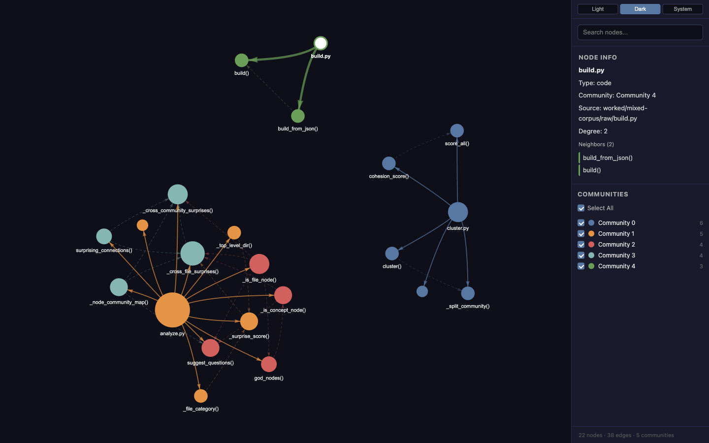
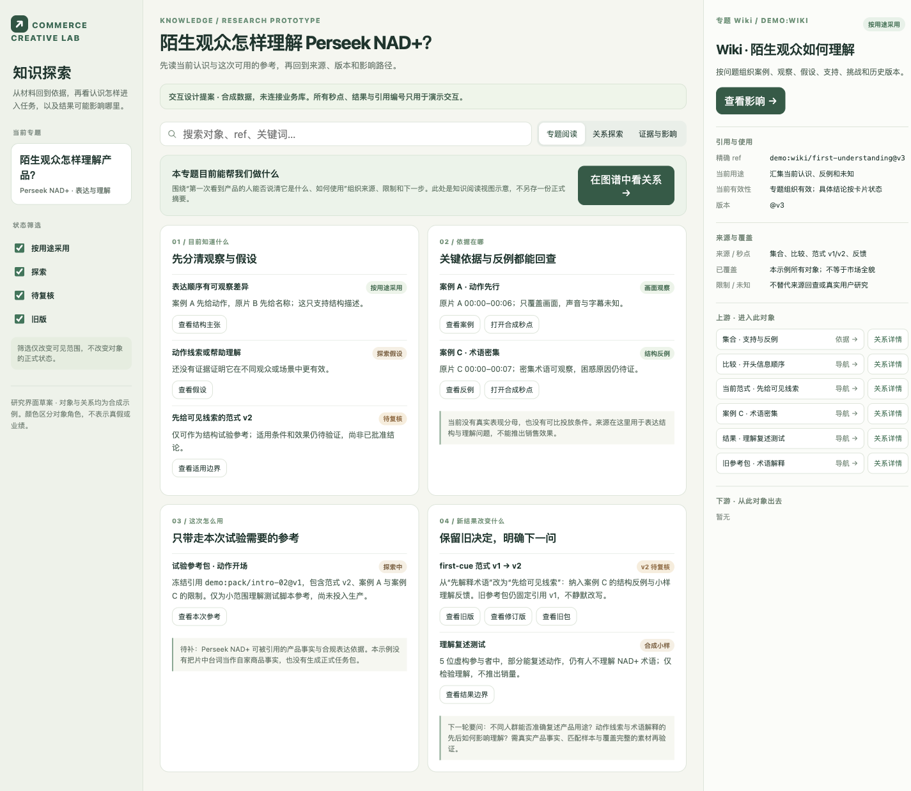

# Graphify 研究与知识工作台图谱设计

研究日期：2026-10-15（Asia/Taipei）。研究对象：[Graphify-Labs/graphify](https://github.com/Graphify-Labs/graphify)，固定源码快照 `fe085cedddde3a18554f8749b230bfe47f3dcce7`（默认分支 v8，提交时间 2026-10-14T13:06:45+01:00）。

## 研究目标与方法

研究 Graphify 的内容/计算/维护层次、知识图谱前端源码与实际交互；对照 Commerce Creative Lab 的材料、案例、知识、使用、反馈五层及 ingest/query/lint，提出前端图谱方案。方案在研究中可视化供讨论，不改变公共合同、共享主入口或正式业务数据。

源码已取得到忽略目录 `local/research/graphify/source`；没有运行 Graphify 安装器、全局 skill 注册或付费提取。OSS 实现、README/Cloud 宣称、实际浏览器观察与本项目建议分别标记。

canonical 范围 Page 和动态项目理解 Page 仍返回 `page_read_forbidden`；Nowledge 检索返回 `memory_search_projection_unavailable`。本轮使用本地可核验的产品、工作台、知识架构及知识模块代码，研究文档不替代业务原本。

## 决策覆盖与验收

| 研究问题 | 证据/产物 | 状态 | 缺失时的影响 |
| --- | --- | --- | --- |
| Graphify 是哪几层，是否等同业务知识库 | 架构、核心数据与维护源码 | 已核源码，见 2–3 节 | 混淆图遍历和经用途采用的知识 |
| 图谱如何渲染及交互，源码与画面一致吗 | renderer/template、固定小图浏览器观察 | 当前生成器已渲染，见 4–5 节 | 根据截图误判框架或交互能力 |
| 哪些信息能映射到我们的五层 | 分层/对象/流程对照表 | 已形成对照，见 6 节 | 只照搬code graph，遗漏秒点/反馈/版本 |
| 关系颜色、状态、版本如何表达 | 本项目可视化提案 | 合成交互已检查；生产方案待实样，见 7、11 节 | 支持、挑战、导航和失效混成一种线 |
| 技术借鉴与引入边界 | 渲染路线/数据投影/许可分析 | 已提出路线；最终引擎待 spike，见 8–9 节 | 用图组件取代PG权威或提前引入图数据库 |
| 大图、引用、安全与可访问性有何限制 | 源码证据及待测清单 | 小图/窄屏已观察；大图与完整 a11y 未验 | 画面漂亮却不可用、截断被当完整 |

本轮完成源码、技术栈、当前小图交互研究，并提供基于本项目效果目标的界面提案；真实图投影、生产接线、大图与完整可访问性验收仍属后续实施。

## 1. 结论：借鉴图谱能力，按我们的知识使用效果设计工作台

Graphify 开源版本是一条 Python 建图与查询管线，配一个由 Python 生成的独立浏览器图谱。它能把文件里的实体与关系变成可探索的图，聚类、查询路径并导出 Wiki。它为“看清关系”提供了具体参考。

Commerce Creative Lab 的目标还包括：带着证据和适用条件使用知识，新证据能够修订旧认识，实际结果能影响下一轮。本轮建议的前端围绕四个问题组织：**目前知道什么、依据在哪里、这次能怎么用、新结果改变了什么。** 图谱分别帮助解释来源、关系、影响与变化；专题正文、原始证据和任务参考共同构成阅读与使用入口。

本项目现有知识模块已经保存准确版本、依赖、审阅和有效性，前端目前主要是独立阅读组件。缺口包括可查询的有界图投影、图谱与阅读联动、影响解释和真实业务接线。不能把“已经有依赖表”写成“已经有图谱前端”。

## 2. Graphify 的技术栈（固定提交的开源实现）

| 部位 | 实际技术 | 用途与证据 |
| --- | --- | --- |
| 主语言与发行 | Python ≥3.10，包名 graphifyy，快照版本 0.9.90；setuptools，CLI graphify | 项目 metadata/入口；本轮没有安装或注册 skill。[G1] |
| 代码结构提取 | tree-sitter ≥0.25,<0.26，多个语言 grammar binding | 本地 AST 提取实体、调用、导入、继承等结构。文档和媒体的语义提取另用模型后端，不能把代码提取的本地性推及全部资料。[G1][G2] |
| 图数据与算法 | NetworkX ≥3.4，numpy、rapidfuzz 等辅助依赖 | 构图、相似标签处理、遍历、中心性、diff 等。[G1][G3] |
| 社区发现 | 优先 graspologic_native / graspologic 的 Leiden；不可用时回退 NetworkX Louvain | 并非所有安装都实际运行 Leiden。本轮直接使用 fixture 的既有社区，没有运行聚类。[G4] |
| **主图谱前端** | **Python HTML exporter + 原生 JavaScript/CSS + vis-network 9.1.6** | 模板内嵌节点/边 JSON；固定 unpkg URL、SHA384 SRI；没有独立 React/Vue 应用装配。[G5] |
| **绘图与布局** | **HTML Canvas；vis.Network 的 forceAtlas2Based 布局** | vis-network 官方文档确认 Canvas；Graphify 配置黄金角初始位置、力导向稳定后关闭物理模拟。[G5][V1] |
| 其他图视图 | D3 v7 + SVG 的独立 tree.html；单独 callflow-html 输出 | 不是主 graph.html 里切换同一套布局。[G6] |
| 查询接入 | Python CLI、MCP SDK；HTTP transport 使用 Starlette、StreamableHTTPSessionManager、Uvicorn | 独立 graph.html 直接读取内嵌数据，不需要先连这些服务器。没有把该 HTTP 层误写成 FastAPI。[G7] |
| 默认存储 | 本地 graph.json、报告、manifest、缓存和 memory/learning sidecar | JSON 记录图格式、Graphify 版本及构建 commit；属于图构建版本，非业务主张逐版审阅史。[G3][G8] |
| 可选图数据库 | Neo4j、FalkorDB 导出/推送与 optional dependency | 不是主图谱页面必需组件；postgres extra 是 PostgreSQL schema introspection 输入，不能据此说默认把知识存 PG。[G1][G9] |
| 可选语义模型/媒体能力 | 配置的助手或供应商后端；可选 PDF、Office、ASR 等依赖 | 本轮未调用任何模型、提取私有媒体或评测多模态质量。[G1][G2] |

Graphify Cloud 是另一项服务。README 宣称常驻跨仓图、SDLC 连接、形式化验证与 token 节省；本轮没有登录账户、验证效果或取得其完整前后端源码。不能用开源 exporter 推断 Cloud 也采用同一技术栈。[G10]

## 3. 它有哪几层

下表是按源码责任归纳的**六层研究划分**，不是 Graphify 官方宣称的六个产品区。其官方管线为 detect → extract → build → cluster → analyze helpers → report → export。[G11]

| 研究划分 | 对象或动作 | 能交出什么 |
| --- | --- | --- |
| 输入层 | 代码、文档、论文、图像、视频及导入文件 | 扫描分类、文件位置及来源信息 |
| 提取层 | AST 结构提取；文档/媒体语义提取；schema 校验 | 节点、边、超边、关系与来源位置 |
| 图原本层 | NetworkX 图及 graph.json | 实体关系、图 schema/version/build commit |
| 分析层 | 社区发现、连接度、跨社区连接、路径、diff | 结构概览、相关子图、建议问题 |
| 消费视图层 | graph.html、报告、Wiki/Obsidian/tree/其他导出；CLI/MCP 查询 | 人或助手可阅读、遍历的视图 |
| 维护与学习层 | cache、update/watch、来源贡献替换、问答结果保存及 reflect | 增量重建；问答经验 sidecar 与 stale 标记 |

节点至少包含 id、label、file_type、source_file；边至少包含 source、target、relation、confidence、source_file。可选来源位置、URL 等字段取决于提取器。默认 NetworkX 图可为无向图，但导出的弧顺序和 _src/_tgt 保存关系方向；集成时必须经过正确 loader，不能用任意无向加载再猜箭头方向。[G12][G11]

**EXTRACTED、INFERRED、AMBIGUOUS 表达关系如何取得以及推断的不确定性。** 它们不等于官方规则/客户陈述/模型假设这些证据类型，也不等于我们的用途采用或当前有效性。

### Wiki、reflect、lint 的区别

- Graphify export wiki 生成索引、社区文章和高连接节点文章，连接节点、关系和来源。它是模板化图导航；重导出会删除本轮没有生成的 wiki/*.md。本项目可维护的专题认知应从权威知识版本投影，不能直接把这个可重建目录变为手改正式原本。[G13]
- save-result/reflect 记录问答的 useful/dead_end/corrected，形成 preferred/tentative/contested 等经验与 LESSONS.md、学习 sidecar；stale 依据引用节点的源文件 hash 改变/消失。它可以启发“保留查询经历”，但不是自家视频理解测试、平台反馈、销量归因或用途撤回合同。[G14]
- validate_extraction 校验字段、枚举和边端点。所读 CLI 没有公开 lint 命令；本轮没有在这些入口看到业务知识矛盾裁定、独立用途审阅、正式发布/撤回、冻结参考包的完整流程。这是固定版本、有界阅读的能力边界，不是证明未来或 Cloud 永远没有这些能力。[G12][G15]

## 4. 图谱前端怎样实现

### 从领域图到页面

`to_html(G, communities, output_path, ...)` 将图映射为浏览器 DataSet：

- 节点：id、label、community/name、source_file、file_type、degree、color、size、font、title；聚合图可带 member_count，学习 overlay 可带 learning_status/stale。
- 边：from、to、label/relation、title、confidence、dashes、width、opacity；由原方向字段恢复箭头。
- 页面：中心 Canvas 和右侧 280px 侧栏；主题、搜索、详情、邻居、社区筛选和总量文字。图数据和页面代码均内嵌到输出 HTML，只有渲染库需要 CDN。[G5]

### 视觉编码与布局

社区使用十色调色板，超过十个会复用颜色。普通节点大小按连接度缩放为 10–40；较低连接度节点默认不常驻显示 label。EXTRACTED 边较粗且实线，其他边更淡且虚线。超边可画成员凸包底色。这些编码强调结构与提取方式，不能借作事实可信度或市场重要性。

布局用 ForceAtlas2-based physics；稳定后关闭 physics，避免持续抖动。节点初始按黄金角分散。暗/亮/系统主题保存在 localStorage。相关实现见 html exporter 和 COMMUNITY_COLORS。[G5][G16]

### 哪些交互已实现，哪些属于别的入口

| 能力 | 主 graph.html 的情况 |
| --- | --- |
| 搜索定位 | label 子串匹配，最多显示 20 个，点击 focus/select 与更新详情 |
| 节点详情与邻居 | 类型、社区、source_file、degree；邻居可点击聚焦 |
| 社区过滤 | checkbox / Select All 隐藏节点；不是业务用途/市场/版本筛选 |
| 拖动、缩放、hover | vis-network 交互；Graphify 将 keyboard 设 false |
| 路径查询 | CLI 有 path/query；主图页没有相同的路径输入/路径高亮工作流 |
| 原证据打开 | source_file 在详情中为纯文本；本次没有可点击文件/原片入口 |
| 多视图 | tree/callflow 为独立输出；主图页没有阅读/证据/影响/变化这些业务模式 |
| 导出按钮 | CLI 可导出多格式；主图页自身没有下载 PNG/SVG/CSV 控件 |
| 实时业务状态 | 内嵌的构建快照；不是自动订阅我们的 PG 采用/失效事件 |

以上是当前模板和实际小图观察的联合结论；底层 vis-network 能力不等于 Graphify 已将其全部接入。[G5]

### 大图与移动端

默认 HTML 可视化上限 5000 节点，可由环境变量调整；直接默认调用超限会报错。显式传 node_limit 的超限路径可生成社区聚合图；只有一个社区时跳过 HTML。本轮没有大图性能 benchmark，5000 是保护阈值，不是可读性或 FPS 保证。没有在此模板发现 Graphify 自己的渐进邻域加载或 Web Worker。[G5]

模板没有 viewport meta，也没有移动断点布局。实测 390px 窄桌面时图窗仅 110px、侧栏仍 280px；mobile=true 的 390px 设备仿真使用 980px 布局视口。它不能直接满足我们的小屏阅读要求。我们的生产图视图需要键盘等价列表、详情和完整来源操作，不能只依赖 Canvas hover。

## 5. 本轮实际浏览器验证

用**当前快照的 exporter**重渲染仓库内 `worked/mixed-corpus/graph.json`：22 节点、38 边、5 个既有社区。没有运行提取或聚类；这次运行不评测图内容正确性、多模态质量或模型费用。

fixture SHA-256：`31a1b29da9f9c8742ea137ba9b4a267127dca06684d1fe7c384c6fb6371896db`。生成器输出及实验记录留在忽略目录 `local/research/graphify/view`。仓库历史 `worked/rsl-siege-manager/graph.html` 是 2026-05-15 的生成品，使用无版本 CDN，不能作为当前前端实现的证明。

| 观察 | 结果 |
| --- | --- |
| 当前 HTML 初始化 | Canvas 成功加载；使用固定 vis-network CDN |
| 搜索 build → build.py | 聚焦并显示 source、类型、社区、degree、两个邻居 |
| 邻居点击 | 成功转到 build_from_json() 详情 |
| 主题切换 | dark → light → dark 成功 |
| Select All | checkbox 状态可切换；未取得隐藏节点数的自动断言，不把它记为完整过滤验证 |
| 窄屏/移动布局 | 得到上述 110px 图窗/980px mobile 布局观察 |
| 未做 | 上游完整测试套件、大图性能、实际提取、Cloud、付费模型调用 |

图注：2026-10-15，固定代码快照 + 上游自带 fixture 的当前重渲染；不是作者 README 配图，也不是对其全部功能的验收。窄屏证据：[390px 图窗](../../research/assets/graphify-current-narrow.png)、[移动仿真](../../research/assets/graphify-current-mobile.png)。

## 6. 与我们的五层和三条流程比较

| 我们的业务层/流程 | Graphify 相近能力 | 关键差别及前端必须表达的内容 |
| --- | --- | --- |
| 原始资料 | 文件、来源位置、不同格式提取 | 我们要区分取得来源、创作者、发布/广告身份；显示原片版本、秒点、覆盖通道与指标窗口 |
| 案例与主张 | 实体/关系与 source；代码解释 | Case/Claim 需区分观察、解释、假设、产品事实；保留独立依据、适用范围与允许用途 |
| 专题知识 | communities、wiki、图摘要 | Collection 有问题/纳排范围；Comparison 有可比与不可比；Pattern 有机制/变量/禁用/预测；Wiki 综合认识与未决问题。社区不自动等于专题或结论 |
| 本次使用 | scoped subgraph、路径查询、预算 | ReferencePack 是按任务用途选材、保留关键事实/限制/反例的准确版本包；相关子图不能直接等同可执行包 |
| 实际反馈 | save-result/reflect | 问答是否有用与作品在某观察窗怎样表现分开；真实 Outcome 绑定任务、成片与分发条件 |
| ingest | 发现/提取/增量更新 | 我们纳入的是带证据的修订提案，之后校验、独立审阅与用途采用；重复来源不增独立支持数 |
| query | label/词匹配与图遍历、CLI/MCP | 我们还要按 SKU、市场、人群、语言、制作条件、用途与当前有效性选择，显示取舍与遗漏 |
| lint | 字段校验、graph diff、源变化、学习 stale | 我们要定位矛盾/过期/断链/用途风险及影响，提出补证/限用/修订，不用“程序校验成功”表示业务结论可靠 |

我们的底座是 React/Vite + Express + 持久任务与自有 PostgreSQL/R2；Graphify 的静态 HTML 不会自动取得这些模块的真实状态。本次只研究展示与计算借鉴，不引入第二套可编辑知识原本。[C1]（仓库源码 `packages/knowledge/src/types.ts`）[C3]

## 7. 从希望达到的知识库效果推导前端

这里是本轮的**产品建议**，并非已经批准的最终界面或部署状态。

| 希望做到的效果 | 用户必须能完成的判断/动作 | 界面应是什么样 |
| --- | --- | --- |
| 研究持续积累为当前认识 | 进入一个问题，读已知、适用条件、支持/反例、未知 | 默认专题阅读：中心是结构化认知，旁边随所选结论显示证据；有关系入口 |
| 结论能回查 | 从一句主张找到准确来源与秒段，知道哪些通道没看 | 结论/引用联动图 + 原始证据抽屉/宽幅播放；保留覆盖和来源类型 |
| 知识能服务这次决定 | 看到任务条件、为什么选这条、什么不能迁移、包是否还可用 | 任务参考视图：任务条件、入选/排除、事实/反例/限制、冻结版本与预算 |
| 错误与新证据能修正认识 | 知道哪个版本变了、原因和受影响的未执行任务 | 变化时间轴、版本差异、影响子图；已执行记录保留当时依据 |
| 自主循环可观察与纠正 | 看系统在编译/检查什么、例外原因、下一轮补什么 | 维护入口：ingest/lint 结果、待补证、自动处理记录与有限的例外操作 |
| 七项目标共用知识 | 按问题跨规则、市场、对标、诊断、动作、试验找依据 | 目标/产品/市场等作为范围维度；保留不同证据类型，不全部改成视频卡 |

### 页面骨架与进入路径

在现有工作台的“专题知识”区域内，建议形成：

- **左侧：范围与问题。** 专题/目标、产品版本、市场语言、查询；维护问题可另进入。筛选只影响可见范围，不修改知识状态。
- **中央：所选任务的主要内容。** 默认专题认知正文；需要看关系时切局部图；需要核依据时看证据链；需要执行时看本次参考；需要纠错时看变化/影响。
- **右侧：与当前选择联动的依据和详情。** 准确版本、采用用途、当前有效性、来源/秒点、限制与未知、邻居及跳转。看片时可展开到宽幅，不把竖屏原片固定挤在小侧栏。
- **状态/维护区域：系统做了什么和下一步。** 最近更新、未决问题、lint 问题与影响；正常自动路径不增加逐卡人工审批。

图谱是同一知识版本的可视化投影。列表、正文、图谱、历史和任务包之间保持所选对象、版本、范围；不能每切一次视图就丢掉定位。

### 图谱的四种问题视图

| 视图 | 看什么 | 默认展现 |
| --- | --- | --- |
| 关系探索 | 此专题有什么结论、案例、方法和未知 | 所选问题的 1–2 跳邻域；可展开、搜索；全库先看专题概览 |
| 证据链 | 这条认识由哪些准确来源支撑或挑战 | 有方向的分层图 + 秒点/覆盖；支持与必要反例同时可达 |
| 影响范围 | 这个依据改变或失效，会影响什么 | 上游 → 下游；关键依赖遍历，列出包/未执行任务；同时给文本解释 |
| 知识变化 | 新结果到底改了什么 | 同一 object 的版本差异/时间轴 + 变更关系；旧包仍指向旧版 |

全库社区布局有助发现结构；具体判断使用局部图，不能要求用户从所有素材的密集连线中寻找依据。布局决定阅读顺序，不能决定真伪或采用资格。

### 节点、连线和状态的设计约束

- 节点身份必须包含对象与准确版本；历史版本可折叠到同一对象，但展开和任务引用时保持独立端点。节点颜色/形状区分材料、案例/主张、知识、使用、结果；大小可以表示连接规模，不能暗示真实效果。
- **采用用途、当前有效性、分析质量、证据来源类型分别表达。** 不能合成一个“可信 95%”或用颜色替代文字。
- supports/challenges/derived_from/uses 有方向和标签；related 只供导航，不作为支持、因果或失效依赖。新反馈的待核挑战与已冻结的关键反例依赖也要分开记录，不能靠线型猜。
- 图中默认箭头为“上游依据 → 依赖它的对象”；数据库 Dependency 记录方向可相反，投影必须显式转换。新反馈修订产生新版，不能形成自我证明的依赖环。
- 显示筛选后仍要保留完整影响数及隐藏项说明；不能因为隐藏探索/旧版而改变影响判定。未加载关系、越界截断、无关系、失效和权限不足分开。
- 每个图操作有列表/详情的键盘等价入口；必要反例与重要未知不只放在 hover。移动端优先五层列表和详情，不压缩成不可读的桌面大图。

## 8. 现有代码能支持什么，还缺什么

本模块已有 KnowledgeRevision、Dependency、RevisionView、scope、精确引用、history、events 和失效屏障。（仓库源码 `packages/knowledge/src/types.ts`） 仍需以下只读投影工作：

1. **图查询合同与接口。** 当前 `/impact` 返回直接依赖者的 ref 列表，`dependents()` 查询一跳关系，不是含节点/类型边/多跳路径的完整图 API。需要焦点版本、方向、深度、节点/边预算、cursor、截断说明与一致性 epoch。
2. **关系语义补齐。** 当前 normalizeRevision 把许多内容引用统一加为 derived_from；Pattern 的 supportRefs/counterexampleRefs、Collection member role、Wiki relatedRefs 要投影为具体语义。不能仅从 PG deps 画图而把支持/挑战混成一样，也不能把 Wiki 导航漏掉。（仓库源码 `packages/knowledge/src/service.ts`）
3. **跨层读取。** materials/analysis/creation/outcomes 对象由所有者经公共 reader 提供；图谱服务不能跨包私读 SQL。现有 AnalysisReadPort 不包含全图邻域列举，扩展须协调所有者。
4. **与界面联动。** API 客户端、URL 选中版本、图/正文/证据/包的统一选中状态、历史视图和事件刷新。图上的“可用”只是显示，执行仍走领域 validate。

建议 GraphProjection 节点带 project/ref/kind/title/current/adoption/validity/scope/citationCount/coverage 与安全详情入口；边带 id/fromRef/toRef/relation/critical/来源依据及版本。另带 graphSchemaVersion、projectionVersion、epoch、limit/cursor、omittedNodes/Edges 和原因。这里只给字段设计方向，正式公共 schema 与接口尚未实现。

PG 的知识版本/审阅/head 继续权威，R2 保留原始证据；图布局、社区、索引可以重建。需要图谱可视化本身，不构成引入 Neo4j、Graphify Python runtime 或第二知识库的理由。

## 9. 前端技术路线建议

下列能力已查官方文档与 Context7；本轮没有把候选库安装到项目或跑真实性能对比，具体版本还需在实施 spike 固定。

| 路线 | 适合的目标 | 本项目需要补的工作 |
| --- | --- | --- |
| vis-network（Graphify 已用） | 快速做关系探索、力导向与社区聚合，Canvas | React 生命周期装配、业务状态、原证据、键盘列表、稳定局部布局；不要把它的截图当完整产品 |
| Cytoscape.js | 类型化有向关系、选择器、遍历/路径与多种布局 | React 详情联动、scope/版本合同、无障碍等价列表、所需布局扩展与性能实测 |
| React Flow | 阅读性较强的卡片节点、证据链、影响流程，与现有 React UI 组合 | 外部布局/密集图验证；关闭未经授权的连线编辑；键盘/焦点按官方配置落实 |
| Sigma.js | 确实需要浏览很大关系网时的 WebGL 候选 | 丰富业务卡片、证据/状态/路径工作流与可访问性仍需产品层实现 |

建议先固定**同一只读图投影**，用真实小样在 Cytoscape.js 和 React Flow 两条路线中验证“局部关系探索 + 证据/影响 + 阅读联动”。前者更贴近关系遍历，后者更贴近可读卡片；本轮不冻结一个未经测试的最终选型，也不一次引入多个引擎。Graphify 的 vis-network 可以作实现成本参照。

验收用我们的任务：从主张到原片秒点、找到必要反例、发现用途不符、旧/新版本不混、失效后解释影响、键盘和窄屏可操作。再测实际节点/边数量的首次显示、选择响应、标签碰撞、内存与展开耗时；“能渲染 5000 节点”不作为完成标准。[V1][V2][V3][V4]

## 10. 可点击提案与后续实施顺序

[打开知识工作台交互提案](../../research/graphify-knowledge-explorer.html)。它使用原生 HTML/JS/SVG 与合成数据展示我们自己的对象和关系，不复用 Graphify exporter，不连接业务库。其作用是让我们判断专题、关系、证据、影响怎样共同服务一次决定；不是已批准的最终视觉规范或生产界面。

研究提案的状态、检查与截图记录在下一节。实施建议顺序：

1. 用一个真实已登记结果及来源，形成准确版本的只读专题/局部图；先把正文、列表、图、证据抽屉联通。
2. 增加有界邻域与完整影响查询，把支持、挑战、导航及关键性投影正确，加入历史/变化视图。
3. 接真实任务 ReferencePack，显示使用条件、选择与限制；执行资格由领域校验。
4. 接 ingest/lint 的结果与例外，并验证实际反馈如何提出新版修订、改变下一轮。
5. 用代表性数据验证布局、性能、多语言搜索与可访问性，再确定正式组件与样式。

无额外逐卡人工批准要求；自动执行范围仍由现有配置策略决定。本轮研究与示意不证明实际闭环或业务效果。

## 11. 本项目交互提案的验证与保留边界

提案现包含 **15 个合成节点、27 条关系、18 条关键依赖**，默认专题阅读，另有关系探索和证据与影响；正文与图使用同一组选中对象。没有接真实库、修改正式知识状态或调用模型。

| 检查 | 本轮结果 |
| --- | --- |
| 静态检查 | JavaScript 语法、节点唯一性、边端点与关键依赖无环通过 |
| 专题阅读 | 四个核心问题及观察/假设/待复核状态分列，可打开对应对象 |
| 来源 | 桌面与 390px 可打开明确标注的合成秒点抽屉 |
| 搜索/切图定位 | 搜索原片 C 后切图，选中卡片位于图窗内；已修复模式切换后焦点被重置的情况 |
| 影响与筛选 | 原片 C 的关键依赖下游共 6 项；隐藏探索/待复核后仍计 6 项并说明 3 项隐藏。导航与待核新反馈不参与失效遍历 |
| 桌面 | 1440px 专题/局部图/详情可阅读；图通过平移缩放展开，原生节点列表可替代图选择 |
| 窄屏 | 390px 阅读单列；图模式使用五层节点列表与详情，整页无横向溢出 |
| 未验 | 真实对象与 graph API、生产筛选/采用、密集图性能、多语召回、完整屏幕阅读器和键盘验收 |

图注：全部业务内容、秒点、测试参与者及效果都是合成示意。可另查看[关系探索](../../research/assets/knowledge-proposal-explore.png)、[证据与影响](../../research/assets/knowledge-proposal-evidence.png)、[窄屏阅读](../../research/assets/knowledge-proposal-mobile.png)。默认读专题是从我们的使用目标推导的方案；完整四种图谱问题视图中，知识变化暂以专题内容/版本关系展示，专门时间轴与 diff 还没有实现。

Graphify 的项目 metadata 标 Apache-2.0，NOTICE 保留重许可前的 MIT 部分。[G17] 本轮未复制其 exporter 到正式前端；以后若复用具体代码或发布衍生产物，应按该范围保留对应许可与声明。当前截图是本轮对固定源码的研究观察，来源见各图注。

本轮产物限 research 文档、合成原型与研究截图；固定源码、实验 manifest 和过程记录在项目忽略目录。canonical Pages 因无权限尚未同步。本研究不改变项目产品目标、正式技术选型或全局 skill 安装范围。

## 12. 证据索引

所有 G 来源固定 `fe085cedddde3a18554f8749b230bfe47f3dcce7`。源码已见、实际运行、产品建议的边界按正文标明。

[G1]: https://github.com/Graphify-Labs/graphify/blob/fe085cedddde3a18554f8749b230bfe47f3dcce7/pyproject.toml
[G2]: https://github.com/Graphify-Labs/graphify/blob/fe085cedddde3a18554f8749b230bfe47f3dcce7/graphify/extract.py
[G3]: https://github.com/Graphify-Labs/graphify/blob/fe085cedddde3a18554f8749b230bfe47f3dcce7/graphify/build.py
[G4]: https://github.com/Graphify-Labs/graphify/blob/fe085cedddde3a18554f8749b230bfe47f3dcce7/graphify/cluster.py#L109-L175
[G5]: https://github.com/Graphify-Labs/graphify/blob/fe085cedddde3a18554f8749b230bfe47f3dcce7/graphify/exporters/html.py
[G6]: https://github.com/Graphify-Labs/graphify/blob/fe085cedddde3a18554f8749b230bfe47f3dcce7/graphify/tree_html.py
[G7]: https://github.com/Graphify-Labs/graphify/blob/fe085cedddde3a18554f8749b230bfe47f3dcce7/graphify/serve.py#L2721-L2934
[G8]: https://github.com/Graphify-Labs/graphify/blob/fe085cedddde3a18554f8749b230bfe47f3dcce7/graphify/export.py#L176-L483
[G9]: https://github.com/Graphify-Labs/graphify/blob/fe085cedddde3a18554f8749b230bfe47f3dcce7/graphify/exporters/graphdb.py
[G10]: https://github.com/Graphify-Labs/graphify/blob/fe085cedddde3a18554f8749b230bfe47f3dcce7/README.md#L450-L460
[G11]: https://github.com/Graphify-Labs/graphify/blob/fe085cedddde3a18554f8749b230bfe47f3dcce7/ARCHITECTURE.md
[G12]: https://github.com/Graphify-Labs/graphify/blob/fe085cedddde3a18554f8749b230bfe47f3dcce7/graphify/validate.py
[G13]: https://github.com/Graphify-Labs/graphify/blob/fe085cedddde3a18554f8749b230bfe47f3dcce7/graphify/wiki.py#L248-L455
[G14]: https://github.com/Graphify-Labs/graphify/blob/fe085cedddde3a18554f8749b230bfe47f3dcce7/graphify/reflect.py
[G15]: https://github.com/Graphify-Labs/graphify/blob/fe085cedddde3a18554f8749b230bfe47f3dcce7/graphify/__main__.py#L908-L990
[G16]: https://github.com/Graphify-Labs/graphify/blob/fe085cedddde3a18554f8749b230bfe47f3dcce7/graphify/exporters/base.py#L9-L15
[G17]: https://github.com/Graphify-Labs/graphify/blob/fe085cedddde3a18554f8749b230bfe47f3dcce7/NOTICE
[V1]: https://visjs.github.io/vis-network/docs/network/
[V2]: https://js.cytoscape.org/
[V3]: https://reactflow.dev/learn/advanced-use/accessibility
[V4]: https://www.sigmajs.org/
[C1]: ../reference/commerce-product.md
[C3]: ../evidence/module-20261015.md

## 2026-10-15 实施后记：已选择 Cytoscape 并接入真实工作台

在上述研究之后，用户明确授权按自己的知识目标落地。现已使用 Cytoscape.js 3.34.3 Canvas/CoSE 接入现有 React/Vite 5174，专题阅读、圆形节点/关系交互、真实证据帧和原片秒点、探索参考包与关键下游影响已实现。PostgreSQL/R2 保持原有权威存储；图谱是版本化资料的展示投影。

本机 Nowledge Mem 已实际打开并搜索 Commerce，返回节点/边统计，但画布为空并报服务错误；没有声称成功操作其节点，也没有据画面推断其实现库。官方演示视频作为视觉补充参照。真实工作台与早前 15 节点合成 HTML 原型是不同产物，合成原型不作为真实接线的验收证据。

详细选择、真实数据、50 项针对性测试和边界见[知识工作台实施记录](../evidence/workbench-20261015.md)。当前 4 条登记报告仍按原质量状态进入探索阅读，没有自动批准为生产知识；正式编译、创作和自家结果闭环仍待完成。
