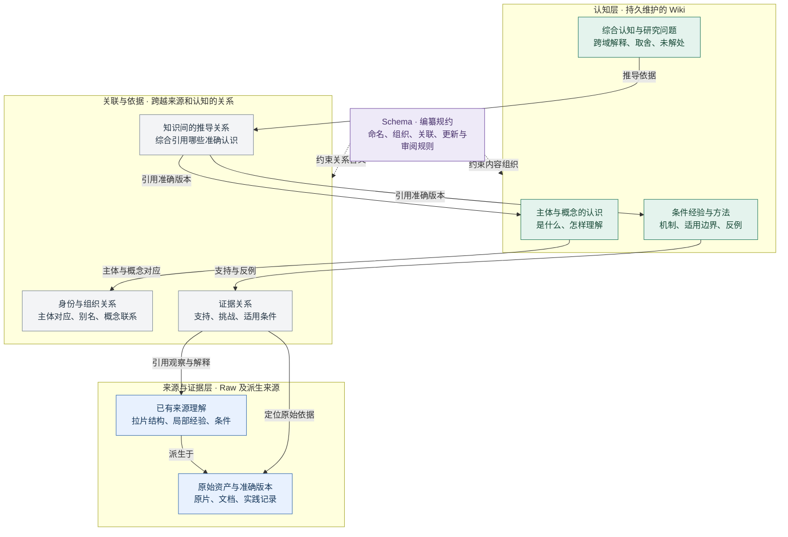
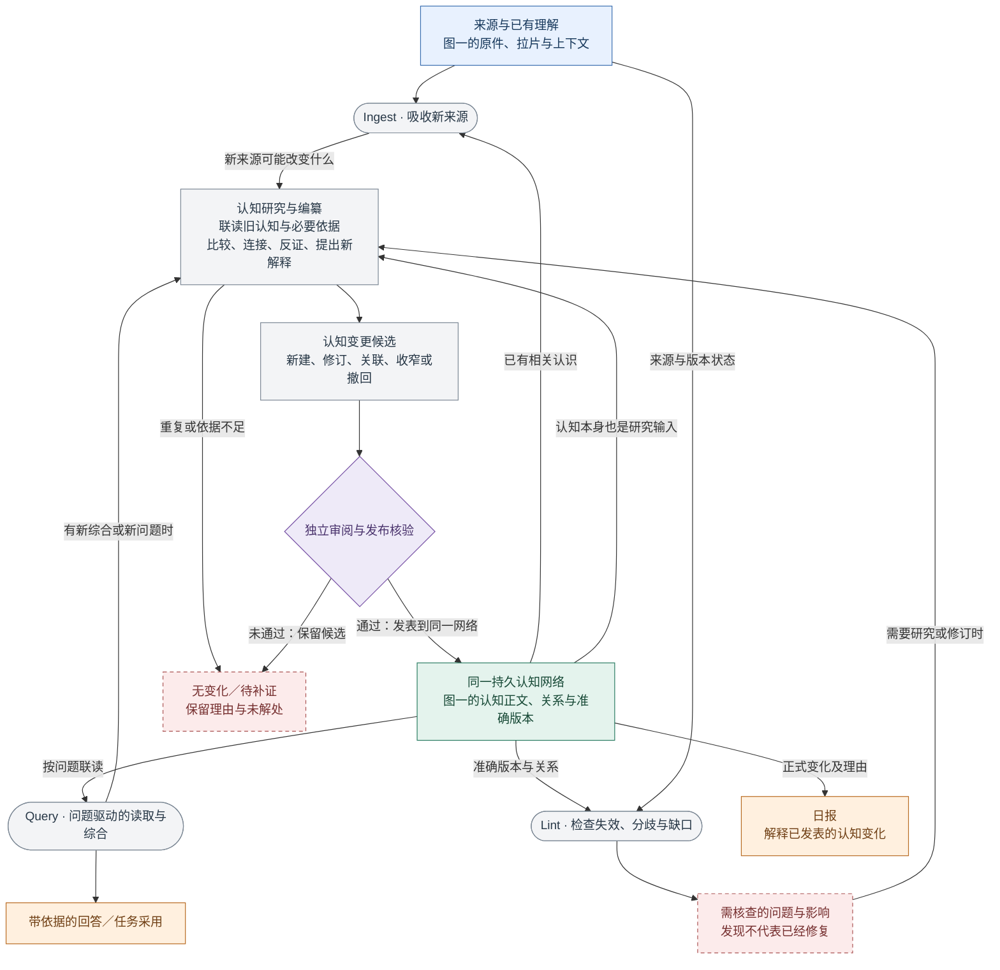

# 知识库如何让认知自我成长：目标、例子与完整架构

2026-10-22 · 目标与启动方向已由用户明确；下文架构与行为合同正按阶段实施，完成状态见[抖音实施与评价计划](../../index.html#cognition-growth-douyin)。2026-10-22新决定：抖音是全新独立项目，直接采用新认知合同，取消旧知识结构兼容与迁移；历史项目保留其自身运行。复用既有执行、准确版本、审阅和发布事务不等于兼容旧知识模型。代码现状的固定核对基线为 `main@1c8ba646a6fa976408e2fb6b287f68a93925a9b3`。本文维护当前目标、内容模型、行为和验收；[实现评审](architecture-review-20261022.md)维护固定版本源码、工程探针与外部范式对照，两者不重复充当实现完成清单。本文不替代[七目标 Page](https://chatgpt.com/space/page_d2cb3d9f4fc8819188ac80363db3f30d)或[持续认知 Page](https://chatgpt.com/space/page_35e0d83c4f14819180a5b50a5995a1d4)。当前优先检验自营抖音的链接、拉片和专题知识；Perseek NAD+ 的 TikTok 研究后置优先级但历史和线上日批保留，七项目标并未取消。

**首要目标：让认知持续形成、积累、关联、综合和修正，使已有认知成为下一轮新认知的基础，持续提高人和Agent理解问题、研究与行动的能力。**

## 设计评估结论

**方向合理，内容模型已能解释要保留什么；此前仍不足以直接指导实现的，是认知研究和持续更新的行为合同。** 两张图能说明可能的成长机制，不能证明系统已经产生认知增益。此次评估保留现有内容与操作分工，补充后文六项默认行为建议，不再靠增加层级或固定对象清单填补这些问题。

| 判断对象 | 当前结论 | 还需要什么证据 |
| --- | --- | --- |
| 认知自我成长的目标 | 用户已明确；日报服务于这一目标 | 后续取舍以是否改善理解、研究与行动为准 |
| 来源、认知、关联与操作的分工 | 概念上成立；不要求固定加工阶梯或新增多套存储 | 实现须保住准确版本、条件、来源和修订理由 |
| 哪些研究值得做、保存及继续维护 | 原设计有意图，但价值判据、读取范围、权威与终止行为不够具体 | 按下文最小合同实施并校准，避免重复总结和错误扩张 |
| 实际认知增益与效率 | 尚未证明；原有工程验收不能代替它 | 同一专题连续两轮使用与反例修订，比较直接阅读相关材料的结果与成本 |

## 先看知识内容，再看对它的操作

这两张图表达**目标知识模型**，并非当前实现完成图。第一张只画长期保存的内容和关系；第二张在同一内容模型上说明 Ingest、Query、Lint 如何工作。具体代码现状仍见后文固定版本对照。

### 图一 知识库保存什么，认知凭什么成立

先看来源、关联和认知三个职责面：原件和已有拉片保存在哪；主体认识、经验、方法与综合保存在哪；这些认识依靠什么来源，又引用了哪些旧认识。**箭头表示有名称的关系，不表示所有素材都必须经过固定加工阶梯。**

认知层中的分类是内容用途示例，不是封闭的类清单，也不等于当前代码的某一个 `Wiki` kind。主体档案和概念解释有持久正文；身份线索和别名关联帮助把正文组织起来。拉片是对原件的已有解释，保留结构、经验与条件，但不会因此增加一份独立观察。关联与依据随知识修订保存，图中居中是为表达跨层关系，不要求独立关系数据库或独立 Link 实体。Schema在侧面约束内容和操作。

### 图二 Ingest、Query、Lint 怎样作用于同一知识库

这三者是操作。新材料、持续追问、旧认识的分歧都能引出认知研究；正式认知变化统一经审阅发布。Query可以只回答；Lint可以只登记问题；编纂可以无变化结束。底层队列、预算和存储为这些操作提供运行支撑，另在职责表展开。

最重要的回路是：**已有认知＋新的问题 → 联读、连接与反证 → 有条件的新综合 → 审阅后回到认知网络 → 成为以后研究的输入。** 拉片认知与创作认知可以在这里形成新的迁移判断；没有新原片时也可以产生认知增量，推导仍沿用原依据和限制。日报读取变化；有价值的读者追问可以通过Query再推动这条回路。

## 为什么这套结构有机会实现认知自我成长

目标是**让已有认知成为下一轮新认知的基础，持续提高理解、研究与行动能力**。架构要给出下面的机制，而不是仅列出对象名称：

| 架构提供的条件 | 它怎样推动认知成长 | 缺少它会发生什么 | 怎样检验 |
| --- | --- | --- | --- |
| 稳定、可修订的认知正文 | 上一轮形成的理解能作为下一轮研究的准确输入 | 每次重新组织材料，无法继承或定位旧判断 | 新问题能引用旧认知版本，保留旧有条件与理由 |
| 有含义的认知间关联与原依据 | 系统知道哪些认识值得联读，以及它们凭什么可组合或相互挑战 | 只有零散页面或关键词相似，跨领域解释仍靠临时拼接 | 从表达认识与制作认识找到适用联系，同时能回查两者的原依据 |
| 问题驱动的认知研究操作 | 新的 Query、旧认知冲突或素材变化能触发比较、连接与反证 | 只会保存或检索已写过的内容，不能形成新的综合 | 无新原片时，也能由旧认知和新问题提出有价值的新解释 |
| 将有价值综合回写同一认知网 | 新综合有身份、依据、条件和后续维护位置，下一轮还能引用 | 综合只停在聊天回答或日报里，积累在这里中断 | 第一次综合出的C能成为第二次研究的输入，而非从A和B重新推导 |
| 审阅、反例与版本化修订 | 新认识可以被质疑、收窄、撤回，改变以后实际使用的版本 | 错误会随总结次数被放大，系统越来越确信自己 | 新反例能定位C及其真正依赖，修订后查询不再采用无条件旧说法 |
| 有界检索、变化驱动与成本账本 | 在持续运行中集中研究相关变化，允许无变化和待补证 | 每轮全库重读、强制造页，维护成本超过价值 | 记录召回缺口、错误归并、读取与调用成本，并与直接读相关材料比较 |

因而“自我成长”指一个可检验的循环：**认知被保留 → 能被发现和联读 → 在新问题下形成新综合 → 被审阅并留下来 → 进入下一轮研究 → 被实践或反例修正。** 人可以像这次对话一样持续提出Query，Agent也可以在已有目标与预算内提出研究问题。两者推动同一个循环，不要求每次新增原始材料，也不声称一旦组合就更可信。

这些结构提供达成目标的必要条件；实际是否产生认知增益，仍须用真实连续专题验证。尤其要检查“新综合解释了什么、条件是否更清楚、能否指导新的判断、错误能否改掉”，不能用多了一页文字代替认知成长证据。

## 目标：让认知自我成长，并被人和 Agent 继承、检验与修正

知识库最重要的目标是让认知自我成长：已有认识可以被下一次问题唤起、联读、重组和反证，形成新的联系、解释、取舍或研究问题；这不以每次都有新原片或真实实验为前提。一次新综合复用原有依据，不会凭空增加独立证据。人和 Agent 在一项任务结束、参与者更换、时间过去之后，仍应能接着研究；未来冒出当初未预设的问题，也能找到相关旧研究、发现此前未命名的主体与联系，不必重做全部历史工作。它保存的不是“最像答案的一段话”，而是对主体、概念、问题和做法的当前理解：我们知道了什么，凭哪一段原始观察、哪份正式资料或哪次实践记录；为什么认为它成立；适用于什么产品、平台、人群、制作条件和时间；哪些相似材料其实同源，哪些证据相互挑战；仍有哪些未知，下一次值得取得什么资料或做什么测试。使用者能沿着结论回到原依据，也能看见它从旧版怎样被补充、收窄、合并或撤回。后来者可以质疑其中一步并修正它，原先的理由与采用记录仍可查。

它的野心是形成可持续的共同研究能力，而不只为日报或创意生成提供固定产出。所谓更高维的认知，是能发现原先分散的认识之间的联系，给出更有解释力的条件与迁移取舍；并非文字越抽象越好，更不意味着经过一次综合就更可信。平台规则、数据质量、市场与竞品、产品诊断、内容制作、经营动作和测试学习，可能需要不同形式的知识；一个问题也可能横跨这些方面。新片、新文档、新问题或行动结果进入后，系统应判断它是否改变已有认识、是否暴露分歧或缺口、是否只重复已知。即使暂时没有结论，也应留下清楚的研究问题和必要证据，让下一次工作有明确起点。日报可以解释认识的变化；创作可以调用适用的方法；经营判断可以检查商品事实和结果口径，但它们都不是知识库价值的唯一尺度。

这一能力必须在真实成本下成立：尽量复用已做的拉片，先找相关目录和准确旧版，只读必要来源，按变化范围编纂，预算不足时公开覆盖缺口，重复输入允许“无变化”。知识库不能自称全知，更不能把模型整理出的文字自动当作真理。可信度来自来源保全、条件表达、版本与依赖、独立审阅，以及后续使用和反例能否推动修订。验收应看它是否使具体判断比直接阅读相关原料更清楚、更少误归并、更容易复现和纠正，同时记录付出的读取、模型与人工成本；页数增长本身不是成功。

## 没有这层知识时，具体会失去什么

人的记忆、文件夹和单次问答都很有用，但各自承担不了持续维护共同认识的全部工作。研究者第一次拉片时会记住“结果先出现”，换任务后未必记得当时的产品、画面、秒点和解释的保留条件。报告可能完整保存这条观察，却不会主动提示第二条相似片与它同源、第三条反例应使哪一页旧结论收窄。问答能即时联读文件，却可能下次用另一组检索结果重新组织一遍，无法可靠说明“上次为什么那样判断、今天为何改变”。普通文件和检索增强方法在单次任务中也可能给出很好的答案；知识层仍要检索，而且应与“直接读相关拉片”比较收益。差异在于：经过审阅的综合、条件、分歧、准确版本和待研究问题是否能跨任务延续；即使暂时没有新来源，也能让旧认识因新问题而产生可追溯的新综合，随后再由新证据挑战和修订。

### 例一（真实）：本轮问题怎样推动我们理解知识库

这次讨论本身有一条可观察的认知变化链。起初用户追问日报重点和“认知”究竟指什么，于是我们把日报从素材清单与固定结论，改理解为说明认识发生了什么变化。随后问题转向拉片已入库为何还需重复解释，促使我们区分“保留单片结构与条件”和“跨片、跨问题编纂已有理解”；重复单片解释不能替代后者。继续追问知识对象、Entity 和范式，促使我们检查固定类型是否把主体、概念、研究问题与表达方法误作一条必须晋级的流水线。用户最终明确：“知识库最重要是认知自我成长”，拉片认知和创作认知还可相互综合，持续指导工作。这句话使目标从“保存并检索认识”推进到“让旧认识在新问题下形成联系、接受挑战、得到可采用的新解释”。

上述变化发生在**人连续提出 Query、我们联读先前研究和概念**的过程中；不是新视频、自动模型任务或业务实验已完成的证据。本文记录这条理解修订的理由与设计影响，不声称本轮对话已经被业务知识库编成正式页面、独立审阅或在生产运行。未来若相同机制可用，人或 Agent 的问题都应能触发有界联读；有价值的综合再走候选与审阅，普通问答无需每次入库。

下面第二例是**假设演示**，贯穿拉片、制作和两者综合；不是已取得的业务结论或已跑通的语义验收。

### 例二（假设）：拉片认知与创作认知怎样合成新认知

**先从拉片研究“先给结果，再解释过程”。**

首次拉片 A 可只得到局部观察：假设一段视频在 0–2 秒展示完成后的状态，之后回放操作；声音和字幕在何时解释原因，需要在拉片记录中准确标明。此时可以保存“画面顺序如此”和“可能用于让人先看见目标状态”的解释，同时标出未知的受众、分发与效果。它还不能成为“这种开头更能带来成交”的结论。

后来出现同一发布者的新片 B，采用相似顺序。目录应先核对发布者与作品身份，查到 A 的原片、拉片和既有主体页；编纂者比较画面功能与差异，可能把“这个主体在两种题材中怎样先展示结果”的描述补充到主体认识。同一发布者的两条片不是默认的独立验证。再有另一主体的片 C 使用相似组织方式，可以提出跨主体的表达机制假设：当结果状态可视、过程需要解释时，先让观众看到目标再解释路径，可能帮助建立观看语境；但商品、受众、平台及表达目的仍可能改变其作用。C 也须核查是否复用了同一底层素材，不能因两个链接就计为两票。

假设片 D 的结果画面难以辨认，后续解释又依赖产品背景，形成可能的反例。审阅后的知识可以把旧说法收窄到“结果能被识别、过程确实需要解释”的情形，或保留争议；若观察不足，宁可提出“什么条件使结果画面可辨”作为下一项拉片或小范围理解测试的问题。下次用户询问某条新片为什么这样开场，查询应给出当前机制、相关 A/B/C/D 的准确依据、适用条件及未证实的效果；日报只说明这次认识由什么变化成什么，以及下一步需补什么证据。若没有持久维护，读者往往重复比片、丢失 D 所限定的条件，或把两条同博主作品误读成普遍规律。这里没有成交数据，不能由表达相似推断转化或 GMV 因果。

**再从制作实践形成方法认识。**

假设团队要制作一条短片，要求包装外观和使用动作准确，同时受预算与工期约束。任务开始时应联读四类不同认识：参考素材怎样表达产品，已核实的当前商品包装和标签事实，既有制作方法在何种条件下容易保真，以及本次可投入的人力、素材和时间。知识库可以提供候选路线与依据，例如纯生成、真实包装镜头与生成过渡的混合路线，指出哪些细节需要实际商品图或实拍验证；它不替执行者保证生成工具已获授权、账户可用或能按时交付。执行侧必须查询当前工具、权限、额度和生产条件。

假设首次按已记录配置生成时，手持动作或包装文字失真。结果记录应保存输入、版本、提示与控制条件、失真位置、人工判断及花费，形成“在这组配置和素材条件下失败”的局部证据，而非“AI 不能拍包装”的全称判断。团队改用准确实拍包装和动作，生成部分只负责不涉及准确性的环境或转场；如果成片经逐镜核对通过，方法知识可以收窄为“这些需核实的细节由实拍承担，其余部分在已试条件下可生成”，并保留两条路线的成本、工期和未测范围。下一次类似任务会知道先核什么事实、避开什么配置、何时选择混合路线，也会提出“哪些动作在更多角度或模型版本下仍可准确生成”的研究问题。没有维护层，失败容易只留在操作者记忆或零散聊天中，下一队又从纯生成重试；也可能把一次失败误扩展为普遍禁令。成片质量的通过只说明制作要求在本次核对范围内满足，不能推导观看、成交或经营效果。

**然后把两种认识结合。** 即使尚未拍第二条片，前面的“先给结果再解释过程”表达认识，也可以和制作方法认识联读，提出新综合：**表达的信息职责**（先让人识别什么、再解释什么）可以与**实现手段**（实拍、生成或组合）分开；随后按包装准确性、动作可靠性和资源条件选择实现路线。它是由两项既有认识推导出的有条件设计判断，保留两者的准确版本和原依据，并提出“目标信息能否在混合镜头中被准确理解”的待测问题。实际成片与理解效果仍待检验；该综合沿用已有证据，也不要求先有 Claim、再有 Pattern、最后才有综合。

## 认知研究与更新的最小行为合同

以下是本次评估提出的**默认行为建议**，用于收紧原设计中的模糊处，不表示已实现或每项取舍已获用户逐条确认。它们约束行为，不要求新增六种实体、六个服务或另一套执行器。

### 一 什么变化值得成为持久认知

研究应说明旧认识尚不能回答的具体问题，以及候选增加了什么：新的解释、条件区分、迁移取舍、可检验预期，或清楚的待研究问题。指出它改善哪种理解或后续判断，不要求每页立刻带来经营指标提升。补充原依据、纠正错误和收窄条件同样有保存价值；已准确保全的来源仍可入库，不必先证明有新综合。

**反例：**把“先给结果”和“混合制作”两页并排缩写为第三页，既未解释两者的关系，也未增加条件、问题或可用判断，不算新的综合认知。普通回答可以结束；不强制造页。新解释有价值但依据尚弱时，可以在明确标注推论和未知的候选或开放研究问题中保留，不能伪装成已验证结论。

### 二 谁触发研究，为什么读取这些知识

新来源、使用者 Query、已授权目标下的 Agent 提问、来源纠正和有界 Lint 都可以触发研究。每次留下同一份可复核记录：研究目的与问题、触发理由、范围和预算；选中及排除的旧页与来源、选择理由和准确版本；实际读取覆盖、缺口、预期变更与结束理由。目录或摘要用来定位，不能当成已阅读完整依据。

先找相关旧认识，按推导需要读取正文和必要原依据；身份冲突、条件缺失、关键依据改变或无法核实支持时回查来源。预算或权限不足就缩小问题、标明未覆盖并返回待补证，不能声称全库无反例。当前研究无须每天重读全库，也不规定必须凑够几条素材。Worker 执行研究与维护任务；方法注册由受控装配共享，语义选择规则由版本化规约定义，知识内核继续掌握审阅发布与版本有效性。

**反例：**研究“包装必须准确时怎样实现结果前置”，只因关键词相同就读开场页，漏掉制作失败和准确性条件，却宣称已经完成综合。读取成功和研究范围充分是两个判断。

### 三 稳定身份、正文权威与更新方式

主体、概念与问题可以有稳定身份、可阅读正文及正式修订；页面用途由有版本、可校验的编纂规约确定，不是一项业务一套核心类。是否新建、更新、合并或拆分，依据它是否回答独立问题、需要单独引用或维护，及旧页范围是否仍准确；不得仅凭同名合并或凭不同措辞造新页。身份不明时保留待核，允许同名不同主体和有理由的不同解释并存。

**同一条可维护认识应有明确的正文权威。** 若其中一项 Claim/Pattern 需要独立审阅、修正和采用，就维护它的准确版本，页面引用并解释它；若无需独立生命周期，则在页内维护，不把每句话拆成对象。同一陈述不能同时在页面和独立对象中各自修改而无关联。综合页可以维护超出所引陈述的新推论，必须标出这一增量；主体页、概念页和综合页不是只读索引或临时摘要。

合并或拆分后保留原身份、历史准确版本、别名或后继关系，并审查实际依赖的处置。新查询可发现当前后继；已冻结的旧引用和采用记录不被悄悄改写。“当前正式版本”也不等于“唯一真理”，分歧和不确定性仍属于正文。

### 四 综合凭什么成立，怎样避免循环放大

关键新判断要能定位到必要旧认识的准确版本、其原始来源来路、保留的适用条件与反例，并说明这次新增的推理步骤。段落或判断级的依据应足够核查，不要求把每句解释都实体化。背景、导航、相似和必要推导前提分别表达；关键依赖承担失效传播责任，普通互链不承担。

两项认识若同源，联读可以产生新解释，但不增加独立支持票数。语义网络可以互链；关键论证不能靠彼此引用来自证。冲突未解时保留双方范围，或把新综合标为有条件、待核，不能平均成“共同证实”。原始资料本身含有主张，也须区分记录事实、来源说法和研究者解释。

**反例：**A和B都解释同一段原片，C又引用A、B，便声称已有两次独立验证；或A引用C、C再引用A，借版本数量增强信心。这两种都不成立。

### 五 何时停止，旧认识变化后维护到哪里

同一问题、同一准确输入集合与同一规约下，没有实质认知变化就复用或 `no_change`；同一旧材料在新问题下仍可形成有价值的新综合。版本变化是重新核查的理由，不是必然造新版的理由。研究预算、权限或依据不足时，记录局限后结束；同一任务不无限继续综合自己的输出。后续有新问题、来源纠正、反例或实质缺口，再明确触发下一轮。

关键前提变化时，沿已声明依赖定位受影响认识，先标明需要核查的准确范围，再选择方法、预算并提出局部修订。发现影响、修复提议、正式发布和问题关闭分别记录；检验后仍成立可以有理由地无变化结束。不是每条导航边都触发全库重写，新的来源与知识变化也不应等待日报才处理。

**反例：**C、D、E只是同一问题的近义总结，系统仍每天自动称其“更高维认知”；或者更改A后，不看实际依赖就重写所有相关页。这两种都消耗成本而没有明确增益。

### 六 何时可发布，怎样证明下一轮真的用到了

候选应交付变化前后、理由、准确读集、必要依据、条件、反例、未知与依赖。独立审阅检查新增价值和论证，发布核验版本与资格；肯定推论的可发表性不等于肯定业务效果。受理、运行未知、候选、审阅通过和正式发布保留不同状态。预算不足或结果流断线，不得自动记成发布成功。

发表后，目录和检索应能发现新版本；下一轮研究或任务应实际读到并保留其条件、未知和用途限制，不能只证明“写进数据库”。查询可仅回答；值得保存的综合进入同一候选路径。采用记录只说明选用了什么，执行记录与效果证据由业务模块提供。日报解释正式变化、理由和对工作的影响；待补证和未覆盖明确列出，不能用日报文字替代知识修订。

**反例：**C已经发表，但下一轮 Query 仍只读A和B；或者读到了C，却丢掉“包装细节须核实”的条件。前者没有完成认知继承，后者没有正确采用。

上述语义边界应先明确，再实现最小链路。召回算法、具体字段名、页型迁移、预算数值及自动研究频率，可以由下文连续验收逐步校准；不以一次设计完全部规则作为开工前置。

## 架构职责怎样支撑认知成长

前面两图分别表达内容模型与操作。下面的职责表继续说明共同存储、检索、研究规划、审阅和运行分别解决什么；它不是另一套知识层，也不意味着要新建十三个服务。Query、Ingest、Lint是对来源、关联和认知的操作；任务和日报是使用方式；Schema是共同规约；Worker与队列是运行设施。

| 职责组 | 职责 | 主要输入 → 输出 | 为什么需要 |
| --- | --- | --- | --- |
| 内容与定位 | 原始来源 | 原片、文档、实践记录 → 可回查的原件及准确版本 | 总结不能替代依据；原件仍由上游持有 |
| 内容与定位 | 来源保全与阅读 | 原件 → 结构、观察、解释、条件及覆盖缺口 | 复用已有拉片，保住步骤和秒点；不再二次解释单素材 |
| 内容与定位 | 持久知识网 | 正文、依据、关系、状态及修订 → 当前与历史认识 | 上一轮的理解能被继承、质疑和修正 |
| 内容与定位 | 目录与有界检索 | 主体、概念、问题与范围 → 候选旧页及必要原依据 | 先定位再细读，同时公开召回与消歧限制 |
| 研究与治理 | 研究目的与问题 | 项目目标、任务、追问 → 判断需求、范围和限制 | 决定值得研究什么，允许原先未预设的问题 |
| 研究与治理 | 编纂与研究规划 | 问题、旧认知与必要来源 → 有理由的变更候选或无变化 | 连接、比较、反证并形成新理解 |
| 研究与治理 | 目的与编纂规约 | 页面用途、证据与审阅要求 → 版本化规约 | 规定内容职责与合格行为，不能只是任意类型字符串 |
| 研究与治理 | 审阅与发布 | 候选、准确读集与理由 → 审阅、正式发布或待补证 | 候选和正式版本有清楚边界，保留修订历史 |
| 研究与治理 | 知识维护与问题发现 | 版本事件、关系及巡检范围 → 影响、矛盾和缺口待办 | 将变化送回研究计划；发现问题不等于修好 |
| 使用与反馈 | Query、任务与日报 | 问题、约束和已发表版本 → 回答、采用或变化解释 | 使认识参与判断；有价值的新综合回到候选入口 |
| 使用与反馈 | 实际业务行动 | 参考、商品事实、当前资源与权限 → 制作、测试或经营执行 | 业务模块检验可执行性，并暴露真实限制 |
| 使用与反馈 | 结果观察记录 | 配置、偏差、测量、成本与结果 → 有条件的实践来源 | 成功和失败均能修正方法；质量通过不代替经营效果 |
| 运行支撑 | 共同执行调度 | 计划、授权、预算及状态 → 队列、取消、幂等与账本 | Worker复用既有执行器，使研究和维护能持续运行 |

这些职责组不是新的知识分层。新来源可以先被准确保全，必要时直接形成规则陈述候选；已有拉片可以直接入库；新问题可以只联读旧认知。需要改变正式认知时，均通过**有理由的候选 → 审阅和发布核验 → 同一持久知识网**。简单Query可以只读取回答；来源重复可以无变化；维护先登记问题，再研究实际影响。行动结果由业务模块登记为新来源。不存在每份素材必须依次产出某组知识对象的共同流水线。

Collection/Comparison保留研究范围与比较过程；Claim/Pattern是否独立维护，由前述身份与正文权威合同决定。页面用途可随新问题演化，规约修订需要审阅并保留旧版。准确引用、依赖和不可变历史应继续复用当前内核；开放页面用途不等于放宽它们的校验。

## 当前实现与建议的距离

这张表只描述固定基线所能支持的判断。现有[架构评审](architecture-review-20261022.md)保存更细的接口证据；历史文档中的目标图和测试不能当作本轮语义用例通过。

| 已有或局部已有 | 仍需补齐才能达到上文目标 |
| --- | --- |
| `source-record` 与 `analysis-source-ingest` 已保全来源和拉片投影；知识正文、修订、依赖及审阅发布已有内核（[类型](https://github.com/cyl19970726/commerce-creative-lab/blob/1c8ba646a6fa976408e2fb6b287f68a93925a9b3/packages/knowledge/src/types.ts#L110)、[发布服务](https://github.com/cyl19970726/commerce-creative-lab/blob/1c8ba646a6fa976408e2fb6b287f68a93925a9b3/packages/knowledge/src/service.ts#L374)）。 | 目录召回、主体消歧、相关旧页和必要原依据的有界选择需要用真实跨片问题验证；当前不等于开放的研究规划。 |
| 已有专用编纂入口，但[经历入口](https://github.com/cyl19970726/commerce-creative-lab/blob/1c8ba646a6fa976408e2fb6b287f68a93925a9b3/packages/contracts/src/wiki-compilation.ts#L5-L13)要求 confirmed Topic 和指定目标；泛内核 `propose` 并不要求 Topic，Wiki 也不强制先经过 Claim/Pattern。 | 建立能发现新主体/概念、与旧页匹配并规划新建、修订、合并、拆分、关联和无变化的编纂规约；新抖音认知页使用开放用途规约与通用scope，不继承固定七目标标签或旧对象迁移约束。 |
| [BoundedWikiQuery](https://github.com/cyl19970726/commerce-creative-lab/blob/1c8ba646a6fa976408e2fb6b287f68a93925a9b3/apps/shared/src/bounded-wiki-query.ts#L114)提供准确 readset；[认知日报读者](https://github.com/cyl19970726/commerce-creative-lab/blob/1c8ba646a6fa976408e2fb6b287f68a93925a9b3/apps/shared/src/cognition-daily-reader.ts#L8)读取已发表认知。 | readset 不是完整语义回答；日报与任务消费者需验收是否真的解释变化、采用适用条件和未知。 |
| [维护入口](https://github.com/cyl19970726/commerce-creative-lab/blob/1c8ba646a6fa976408e2fb6b287f68a93925a9b3/apps/shared/src/knowledge-maintenance.ts#L25)识别 critical 依赖影响；反馈已有枚举与部分入口。 | critical 影响不是全库语义矛盾、孤页及缺口维护；反馈枚举不等于“实际行动—结果—知识修订”闭环。 |

推荐保留当前可信内核，在其上增加**可配置、版本化的页面与编纂规约，以及有界的目标发现和变更规划**。三套外部方案的具体用途、代码依据和限制集中保存在[外部范式对照](architecture-review-20261022.md#外部范式对照与当前设计取舍)。它们支持完善编纂机制，没有证据表明仅更换执行器或数据库就能补齐上述行为。

## 还有哪些地方需要在实现中定准

六项行为合同提供默认边界，以下选择仍需实际链路校准，不能包装成已经解决：

| 待定处 | 建议的起点 | 由什么决定下一步 |
| --- | --- | --- |
| 新页面规约与通用领域合同怎样落地 | 继续复用修订、准确引用和审阅发布；先做严格且可版本化的少量规约；抖音只使用新知识页，不接受旧形状回填或任意JSON绕过校验 | 同一个主体／概念与跨域综合能否共同运行，并且没有旧对象迁移或重复正文权威 |
| 目录召回与主体消歧怎样足够可靠 | 多线索召回后核实身份；疑似同名保留候选，审阅会改变身份或依赖的归并 | 真实同主体、同名异主体、跨平台同源及别名用例的误归并与漏关联 |
| 新综合的价值怎样审阅 | 使用“问题缺口＋具体认知增量＋条件和依据＋后续用途”，拒绝纯拼接；审阅保留理由，不先造一个自动分数 | 连续专题中，读者是否获得旧页未给出的解释或取舍，反例是否能推翻不当综合 |
| Agent主动研究与维护多久做、做多少 | 事件与明确问题优先，在已授权目标和预算内选择任务；同问题无增量停止，公开未覆盖 | 实际漏更新、研究成本、队列积压和任务收益，不以每天必须产出新认知倒推数量 |

这些不是必须一次性设计完的前置清单。先用现有执行与发布内核完成一个有实质认知增量的连续专题，再依据失败位置调整合同和实现，避免以注册重构、全库迁移或增加页型代替语义验证。

## 连续两轮怎样验收认知成长

以下是**验收设计，尚未运行**。以同一专题贯穿，不将几个互不相干的小样拼成完整链路。A、B、C是示例标记，不是要求所有研究必须正好有两条前提。

| 步骤 | 必须看见的实际结果 | 不应判为通过的情况 |
| --- | --- | --- |
| 准备与基线 | 已有拉片直接保全结构、步骤职责、经验、条件和准确依据；形成或选定两项相关旧认知A/B。保留直接阅读相同相关材料的答案与成本 | 只保存摘要；重复单素材解释；用文件名或同博主标签代替准确身份 |
| 第一轮，新问题Q1，无新raw | 研究记录解释为何联读A/B；成长主用例须审阅并发表有实际解释增量的C。若实际只能无变化／待补证，则记录这一合理结果，但主用例尚未通过，不强制造C | 纯拼接换词也强制发布C；把引用A/B记作新增独立证据 |
| 第二轮，新问题Q2 | 实际检索并读取C的准确版本，利用其新解释和条件参与判断；必要时再读A/B及原依据 | C可存不可发现；仍从A/B重复推导；读取C却遗漏条件与未知 |
| 反例或来源纠正 | 定位C及真正依赖它的后继，收窄、保留分歧、撤回或有依据地维持；新查询遵守当前有效版本，历史采用仍准确可查 | 找到finding就声称修好；自动覆盖旧引用；沿所有互链重写全库 |
| 重复与中断 | 相同问题、输入与规约无增量时复用或no_change；预算不足、权限缺口和运行未知如实可见 | 无限自我综合；强行发布；把未完成请求或失败回执视为正式知识 |
| 日报与实际使用 | 说明今天新增／修正了什么、为什么、条件与工作含义、反例和待研究处；能查回正式变化 | 把素材清单或独立重写的漂亮文章当认知成长；以采用记录证明已执行或有效果 |

第二轮继承检查以C已正式发表为前提。另用重复、纯拼接和依据不足的负例验证`no_change`／待补证分支；正确停止是必要行为，但单独通过这一分支不能证明已经发生连续认知成长。

对比两条路径在同一问题、相同信息可用性下的解释、条件、错误、可追溯性及纠错能力；记录实际读取量、调用量、人工复核、维护成本、误归并和漏关联。若直接读材料同样清楚而知识库增加了维护负担，应如实指出成本尚未划算，调整检索或编纂。这里的包装／动作准确性与真实经营效果分别验收，不以成片通过推导成交增长。

**设计评估记录截至前一阶段；现已进入实现。** 用户最新确认抖音为全新项目，不做旧知识结构兼容。当前阶段状态与验证见[实施与评价计划](../../index.html#cognition-growth-douyin)，尚不能把工程接线或文档检查当认知增益证明。
